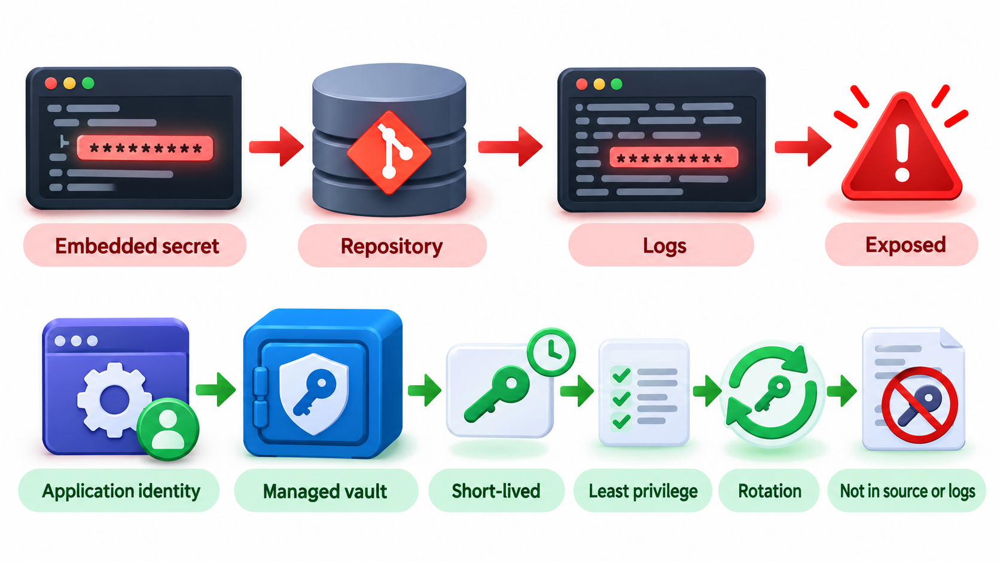
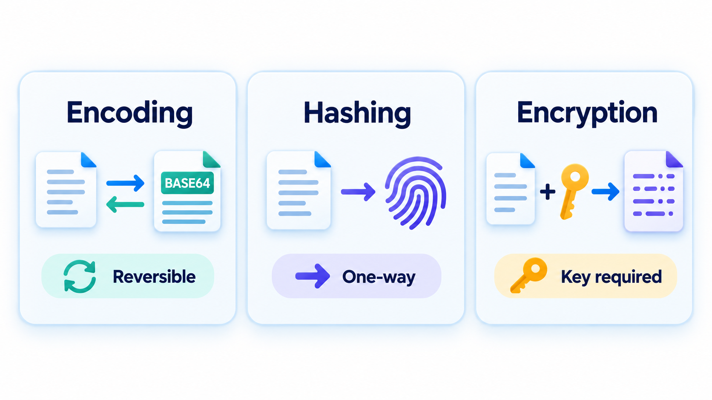
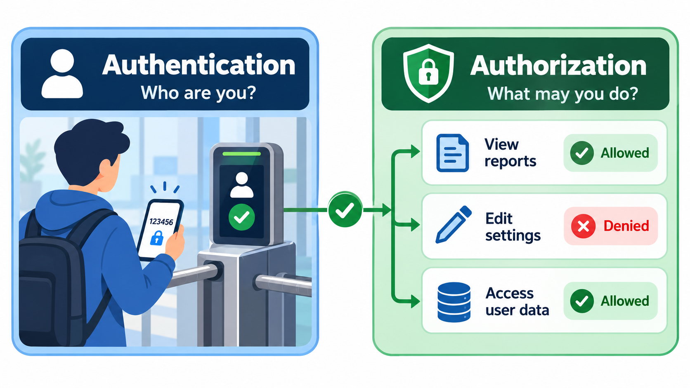
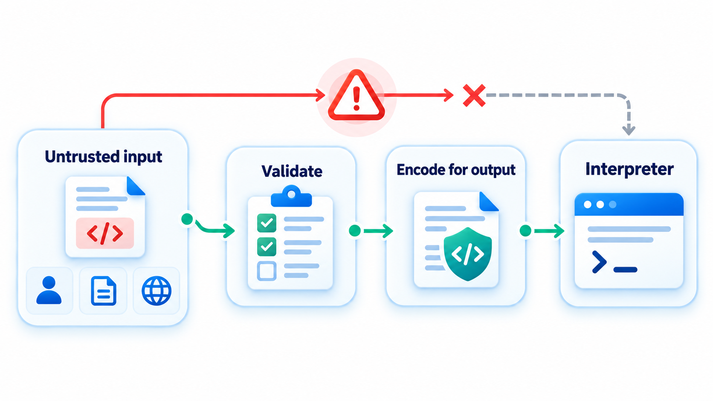
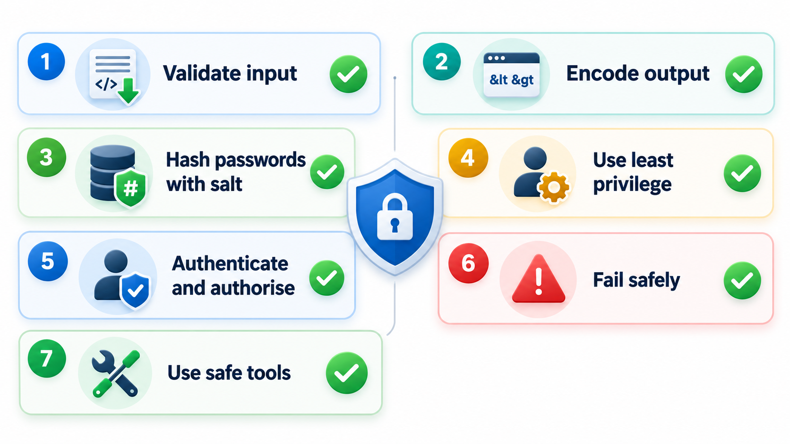

## The Rules That Remove Most Vulnerabilities

A security flaw can sit in widely used code for a quarter of a century, read by thousands of people, because it is a classic mistake that is easy to make: the program trusted data from outside, such as a string in a setting, and treated part of it as a command to execute. The lesson is not that the authors were careless, but that the error is easy to make and sits quietly until somebody looks in exactly the right way.

**Secure coding** is the set of habits that prevent such errors. They are not obscure. A handful of rules, applied consistently, remove the majority of common vulnerabilities. This topic covers the most important: treat all input as untrusted, encode output, handle secrets and passwords correctly and give code the least privilege it needs.

## Rule One: Treat Input as Hostile

All data that comes from outside the code you control is **untrusted**: form fields, URLs, headers, files, messages from other services, even data from your own database if it once came from a user. The attacker's input will be as awkward as they can make it. The rule is to **validate** it before use.

The best validation is an **allow-list**: define exactly what is permitted and reject everything else. A roll number is exactly six digits. A country is one of a known list. A deny-list, which tries to list bad inputs, always misses something. Validate on the server, because anything on the client can be bypassed. Check type, length, range and format. Reject bad input with a clear error rather than trying to repair it.

| Input | Allow-list rule | Deny-list rule (weaker) |
| --- | --- | --- |
| Roll number | Exactly six digits | Reject quotes and semicolons |
| Country | One of a fixed list | Reject strings containing "script" |
| Date of birth | A valid date in a sensible range | Reject letters |
| Email | A pattern plus a confirmation message | Reject spaces |
| Uploaded file | Only certain types, checked by content, with a size limit | Reject files ending in ".exe" |

The deny-list in each row can be bypassed by an input the author did not think of. The allow-list cannot, because anything not expressly permitted is refused.

## A Real Case: A Flaw Hidden for Twenty-Five Years

In 2014 a flaw named Shellshock was found in Bash, the command interpreter used on most Linux and Mac computers. It had been present for about twenty-five years. The program trusted data from an environment setting and treated part of it as a command to execute.

## Rule Two: Encode Output

Validation reduces what comes in. **Output encoding** makes sure that what goes out is treated as data, in whatever context it lands. The same text means different things in an HTML page, a URL, a SQL query and a shell command, and each needs its own encoding. When text from a user is placed in a web page, characters such as the angle brackets must be turned into harmless forms, or a user's comment can contain a script that runs in other users' browsers. This is the defence against cross-site scripting. For database queries, the equivalent is the parameterised query.

| What is done with a user comment containing a script | Result |
| --- | --- |
| Pasted into the page raw | The browser sees a script tag and runs it, sending the visitor's cookie to the attacker |
| Encoded first | The angle brackets become harmless forms, the text is displayed as text, and the script never runs |

Validation uses an **allow-list**: say what *is* allowed and reject the rest. For a six-digit roll number:

| Entry | Decision |
| --- | --- |
| 104233 | Accepted |
| 1042 | Rejected: too short |
| 10423x | Rejected: contains a letter |
| 104233 followed by an attempted command | Rejected |

Neither technique alone is enough. Validation limits the damage of bad input, and encoding protects at the point of use. Using both, at the right places, is called defence in depth.

| Where the text lands | Encoding needed | Risk if missing |
| --- | --- | --- |
| HTML page | HTML encoding | Cross-site scripting |
| Web address | URL encoding | Altered parameters |
| SQL command | Parameterised query | SQL injection |
| Shell command | Avoid the shell, or strict argument passing | Command injection |
| JSON or XML | The library's serialiser | Broken structure, injection |

## Rule Three: Handle Passwords and Secrets Correctly

If your system stores passwords, it will be attacked, and its database may leak. The rule is never to store a password itself. Store a **salted, slow hash** of it. A hash is a one-way function: easy to compute, practically impossible to reverse. A **salt** is a random value, different for each user and stored with the hash, which means that two users with the same password have different hashes, and attackers cannot use precomputed tables. A **slow** hash function, such as PBKDF2, bcrypt, scrypt or Argon2, is deliberately expensive to compute, so that guessing millions of passwords per second becomes impractical. Fast hashes like plain SHA-256 or, worse, MD5, are unsuitable.

| Situation | What is stored or happens |
| --- | --- |
| Asha and Ravi choose the same password, with different salts | Their stored values are completely different, so a thief who steals the table cannot tell they share a password |
| Login with the correct password | The entered password is hashed with the stored salt and matches |
| Login with a wrong password | The hash does not match and the login is refused |

In real use, the salt is random and long, generated for each user and stored with the hash. Never invent your own scheme. Use a library designed for the job. The same goes for encryption: use well-tested libraries and never write your own algorithm.

Other secrets, such as API keys and database credentials, belong in a secrets manager or the environment, never in the code, and never in logs.

The cost of a slow hash is easy to count. If a fast hash can be tried 10 billion times a second on a graphics card and a slow one only 10,000 times a second, an attacker who needs to test a billion guesses takes a tenth of a second against the first and about 28 hours against the second.

| Hash type | Guesses per second (attacker) | Time for a billion guesses |
| --- | --- | --- |
| Fast (plain SHA-256, MD5) | About 10 billion | About 0.1 second |
| Slow (bcrypt, Argon2, tuned) | About 10 thousand | About 28 hours |

<!-- Visual: A comparison of encoding, hashing and encryption. -->

## Rule Four: Least Privilege

Code should run with the smallest set of permissions it needs. A web application connects to its database as a user that can read and write the tables it uses, and cannot drop them. A service has access to the one storage bucket it needs, not the whole account. A process runs as an ordinary user, not as the administrator. This limits what an attacker can do when, not if, a flaw is exploited. It is the same principle at every level: users, processes, services, API keys.

| Component | Over-privileged | Least privilege |
| --- | --- | --- |
| Web app's database account | Can create, change and drop any table | Can read and write only the tables it uses |
| Reporting service | Full write access | Read-only access to the report views |
| Cloud function | Admin rights on the cloud account | One permission: read one storage folder |
| Application process | Runs as the system administrator | Runs as an ordinary user with access only to its folder |
| Developer | Production access always on | Access granted when needed, then removed |

## Rule Five: Authenticate and Authorise Properly

Use established mechanisms for logins and sessions, and not your own. Check *every* request on the server for both who the caller is and whether they may do this. Use multi-factor authentication for sensitive access. Expire sessions. Make tokens unpredictable and short-lived.

<!-- Visual: authentication establishing identity and authorisation controlling what that identity can do. -->

## Rule Six: Fail Safely and Do Not Leak

When something goes wrong, deny access and not grant it. Show users a plain message, and log the detail privately. Error pages that show stack traces, file paths, database errors or version numbers help attackers. Do not put secrets or personal data in logs.

| Situation | Unsafe response | Safe response |
| --- | --- | --- |
| Permission check throws an error | Allow, "to avoid blocking users" | Deny, and log |
| Login fails | "No such user" vs "wrong password" (reveals which names exist) | The same message for both |
| Unexpected exception | Show the stack trace to the user | A generic message with a reference number; detail in the private log |
| Database unreachable | Show the connection string in the error | "Service unavailable"; detail logged |

## Rule Seven: Use Safe Tools and Keep Them Current

Prefer languages and libraries that make mistakes harder: memory-safe languages, frameworks that encode output and parameterise queries by default. Keep dependencies updated. Run static analysis and secret scanners on every change, and review code with security in mind. Tools find the mechanical errors, and people find the logical ones.

<!-- Visual: A safe pipeline for validating, processing and encoding untrusted input. -->

## A Review Checklist

A reviewer reading a change can use these questions.

<!-- Visual: a checklist card of the seven rules: validate input, encode output, hash passwords with salt, least privilege, authenticate and authorise, fail safely, use safe tools. Save as images/144_seven_rules_card.png. -->

| Question | What a good answer looks like |
| --- | --- |
| Where does data enter, and is it validated on the server? | An allow-list at each entry point |
| Where does data leave, and is it encoded for that context? | Encoding or parameterisation at each exit |
| Are any commands or queries built by joining strings? | No |
| Are secrets in code, config files or logs? | No |
| Does every request check who and what? | Yes, on the server |
| What does an error show the user? | A plain message only |
| Does this code have more access than it needs? | No |
| Are new libraries trusted, maintained and current? | Yes |

## Five Misreadings of Secure Coding

**"Validating on the client is enough."** Anyone can send a request without your page. Validate on the server.

**"Encrypting passwords is the right way to store them."** Passwords should be hashed, not encrypted. Encryption can be reversed with the key.

**"A deny-list of bad characters is safe."** Attackers find the one you missed. Use an allow-list.

**"Old, widely used code must be secure."** A flaw in a widely used command interpreter lived there for twenty-five years. Age is not a review.

**"Security is a feature to add later."** It is a property of how the code is written, every day.
