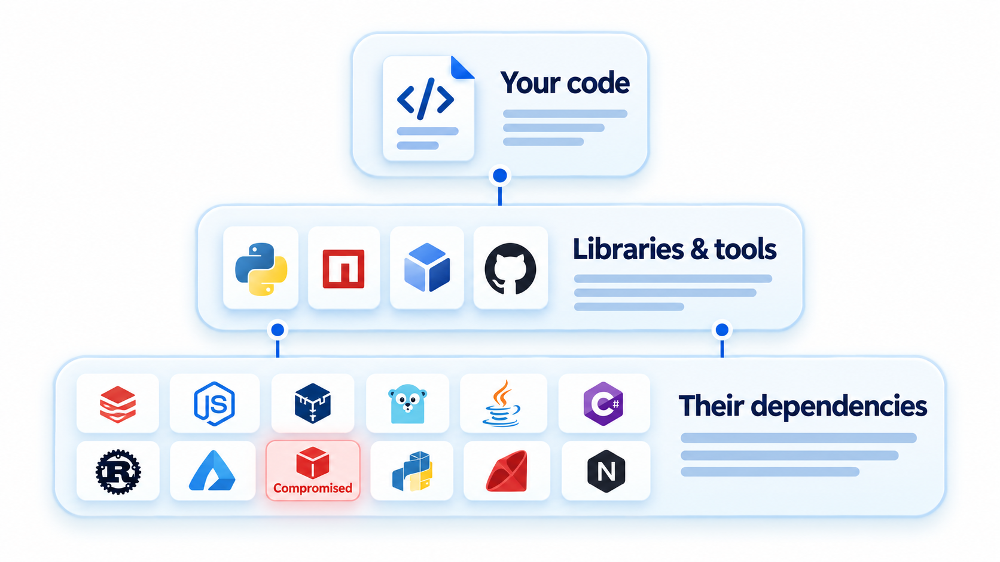
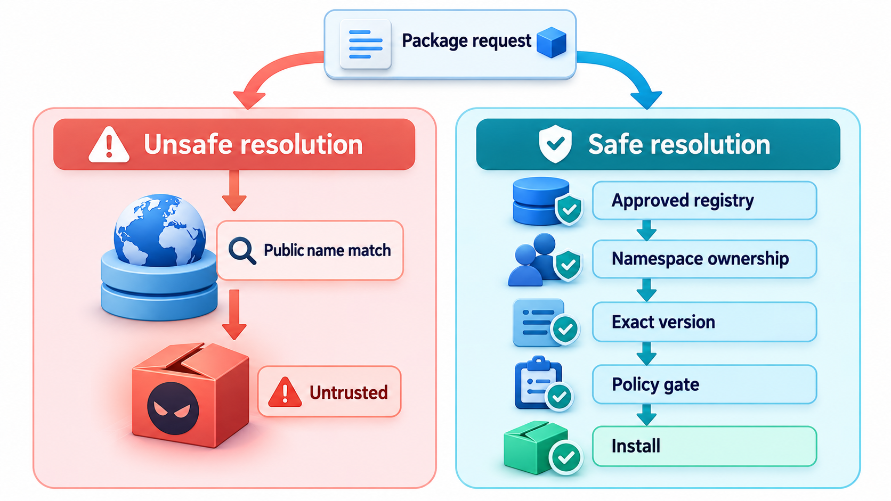
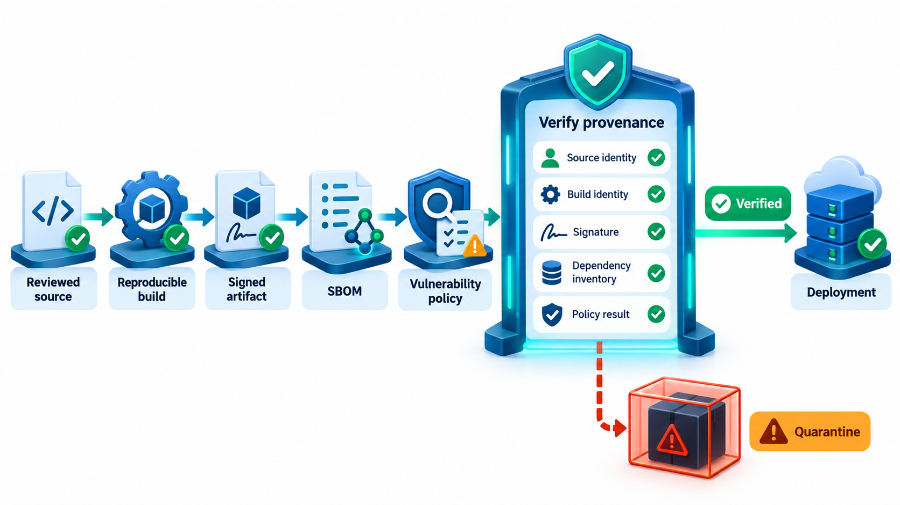
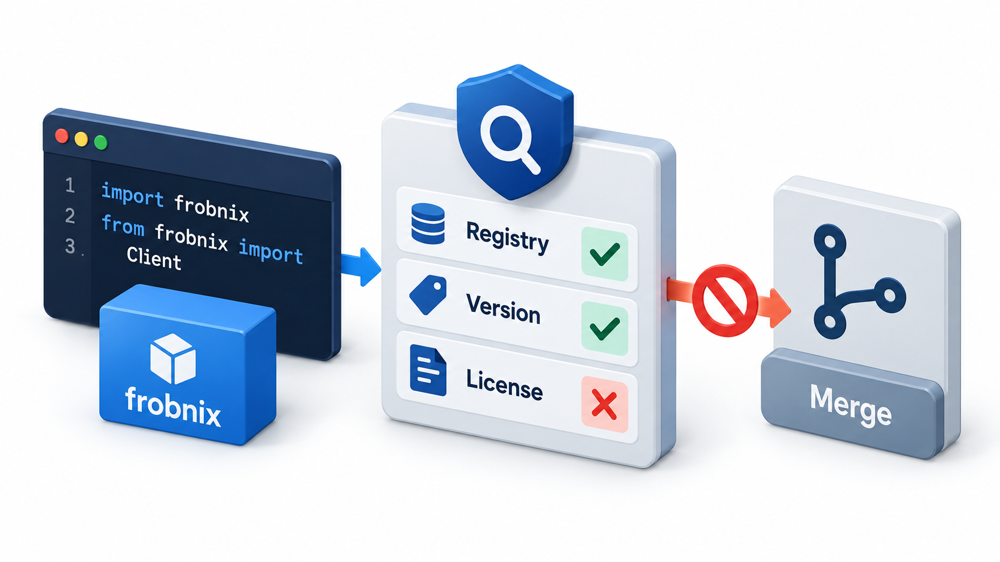
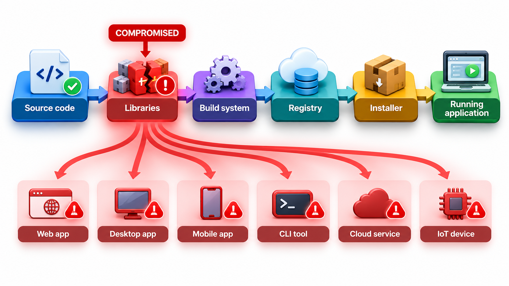

## You Are Only as Trustworthy as Your Dependencies

Modern software is mostly assembled from components written by others. Each component, and each person who maintains it, is a link in a **supply chain**, and an attacker who compromises any link reaches everyone downstream. A hidden backdoor placed by someone who spends years earning the trust of a library's sole, overworked maintainer can sit in files that no reviewer reads.

This topic is about the shape of that problem and its defences: knowing what you depend on, verifying what you download, limiting what dependencies can do, and watching for compromised packages.

## What the Supply Chain Is

When a team ships an application, the finished product includes more than the code its own developers wrote. It includes:

- the **libraries** it uses directly, and the ones those libraries use in turn;
- the **build tools** and compilers that turn code into programs;
- the **build system** and its scripts, which take the code and produce a package;
- the **distribution channels**, package registries and update servers;
- the **base images** and operating systems it runs on;
- the **people** who write, review and maintain all of these.

Any of these can be attacked. The aim of **software supply chain security** is to reduce the chance of that, and the damage when it happens.

| Stage of the chain | Example of what could go wrong |
| --- | --- |
| **Source** | A malicious change merged by a trusted-looking contributor |
| **Dependencies** | A library with a hidden backdoor or a known flaw |
| **Build** | A compromised build server inserts code |
| **Distribution** | A fake package on a registry; a hijacked update server |
| **Deployment** | A tampered container image |
| **People** | A maintainer's account is stolen, or a maintainer is pressured or tricked |

## A Real Case: A Half-Second Delay

In March 2024 a Microsoft engineer, Andres Freund, noticed that logins to a test machine were taking about half a second longer than they should. Tracing the delay, he found a hidden backdoor in xz, a compression library that sits underneath the remote-login software on most Linux servers. It had been placed by someone who spent roughly two years earning the trust of the library's sole maintainer, and it was found because of that half-second delay.

## Ways the Chain Breaks

Several kinds of attack recur.

| Attack | How it works | Example |
| --- | --- | --- |
| **Compromised build system** | The attacker gets into the process that builds a product, and inserts malicious code into an otherwise honest release | SolarWinds, 2020: the build of the Orion network tool was subverted, and about 18,000 customers received a tainted update |
| **Malicious or hijacked maintainer** | A trusted contributor, or someone who takes over their account, adds bad code | The xz backdoor, 2024; the `event-stream` package in 2018 |
| **Typosquatting** | The attacker publishes a package whose name resembles a popular one, hoping for a typing slip | `reqeusts` imitating `requests` |
| **Dependency confusion** | An internal package name is registered on the public registry with a higher version, and the build fetches it | Demonstrated against dozens of large companies in 2021 |
| **Vulnerable components** | A real, honest library has a flaw that spreads to all users | Log4Shell in 2021 |
| **Compromised credentials** | Stolen tokens used to publish malicious versions | Several incidents on package registries |

Some of these are attacks, and some are accidents. The defences overlap.

<!-- Visual: an outdated or compromised dependency opening a path into an application. -->

## How Dependency Confusion Works

The trick is simple and shows how small assumptions create openings.

| Step | What happens |
| --- | --- |
| 1 | A company has an internal package called `acme-billing-utils`, version 1.2, stored on its private registry |
| 2 | Its build is configured to look at both the private registry and the public one, and to take the highest version available |
| 3 | An attacker registers `acme-billing-utils` on the public registry as version 99.0, containing malicious code |
| 4 | The next build sees version 99.0 as the newest and installs it |
| 5 | The attacker's code runs inside the company's build or application |

The defence is to configure builds so that internal names can only come from the internal registry, and to pin versions with checksums.

## Two Small Checks in Code

Two defences are simple enough to demonstrate. One looks for names that are suspiciously close to a popular package, a trick called typosquatting. The other checks that a download matches a published fingerprint.

| Package name | Check against popular names (requests, numpy, pandas, flask, django) |
| --- | --- |
| requests | The real package |
| reqeusts (two letters swapped) | Suspicious: looks like requests |
| numpyy (an extra letter) | Suspicious: looks like numpy |
| left-pad | No close match, no flag |
| flaskk | Suspicious: looks like flask |

| Download | Fingerprint compared with the publisher's | Result |
| --- | --- | --- |
| Genuine | Matches | Accepted |
| Tampered (a backdoor appended) | Does not match, since any change to the data changes the fingerprint completely | Rejected |

Real tools do these checks at scale. Registries scan for lookalike names, and package managers can verify fingerprints recorded in the lockfile. A fingerprint check proves that you got what the publisher published. It does not prove that the publisher is honest, which is why the next defences exist.

## Defences

**Know what you ship: the SBOM.** A **software bill of materials** is a list of every component in an application, with versions, including nested ones. Like an ingredients list on food, it lets you answer "are we affected?" within minutes when a flaw like Log4Shell is announced. Standard formats are SPDX and CycloneDX. Many governments and large customers now require them.

**Pin and verify.** Use lockfiles with hashes so that the same, verified versions are installed every time. Do not install unpinned versions automatically in builds.

**Sign artefacts.** Digital signatures let a consumer check who published a package and that it has not been changed. Projects such as Sigstore make signing easier. **Provenance** records how and where an artefact was built.

**Secure the build.** Build in clean, controlled environments. Limit who can change build scripts. Make builds reproducible, so anyone can check that a published binary matches its source. A framework called SLSA (Supply-chain Levels for Software Artefacts) grades builds on how well they resist tampering.

**Vet and limit dependencies.** Prefer fewer, well-maintained libraries. Watch for sudden changes in ownership or behaviour. Review updates to critical dependencies, not only apply them.

**Scan continuously.** Check dependencies against databases of known vulnerabilities, and be ready to patch quickly.

**Protect accounts.** Use multi-factor authentication for anyone who can publish or merge. Registries now require it for popular packages.

**Support maintainers.** Many critical libraries are kept going by one volunteer. The attackers in such cases exploit exhaustion and isolation. Funding, shared maintenance and review capacity are security measures.

<!-- Visual: verifying a generated or fetched dependency before it is merged. -->

## Which Defence Stops Which Attack

| Attack | Defences that help |
| --- | --- |
| Compromised build system | Hardened, isolated builds; provenance; reproducible builds |
| Hijacked maintainer | Multi-factor authentication; review of changes to critical dependencies; funding more maintainers |
| Typosquatting | Name checks; installing from a reviewed list; code review of new dependencies |
| Dependency confusion | Registry configuration; scoped names; pinned hashes |
| Vulnerable component | SBOM; scanning; fast patching |
| Tampered download | Checksums; signatures |

No single defence covers everything. The practice is layered, in the same way as other security work.

## Lessons from the Cases

- **Log4Shell** showed that you cannot defend what you cannot see. Without an inventory, finding a flaw took weeks.
- **SolarWinds** showed that a vendor's build process is part of your attack surface.
- **xz** showed that the weakest link may be a person, and that careful attention to small anomalies can still save the day. It also showed that open source's openness helps both attackers and defenders: the malicious code was discovered because the source could be inspected.
- **Left-pad**, in 2016, showed that even harmless events, a developer removing his own package from the registry, can break builds across the world.

<!-- Visual: a chain with links labelled source code, libraries, build system, registry, installer and running application, a red cross marking a compromised link and arrows from it to many downstream applications. Save as images/145_chain_with_broken_link.png. -->

## Five Misreadings of Supply Chain Security

**"We only need to secure our own code."** Most of the code you ship is someone else's. Their flaws are yours.

**"Popular means safe."** Popular packages are targets, and are often maintained by one person.

**"A hash check proves a package is safe."** It proves it is the same as what was published. It does not prove the publisher is trustworthy.

**"Open source is less secure."** Closed source has supply chains too. Open source lets everyone look, as in the xz case.

**"This is a problem for big companies."** Any project that installs packages is in the chain.
