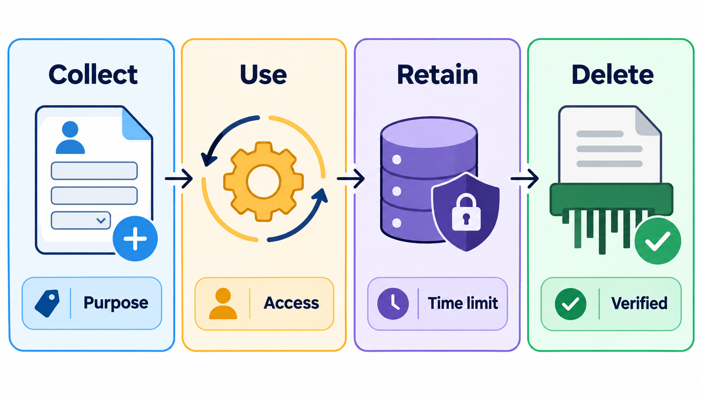
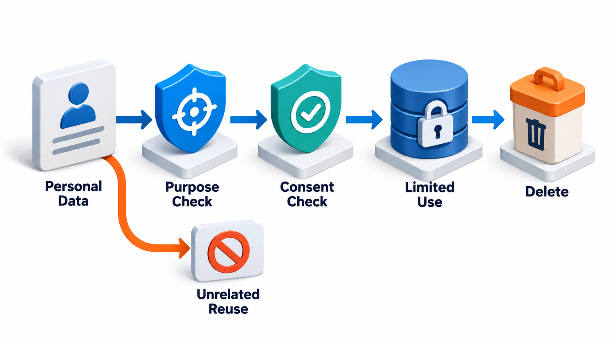
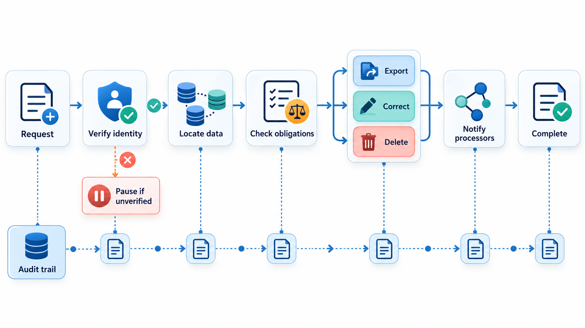
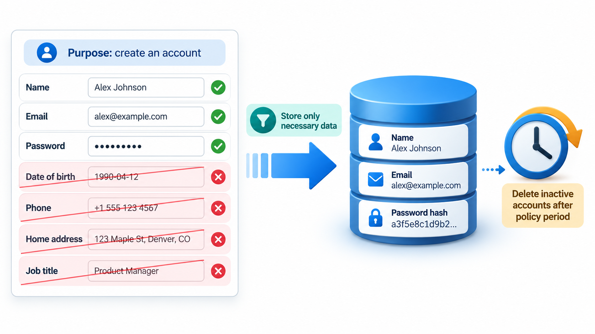
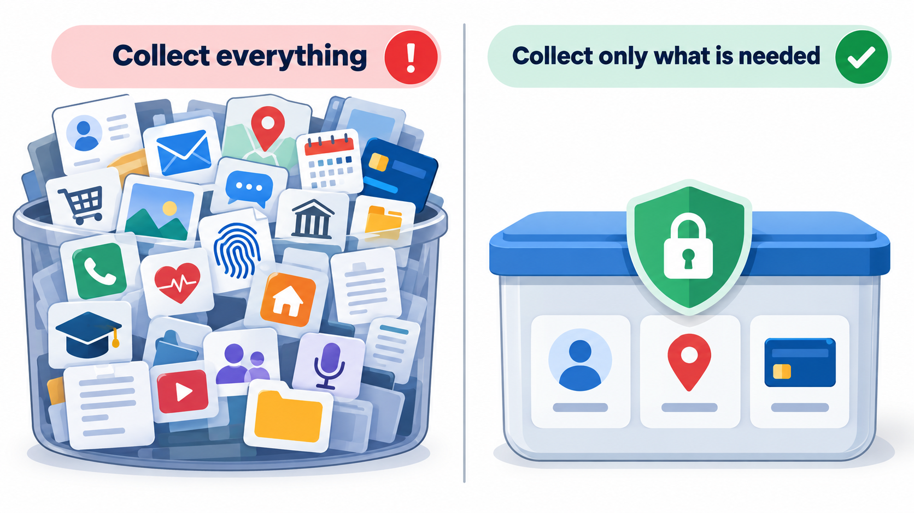

## What You Collect, You Must Protect

An app that collects more than it needs, from people who agreed to share only a little, puts everyone it touches at risk, including people who agreed to nothing. Behind headlines about huge fines are questions that every software team faces: what data should we collect, from whom, with what permission, for what purpose, for how long and who else can get at it?

**Privacy engineering** is the practice of building systems that answer those questions properly. It turns legal and ethical principles into design decisions and code. This topic covers the principles, the laws that now require them, with India's Digital Personal Data Protection Act and Europe's GDPR as the main examples, and the engineering techniques that follow.

## What Counts as Personal Data

The first task is to recognise it. Personal data is any information that relates to an identifiable person, directly or in combination with other data.

| Kind | Examples | Notes |
| --- | --- | --- |
| **Direct identifiers** | Name, phone number, email, Aadhaar or passport number | Obvious |
| **Indirect identifiers** | Roll number, device ID, IP address, cookie ID | Identify a person when linked to other data |
| **Combinations** | Postcode + date of birth + gender | Can single out an individual even without a name |
| **Sensitive categories** | Health, religion, caste, biometric data, financial details, a child's data | Extra care; often stricter rules |
| **Behavioural data** | Location history, browsing, purchases | Can reveal much about a person |
| **Derived data** | A score or profile inferred about a person | Still about them |

A useful test: could this information, alone or joined with other things the organisation holds, be used to identify or affect a particular person? If so, treat it as personal data.

## Principles of Privacy by Design

The idea of **privacy by design**, set out by Ann Cavoukian in the 1990s and written into law by the GDPR, is that privacy should be built in from the start, as a default, and not added later. A set of principles recurs in laws and guidance.

- **Data minimisation.** Collect only what you need for a stated purpose. Data you do not hold cannot leak.
- **Purpose limitation.** Use data only for the purpose it was collected for, and tell people what that is.
- **Consent and transparency.** Where consent is the basis, make it clear, specific, informed and easy to withdraw. Explain in plain language.
- **Storage limitation.** Keep data only as long as needed, then delete it.
- **Accuracy.** Keep it correct and let people fix it.
- **Security.** Protect it with appropriate technical measures.
- **Accountability.** Be able to show what you do with data, and who is responsible.
- **Individual rights.** People can see their data, correct it and ask for it to be deleted.

<!-- Visual: the privacy life cycle of data from collection through verified deletion. -->

## The Laws

**GDPR.** The European Union's General Data Protection Regulation, in force since 25 May 2018, applies to any organisation that handles the personal data of people in the EU, wherever it is based. It requires a legal basis for processing, gives individuals strong rights, requires breach notification within 72 hours and allows fines of up to 4 per cent of global annual turnover or 20 million euros.

**India's DPDP Act.** The Digital Personal Data Protection Act, 2023, received presidential assent in August 2023. In its terms, an organisation that decides why and how personal data is processed is a **data fiduciary**. The person the data is about is a **data principal**. The Act requires that personal data be processed only with the consent of the data principal, or for specified legitimate uses; that consent be free, specific, informed and clear, and be as easy to withdraw as to give; that notice be given in clear language, including in Indian languages listed in the Constitution; that the data be accurate, kept secure and deleted when its purpose ends; that breaches be reported; and that special care be taken with children's data, including verifiable parental consent. Data principals have rights to access, correction, erasure and grievance redress. Penalties can reach hundreds of crores of rupees for serious failures such as inadequate security safeguards. The detailed rules are made under the Act, and details have been evolving, so teams should check the current rules.

The two laws differ in detail and share a spirit. A system built on the principles above will be close to compliance with both. The details of the law should be checked with legal advisers, and this topic is an engineer's overview and not legal advice.

| Concept | GDPR term | DPDP Act term |
| --- | --- | --- |
| The organisation deciding why and how data is used | Controller | Data fiduciary |
| The person the data is about | Data subject | Data principal |
| Basis for use | Several lawful bases (consent, contract, legal duty, legitimate interest, and others) | Consent, or specified "legitimate uses" |
| Breach notification | To the authority within 72 hours | To the Data Protection Board and affected persons, as the rules prescribe |
| Children | Special protection; age thresholds vary | Verifiable parental consent for under 18s, with limits on tracking |
| Individual rights | Access, rectification, erasure, portability, objection | Access, correction, erasure, grievance redress |

<!-- Visual: purpose, consent, limited use and deletion constraining the handling of personal data. -->

## Minimisation in Code

The most effective privacy technique is also the simplest: do not collect or keep what you do not need. Take a sign-up record with seven fields (name, email, phone, date of birth, a sensitive category, course and fee status) for a fee-reminder service.

| Habit | Applied here |
| --- | --- |
| Collect only what the purpose needs | Keep email, course and fee status: 3 of 7 fields. Name, phone, date of birth and the sensitive category are never stored |
| Replace direct identifiers with a pseudonym for analytics | Analytics sees a short code derived from the email, plus the course, with no email and no name |
| Enforce a retention limit | A record 400 days old, against a limit of 365, is deleted |

Pseudonymised data is still personal data in law if it can be linked back, so access to the original must be controlled. Teams automate retention with scheduled jobs. Each of these steps costs a few lines of effort. The benefit is that the next breach, and every system has some risk of one, exposes much less.

## Mapping Data: Know What You Hold

A data map is a table of what personal data exists, where, and why.

| Data item | Where stored | Purpose | Legal basis / consent | Retention | Who can access | Shared with |
| --- | --- | --- | --- | --- | --- | --- |
| Email | Accounts database | Send fee reminders | Consent at sign-up | While enrolled + 1 year | Support, accounts | Email provider |
| Fee status | Fees database | Calculate dues | Contract | 7 years (accounting rules) | Accounts | Auditors |
| Login IP address | Security logs | Detect abuse | Legitimate use | 90 days | Security team | None |
| Photo | Student ID system | Identity card | Consent | While enrolled | Registrar | Printing vendor |

Completing such a table exposes surprises: a copy in a spreadsheet nobody remembers, a vendor with more access than needed, data kept for years without a reason. It is also the basis for answering a person's request for their data.

## Techniques

Beyond minimisation, privacy engineers use a toolkit.

- **Pseudonymisation and anonymisation.** Replace identifiers with codes (pseudonymise), or remove them so that nobody can be identified (anonymise). Anonymisation is hard to do well, because combinations of ordinary fields, such as postcode, birth date and gender, can identify people.
- **Encryption** in transit and at rest, with keys managed separately.
- **Access control and logging.** Only those who need the data can see it, and access is recorded.
- **Consent management.** Record what each person agreed to, when and in what words, and honour withdrawal.
- **Data mapping.** Know what personal data you hold, where it lives, who can reach it and where it flows. You cannot protect or delete what you cannot find.
- **Deletion that works.** Deleting from the main database but leaving copies in backups, logs and analytics is not deletion. Design for it.
- **Privacy impact assessments.** Before building something that handles personal data in a risky way, assess the risks to the people involved and plan how to reduce them.
- **Differential privacy** and similar methods add mathematical guarantees to published statistics.

## Honouring a Person's Request

Laws give people rights, and the engineering must make them practical.

| Request | What the system must do | Typical difficulty |
| --- | --- | --- |
| **Access: "what do you hold about me?"** | Gather data from every store and present it clearly | Data spread across systems |
| **Correction** | Fix the record everywhere | Copies and downstream systems |
| **Erasure** | Delete from production, backups (on schedule), logs and analytics; tell processors | Backups; legal duties to keep some records |
| **Withdraw consent** | Stop the processing it allowed | Pipelines that continue to use the data |
| **Portability** | Export in a common format | Messy internal formats |

A team that has built a data map and a single place for deleting a person's data can respond in a day. One that has not may take weeks, and miss a copy.

<!-- Visual: a sign-up form with seven fields, four crossed out as not needed for the stated purpose, and below it a data store that holds only three fields, with a retention clock beside it. Save as images/146_form_to_minimal_record.png. -->

## Everyday Habits for Developers

- Ask "do we need this field?" before adding it to a form or table.
- Keep personal data out of logs, error messages, test data and screenshots.
- Use fake or generated data in development and testing.
- Make deletion and export features part of the design, not an afterthought.
- Treat children's data, health data and financial data with extra care.
- Tell users what you do, in plain words, at the moment it matters.

<!-- Visual: collecting all available data compared with collecting only what is needed. -->

