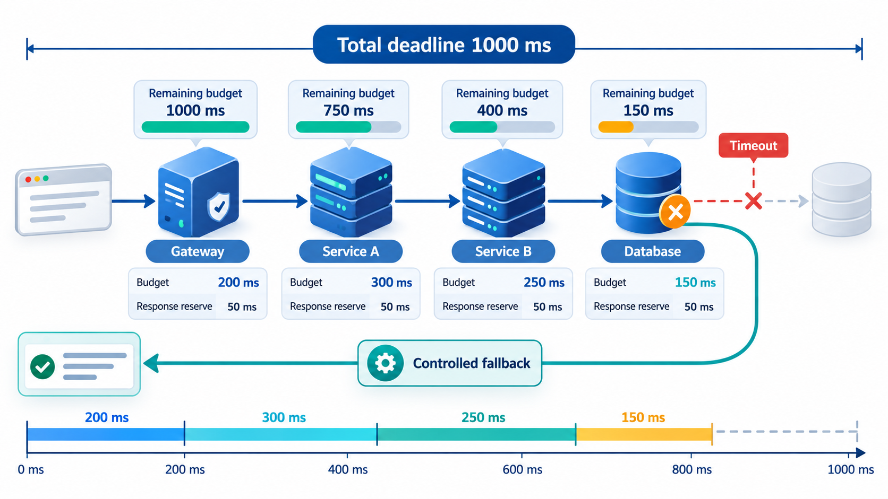
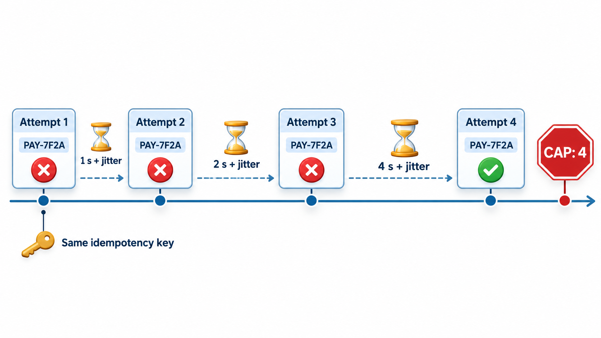
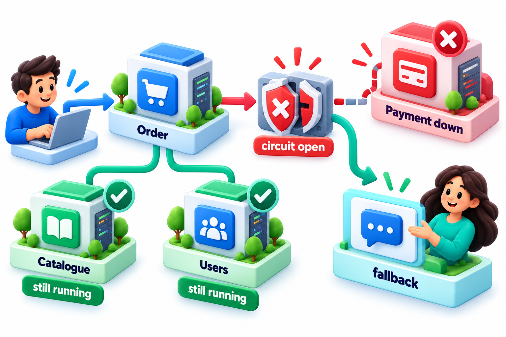
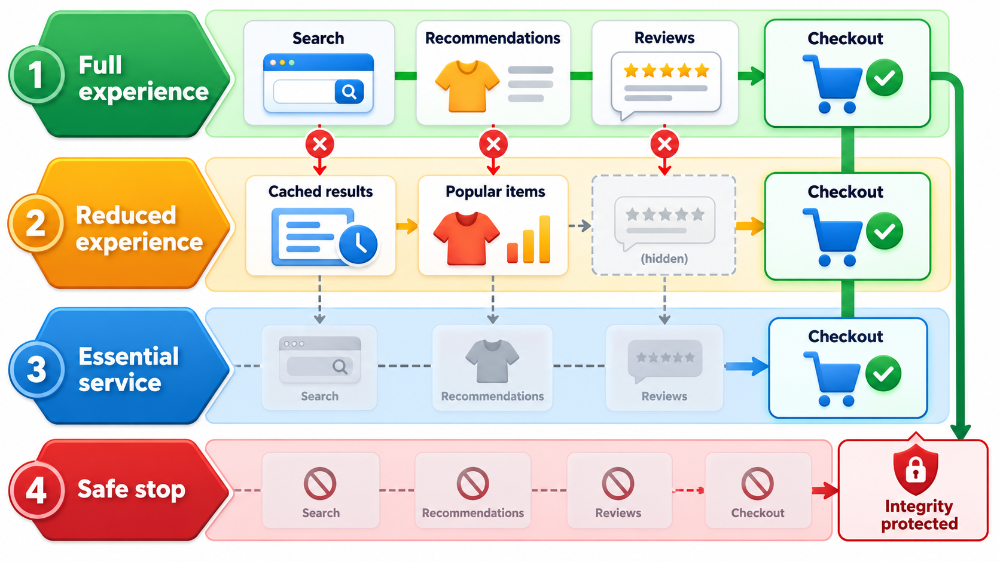
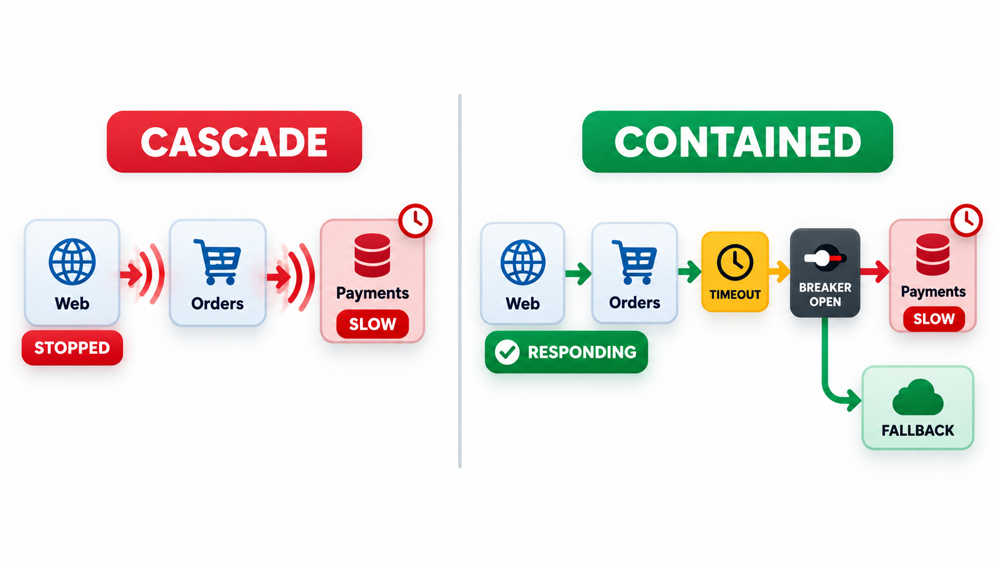

## A Fuse for Every Call

In a system made of hundreds of small services that call each other, a risk follows from the design. If one service becomes slow, the services that call it wait. While they wait, they use up their own threads and memory. Soon *they* become slow, and the services that call them are affected in turn. A problem in a minor service, such as the one that provides recommendations, can cascade upward until the whole site is unresponsive, even though most of its parts are healthy.

The answer is to wrap every call in protective layers: a time limit, a cap on simultaneous requests, and a **circuit breaker**, named for the fuse in an electrical system, that stops sending requests to a failing service for a while and returns a fallback answer straight away. A failure that would have been a disaster for the whole site becomes a small loss of quality in one corner of the screen. This topic covers the main **resilience patterns** at the level of application code: timeouts, retries, idempotency, circuit breakers and graceful degradation.

## How a Failure Cascades

The spreading of a small slowdown is a matter of arithmetic. Suppose a service has 100 worker threads, each normally busy for 0.1 seconds per request, so it can handle 1,000 requests per second. A dependency it calls becomes slow, so each request now takes 5 seconds.

| Condition | Time per request | Requests per second the service can handle (100 threads) |
| --- | --- | --- |
| Healthy | 0.1 s | 1,000 |
| Dependency slow, no timeout | 5 s | 20 |
| Dependency slow, 1 s timeout | 1 s | 100 |
| Dependency slow, breaker open (fail fast, 0.01 s) | 0.01 s | 10,000 |

Without a timeout, capacity falls by 98 per cent, requests queue, callers time out in turn and the slowness spreads. A timeout limits the damage, and a breaker removes it altogether for the time the dependency is down. The patterns below are layered for that reason.

## Timeouts: Never Wait for Ever

The simplest and most important pattern is to put a time limit on every call to anything outside your own process: another service, a database, a network request. Without one, a stuck dependency holds a thread for ever, and enough stuck threads bring your service down. A timeout turns "wait indefinitely" into "give up after two seconds and do something sensible". It should be set from knowledge of how long the call normally takes, plus a margin, and shorter at the edge of a system than deeper inside, so that the caller does not give up before the callee does.

## Retries and Backoff

Many failures are momentary: a network blip, a restarting server. A **retry** often succeeds. But retries must be used with care. Retrying at once and at full speed hammers a service that is already struggling, and thousands of clients doing it together can turn a hiccup into an outage. The standard remedy is **exponential backoff**: wait a little before the first retry, then twice as long, then four times, and so on, usually with some randomness, called *jitter*, so that clients do not all return at the same moment. Retries also need a limit, a few attempts and then give up.

| Strategy | Waits between attempts | Effect on a struggling service |
| --- | --- | --- |
| Immediate retries | 0, 0, 0 | Triples the load at the worst moment |
| Fixed delay | 1 s, 1 s, 1 s | Clients retry in step: waves of traffic |
| Exponential backoff | 1 s, 2 s, 4 s | Load spreads out and falls |
| Backoff with jitter | About 1 s, 2 s, 4 s, each varied at random | Clients do not return together; best in practice |

## Idempotency: Making Retries Safe

Retrying is only safe if doing something twice has the same effect as doing it once. That property is called **idempotency**. Setting a value is idempotent. Adding 500 to a balance is not: a retry after a timeout, when the first attempt had actually worked, would charge twice. The solution for operations like payments is an **idempotency key**: the client generates a unique identifier for the intended operation and sends it with every attempt. The server remembers which keys it has handled and, on seeing one again, returns the earlier result instead of repeating the action. Take a payment gateway that times out twice, then works, with the delay doubling each time (exponential backoff).

| Attempt | Outcome | What happens next |
| --- | --- | --- |
| 1 | Timed out | Wait 1 second |
| 2 | Timed out | Wait 2 seconds |
| 3 | Paid 500 | Done |
| Later retry of the same order (the confirmation was lost) | The server recognises the key: already paid, duplicate ignored | No second charge |

Without the key, an automatic retry could take 500 rupees twice from the same student. With it, retrying is safe. In real code, the waits are real pauses with some randomness.

<!-- Visual: attempts on a time axis with waits of 1, 2 and 4 seconds growing between them (with a little random jitter), a cap of four attempts, and the same idempotency key on every attempt. Save as images/147_backoff_with_idempotency_key.png. -->

## Circuit Breakers

Retries help against brief failures. When a dependency is down for a longer time, retrying only wastes resources and slows the caller. A **circuit breaker** watches the calls and has three states.

- **Closed:** normal operation. Calls go through. Failures are counted.
- **Open:** after too many failures, the breaker trips. Calls fail immediately, without even trying, and a fallback is used.
- **Half-open:** after a pause, the breaker lets one test call through. If it works, the breaker closes. If it fails, it opens again.

Take a breaker that opens after 3 failures in a row.

| Call | Outcome | Failures in a row | Breaker |
| --- | --- | --- | --- |
| 1 | Failed | 1 | Closed |
| 2 | Failed | 2 | Closed |
| 3 | Failed | 3 | Opens |
| 4 | Not made | n/a | Open: the failing service is not called and a saved copy is shown |

The fifth call, which would have succeeded, is never made. In a real breaker, the half-open state would test the service after a pause and close the circuit if it had recovered. The benefit is double. The failing service gets a rest, and the caller is not held up by calls that would fail anyway. Users get a quick, if reduced, answer.

| Setting | What it controls | Typical choice |
| --- | --- | --- |
| Failure threshold | How many failures trip the breaker | 5 failures in 10 seconds, or 50% of calls |
| Open duration | How long to wait before testing | 30 seconds |
| Half-open probes | How many test calls | 1 to 3 |
| What counts as failure | Timeouts and server errors; not client mistakes | Timeouts, 5xx errors |
| Fallback | What to return while open | Cached value, default, or clear error |

<!-- Visual: A circuit breaker isolating a failed payment service while others continue. -->

## Graceful Degradation and Fallbacks

When a part fails, the best systems do less and not nothing. A **fallback** is the plan for what to do instead: show cached data, a default, a simplified feature, or a clear message. A shop whose recommendations service is down still shows products and takes orders. A fee portal whose receipt service fails still records the payment and promises the receipt by email later. Deciding fallbacks is a product decision as well as a technical one: which features are essential, and what is acceptable when others are missing?

| Failing part | Essential? | Fallback |
| --- | --- | --- |
| Recommendations | No | Show popular items or nothing |
| Receipt generation | Not at the moment of payment | Record payment; send receipt later |
| Payment gateway | Yes | Retry; offer another method; show clear status |
| Notifications | No | Queue and send later |
| Search | Important | Fall back to a simpler search or browsing |
| Login service | Yes | Allow existing sessions to continue; show a clear message to new users |

## Other Patterns

- **Bulkheads.** Divide resources into separate pools, like the watertight compartments of a ship, so that a flood in one does not sink the rest. One slow dependency gets its own limited number of threads.
- **Rate limiting and load shedding.** Refuse some requests early when overloaded, to keep serving the rest well. It is better to reject 10 per cent quickly than to serve everyone slowly.
- **Health checks and self-healing.** Report health so that unhealthy instances are removed from service and restarted automatically.
- **Queues for decoupling.** Put work in a queue and let it be processed when the downstream is ready.
- **Chaos testing.** Inject failures on purpose to check that these patterns work, as Netflix did with a tool called Chaos Monkey that randomly shut down its servers.

These patterns interact. A retry inside a retry inside a retry multiplies traffic. A timeout longer than the caller's own timeout is useless. So teams design them as a set and test them with failures, not only in theory.

| Interaction | Problem | Remedy |
| --- | --- | --- |
| Three layers each retry three times | One request becomes 27 | Retry at one layer only |
| Inner timeout 10 s, outer timeout 5 s | The caller gives up while work continues | Shorter timeouts as you go deeper |
| Breaker opens but fallback calls the same failing service | No relief | Fallbacks must not depend on the failure |
| Retrying a non-idempotent call | Duplicate effects | Idempotency keys |

<!-- Visual: a chain of three services where the last is slow; on the left the delay spreads back through all three until the site stops, and on the right a timeout, a breaker and a fallback contain the problem to one box. Save as images/147_cascade_vs_contained.png. -->

## Five Misreadings of Resilience Patterns

**"Retry until it works."** Unlimited, immediate retries can turn a small fault into an outage. Limit, back off and add jitter.

**"Retries are always safe."** Only for idempotent operations. Payments need keys.

**"A timeout is an error to be avoided."** It is a protection. The error is having no timeout.

**"A circuit breaker hides failures."** It limits their spread, and the breaker's state should be monitored and alerted on.

**"Resilience is an infrastructure job."** The decisions about fallbacks and what to degrade are made in the application.
