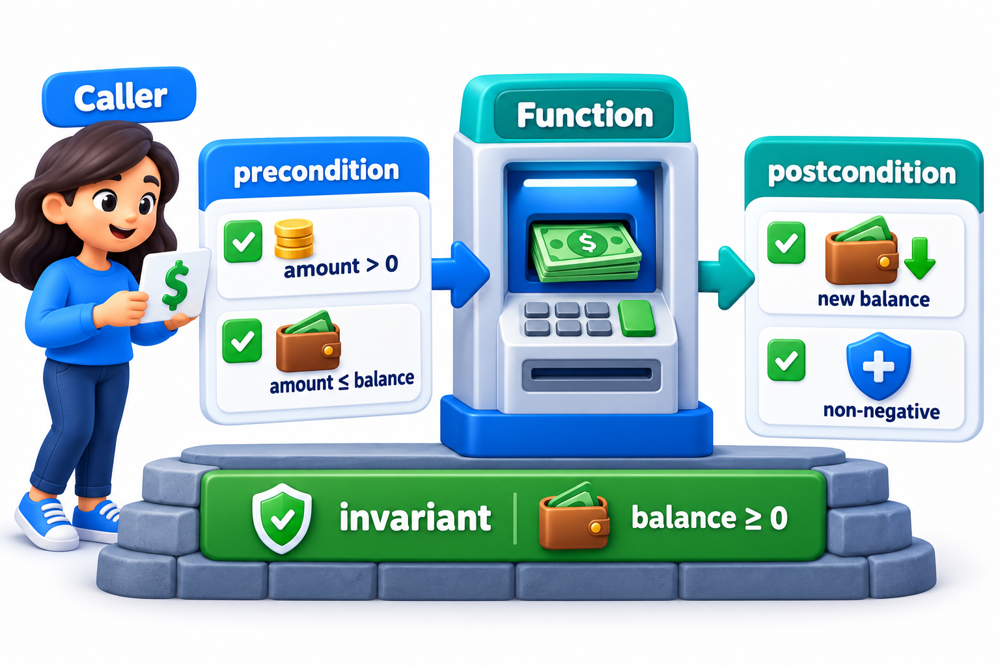
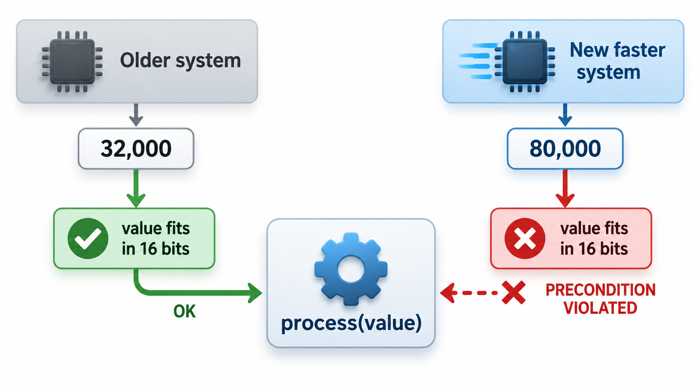
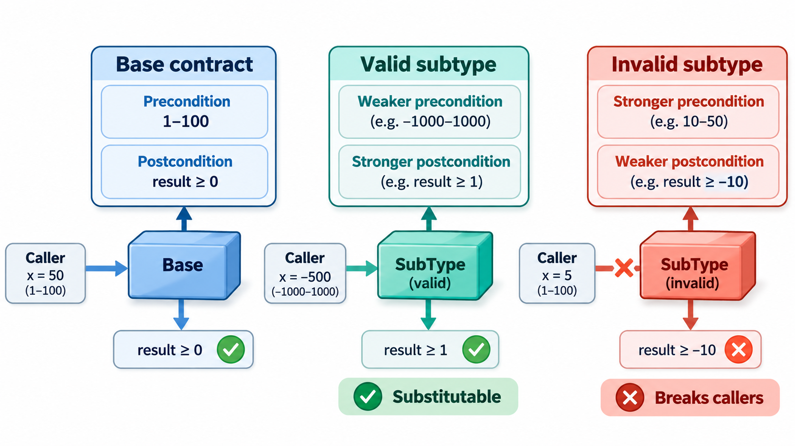
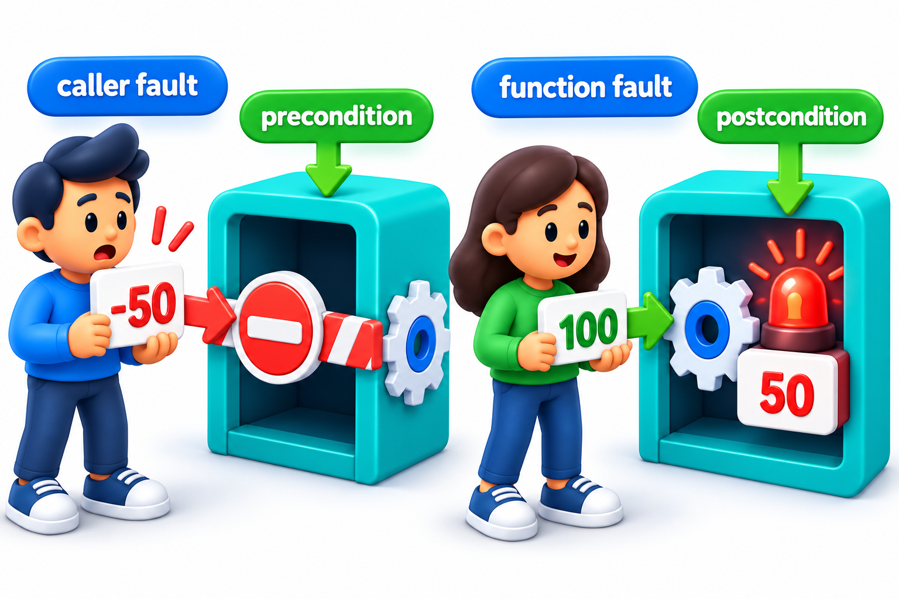
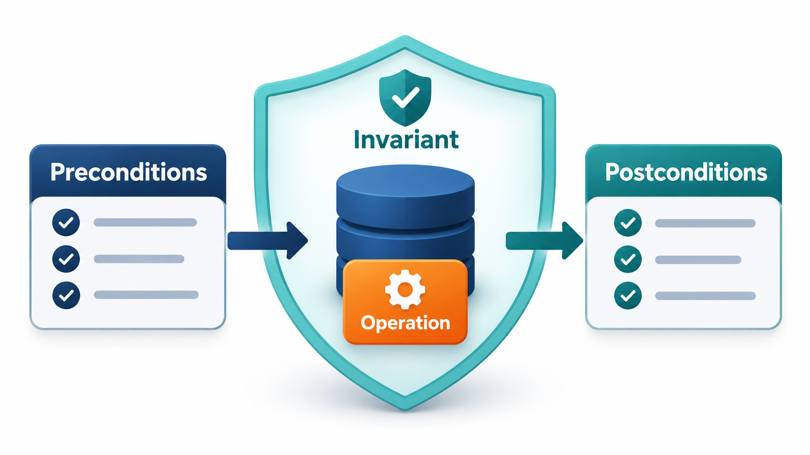

## A Condition That Was True Only by Luck

A routine can work perfectly for years because of a condition nobody wrote down. It converts a large measurement into a small whole number, and it works as long as the measurement fits. In the first system it always fits, by luck of how that system behaves. Reused in a faster system, the value no longer fits, the conversion fails, and the failure shuts everything down. The code was not faulty in the usual sense; its assumption was never stated, so nobody reusing it could have known it was a condition of correctness.

If the requirement had been stated as an explicit **precondition** of the routine, then at the moment of reuse a reviewer would have asked: does this hold here? That is the discipline of **design by contract**: every routine states what it requires of its caller (precondition), what it promises in return (postcondition) and what is always true of its data (invariant). It is the foundation of program verification, because to verify a program you first need to say, precisely, what it is supposed to do.

## What a Specification Is

A **specification** is a precise statement of what a piece of software is supposed to do, without saying how. For a function, it says what must be true of the inputs and what will be true of the outputs. A specification serves several readers. The caller reads it to learn how to use the function. The implementer reads it to know what to build. The tester reads it to design checks. And a verification tool can read it to prove, or search for violations of, the claim.

Natural language specifications are easy to write and easy to misread. "Returns the average of the marks" leaves open what happens for an empty list. A contract states it exactly.

| Specification style | Example for "average of marks" | Precision | Checkable by machine? |
| --- | --- | --- | --- |
| **Informal prose** | "Returns the average of the marks" | Low: empty list? decimals? | No |
| **Examples** | "average of 60, 70, 80 is 70" | Illustrates, does not define | Yes, as tests |
| **Contract** | Requires at least one mark; ensures the result lies between the smallest and largest mark | High for the stated properties | Yes, as assertions or proofs |
| **Formal specification** | A statement in mathematical logic | Very high | Yes, with proof tools |

## A Real Case: The Rocket That Reused Its Guidance Code

On 4 June 1996 the first Ariane 5 rocket of the European Space Agency lifted off from French Guiana. About 37 seconds later it veered off course and destroyed itself, along with satellites worth hundreds of millions of dollars. The investigation found a cause that was almost embarrassingly small.

The guidance software had been reused from Ariane 4, a slower rocket. One part of it measured the rocket's sideways velocity as a decimal number and converted it into a 16-bit whole number, which can hold values only up to about 32,000. On Ariane 4 the value never came near the limit. Ariane 5 was faster, the value was larger, the conversion failed, and nothing was written to handle the failure. The error shut down the main guidance computer, and its identical backup, which ran the same code, failed in the same way a moment earlier. The shutdown message was then read by the flight controller as if it were navigation data, and the rocket turned sharply and broke up. The calculation that failed was not even needed after lift-off. It had been left running for reasons that belonged to Ariane 4.

What was missing was a statement of the assumption. Nobody had written down, in a form that could be checked, that the code was correct only while the velocity stayed below a limit.

| Idea from the topic | How it applies to Ariane |
| --- | --- |
| Precondition: what must be true before the code runs | The velocity must fit in 16 bits |
| Postcondition: what the code promises afterwards | The converted value is a valid number |
| Contract between caller and component | The component was reused in a setting that broke its contract |
| Checking the specification before reuse | The assumption would have been found when Ariane 4's limits were compared with Ariane 5's |

Specifications and design by contract turn hidden assumptions into written promises that can be reviewed and tested. The topic that follows shows how.

## Three Parts of a Contract

The idea comes from business contracts, in which each party has obligations and gets benefits. A software contract has three parts.

- **Precondition.** What must be true when the function is called. This is the *caller's* obligation. "The amount must be positive and no more than the balance." If a precondition is broken, the fault is in the caller, and the function owes nothing.
- **Postcondition.** What the function guarantees when it finishes, provided the precondition held. This is the *function's* obligation. "The balance has fallen by exactly the amount."
- **Class invariant.** A condition about an object that is true whenever no operation is in progress: "the balance is never negative". Every operation may rely on it at the start and must restore it at the end.

The division of responsibility is what makes contracts useful. If the precondition fails, the blame lies with the caller. If the postcondition fails, the blame lies with the function. When something goes wrong, you know where to look.

| Part | Whose duty | Bank withdrawal example | If it fails |
| --- | --- | --- | --- |
| **Precondition** | Caller | Amount is positive and not above the balance | Bug in the caller |
| **Postcondition** | Function | New balance equals old balance minus amount | Bug in the function |
| **Invariant** | Class, always | Balance is never negative | Bug in some operation |

<!-- Visual: caller obligations, function promises and the withdrawal invariant. -->

## A Contract in Code

Some languages check contracts as part of the language. Most do not, but the idea can be applied by writing the checks by hand. Give a bank account a contract: the precondition is that the amount withdrawn must be positive and no more than the balance (the caller's duty); the postcondition is that the balance falls by exactly the amount (the routine's promise); the invariant is that the balance is never negative. Try three withdrawals from a balance of Rs 1,000.

| Request | Contract check | Result |
| --- | --- | --- |
| Withdraw 300 | Precondition met | Balance becomes 700 |
| Withdraw 5,000 | Precondition broken: amount 5,000 with balance 700 | Refused |
| Withdraw -50 | Precondition broken: amount -50 with balance 700 | Refused |

The refusals say which condition failed and with which values. Notice the wording: "precondition broken". The message does not say the withdraw routine has a bug. It says the *caller* asked for something outside the deal. That one word changes where the programmer looks, and it would change the conversation about any reused code whose assumptions were never stated.

## The Ariane Case as a Contract

Stating the contract for the velocity conversion would have looked like this.

<!-- Visual: an older slower system and a newer faster system with the same routine between them and a precondition card "value fits in 16 bits" valid on the left and violated on the right. Save as images/148_precondition_at_reuse.png. -->

| Part | Statement |
| --- | --- |
| **Precondition** | The horizontal velocity value, once scaled, lies within -32,768 to 32,767 (the range of a 16-bit integer) |
| **Postcondition** | The result equals the velocity, scaled, as a 16-bit whole number |
| **Reuse check** | Ariane 5's velocities reach values beyond 32,767: the precondition does not hold |

A reviewer comparing the precondition with the new rocket's flight data would have found the problem on paper. The lesson is general: when code is reused, check its preconditions against the new context.

## Contracts and Inheritance

Contracts also govern how a subclass may differ from its parent, which links to the Liskov substitution principle. A subclass may **weaken** a precondition (accept more) and may **strengthen** a postcondition (promise more), but not the reverse. A caller written to the parent's contract must still be satisfied by the child. A square that demands equal sides where a rectangle did not has strengthened a precondition, and breaks substitution.

| Change in the subclass | Allowed? | Why |
| --- | --- | --- |
| Accepts a wider range of inputs (weaker precondition) | Yes | Callers who satisfied the parent's precondition still satisfy it |
| Demands more of the caller (stronger precondition) | No | A caller written for the parent might fail |
| Promises more about the result (stronger postcondition) | Yes | Callers get at least what they expected |
| Promises less (weaker postcondition) | No | Callers relying on the parent's promise are let down |

## Contracts Versus Tests

A test checks a few chosen cases. A contract states a rule for *all* cases. They complement each other. A contract tells a tester what to check and gives every test an automatic oracle, since a test that calls a function with a contract is checked on every call, including the many calls in a large run. Contracts left switched on in testing act as thousands of embedded checks. Whether they stay on in production is a question of cost and risk.

<!-- Visual: responsibility falling on the caller or the function depending on which part of the contract fails. -->

## Writing Good Contracts

- **Say what, not how.** A contract describes the effect, not the algorithm.
- **Make preconditions easy to check,** so callers can satisfy them.
- **Keep the invariant simple.** If it takes a page to state, the class is doing too much.
- **Document them where the caller will see them.** In a docstring or in the interface.
- **Put the cheap ones in code and the hard ones in writing.** Not every condition can be checked at run time ("the list is sorted" is cheap to state, costly to check on every call).
- **Review contracts when reusing code.** The reuse lesson: the contract of the old context may not hold in the new one.

<!-- Visual: the idea of a contract as a promise between caller and function. -->

