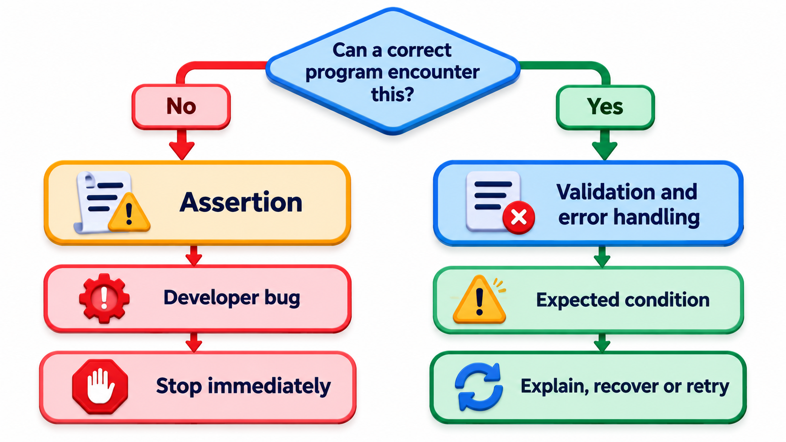
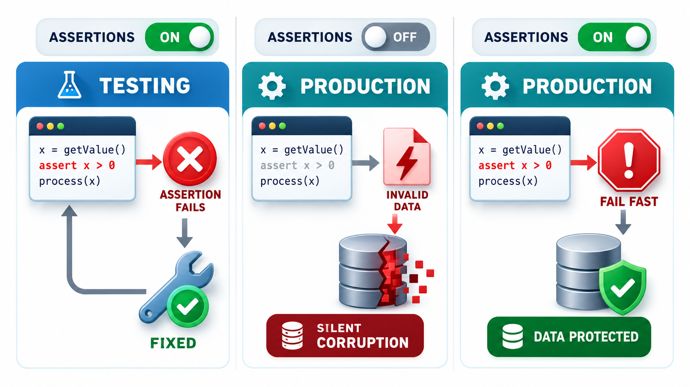
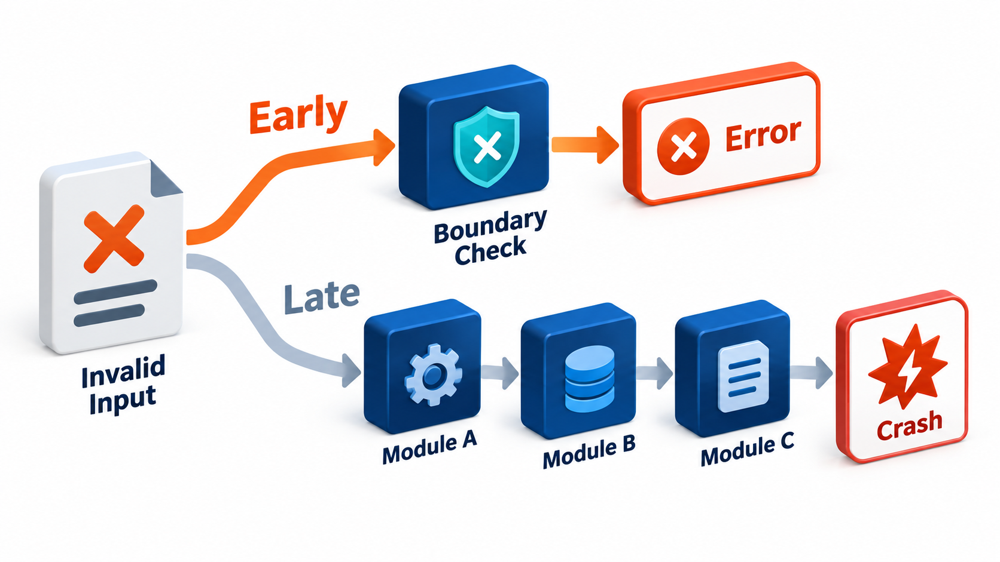
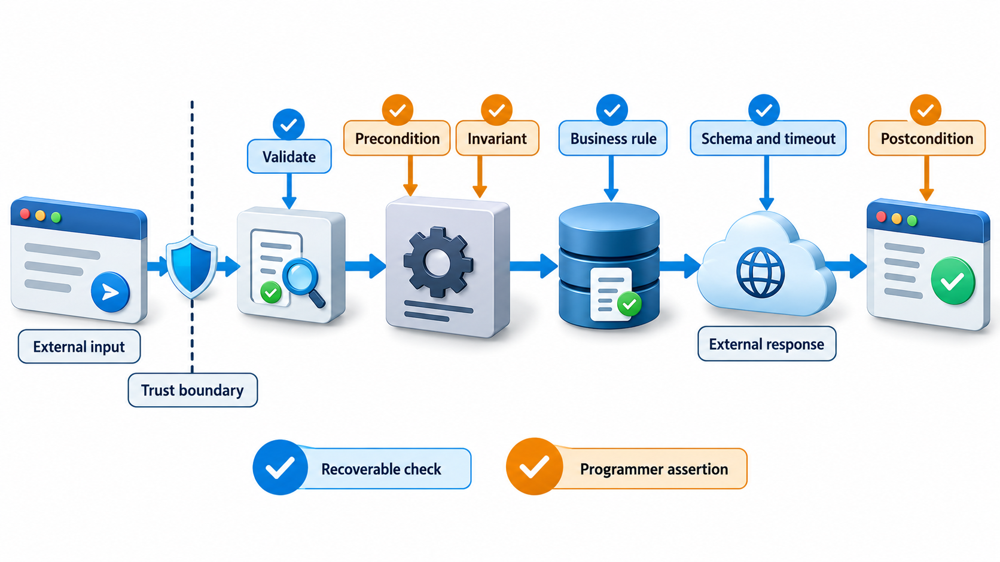
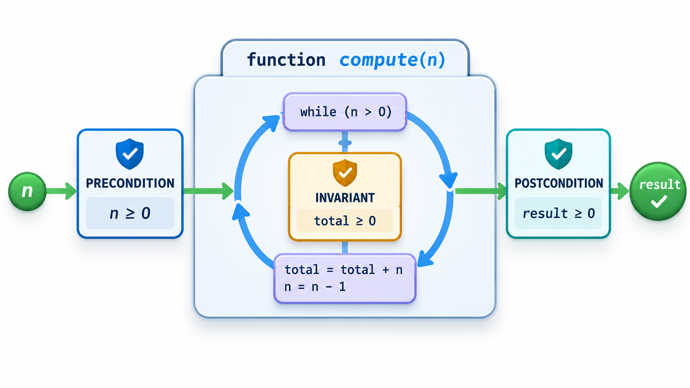

## A Check That Says "This Must Be True Here"

Programmers hold many beliefs about their code that are never written down: this list is never empty, this value is never negative, this branch cannot happen. When a belief is false, the program carries on with bad data, and the failure appears far from the cause. Teams that write safety-critical code often adopt a rule such as the one in NASA's Jet Propulsion Laboratory coding standard: a minimum of two assertions per function on average, because the habit of stating what must be true makes programmers think harder about what the code really does.

An **assertion** is a statement in the code that a condition must be true at that point. If it is true, the program carries on. If it is false, something is badly wrong and the program stops, or does something else defined in advance. This topic explains what assertions are for, how they differ from ordinary error handling and what happens to them in production.

## What an Assertion Says

In Python an assertion is written with the word assert, then the condition, then an optional message. Most languages have a similar one. The condition states a fact that the programmer believes to be true. If it is wrong, an `AssertionError` is raised with the message.

Assertions are used to state:

- **Preconditions:** what a function expects of its arguments.
- **Postconditions:** what it promises about its result.
- **Invariants:** facts that should hold throughout a loop or an object's life.
- **Impossible cases:** the `else` that "can never happen".

Take two small routines with assertions. The first computes the average of a list of marks, with two assertions: a precondition that there is at least one mark (the average of nothing is undefined), and a postcondition that the average lies between the smallest and the largest value. The second applies a percentage discount to a fee, and asserts that the percentage is between 0 and 100.

| Call | Assertion result | Output |
| --- | --- | --- |
| Average of 60, 70, 80 | Both hold | 70 |
| Average of an empty list | Fails: "needs at least one mark" | Stops |
| Average of one mark, 90 | Both hold | 90 |
| Fee of 5,000 after a 120% discount | Fails: "discount must be 0 to 100 per cent, got 120" | Stops |
| Fee of 5,000 after a 10% discount | Holds | 4,500 |

Failures are caught here only to show them. In real code, a failed assertion is meant to stop the program, because it reveals a bug. A good assertion message says what was expected and what was found. "got 120" tells the person debugging at once where to look.

## Where Assertions Catch Bugs Early

The value of an assertion is in how close it sits to the cause. Compare what happens with and without one in a pipeline of three steps.

| Step | Without an assertion | With an assertion |
| --- | --- | --- |
| 1. Import reads a mark of -5 from a bad file | Passes it on | Assertion in the import: "mark must be 0 to 100, got -5": **fails here** |
| 2. Average computed | Result is wrong, but plausible | Not reached |
| 3. Grade printed | Student sees a wrong grade | Not reached |
| Time to find the fault | Days, after a complaint | Minutes, at the line that read the file |

A failure that appears three steps and three days from its cause costs far more to diagnose than one that stops at the source.

## Assertions Are Not Error Handling

The most important distinction is between two kinds of problem.

- **A bad input from the outside world,** such as a user typing 120 per cent in a form, is *expected*. It must be handled gracefully, with a message to the user. This is validation, and it runs always.
- **A violated internal assumption,** such as a function being called with an impossible value by another part of the program, is a *bug*. An assertion catches it.

Using assertions for user input is a mistake, because in some environments assertions are switched off, and then the check vanishes. Python removes `assert` statements when run with the `-O` flag. A program that relies on `assert` to check a password or a permission has no check at all in that mode. The rule is: never use an assertion for something that must hold in production even if all internal code is correct.

| Situation | Use | Why |
| --- | --- | --- |
| User enters a negative amount in a form | Validation with a friendly message | Expected; must always run |
| A function receives a negative amount from another internal function | Assertion | A bug in the caller |
| A file from another system has a missing column | Validation and an error report | Outside data can be wrong |
| A `switch` reaches a case that "cannot happen" | Assertion (or an error) | A logic fault |
| A permission check on a request | Real check, never an assertion | Must hold in production |

<!-- Visual: a switch labelled assertions with two positions, on in testing where a failure is caught and fixed, and off or on in production where a failure either corrupts silently or stops safely. Save as images/149_assertions_on_or_off.png. -->

## Should Assertions Stay On in Production?

There are two schools.

**Turn them off.** Assertions take time, and in a speed-critical program the cost may matter. Many systems compile them out of release builds. The assumption is that testing with assertions on has already found the bugs.

**Leave them on.** A bug that testing did not find will show itself in production, and an assertion turns a silent corruption, which spreads and is found weeks later, into an immediate, visible failure. For many applications, stopping early is better than carrying on with wrong data. Systems that must not fail abruptly often do something else on a failed check: log it, switch to a safe mode, restart the component.

A sensible practice is to keep cheap checks on everywhere and costly ones only in testing. And to decide deliberately, not by default.

| Kind of system | Typical choice | Reason |
| --- | --- | --- |
| Web service | Keep cheap assertions on; log and return an error | A failed request is better than wrong data |
| Game | Off in release | Speed matters; a glitch is minor |
| Banking | On | Wrong money is worse than a stopped transaction |
| Medical or aircraft | On, with a defined safe response | A defined safe state beats continuing blindly |
| Data pipeline | On | Bad data spreads quietly otherwise |

<!-- Visual: A fail-fast function stopping at the first sign of bad input. -->

## Beyond Assertions: Runtime Checks

Other runtime checks are built into languages and tools.

- **Bounds checking.** Languages like Python, Java and Rust check every access to a list or array and refuse one that is out of range. C does not, which is the source of buffer overflows.
- **Null and type checks.** Many languages raise an error on invalid operations instead of misbehaving.
- **Overflow checks.** Some languages and compiler options trap integer overflow. Rust does so in debug builds.
- **Sanitizers.** Compiler options that add checks for memory errors, undefined behaviour and data races, covered under dynamic analysis.
- **Monitors.** Code or tools that watch a running system for violations of a rule, such as a maximum response time.
- **Watchdogs and heartbeats.** A timer that resets the system if it stops responding.

| Check | Catches | Typical cost |
| --- | --- | --- |
| Assertion | A violated assumption | Very small per check |
| Bounds check | Out-of-range access | Small |
| Overflow trap | Arithmetic wrap-around | Small |
| Sanitizer | Memory errors, data races | 2 to 10 times slower: testing only |
| Monitor | Rule violations in a live system | Depends on rule |
| Watchdog | A hung program | Negligible |

## Where to Put Assertions

- At the **start** of functions, for preconditions that are cheap to check.
- At the **end**, for postconditions that catch your own errors.
- **Inside loops,** for invariants, especially in tricky algorithms.
- In the "**impossible**" branch of an `if` or `switch`, with an assertion that always fails there, so that an unexpected case does not pass silently.
- At **boundaries between modules,** where one part's assumptions meet another's.

Avoid assertions with **side effects**, such as one that checks the result of a call that removes an item, because if assertions are removed the action disappears with them.

<!-- Visual: a function drawn as a box with an assertion gate at the entrance for the precondition, one inside the loop for the invariant, and one at the exit for the postcondition. Save as images/149_assertions_in_a_function.png. -->

## Five Misreadings of Assertions

**"Assertions are for validating user input."** They are for catching bugs. Input needs proper validation that cannot be disabled.

**"A failing assertion should be caught and ignored."** It signals a bug. Catch it to log and fail safely, not to carry on as if nothing happened.

**"Assertions have no cost."** They take time, and some are costly. Choose which stay on.

**"Put side effects in assertions to save lines."** If assertions are switched off, the side effects vanish and the program changes behaviour.

**"More assertions are always better."** Pointless ones add clutter. Use them for the facts that matter.
