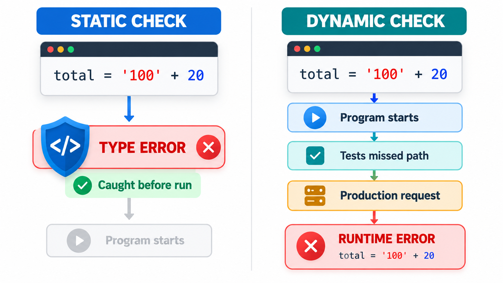
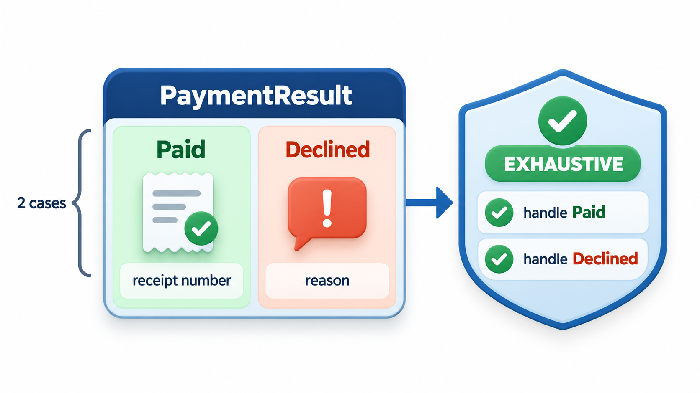
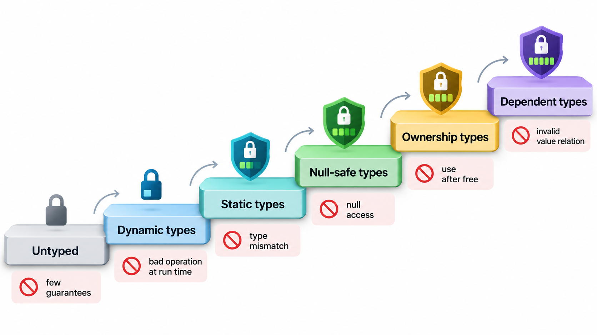
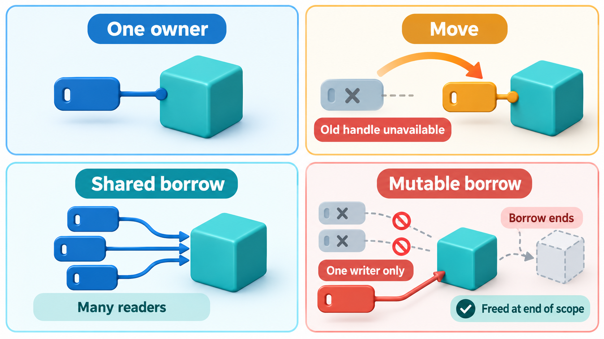
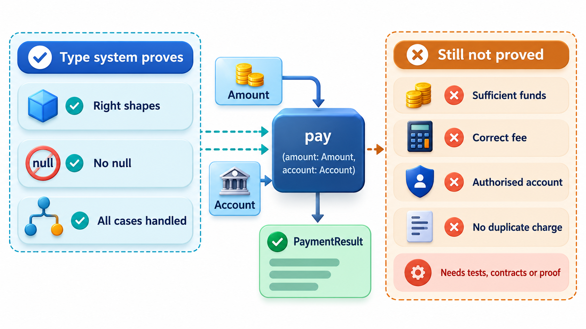

## Let the Compiler Prove the Boring Things

Many bugs are not subtle. A value that might be absent is treated as if it were present. Text is multiplied by a number. A function that expects a list receives a single item. These errors are cheap to make and expensive to find, because the program fails at run time, perhaps on a rarely used path.

A **type system** is a set of rules that assigns each value and expression a type, and checks that they are used consistently. Done well, it is one of the most effective and least effortful forms of verification: a proof, checked by the compiler on every build, that a whole category of errors cannot happen. One of the best-known examples is the "null" reference, which let a reference point at nothing without the type system noticing. Its inventor, the computer scientist Tony Hoare, later called it his "billion-dollar mistake", because the compiler could not warn a programmer who forgot to check.

## What Types Prove

A type says what kind of thing a value is, and so what you may do with it. The statement "this function takes a whole number and returns text" is a small specification. When the compiler checks that every call matches it, it proves that no call passes text where a number is wanted. The proof covers *all* calls, not just the ones a test tries.

Types can express more than simple kinds.

- **Different units** (a distance in metres and a distance in feet, as two distinct types) would have prevented the loss of the Mars Climate Orbiter in 1999, where one team's software gave thrust figures in pound-force seconds and another's expected newton-seconds, and the probe passed too close to Mars and was lost.
- **Optionality:** a type for "a student or nothing", which the compiler forces you to unpack and check.
- **Permitted states:** a type with exactly the cases that are possible and no others.
- **Ownership and lifetime,** as in Rust, where the type system tracks who is responsible for each piece of memory.

| What the type says | Mistake it prevents | Example |
| --- | --- | --- |
| `Roll` (not a plain number) | Using a roll number as a fee | A function that wants a roll rejects an amount |
| `Rupees` and `Paise` as separate types | Mixing units | Adding 500 paise to 500 rupees is a compile error |
| `Optional[Student]` | Using a missing student | The caller must handle "not found" |
| `PaymentResult` with two cases | Forgetting a case | The compiler requires both Paid and Declined to be handled |
| `Immutable` / read-only | Changing data by accident | Writes are rejected |

## Static and Dynamic Typing

Languages check types at different times.

**Static typing** checks types *before the program runs*, at compile time or in a separate checking step. Languages such as Java, C#, Go, Rust and TypeScript work this way. Errors are found early, by tools, in all code paths. The cost is that programmers must write types, and may find the checker restrictive.

**Dynamic typing** checks types *while the program runs*. Python, JavaScript and Ruby work this way. They are flexible and quick to write. The cost is that a type error appears only when the faulty line executes, perhaps in production, on a path no test took.

Take a routine that multiplies credits by a rate to get a fee. Called with numbers, it works. Called with the text "4" and no rate at all, it fails.

| Call | Dynamic typing | Static typing |
| --- | --- | --- |
| 4 credits at a rate of 1,000 | Works: 4,000 | Works |
| The text "4" and no rate | Fails with a type error only when that line runs | Rejected before the program ever starts, if the routine declares that credits and rate are whole numbers |

The error appeared when that line ran. The language did not complain at the definition of the routine nor at the start of the program. If the faulty call were on a rarely used path, the error would wait until a real user took it. Many languages allow optional type hints that a separate checker reads; that tool could reject the call before anything ran. The trade-off is one of earlier errors against more writing. Large and long-lived programs, where many people change code they did not write, tend to benefit from static checking. Some teams adopt gradual typing, adding hints to the parts that matter.

<!-- Visual: the same mistake shown twice: a type error caught by a static checker before the program starts, and caught by dynamic typing only when the faulty line runs in production. Save as images/150_static_vs_dynamic_timing.png. -->

| Aspect | Static typing | Dynamic typing |
| --- | --- | --- |
| **When errors appear** | Before running | When the faulty line runs |
| **Writing effort** | More: types declared | Less |
| **Refactoring safety** | High: the checker finds every affected use | Lower: relies on tests |
| **Tooling** | Strong completion, navigation | Weaker without hints |
| **Prototyping speed** | Slower | Faster |
| **Best for** | Large, long-lived, multi-person code | Scripts, quick experiments, small programs |

<!-- Visual: a payment result drawn as a box with exactly two labelled doors, Paid with a receipt number and Declined with a reason, and a compiler check mark on code that handles both doors. Save as images/150_two_case_type.png. -->

## Algebraic Data Types and Null Safety

A modern idea in type design is the **algebraic data type** (ADT, not to be confused with abstract data type): a type defined as one of several named cases, each possibly carrying data. A payment result is either "paid, with a receipt number" or "declined, with a reason". Nothing else. The language can then check that every piece of code handling a result deals with *both* cases, and complain if one is forgotten.

<!-- Visual: a ladder of strength from untyped through dynamic types, static types, null-safe types and ownership types, to dependent types, with the kinds of error each rung rules out. Save as images/150_type_strength_ladder.png. -->

A type that means "a value or nothing", often called Option or Maybe or Optional, is the cure for the null mistake. A function that might not find a student returns an Option of a student. The caller cannot use it as a student until it has checked which case it is. Several modern languages have null safety of this kind.

| Situation | Without null safety | With null safety |
| --- | --- | --- |
| A payment result of Paid, receipt 7731 | Handled | Handled |
| A payment result of Declined, insufficient funds | Handled | Handled, and the compiler warns if a case is forgotten |
| Looking up roll number 999, which does not exist | Returns "nothing", and using it as a name crashes at run time | Rejected at compile time unless the code handles "maybe nothing" |

The caller who forgets to check a missing student has made the billion-dollar mistake in four lines. A language with null safety would reject that use at compile time, because the type would say "maybe nothing", and the code would be forced to handle it. The message is that the more a type says, the more the compiler can check on your behalf.

## Ownership in Rust

The language Rust takes the idea further. Its type system includes **ownership**: every value has exactly one owner, a value can be borrowed under strict rules, and the compiler checks that no reference outlives the thing it points to and that data cannot be changed from two places at once. These rules rule out whole classes of faults, such as use-after-free, double free and data races, *at compile time*, without a garbage collector. The price is a steep learning curve and a compiler that is exacting. The reward is that memory-safety bugs, which account for about 70 per cent of serious vulnerabilities in large C and C++ projects, become compile errors. This has led operating system, browser and cloud companies to use Rust for new low-level code.

| Fault | C and C++ | Rust (safe code) |
| --- | --- | --- |
| Use after free | Possible; found at run time, if at all | Rejected at compile time |
| Data race between threads | Possible | Rejected at compile time |
| Buffer overflow | Possible | Prevented by bounds checks and types |
| Null pointer misuse | Possible | No null in safe code; uses Option |
| Memory leak | Possible | Possible but harder; not prevented |

## What Types Cannot Do

Types are not a complete verification. Most type systems say nothing about whether a sort function really sorts, or whether a discount is calculated correctly. They check structure and consistency, not meaning. Stronger systems exist, such as dependent types, in which a type can say "a list of length n", but they are harder to use. The practical conclusion is that types remove a large class of errors cheaply and tests, contracts and reviews cover the rest.

