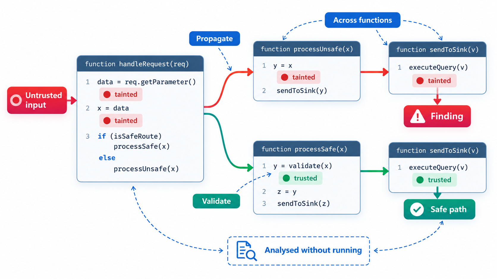
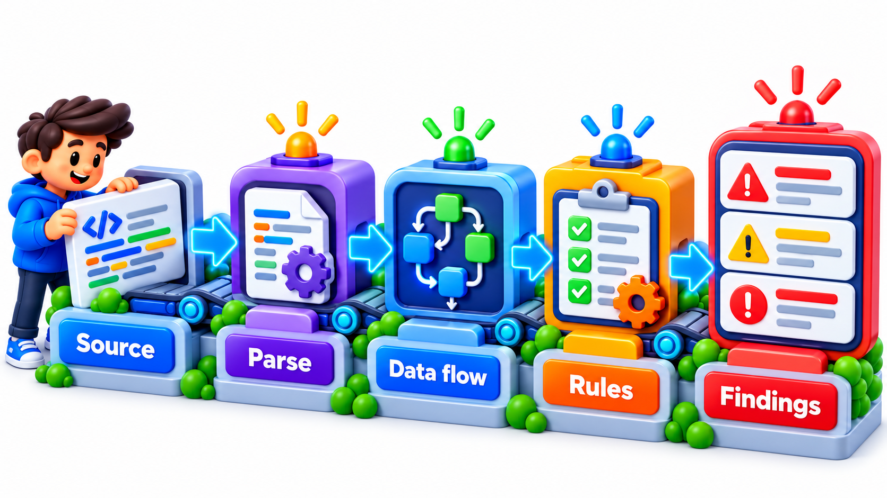
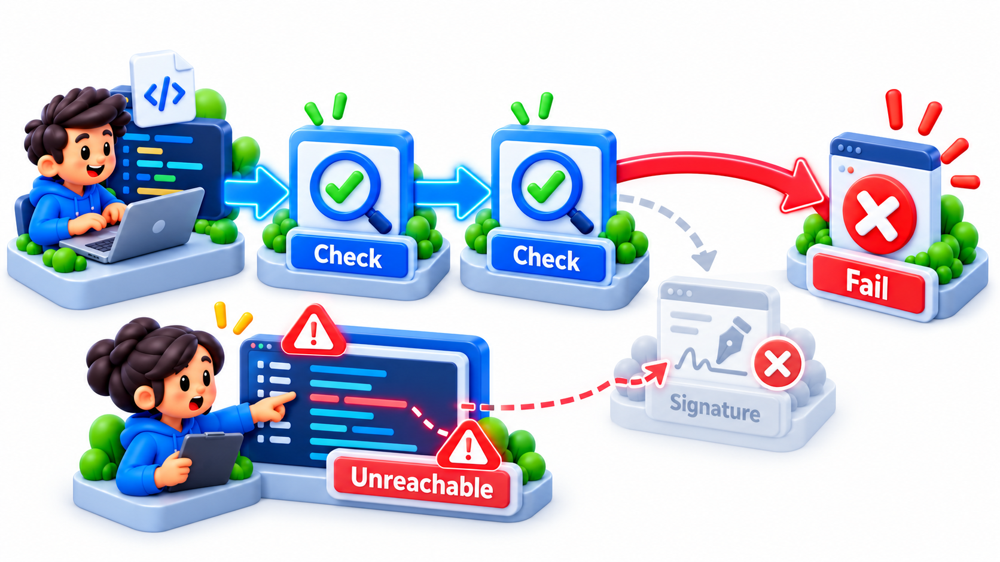
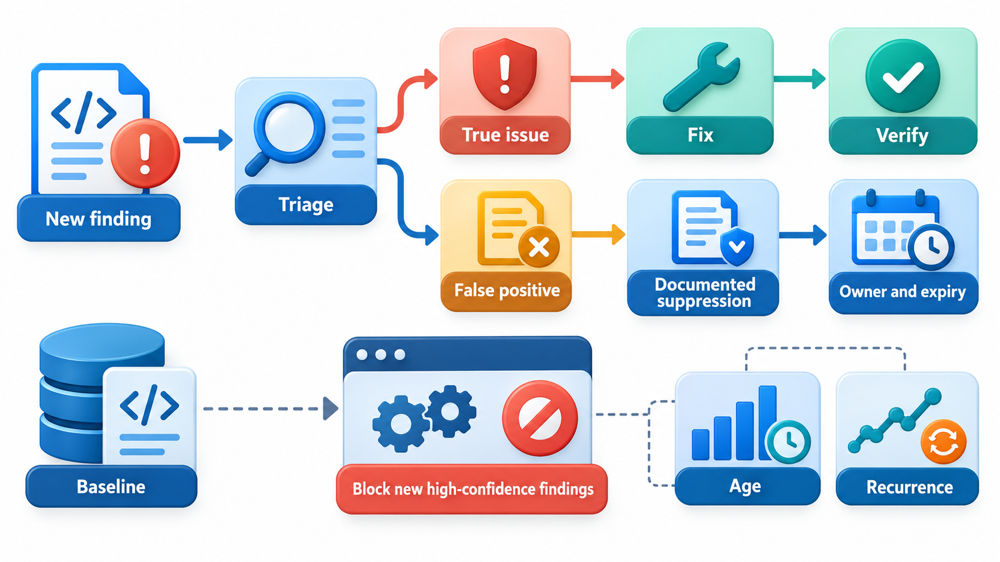
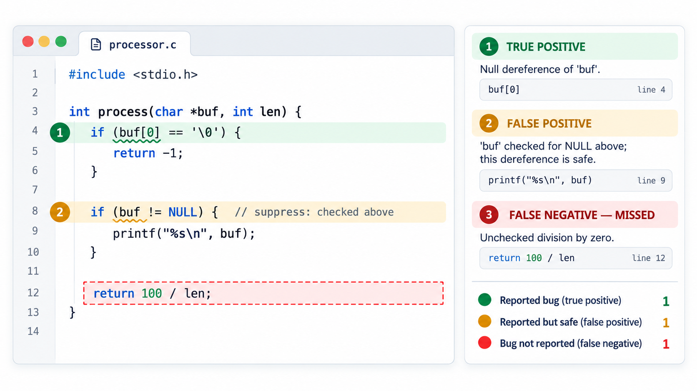

## Finding Bugs Without Running the Program

Programmers write code according to rules they know but do not write down: always check the result of this call, release the lock you took, never use this pointer after freeing it. Most of the time the code obeys the rules. When it does not, that is probably a bug. A tool that can read the code and notice where such rules are broken finds bugs without anyone having to run the program or specify them.

**Static analysis** is the examination of a program's source code, without running it, to find defects, security flaws and style problems. It is the family of tools that includes linters, type checkers and the heavyweight analysers used on safety-critical code. This topic explains how they work, what they can and cannot find and how to use them without being buried in noise.

In 2014 a famous example appeared: a security flaw in Apple's software, caused by a single duplicated line of code that made a check unreachable, left connections unprotected for months. A static analyser that reports unreachable code would have flagged the line. The flaw was simple, and the tool needed no knowledge of the program's purpose to see that the code after the duplicated line could never run.

## Looking Without Running

A static analyser reads the code and builds a model of it: a tree of its structure, a graph of the order in which statements can execute, a record of where each variable is set and used. It then checks that model against a set of rules. Because it never runs the program, it does not need test inputs, and it can reason about every path through the code, including the ones tests miss.

The simplest checks are about structure. Is a variable assigned and never used? Is code unreachable because of an earlier return? Take a small function that totals a list of numbers, and has two variables that are set and never read.

| Line | Variable | Mentioned on how many lines | Finding |
| --- | --- | --- | --- |
| 3 | unused_count | 1 (only where it is created) | Assigned but never used |
| 6 | temp | 1 | Assigned but never used |
| (various) | total | 4 | Fine |
| (various) | the list parameter | 2 | Fine |

None of the program ran, and the analysis found two probable defects. A variable that is set and ignored often means a forgotten step, or code left over from a change. Real analysers read the code properly, as a tree of statements, so they cannot be fooled by comments or text that merely looks like code. They check many hundreds of such rules across millions of lines in seconds, but the first rule in the list is just this one.

## What Static Analysis Looks For

| Category | Examples of findings |
| --- | --- |
| **Dead and redundant code** | Unreachable statements; variables never used; conditions always true |
| **Likely bugs** | Comparing a value to itself; assignment in place of comparison; missing return on some path |
| **Resource handling** | A file opened and not closed on an error path; a lock not released |
| **Null and memory** | Possible null dereference; use after free; buffer overruns |
| **Concurrency** | Shared data accessed without a lock; inconsistent lock order |
| **Security** | Unsanitised input reaching a query; hard-coded secrets; weak cryptography |
| **Style and maintainability** | Overlong functions; deep nesting; duplicated code |

## Data-Flow Analysis

A deeper technique is **data-flow analysis**, which follows how values travel through a program. The idea in plain terms is to track facts about variables along every path. Is this variable definitely assigned before it is read? Could this pointer be null here? Has this file been closed on every path out of the function? Has the data from the user been checked before it reaches the database query?

An analyser might reason: "on the path where the `if` condition is false, `result` is never assigned, and line 20 uses `result`". It reports a possible use of an uninitialised variable. The best-known security application is **taint analysis**: mark data that comes from outside as "tainted", follow it through assignments and calls, and warn if it reaches a dangerous place, such as a database query, without passing a sanitising function. That is how many tools find injection flaws.

| Fact tracked | Along each path | Warning raised |
| --- | --- | --- |
| Variable assigned? | Path where the `if` is false never assigns it | Use of a possibly unassigned variable |
| Pointer null? | A lookup may return nothing; the code then uses it | Possible null dereference |
| File open? | An early return skips the close call | Resource leak |
| Data tainted? | Request parameter flows into a query string | Possible injection |

<!-- Visual: static analysis turning code structure and rules into findings. -->

## False Positives and False Negatives

No static analyser is perfect, and the reason is deep. Whether a program has a particular property is, in general, impossible to decide exactly for all programs. So tools approximate, and approximation gives two kinds of error.

<!-- Visual: A control-flow path that analysis finds but tests may miss. -->

- A **false positive** is a warning about something that is not really a bug. The analyser was cautious and the code is fine. Too many, and developers stop reading the reports.
- A **false negative** is a real bug the tool did not report. A tool tuned to avoid false positives will miss some bugs.

Practical accounts of using these tools are largely about managing this balance. A tool people trust finds real bugs at a high rate and rarely cries wolf. Teams tune the rules, suppress known false alarms with a comment that says why, and rank findings by severity and confidence.

| Tool setting | False positives | False negatives | Effect on trust |
| --- | --- | --- | --- |
| Very strict, warns on anything doubtful | Many | Few | Developers learn to ignore the output |
| Balanced, high-confidence rules only | Few | Some | Developers read and fix findings |
| Very lenient | Almost none | Many | False comfort |

A rough measure of a tool's usefulness is the share of its findings that are real. If 60 of 100 warnings lead to a fix, people keep using it. If 5 of 100 do, they stop.

## Kinds of Tool

| Kind | What it checks | Examples |
| --- | --- | --- |
| **Linters** | Style, simple bug patterns, unused code | Flake8, Pylint, ESLint, Ruff |
| **Type checkers** | Type consistency | mypy, TypeScript, the Rust compiler |
| **Bug finders** | Deeper flaws: null dereference, resource leaks, concurrency errors | SpotBugs, Infer, Coverity, Clang Static Analyzer |
| **Security scanners (SAST)** | Vulnerabilities such as injection and weak cryptography | CodeQL, Semgrep, SonarQube |
| **Formal verifiers** | Proofs of properties of the program | Frama-C, SPARK, abstract interpreters |

They run at different speeds. Linters run in the editor in milliseconds. Deep analysis may take minutes or hours and is run nightly or on larger changes.

## Using Static Analysis Well

- **Run it in continuous integration,** so that new problems are caught when they are introduced, when fixing is cheapest.
- **Start with the rules that matter.** A huge backlog of old warnings demoralises people. Block new findings and clean the old ones gradually.
- **Fix, don't just suppress.** If you must suppress a warning, write why.
- **Treat serious findings as defects,** with owners and deadlines.
- **Combine with other techniques.** Static analysis, testing, review and runtime checks find different bugs.
- **Mind the cost of noise.** A tool nobody trusts is worse than none.

| Stage of adoption | What to do |
| --- | --- |
| **Week 1** | Run the tool on the codebase; do not block anything; look at the sample of findings |
| **Week 2** | Turn off rules that give mostly noise; keep the high-value ones |
| **Week 3** | Block new findings in changed code; leave old ones in a baseline |
| **Months** | Fix the baseline gradually, starting with serious security and correctness items |
| **Ongoing** | Review the rule set; add new rules after incidents |

<!-- Visual: a code listing with three findings marked in the margin, one true positive circled green, one false positive crossed with a suppression comment, and one real bug the tool missed shown as a dashed false negative. Save as images/151_positives_and_negatives.png. -->

