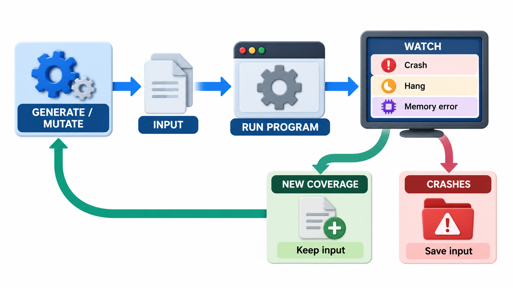
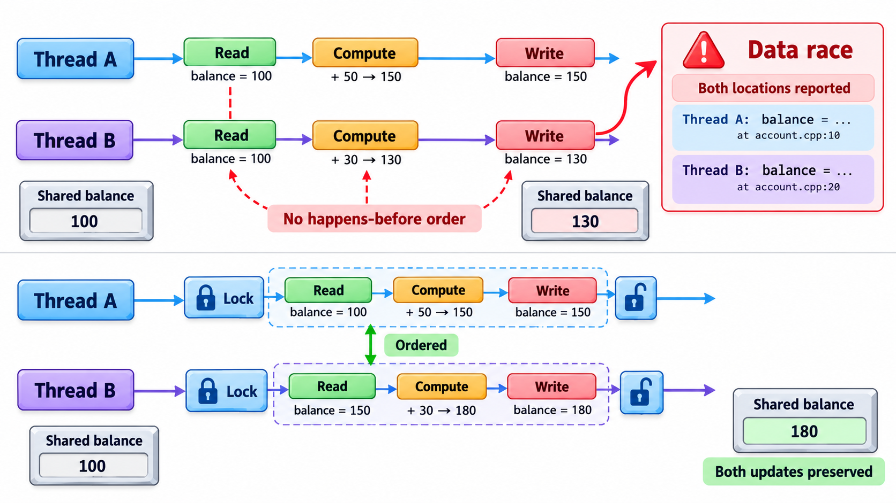
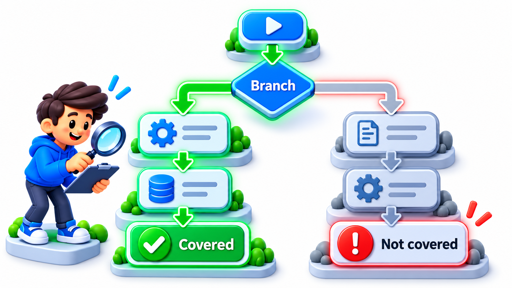
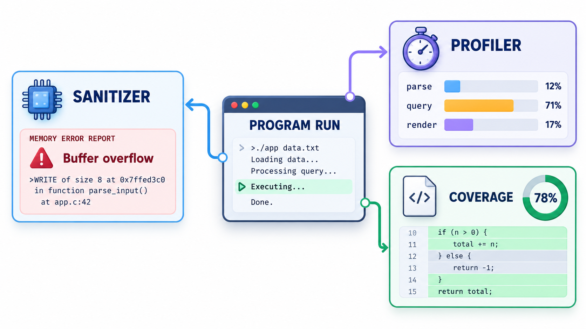
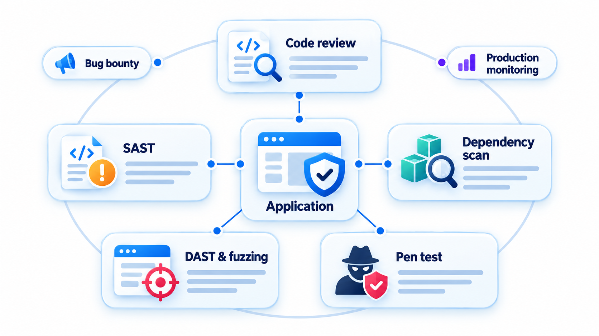

## Finding Bugs by Watching Them Happen

Some bugs do not crash at the moment they occur. Reading or writing past the end of an array, using memory after it has been freed, freeing it twice: these quietly corrupt whatever sits next to the memory they touched, and the program fails later, somewhere else, or never fails at all and is merely vulnerable. Reading the code is not always enough to find them.

**Dynamic analysis** is examining a program by *running* it and watching what it does. Where static analysis reads the code and reasons about all possible runs, dynamic analysis observes actual ones. It sees what really happens, with real data and real timing, and cannot report a path that never occurs. Its weakness is the mirror image: it sees only the runs that are executed. This topic covers the main kinds, such as profilers and sanitizers that add checks to a program as it is built, and how they combine with the static techniques.

## What You Can Observe

A running program can be watched in many ways. Each kind of dynamic analysis looks at something different.

| Technique | What it watches | Finds |
| --- | --- | --- |
| **Sanitizers** | Memory accesses, arithmetic, thread operations | Buffer overflows, use-after-free, undefined behaviour, data races |
| **Profilers** | Time and memory use by function | Slow code, memory leaks, hot spots |
| **Coverage tools** | Which lines and branches ran | Code the tests never exercise |
| **Memory checkers** (Valgrind and similar) | Allocation and use of memory | Leaks, invalid reads and writes |
| **Race detectors** | Accesses to shared data from several threads | Unsynchronised access that can corrupt data |
| **Runtime monitors** | Behaviour against a rule | Violations of a stated property, such as "a file opened must be closed" |
| **Tracing and logging** | Sequences of events | The path a failure took |

## How Instrumentation Works

Most dynamic analysis works by adding observation code to the program, either when it is compiled or while it runs.

| Method | How | Example |
| --- | --- | --- |
| **Source or compile-time instrumentation** | The compiler inserts extra code at each memory access or function entry | Sanitizers, coverage tools |
| **Binary instrumentation** | A tool rewrites the compiled program as it loads | Valgrind |
| **Sampling** | A timer interrupts the program regularly and notes where it is | Many profilers |
| **Hooks and interposition** | Replace library calls (for example memory allocation) with checking versions | Memory leak detectors |
| **Tracing** | The system records events as they occur | Operating system tracers, application tracing |

Each adds cost: more time, more memory. Sampling is cheap and approximate; instrumentation is exact and slower.

## A Profiler in a Few Lines

The simplest dynamic analysis is to count what happens: each function adds one to a tally every time it is called, and the report shows which function is called most. This is **instrumentation**: adding measuring code to the program. Take a routine that goes through a thousand numbers and asks a second routine whether each is even.

| Function | Times called |
| --- | --- |
| The routine that goes through the numbers | 1 |
| The even-number check | 1,000 |

The hot spot is the even-number check. Real profilers do the same without your editing every function: they hook into the running program and record calls and the time spent in each. The data show where the program spends its effort, with no guessing. The result depends on running the program with real input. A function that never runs would never appear in the report, which is the limit of dynamic analysis: it sees only what actually happens.

## Sanitizers

Sanitizers are the success story of dynamic analysis. They are options in the compiler. When the program is built with them, extra checks are inserted, and the program is run, usually under the test suite or a fuzzer. The common ones are:

- **AddressSanitizer (ASan):** invalid memory accesses and leaks.
- **UndefinedBehaviorSanitizer (UBSan):** operations the language leaves undefined, such as signed integer overflow.
- **ThreadSanitizer (TSan):** data races between threads.
- **MemorySanitizer (MSan):** use of uninitialised memory.

They make silent bugs loud. A buffer overflow that would have corrupted a neighbouring variable without a sound now stops the program at the faulty line with a stack trace. They slow the program by a factor of two to ten, so they are used in testing and not in production. Combined with fuzzing, they give a powerful way to find security bugs: the fuzzer produces unusual inputs, and the sanitizer notices when any of them does something illegal.

| Without a sanitizer | With a sanitizer |
| --- | --- |
| A write one element past the end of an array changes a nearby variable | The program stops at the write: "heap-buffer-overflow, line 48" |
| The program continues and gives a wrong answer ten minutes later | A stack trace shows exactly where the memory was allocated and misused |
| The bug depends on memory layout and may vanish when debugging | Found reliably |

<!-- Visual: A fuzzing loop turning a crashing input into a reproducible security test. -->

## Race Detectors: Finding Timing Bugs

Two threads touching the same data without coordination can corrupt it, but only when the timing is unlucky. A race detector watches memory accesses and the locks held, and reports any shared data accessed by two threads, at least one writing, with no common lock.

| Thread A | Thread B | Common lock held? | Race detector report |
| --- | --- | --- | --- |
| Reads `balance` | Writes `balance` | No | Data race on `balance` reported, even if this run happened to be fine |
| Takes lock, reads `total` | Takes the same lock, writes `total` | Yes | Fine |

The valuable point is that the detector reports a race it *could* see, even if the bad interleaving did not occur in this run. It finds a bug that testing alone would find only by luck.

## Coverage Tools

A **coverage tool** records which lines or branches were executed during a test run. It is dynamic analysis, since it watches execution. The result is a map of untested code. As discussed under testing, coverage tells you what was *not* run, which makes it more useful than the headline percentage suggests: each uncovered line is a question, "should a test reach this?".

<!-- Visual: coverage revealing which control-flow paths tests have not exercised. -->

## Runtime Monitoring

A **runtime monitor** is a piece of code, or a tool, that watches a running system and checks it against a rule written in advance. The rule could be a property such as "every opened connection is closed within a minute" or "no transaction is processed twice". When the rule is broken, the monitor logs, raises an alarm or takes a safe action. It is the production-time version of an assertion. In safety-critical systems, an independent monitor checks the main software's outputs against safe limits and takes over if they are exceeded. Application performance monitoring services do much the same for web systems, and observability tools watch metrics against thresholds.

## Dynamic and Static, Together

The two approaches suit each other.

<!-- Visual: a program run under three observers at once, a sanitizer watching memory, a profiler counting time per function and a coverage tool colouring executed lines green, each producing its own report. Save as images/152_three_observers.png. -->

| | Static analysis | Dynamic analysis |
| --- | --- | --- |
| **Runs the program?** | No | Yes |
| **Sees** | All paths (approximately) | Only executed paths |
| **False positives** | Common | Rare: what it reports really happened |
| **False negatives** | Some | Many: whatever the tests never reached |
| **Needs test inputs?** | No | Yes |
| **Best for** | Early, broad checking | Precise findings, memory and timing behaviour |

A strong pipeline uses both. Static tools run on every change as the first screen. Tests, fuzzers and sanitizers then exercise the program and watch it. Profilers and monitors take over for performance and production behaviour.

<!-- Visual: A security toolbox surrounding an application with several kinds of analysis. -->

## Five Misreadings of Dynamic Analysis

**"If no tool reports a problem, there isn't one."** Dynamic analysis sees only the runs performed. Bugs on untested paths stay hidden.

**"Sanitizers are only for C programmers."** The bugs they find are mostly in memory-unsafe languages, and these power operating systems and browsers, so it matters to everyone.

**"A profiler tells you how to fix slowness."** It tells you where the time goes. The fix is a design decision.

**"Run the sanitizers in production."** They slow the program too much. Use them in testing and fuzzing.

**"Dynamic and static analysis are alternatives."** They find different things and work best together.
