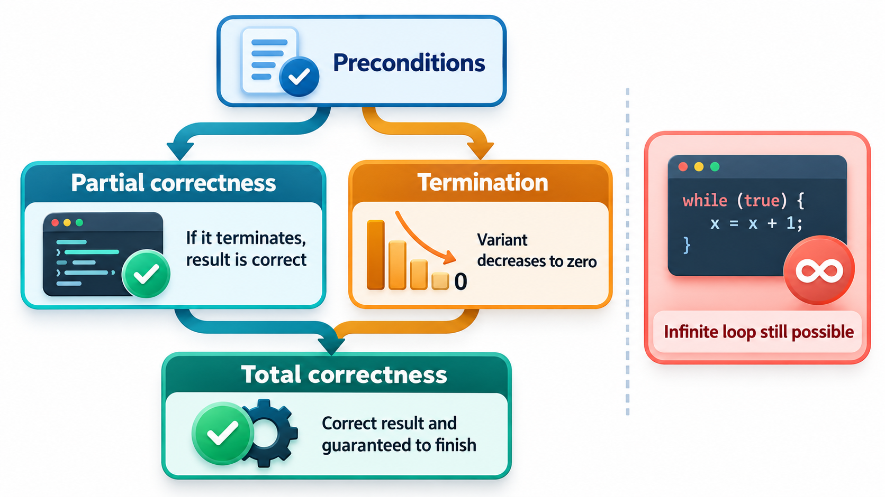
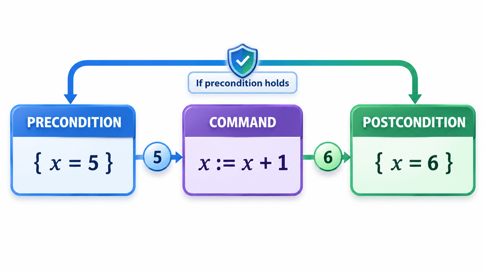
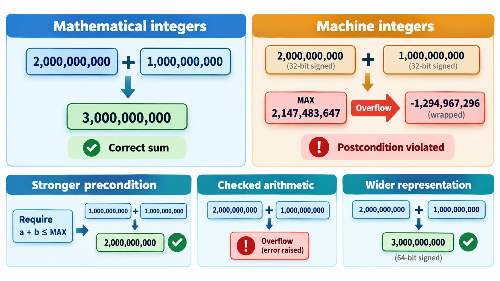
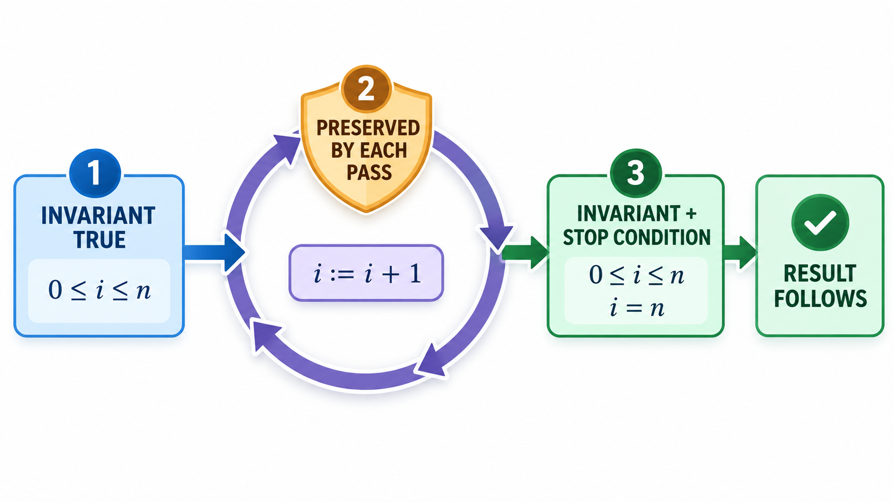

## Easy to Describe, Hard to Get Exactly Right

Even the simplest and most famous algorithms are hard to get exactly right. Take binary search: find a value in a sorted list by repeatedly looking at the middle and discarding half. The task is easy to describe, yet it is surprisingly easy to write with a bug, and a version that has been proved correct on paper, in the sense of its logic, can still fail because the proof silently assumes that numbers never overflow.

What does it mean for a program to be *correct*, and how can we show it? **Program correctness** is the study of reasoning about programs with logic, so that we can prove that they do what they should, for all inputs, rather than hoping that tests found the problems. It is a deep field, and a few of its central ideas are useful to every programmer.

## Correctness Is Relative to a Specification

A program is not simply correct or incorrect. It is correct *with respect to a specification*. Write down what the program must do: for a sorting function, "the output is in order and contains the same items as the input". Then correctness means that the program meets that statement for every input that meets the precondition. If the specification is wrong, the program can be provably correct and useless.

Two kinds of correctness are distinguished. **Partial correctness** means that *if* the program finishes, the result is right. **Total correctness** means that it also *does* finish: it does not loop for ever.

| Notion | Meaning | Example: a search routine |
| --- | --- | --- |
| **Partial correctness** | If it returns, the answer is right | If it returns a position, that item is the target |
| **Termination** | It always returns | The range shrinks every step, so the loop must end |
| **Total correctness** | Both | It always returns, and the answer is right |
| **Specification error** | The routine meets its spec, which is wrong | A spec that forgot the "not found" case: provably correct, still useless |

## A Real Case: Binary Search and Its Overflow

Binary search is one of the simplest ideas in programming: to find a value in a sorted list, look at the middle, discard the half that cannot hold it, and repeat. In the 1980s the author Jon Bentley gave the problem to groups of professional programmers, with plenty of time and the language of their choice, and reported that about ninety per cent of them produced programs with bugs. Some failed on an empty list, some on a value at the end, some looped forever. The first published description of the method appeared in 1946, and it took until 1962 for a version without bugs to be published.

It did not end there. Bentley himself had proved a version correct, and it was copied into textbooks and standard libraries. In 2006 the engineer Joshua Bloch reported that a line in such a version had a flaw. To find the middle, it added the lowest and highest positions and divided by two. If the list is very large, the sum of the two positions can exceed the largest whole number the computer can hold, and the result becomes negative. The flaw had lain unnoticed in widely used code for about twenty years because lists that large had been rare. A small change, which finds the middle by adding half of the difference to the lowest position, avoids it.

| What went wrong | What it shows about correctness |
| --- | --- |
| Most programmers got a simple algorithm wrong | Intuition about correctness is unreliable |
| A proof was published, and a flaw was still found | A proof covers the assumptions it states, such as numbers that never overflow |
| The bug waited for large inputs to appear | A program can be correct on every test and still wrong |

Program correctness is the study of what it means to say that a program does its job and how to show it. The topic that follows describes preconditions, postconditions and loop invariants, which are the tools that turn the idea into something that can be reasoned about.

## Hoare Triples

In 1969 the British computer scientist Tony Hoare published a paper called "An Axiomatic Basis for Computer Programming", building on earlier work by Robert Floyd. It introduced a notation that is still the standard way to state what a piece of code does. A **Hoare triple** has three parts:

**{ P } C { Q }**

It reads: if the condition P (the **precondition**) holds before the command C runs, then, after C finishes, the condition Q (the **postcondition**) holds. For example:

- If x is 5 before a command that adds 1 to x, then x is 6 afterwards.
- If the balance is at least the amount before a command that subtracts the amount from the balance, then the balance is not negative afterwards.

The second one says something real: if you start with enough money, you end without a negative balance. The triples are the precise form of contracts. Hoare also gave **rules** for composing them: for an assignment, a sequence of statements, a choice and a loop. By chaining the rules, you can prove statements about whole programs.

A useful way to work is backwards. Given the postcondition you want, ask: what is the *weakest* precondition that guarantees it? This is the **weakest precondition** of Edsger Dijkstra. To end with x above 10 after adding 3 to x, you must start with x above 7. Working backwards from the goal through each statement tells you exactly what must be true at the start.

| Command | Postcondition wanted | Weakest precondition |
| --- | --- | --- |
| Add 3 to x | x above 10 | x above 7 |
| Double x | x at least 20 | x at least 10 |
| Subtract the amount from the balance | Balance at least 0 | Balance at least the amount |
| Copy x to y, then add 1 to x (in that order) | x above y | Always true (since y is the old x) |

<!-- Visual: a Hoare triple drawn as three boxes, a precondition card on the left, a command in the middle and a postcondition card on the right, with the example x equals 5, x becomes x plus 1, x equals 6. Save as images/153_hoare_triple.png. -->

## Loop Invariants

Loops are the hard part, because they may run many times and the proof cannot unroll them. The key idea is the **loop invariant**: a statement that is true before the loop starts, true after every pass through the body, and so true when the loop ends. At the end, the invariant plus the fact that the loop condition is now false gives the result you want.

To prove a loop correct you show three things.

1. **Initialisation.** The invariant is true before the first pass.
2. **Maintenance.** If it is true before a pass, it is true after.
3. **Termination.** The loop ends (some quantity strictly decreases and cannot go below a limit), and when it does, the invariant implies the postcondition.

Take a loop that adds the numbers 1 to n. The invariant is that the running total equals the sum of the numbers 1 up to the current number i, which equals i x (i + 1) / 2. For n of 10:

| After pass | i | Running total | Invariant (i x (i + 1) / 2) |
| --- | --- | --- | --- |
| Before the loop | 0 | 0 | 0, holds |
| 1 | 1 | 1 | 1, holds |
| 2 | 2 | 3 | 3, holds |
| 3 | 3 | 6 | 6, holds |
| 10 (end) | 10 | 55 | 55, holds |

Initially both are 0 and the invariant holds. Each pass increases i by one and adds the new i to the total, which keeps the statement true: that is the maintenance step. When the loop ends, i equals n, and the invariant gives the answer, 55.

The binary search of the story has its own invariant: if the target is in the list at all, it lies between the low and high ends of the range. Each step narrows the range and keeps the invariant true. Searching the sorted list 10, 20, 30, 40, 50, 60, 70, 80 for 70 finds it at position 6, counting from zero. Writing the invariant down is the discipline that most programmers lack. Most bugs in such loops come from boundaries ("less than" or "less than or equal", the middle plus one or the middle itself) that were not reasoned about.

| Step | Low | High | Middle | Item at middle | Action |
| --- | --- | --- | --- | --- | --- |
| 1 | 0 | 7 | 3 | 40 | 70 is larger: discard the left half, low = 4 |
| 2 | 4 | 7 | 5 | 60 | 70 is larger: low = 6 |
| 3 | 6 | 7 | 6 | 70 | Found at position 6 |

At each step, the invariant "if 70 is in the list, it is between low and high" holds, and the range roughly halves.

## The Overflow Lesson

The proof of a binary search shows that the algorithm is correct on ideal numbers. A real computer has numbers of limited size, and the flaw lay in the gap. The middle of a range was computed as (low + high) / 2. Take two positions in an enormous array, one and a half billion and two billion, with 32-bit whole numbers that can hold at most 2,147,483,647.

| Way of computing the middle | Result in 32-bit arithmetic |
| --- | --- |
| True midpoint | 1,750,000,000 |
| (low + high) / 2: the sum, 3,500,000,000, does not fit and wraps around to a negative number, and half of that is negative | -397,483,648: a negative position, so the search would crash or go to the wrong place |
| low + (high - low) / 2: never forms the oversized sum | 1,750,000,000, correct |

The moral is that a proof is only as good as its assumptions. The original proof assumed unbounded integers. Verification must model the machine the program really runs on, including its limits.

## Practical Use of Correctness Ideas

Few programmers write full proofs. But the ideas are useful at many levels.

<!-- Visual: a loop drawn as a cycle with three labelled checks, invariant true before the first pass, preserved by every pass, and on exit combined with the stop condition to give the result. Save as images/153_loop_invariant_cycle.png. -->

- **Think in preconditions and postconditions** for every function. Write them as contracts or assertions.
- **State loop invariants** for non-trivial loops, as comments or assertions. Most loop bugs disappear when you do.
- **Use tools that prove things.** Proof assistants and verifiers (Frama-C, SPARK, Dafny, Coq) prove programs correct, and have been used for operating system kernels, compilers and cryptographic libraries. The seL4 microkernel and the CompCert compiler are famous examples.
- **Know the limits.** Proof requires a formal specification and is costly. It is used where the cost of failure justifies it.

| Level of effort | What you do | Typical use |
| --- | --- | --- |
| **Informal reasoning** | State pre- and postconditions and loop invariants in comments | All code of any importance |
| **Runtime checks** | Turn them into assertions | Testing and safety margins |
| **Property-based tests** | Check the properties on thousands of random inputs | Libraries, parsers |
| **Automated verification** | Tools check annotated code | Critical modules |
| **Machine-checked proof** | A proof assistant verifies a full proof | Kernels, compilers, cryptography |

<!-- Visual: testing and proof compared: testing shows the presence of bugs, proof can show their absence for a stated property. -->

