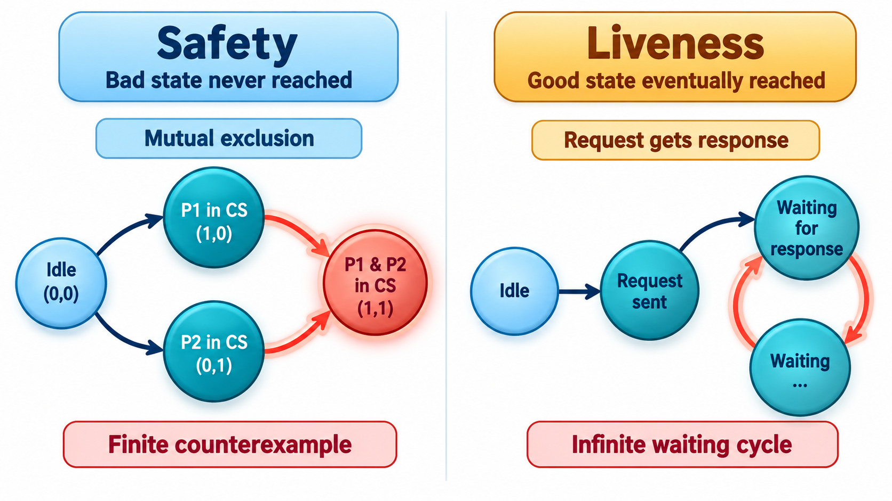
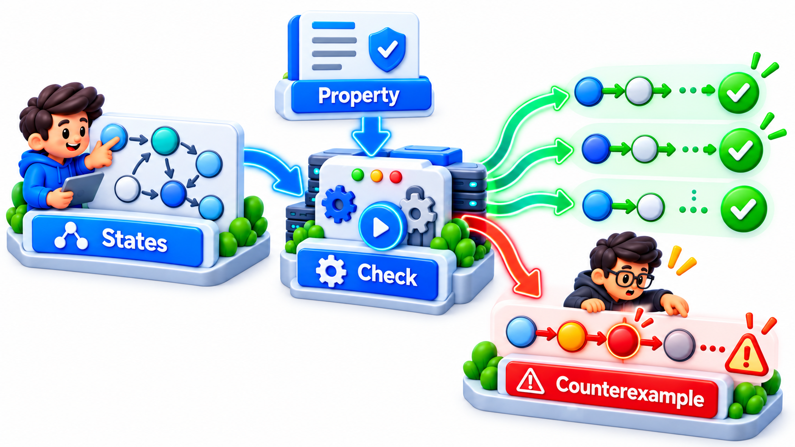
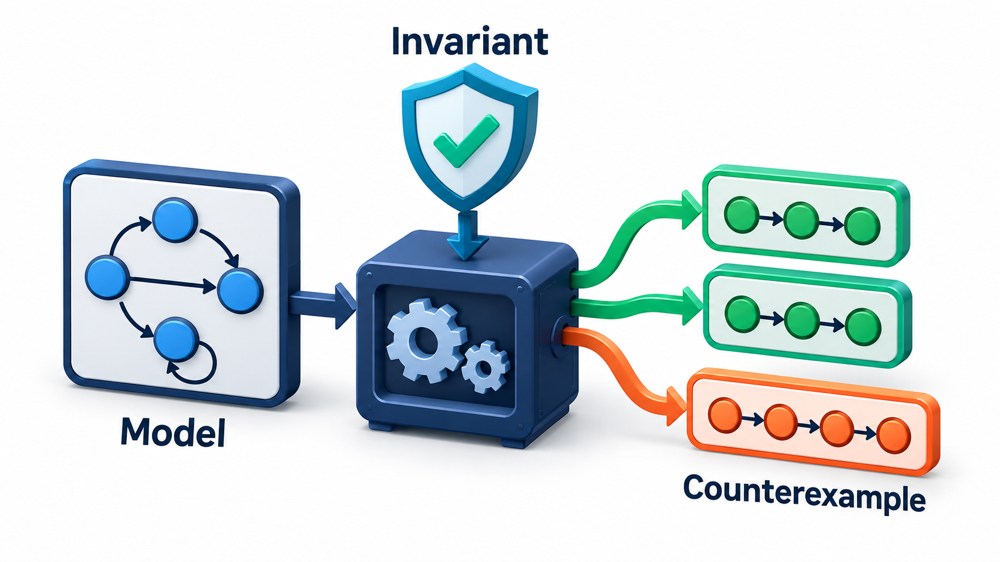
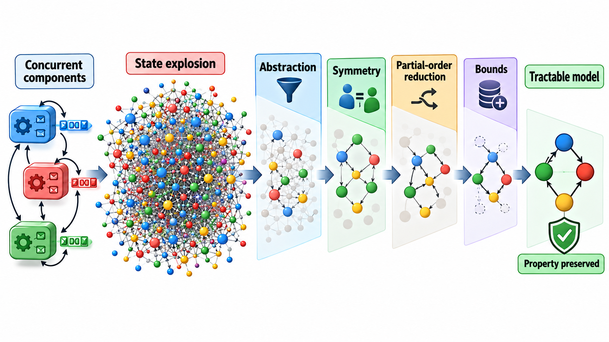
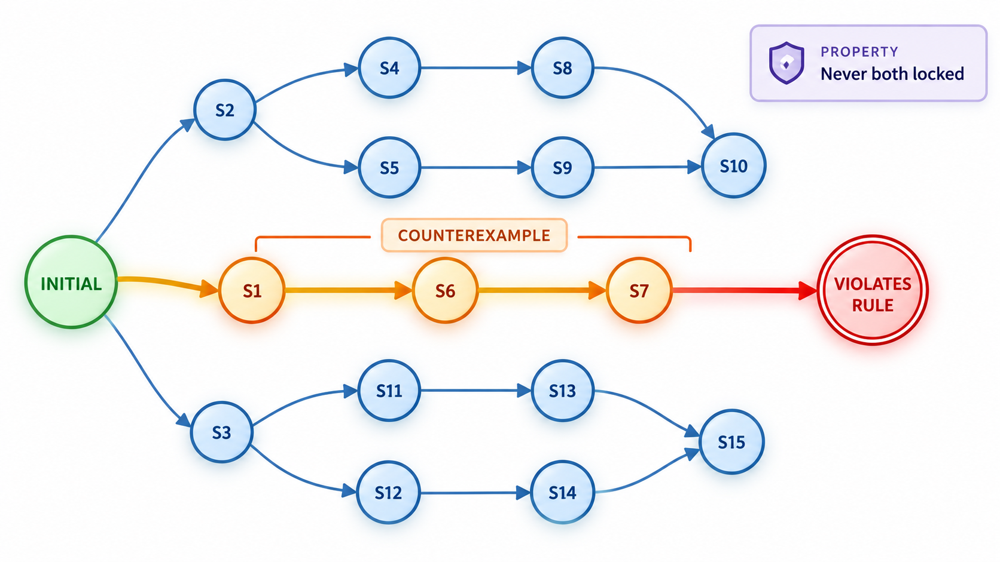

## Trying Every Order of Events

Testing samples some of the ways a system can behave. Some bugs appear only after a particular sequence of events, with failures at particular moments, which no amount of testing is likely to find because the chance of a real system hitting that exact sequence is tiny. But at the scale of a large internet service, a tiny chance happens regularly.

**Model checking** is a verification technique that checks a system by *exhaustive exploration* of its possible behaviours. A model checker takes a design written in a precise specification language and explores *every* sequence of events the design allows, looking for one that breaks a stated rule. Engineers who use it report that it finds flaws in designs that had been through many reviews, and that writing the specification itself, forcing them to say precisely what the system should do, improves their understanding before the tool even runs. This topic explains the idea and what it is used for.

## The Idea: Explore Every State

A system can be modelled as a set of **states** and the **transitions** between them. A state is a snapshot of all the variables: who holds a lock, what is in each message queue, what each process has done. A transition is a step that moves from one state to another. The model checker starts from the initial state, follows every possible transition, then every transition from each new state, and so on, until it has seen every reachable state. At each state it checks the properties you care about.

Two kinds of property are checked.

- **Safety:** "something bad never happens". Two processes are never in the critical section together. The balance is never negative.
- **Liveness:** "something good eventually happens". Every request eventually gets a response. The system does not get stuck.

If a property is violated, the checker does not merely say so. It produces a **counterexample**: the exact sequence of steps that leads from the start to the violation. That trace is the most valuable output, because it reads as a story of how the bug can occur, and it can be turned into a test.

| Term | Meaning | Example |
| --- | --- | --- |
| **State** | A snapshot of all variables | Balance 1,000; clerk A has read; clerk B has not |
| **Transition** | A step that changes the state | Clerk B reads the balance |
| **Initial state** | Where the system begins | Balance 1,000; nobody has acted |
| **Safety property** | A bad state is never reached | Final balance is never wrong |
| **Liveness property** | A good state is eventually reached | Every payment is eventually recorded |
| **Counterexample** | A path to a violation | The four-step sequence in which both clerks read first |

<!-- Visual: A model checker exploring states and returning a counterexample. -->

## A Real Case: A Thirty-Five-Step Bug

Engineers at Amazon Web Services reported in 2014 that they had used a model checker on the designs of core services such as storage and found subtle bugs that needed a sequence of around thirty-five steps to appear, a path that no test or review had found.

## A Model Checker in Twenty Lines

A tiny model checker for a familiar problem: two clerks each add 100 rupees to a balance of 1,000. Each does two steps in order, read the balance then write back what they read plus 100. The checker tries every way the four steps can be interleaved, keeping each clerk's steps in order. There are 24 orderings of four steps, but only 6 keep read before write for both clerks.

<!-- Visual: an invariant violated at the end of a counterexample trace. -->

| Order of steps | Final balance |
| --- | --- |
| A reads, A writes, B reads, B writes | 1,200 |
| B reads, B writes, A reads, A writes | 1,200 |
| A reads, B reads, A writes, B writes | 1,100: counterexample |
| A reads, B reads, B writes, A writes | 1,100: counterexample |
| B reads, A reads, A writes, B writes | 1,100: counterexample |
| B reads, A reads, B writes, A writes | 1,100: counterexample |

Four of the six end at 1,100 instead of 1,200, and each is a counterexample. The four bad orders are the ones in which both clerks read before either writes, so the second write overwrites the first. A test would find the bug only if it happened to try one of them. The model checker tried all six. The idea scales: real tools generate and check millions of orders far faster, and print the first failing one as a replayable story.

## Reading a Counterexample

The first counterexample from the checker reads like an account of how things went wrong.

| Step | Who | Action | Balance in memory | Clerk A holds | Clerk B holds |
| --- | --- | --- | --- | --- | --- |
| 0 | | Start | 1,000 | nothing | nothing |
| 1 | A | Reads the balance | 1,000 | 1,000 | nothing |
| 2 | B | Reads the balance | 1,000 | 1,000 | 1,000 |
| 3 | A | Writes 1,000 + 100 | 1,100 | | 1,000 |
| 4 | B | Writes 1,000 + 100 | 1,100 | | |
| Violation | | Expected 1,200, found 1,100 | | | |

A developer can read this and see the cause at once: B's write was based on a stale read. The fix is to make read-and-write one indivisible step, and the model checker can then be run again to show that all orderings now end at 1,200.

## State Explosion

The weakness of exhaustive exploration is that the number of states grows explosively. Two clerks with two steps each have 6 interleavings. Five processes with ten steps each have trillions. This is the **state-space explosion problem**, and it limits what can be checked. Practitioners deal with it by:

- **Modelling at a high level,** keeping only what matters for the property and leaving out detail. A model is an abstraction, not the code.
- **Limiting the size,** checking with small numbers of processes, messages and values. Most bugs show up with a handful, a belief called the "small scope hypothesis".
- **Symmetry and reduction techniques** that treat equivalent states as one.
- **Symbolic methods** that represent huge sets of states compactly.
- **Bounded checking,** which searches only up to a given depth.

A model checker that completes proves that the property holds for the model, within the stated bounds. It is strong evidence about the design, not about every line of the final code.

| Processes | Steps each | Number of interleavings |
| --- | --- | --- |
| 2 | 2 | 6 |
| 2 | 5 | 252 |
| 3 | 5 | 756,756 |
| 4 | 5 | About 11.7 billion |
| 5 | 10 | About 4.8 x 10 to the power 31 |

The growth explains why a model is kept small: adding one more process multiplies the work by thousands.

## Tools: TLA+ and Alloy

**TLA+** (the Temporal Logic of Actions) is a language for describing the behaviour of concurrent and distributed systems, created by Leslie Lamport. A specification says what the states are and which steps are allowed, and states properties in temporal logic. The model checker TLC explores it. TLA+ has been used at Amazon, Microsoft, Intel and elsewhere, mainly for distributed protocols, where the interleavings of messages are too numerous for humans to reason about. The same engineers often say that its value comes as much from forcing clear thought as from the checking.

**Alloy** is a language and analyser for describing the structure of a system: objects, relationships and constraints, in a simple notation based on sets and relations. Its analyser searches for instances that satisfy a description or counterexamples to a claim, within a small scope. It is used to find design flaws in things like access control rules, file systems, protocols and data models. Daniel Jackson at MIT created it, and his book *Software Abstractions* is the standard introduction.

Other model checkers work on programs directly (for example, the SPIN tool for protocols, and CBMC for C code) or on hardware designs, where model checking has long been standard practice in the chip industry. After the 1994 Pentium division flaw, in which a few missing table entries caused wrong results in rare divisions and cost Intel about 475 million dollars, chip makers adopted formal verification far more widely.

| Tool | Describes | Typical use |
| --- | --- | --- |
| **TLA+ / TLC** | Behaviour over time of concurrent or distributed systems | Consensus, replication, locking designs |
| **Alloy** | Structures and constraints within a small scope | Access rules, data models, protocols |
| **SPIN** | Communicating processes | Network and concurrency protocols |
| **CBMC** | C programs, up to a bound | Embedded code, finding overflows |
| **Hardware model checkers** | Circuit designs | Processor and cache verification |

## Where Industry Uses It

Model checking is not for everything. It pays where the cost of a design flaw is high and the behaviour is subtle:

- **Distributed protocols:** consensus, replication, leader election.
- **Concurrency:** locks, queues, memory models.
- **Safety-critical control:** railway interlocking, aircraft systems, medical devices.
- **Security protocols:** key exchange and authentication.
- **Hardware:** processors, caches, buses.
- **Access control and workflow rules,** where combinations of permissions produce surprises.

For an ordinary CRUD application with simple logic, it is usually not worth the effort. The question to ask: could a rare interleaving or combination of events cause serious harm, and would testing struggle to find it?

<!-- Visual: a state graph with an initial state at the left, many branching states, one red state marked "violates the rule", and a highlighted path from the start to it labelled counterexample. Save as images/154_state_graph_counterexample.png. -->

## Five Misreadings of Model Checking

**"Model checking proves the program correct."** It checks a model of the design, within bounds. The code can still differ from the model.

**"It is only for academics."** Amazon, Microsoft and chip makers use it on real systems, and found bugs that reviews and tests missed.

**"If the checker finishes, there are no bugs."** There are none of the kinds you asked about, in the model you wrote. A missing property is not checked.

**"Counterexamples are just error messages."** They are a replayable story of the failure, and often the best test case.

**"It replaces testing."** It checks the design. Testing checks the implementation and the environment.
