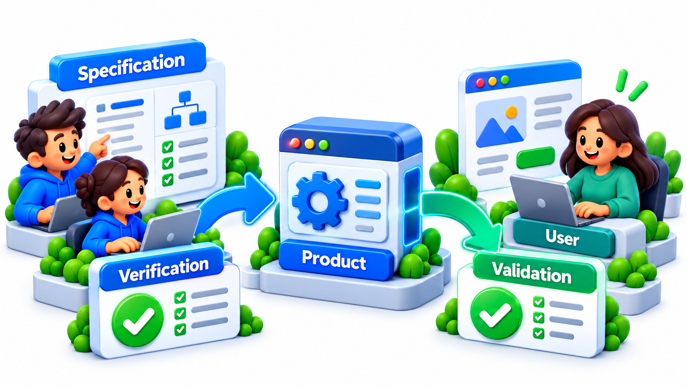
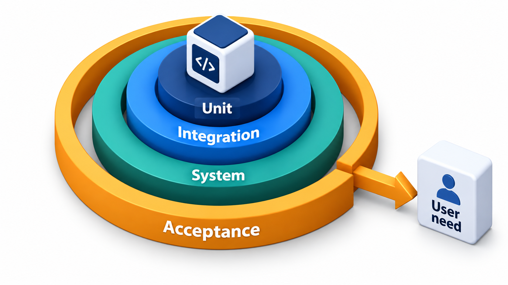
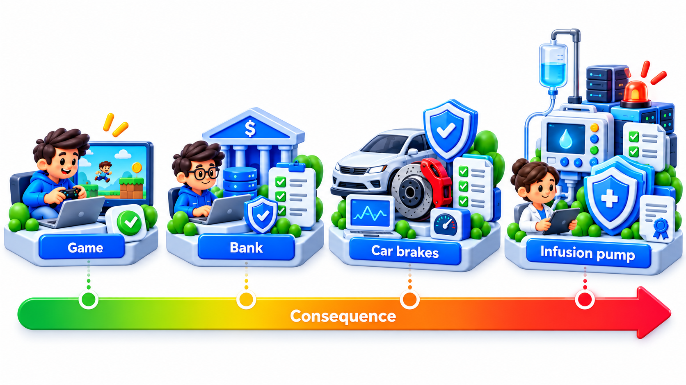
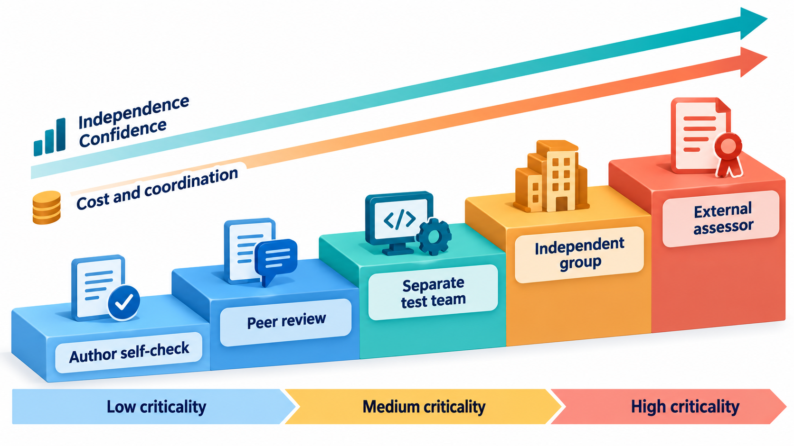
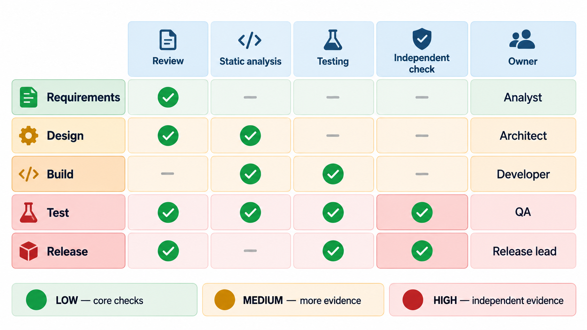

## How Much Checking Is Enough, and by Whom?

Not every project needs an independent team examining its software, but the principle is useful on any scale. Checking done by the people who built a system shares their assumptions and their schedule pressures. The most critical programmes therefore have checking that is independent of the people who built and manage them, free of their cost and deadline pressures, from the requirements through to the final system.

How much checking is enough, who should do it, and at what stages? **Verification and validation planning** is the discipline of answering those questions before the work begins. This topic ties the main verification techniques together into a plan.

## Verification and Validation, Once More

The two words ask different questions, and a plan needs both.

- **Verification:** *Are we building the product right?* Does each stage's output conform to the specification from the stage before it? Reviews, inspections, static analysis, proofs and tests are all verification.
- **Validation:** *Are we building the right product?* Does the finished product meet the real needs of its users? Acceptance testing, prototypes shown to users and trials in the real setting are validation.

Together, V&V is the whole set of activities that give confidence that software is correct and fit for use.

| | Verification | Validation |
| --- | --- | --- |
| **Question** | Built right? | Built the right thing? |
| **Checked against** | The specification or previous stage | The user's real need |
| **Typical activities** | Reviews, static analysis, proofs, testing against requirements | Prototypes, user trials, acceptance tests |
| **A failure means** | The product departs from the specification | The specification itself was wrong or incomplete |
| **Who is the judge** | Engineers, testers | Users, customers |

<!-- Visual: verification checking against the specification and validation checking against the user's need. -->

## A Real Case: An Independent Facility

After the loss of the space shuttle Challenger in January 1986, investigators paid close attention to how the agency made decisions about risk, and over the following years NASA came to the view that the most critical software should be checked by people who were separate from those who wrote it. In the early 1990s it set up an independent verification and validation facility, which has been based in West Virginia since then. Its engineers examine the software of the agency's most critical missions, from the requirements to the code and the tests, and they report on what they find to the agency, not to the project that built the system.

The independence is deliberate and has three parts. The facility is technically independent, using its own methods and tools. It is managerially independent, so that a project manager cannot overrule or delay a finding. And it is financially independent, so that its budget does not depend on the project it reviews. The aim is to avoid the situation in which people who built a thing are the only ones who say that it works.

| Independence | What it prevents |
| --- | --- |
| Separate methods and tools | The same blind spot being shared by builders and checkers |
| Separate reporting line | Pressure to soften a finding to protect a schedule |
| Separate budget | Reduced effort when the project is short of money |

Few teams can have a facility of this kind, but the questions it answers apply to every project: who will check the work, with what and how independently, and how much checking does this system deserve given what could go wrong? A verification and validation plan answers them in advance, matching the effort to the risk. The topic that follows describes how to write one, and why a plan made early is worth more than a long test phase at the end.

## Activities Through the Life Cycle

V&V is not a phase at the end. It runs through the life cycle, with activities suited to each stage.

| Stage | Verification and validation activities |
| --- | --- |
| **Requirements** | Review for completeness, consistency and testability; validate with users and prototypes; trace requirements to their sources |
| **Design** | Design reviews; threat modelling; model checking of critical protocols; check that every requirement is covered; trace design to requirements |
| **Implementation** | Code review and inspection; static analysis; coding standards; contracts and assertions; unit tests |
| **Integration** | Interface checks; integration tests; contract tests |
| **System** | System tests (functional, performance, security); dynamic analysis; fuzzing; fault injection |
| **Acceptance and release** | Acceptance tests; trial in the real environment; final review of evidence |
| **Operation** | Monitoring; regression testing for changes; review of incidents |

The earlier an activity is, the cheaper the faults it finds. A plan puts effort in the early stages as well as the last.

<!-- Visual: testing levels paired with the stages of development they verify. -->

## Which Technique Finds What

No single technique finds every kind of fault, which is why a plan combines them.

| Technique | Best at finding | Weak at |
| --- | --- | --- |
| **Reviews and inspections** | Requirement and design flaws, logic errors, missing cases | Subtle timing and numeric problems |
| **Static analysis** | Common code defects, security patterns | Whether the program meets user needs |
| **Types and contracts** | Misuse of interfaces, broken assumptions | Anything not stated |
| **Unit and integration tests** | Logic and interface faults | Rare interleavings, scale effects |
| **System tests** | End-to-end behaviour, performance | Causes of failures |
| **Dynamic analysis and fuzzing** | Memory errors, crashes, race conditions | Logic errors with plausible output |
| **Model checking and proof** | Design flaws in concurrency, exact properties | Cost; reach is limited to what is modelled |
| **User trials** | Whether the product meets real needs | Rare or technical faults |

## How Much Is Enough? Choosing the Level of Assurance

The central planning decision is the *level of assurance*: how much confidence is needed. It is set by the **criticality** of the software, meaning the harm that would follow from its failure. A student club's website, a fee payment portal, an online exam system and a drug infusion pump differ enormously in what a failure costs, and so in how much checking they deserve.

A common way to plan is to define levels, each with a package of required activities, and to assign the project to a level. Each level contains those of the one below and adds more.

| System | Criticality | V&V activities | What it includes |
| --- | --- | --- | --- |
| College club website | Low | 2 | Unit tests, peer code review |
| Fee payment portal | Medium | 5 | Adds integration tests, static analysis, a security scan |
| Online exam system | High | 8 | Adds requirements traceability, an independent test team, fuzzing of parsers |
| Infusion pump controller | Critical | 11 | Adds formal specification of key parts, an independent V&V organisation, a safety case |

What "critical" adds beyond "high" are the expensive items, and they are reserved for the work where lives depend on correctness. The same logic appears in the standards of regulated industries, which define levels (for aircraft software, five levels from "no effect" to "catastrophic") with required activities for each. Planning is the choice of the level and the package.

| Level | The 11 activities, cumulatively |
| --- | --- |
| **Low (2)** | 1. Unit tests; 2. Peer review of code |
| **Medium (5)** | 3. Integration tests; 4. Static analysis in CI; 5. Security scan |
| **High (8)** | 6. Requirements traceability to tests; 7. An independent test team; 8. Fuzzing of input parsers |
| **Critical (11)** | 9. Formal specification of key parts; 10. Independent V&V organisation; 11. A safety case reviewed by a regulator |

<!-- Visual: the criticality spectrum from minor inconvenience to loss of life. -->

## Independence

An important dimension of a plan is *who* does the checking. People who built something are poor judges of it. They see what they intended, share the same assumptions and have an interest in success. Independence comes in degrees.

- **Self-review:** the author checks their own work. Weakest.
- **Peer review:** a colleague on the same team.
- **Independent team:** testers or reviewers who report separately from the developers and are not under the same schedule pressure.
- **Independent organisation:** a separate company or agency, such as NASA's IV&V facility. Strongest, and costly.

Plans for high-criticality software specify the required independence. Even low-criticality projects benefit from a second pair of eyes.

| Degree | Who checks | Independence from schedule pressure | Cost |
| --- | --- | --- | --- |
| Self | The author | None | Lowest |
| Peer | Teammate | Little | Low |
| Independent team | A separate group in the same organisation | Moderate | Medium |
| Independent organisation | A separate company or agency | High | High |

## The V&V Plan

A **V&V plan** records the decisions. A typical plan states the scope and the criticality level; the activities for each stage, with who does them and who is independent; the tools and environments; the entry and exit criteria for each stage; how requirements will be traced to evidence; how defects will be tracked and what level of open defects is acceptable for release; the schedule and resources; and the risks to the V&V effort itself. It is reviewed when the project changes. The plan's output is *evidence*: reports, test results, review records and analysis results that together show that the software is fit for use.

| Plan section | Content for the fee portal |
| --- | --- |
| **Scope and level** | Medium criticality; payment module treated as high |
| **Activities** | Peer review of every change; static analysis in CI; unit and integration tests; load test before term start; security scan |
| **Responsibilities** | Developers write unit tests; a tester owns system tests; the security lead owns scans |
| **Entry and exit criteria** | Build passes CI to enter system test; no open critical defects to release |
| **Traceability** | Each requirement linked to at least one test |
| **Evidence kept** | Review records, test reports, scan results |
| **Risks** | Test environment differs from production; mitigated by a rehearsal in staging |

## Putting the Unit Together

The techniques of program verification are the tools from which a plan is built. Contracts and assertions put the specification into the code. Types and static analysis check it before anything runs. Dynamic analysis, tests and fuzzing watch it run. Proof and model checking give strong guarantees about the parts where they are worth the cost. Reviews, inspections and independent checks bring in fresh minds. No one of them is enough. The plan selects a combination suited to the risk, and shows by evidence that it was carried out.

<!-- Visual: a V&V plan as a table with the stages of the life cycle as rows, the activities as columns, a coloured band for each criticality level showing which cells are required, and a column marking who does each activity and how independent they are. Save as images/155_vv_plan_matrix.png. -->

