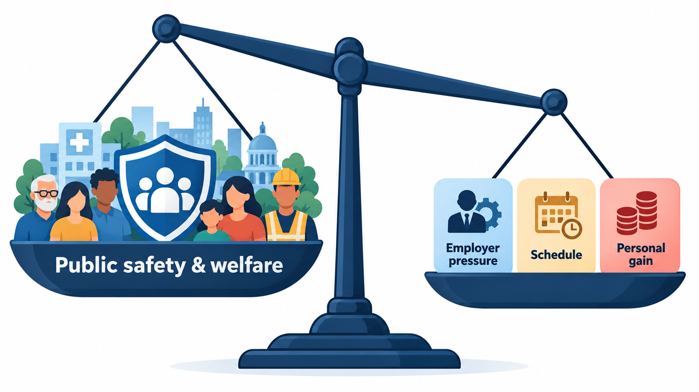
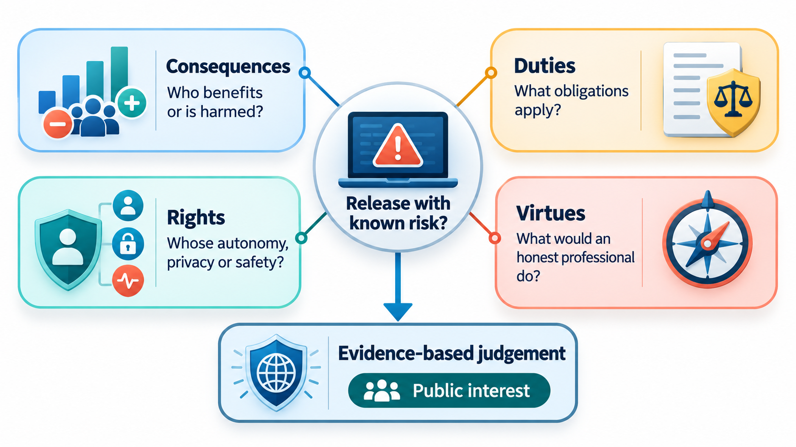
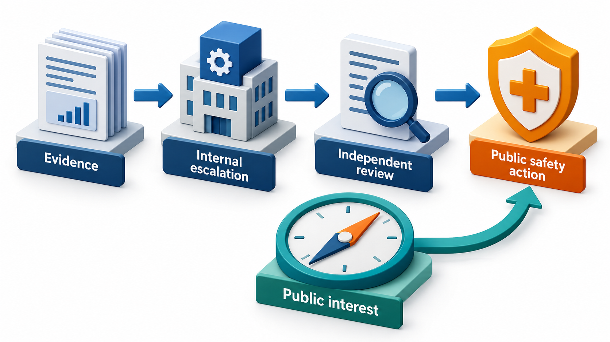
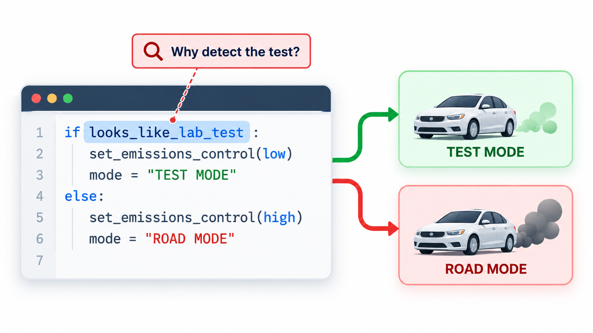
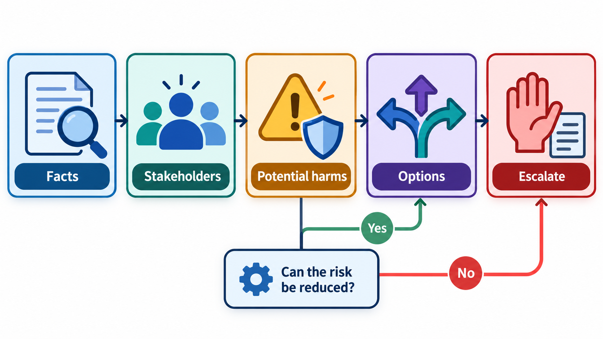

## Code Is Not Neutral

It is tempting to think of code as a neutral tool: the engineer builds what is specified, and responsibility lies with whoever decided what to specify. But code carries decisions that affect people's health, money, safety and freedom, and the person who writes it takes part in those decisions. An engineer who writes software that detects when a machine is being tested and makes it behave differently during the test has not simply followed instructions; they have written the deception, and the law and their profession treat the act as theirs.

**Professional ethics** is the set of principles that guide an engineer when the demands of an employer, a client or a deadline conflict with the interests of the people who will be affected. This topic sets out those principles and how they work in practice.

## Why Engineering Has a Code of Ethics

A profession differs from a trade in that its members hold knowledge that the public cannot judge for themselves, and so must trust. Patients cannot check a surgeon's skill, and passengers cannot inspect an aircraft's software. In return for that trust, professions commit themselves to standards that put the public's welfare first, even above the wishes of an employer. Doctors, lawyers and civil engineers have codes. Software engineers do too.

The two best known are the **ACM Code of Ethics and Professional Conduct**, first adopted in 1972 and revised in 1992 and 2018, and the **Software Engineering Code of Ethics and Professional Practice**, produced jointly by the ACM and the IEEE Computer Society in 1999. The second sets out eight principles, each with a number of detailed clauses. In summary:

| Principle | The commitment |
| --- | --- |
| **Public** | Act consistently with the public interest |
| **Client and employer** | Act in the best interests of client and employer, consistent with the public interest |
| **Product** | Ensure that products meet the highest professional standards possible |
| **Judgment** | Maintain integrity and independence in professional judgment |
| **Management** | Managers and leaders promote an ethical approach |
| **Profession** | Advance the integrity and reputation of the profession |
| **Colleagues** | Be fair to and supportive of colleagues |
| **Self** | Participate in lifelong learning and promote an ethical approach to the practice |

The order is deliberate. The **public interest comes first**. The 2018 ACM code puts the same idea in its opening principle: contribute to society and to human well-being, and avoid harm. When the interests of an employer and the public collide, the code says which wins.

<!-- Visual: A professional ethics balance prioritising public safety and welfare. -->

## A Real Case: Software That Detected the Test

In 2015 the world learned that Volkswagen had installed software in about 11 million diesel cars that detected when the car was being tested for emissions and made the engine behave differently during the test. An engineer who helped write it, James Liang, later pleaded guilty in a United States court and was sentenced to prison.

## What Ethical Questions Look Like in Practice

Engineers seldom face a dramatic choice. More often the ethical question arrives as something small and practical.

- A manager asks you to ship with a known safety defect to meet a deadline.
- A client wants a feature that collects data users have not agreed to share.
- You are asked to make a screen more persuasive in ways that trick users into paying.
- A test is failing, and the quickest way to a green build is to switch it off.
- You are asked to certify that a system has been tested when it has not.
- You notice a colleague's code contains a security flaw that has not been reported.
- A model you built works worse for some groups of people than others.

None of these announces itself as an ethical test. They come as ordinary pressures, and the easy path is to go along. The value of a code is that it gives you words for what you are being asked to do, and a position to argue from.

| Everyday request | The principle in play | A reasonable response |
| --- | --- | --- |
| "Ship it; we'll fix the safety bug later" | Public; Product | Document the risk, escalate, refuse to sign off |
| "Collect that data too, just in case" | Client and employer, within the public interest | Ask what purpose it serves; raise privacy concerns |
| "Make the cancel button hard to find" | Public; Judgment | Point out harm to users and legal risk; propose a fair design |
| "Turn off the failing test" | Product; Judgment | Find out why it fails; fix the code or test |
| "Write that it passed all tests" | Judgment; honesty | Report what was actually tested |
| "Don't mention the data leak yet" | Public; Client | Advise early disclosure as required by law and decency |

## A Defeat Device in Twelve Lines

Such behaviour can be written very plainly. Imagine an engine whose software decides what to do by looking at the driving pattern. If the car has no steering movement and follows the standard test speed profile, which is what a laboratory test looks like, it runs clean. Otherwise it runs dirty. The legal limit is 80 units of nitrogen oxide per kilometre.

| Situation | Emissions | Verdict |
| --- | --- | --- |
| Official lab test | 40 | Within the limit |
| Real road | 400 | Over the limit, five times |
| Lab test with a surprise: still no steering, but random speeds | 400 | Over the limit: the cheat is exposed |

The code itself is short and ordinary. Nothing in the syntax reveals the intent. What reveals it is a condition that treats test conditions differently from real ones, and a reviewer who asks why the software needs to know whether it is being tested. Honest software gives the same answer in all three; a different result under test is the red flag. The practical lessons are two. A reviewer or colleague who sees such a branch has a duty to ask about it. And tests that vary their conditions, rather than repeating a predictable routine, are harder to cheat.

## Frameworks for Thinking Through a Dilemma

When the right course is unclear, several ways of reasoning help. None gives a formula; together they make the discussion more complete.

| Lens | Question it asks | Applied to "collect extra user data" |
| --- | --- | --- |
| **Consequences** | Who benefits and who is harmed, and how much? | Small gain to the company; risk of leak to thousands of users |
| **Duties and rights** | What do I owe people, whatever the outcome? | Users have a right to know and to agree |
| **Fairness** | Are those affected treated justly? | Are users given a real choice? |
| **Character** | What would a person of integrity do? | Would I be comfortable explaining this to the users? |
| **Professional code** | What do the codes say? | Public interest first; privacy and honesty |
| **The newspaper test** | How would this look on a front page? | A headline about a data grab would be damaging |

## When You Disagree: A Path of Escalation

When an engineer is asked to do something they believe is wrong, the codes and the experience of whistle-blowers point to a sequence of steps.

1. **Get the facts straight.** Be sure of what is being asked and what the risk is. Write it down.
2. **Raise it with the person asking,** privately and calmly, with evidence. Often there is a misunderstanding, and often there is an alternative that meets the need safely.
3. **Escalate inside the organisation:** to a manager, a safety or compliance officer, an ethics hotline, a more senior leader. Keep a record.
4. **Refuse to take part,** if the matter is serious and unresolved. You may not be able to stop the project, and you are entitled to decline your own part.
5. **Go outside** as a last resort, to a regulator or the public, when there is a serious risk to people and the internal route has failed. This is **whistleblowing**. It carries serious risk to a career, and laws in many countries give some protection to those who report real dangers in good faith. Take advice before you do it.

<!-- Visual: evidence and escalation guiding action towards the public interest. -->

The decision to act is easier when it has been thought about in advance. An engineer who has asked beforehand "what would I do if asked to hide a safety problem?" is better prepared than one who meets the question for the first time under pressure.

## Honesty, Competence and Confidentiality

Three duties come up constantly.

<!-- Visual: a branch in a code listing labelled "if looks_like_lab_test" with a reviewer's hand raising a question mark beside it and a note "why does this code need to know it is being tested?". Save as images/156_the_suspicious_branch.png. -->

**Honesty.** Do not misrepresent what a system does, how well it has been tested or how long work will take. Report bad news early. Do not claim credit for what is not yours.

**Competence.** Take on only work you are qualified to do, or say so and get help. Keep learning. Do not certify what you have not verified.

**Confidentiality.** Respect what clients and employers tell you in confidence, and the privacy of the users whose data you handle. This duty is limited: it does not extend to concealing a danger to the public.

<!-- Visual: A structured path for making and escalating ethical decisions. -->

## Five Misreadings of Professional Ethics

**"I only wrote what I was told."** Following instructions does not remove responsibility. The Volkswagen engineer was convicted for work he did on instruction.

**"Ethics is a matter of personal opinion."** Professional codes set shared standards, including putting the public first.

**"If it is legal, it is ethical."** Law sets a minimum. Many harmful acts are legal, and some ethical acts are unwelcome to employers.

**"Ethical problems are dramatic."** Most are small, practical and easy to slide past. Notice them early.

**"Speaking up always ends careers."** Sometimes it carries a cost. Often a calm, evidence-based concern is welcomed. Know your options and your protections.
