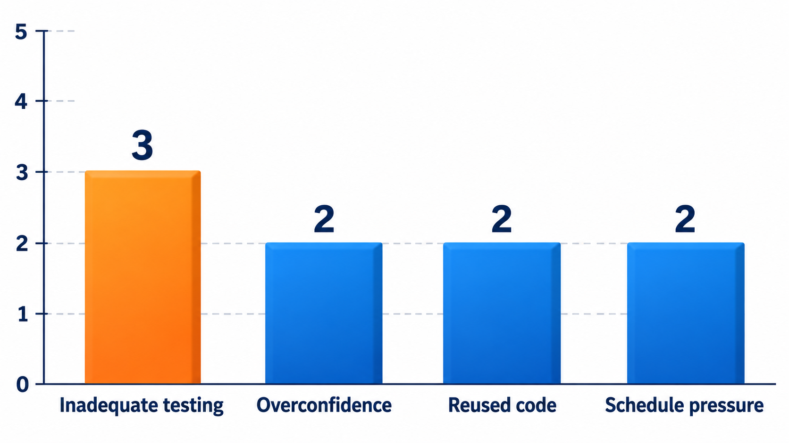
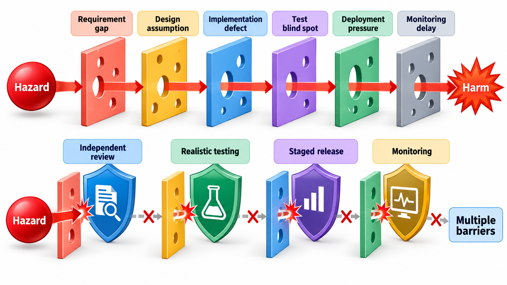
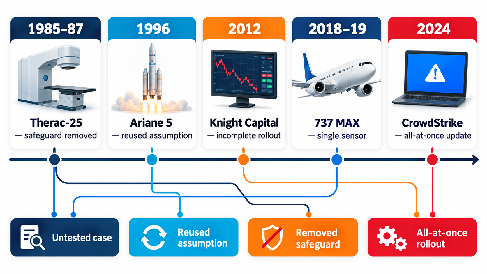
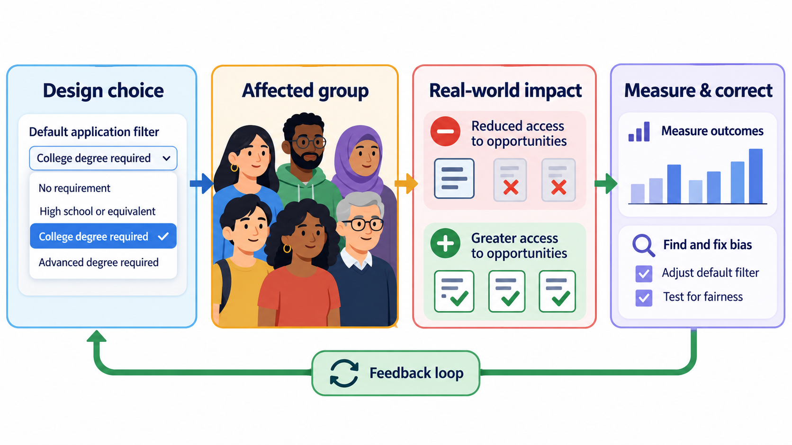
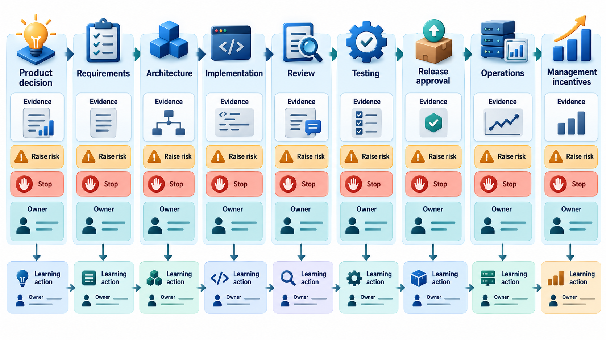

## Failures Repeat Because Their Causes Repeat

Studying failures is among the most valuable things an engineer can do. Mistakes are expensive to make for yourself, and the same causes recur across fields and decades: a safety check removed, a reused part whose old assumption no longer holds, a warning ignored, an update pushed to everyone at once. A failure of enormous scale can have a simple cause, and a simple cause is the easiest to learn from.

This topic tells five cases briefly, then looks for the patterns. The cases differ in field and decade, but their causes overlap, and the overlap is the lesson.

## Five Cases in Brief

**Therac-25 (1985 to 1987).** A radiation-therapy machine delivered massive overdoses to patients, several of whom died. An earlier model had hardware interlocks that would have stopped such overdoses; in this one they were removed, and the software was trusted instead. A timing fault (a race condition) let a fast operator edit trigger the wrong mode, and the machine reported only cryptic error numbers, so staff did not understand what had happened. Code was reused from earlier models without re-examining its assumptions.

**Ariane 5 (1996).** A rocket was lost about 37 seconds after launch. Guidance code reused from the earlier, slower Ariane 4 converted a large measurement into a small whole number. On the faster rocket the value no longer fitted, the conversion failed, and the failure shut down the guidance computers. The assumption that made the code safe had never been written down, and the code was never tested with the new rocket's flight path.

**Knight Capital (2012).** A trading firm installed new software on seven of its eight servers and missed the eighth. An old, unused test feature on that server was woken by a setting the new release reused, and it began sending unintended orders to the exchange. Alerts that arrived early were ignored, there was no clear procedure for switching the faulty server off, and an attempt to roll back made it worse. In about 45 minutes the firm lost roughly 440 million dollars.

**Boeing 737 MAX (2018 to 2019).** An automatic flight-control feature relied on a single sensor, pushed the nose of the aircraft down when that sensor gave a false reading, and was not explained adequately to pilots. Two aircraft crashed, killing 346 people. Investigations pointed to a single point of failure, inadequate testing of its failure, pressure on the schedule and poor communication with the people who had to fly the aircraft.

**CrowdStrike (2024).** A routine security update pushed to millions of Windows computers on 19 July 2024 contained a data file with 20 fields where the component reading it expected 21. The component read past the end of what it was given and crashed, and because it ran deep inside the operating system, it took the whole machine with it. About 8.5 million computers were affected, grounding flights and halting hospitals, banks and broadcasters. The update went to everyone at once, with no gradual rollout, and each machine had to be repaired by hand.

(The facts in these summaries are from public investigations and should be checked against the primary reports before use.)

| Case | Field | Harm | Immediate trigger |
| --- | --- | --- | --- |
| Therac-25 | Medical | Deaths and injuries from overdose | Race condition; removed hardware interlock |
| Ariane 5 | Aerospace | Loss of a rocket and its payload | A number too large for its storage |
| Knight Capital | Finance | About 440 million dollars lost in 45 minutes | One server left on old software |
| 737 MAX | Aviation | 346 deaths | Single-sensor dependence |
| CrowdStrike | General IT | About 8.5 million computers down | A malformed update file |

## Looking for Patterns

Tag each case with the factors that contributed, as the investigators found them (simplified here, and a judgement), then count how many cases share each.

| Factor | Cases it appears in | Count |
| --- | --- | --- |
| Inadequate testing | Ariane 5, Boeing 737 MAX, CrowdStrike | 3 of 5 |
| Overconfidence in software | Therac-25, Boeing 737 MAX | 2 of 5 |
| Reused code | Therac-25, Ariane 5 | 2 of 5 |
| Pressure on schedule | Boeing 737 MAX, CrowdStrike | 2 of 5 |

Several more factors appear in a single case, such as manual deployment, ignored alerts, a single sensor, no staged rollout or an unstated assumption. Inadequate testing appears in three of the five cases: one rocket was not tested with the new trajectory, one aircraft was not tested for a single-sensor failure with confused pilots, and one update file was not caught by the checks it passed through. Most of these causes are not technical in the narrow sense. They are about people, process and pressure. The count is rough, since five cases are a small sample. The value lies in the questions it raises for your own projects: have we tested the unusual case? Do we trust old code too much? Are we rolling out all at once?

<!-- Visual: a bar chart of how many of the five cases share each contributing factor, with inadequate testing as the tallest bar at three and several factors at two. Save as images/157_shared_factors_chart.png. -->

## Asking What Would Have Stopped Each

A useful exercise for a student is to name the cheapest defence that would have prevented each case.

| Case | A cheap defence that would have helped |
| --- | --- |
| Therac-25 | Keep the hardware interlock; test the software with fast, unusual operator input; clear error messages |
| Ariane 5 | State and check the preconditions of reused code; test with the new flight data |
| Knight Capital | Automated deployment with a check that every server has the same version; remove dead code; a tested kill switch |
| 737 MAX | Use two sensors and compare them; test the failure; train pilots and document the feature |
| CrowdStrike | Validate the file against its format before release; staged rollout to a small share of machines first |

Every entry costs a small fraction of the harm. That is the recurring shape of these cases: the defence was cheap, known and omitted.

## Lessons That Recur

- **Software is part of a system.** Hardware, people, procedures and regulators are all part of the failure, and part of the cure.
- **Assumptions need to be written down and re-examined.** Ariane 5 and Therac-25 both reused code whose limits were forgotten.
- **Test the unusual.** Failures happen at the boundaries and in combinations no one tried.
- **Do not remove independent safeguards.** The Therac-25's hardware interlocks and the 737's second sensor were exactly such protections.
- **Roll out in stages and be able to go back.** Knight Capital and CrowdStrike show what a single-step release costs.
- **Take warnings seriously.** Operators and engineers in several cases raised concerns that were dismissed.
- **Pressure is a hazard.** Deadlines and costs shaped decisions in many of these stories.
- **Learn in public.** The industries that study their failures openly, as aviation does, improve fastest.

<!-- Visual: a timeline from 1985 to 2024 with the five failures marked, each with a one-line cause and a shared set of recurring-theme icons beneath: untested case, reused assumption, removed safeguard, all-at-once rollout. Save as images/157_five_failures_timeline.png. -->

## How to Study a Failure

When you read a failure report, a consistent method makes the reading productive.

| Step | Question |
| --- | --- |
| 1. Timeline | What happened, in order, with times? |
| 2. Immediate cause | What technical event triggered the harm? |
| 3. Contributing factors | What conditions let it happen: design, testing, process, people, pressure? |
| 4. Missed chances | Where was it noticed or nearly noticed before the harm? |
| 5. Defences | Which safeguards existed, and why did they fail or not exist? |
| 6. Aftermath | What changed afterwards? |
| 7. Your own project | Where might the same pattern lie in what I am building? |

The last step is the point. A case study is useful only if it changes what you do on Monday.

## Responsibility Across the Chain

In each case, responsibility was spread across several parties, which is one reason failures are hard to prevent.

| Party | Their part | Example |
| --- | --- | --- |
| **Engineers** | Design, code, test | Reusing code without checking its limits |
| **Managers** | Schedule, budget, priorities | Pushing a deadline over safety concerns |
| **Organisation** | Culture, incentives | Rewarding speed and discouraging bad news |
| **Suppliers and partners** | Components and updates | A vendor update going to all customers at once |
| **Regulators** | Oversight, certification | Relying on the manufacturer's own assessment |
| **Users and operators** | Use, response | Pilots or staff without proper training or information |

A single person rarely causes a catastrophe. A chain of decisions, each reasonable in isolation, does. That is why the remedies are structural: independent checks, written assumptions, staged rollouts and cultures where concerns are heard.

## Five Misreadings of Failure Case Studies

**"It was one bug."** In each case, many factors lined up: the bug was one slice of cheese among several holes.

**"Those were careless teams."** They included experienced engineers at respected organisations. The same pressures act on any team.

**"It could not happen now."** The CrowdStrike failure is recent, and it repeats old patterns.

**"The software failed."** The system failed: software, hardware, process, people and oversight together.

**"We learn by being blamed."** We learn by understanding causes. The best case studies are written without blame.
