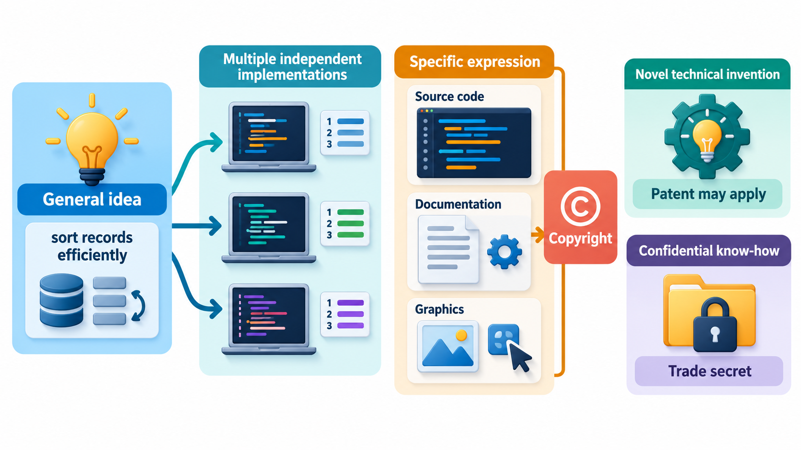
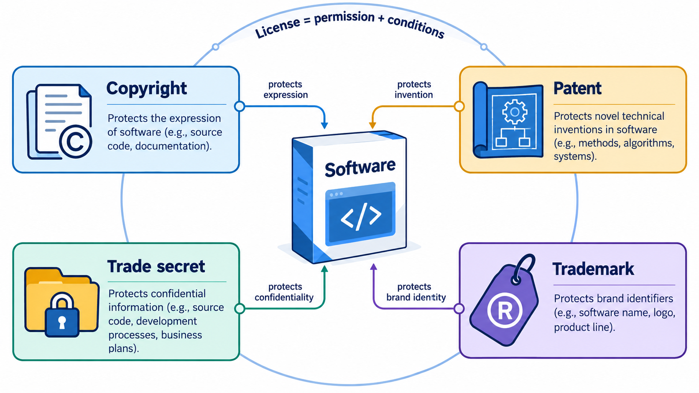
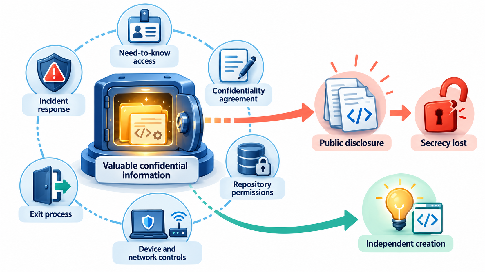
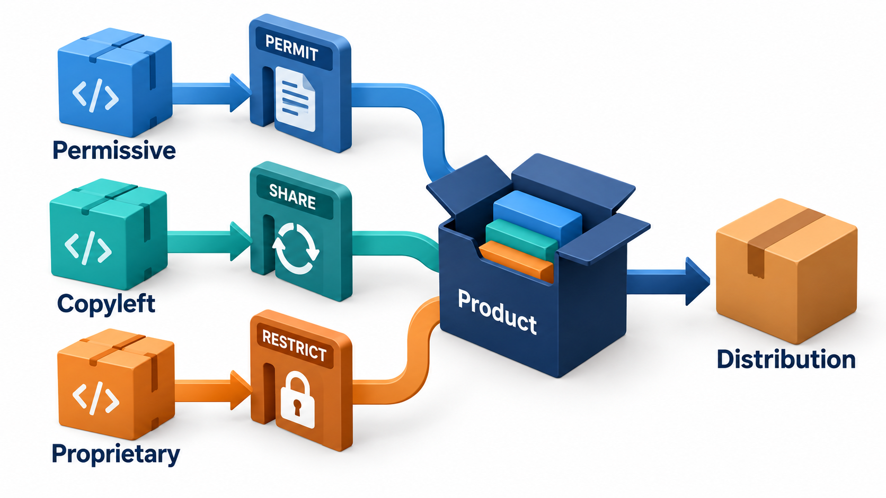
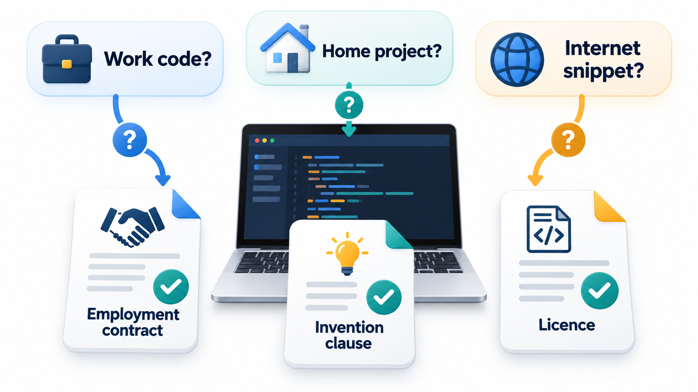

## Who Owns What You Write?

When someone writes code, who owns it? Can anyone copy it? What may be kept secret? What may an employee take to a new job? Even the names and arrangement of the functions that programmers call can become the subject of years of litigation, with consequences for every developer who writes software compatible with an existing interface.

Every software engineer works in the shadow of **intellectual property (IP)**: the legal rights that attach to creations of the mind. It decides who owns code, who may copy it, what may be kept secret and what an employee may take to a new job. This topic is a practical orientation, not legal advice, since the law differs from country to country and depends on the facts.

## Four Kinds of Protection

| Right | What it protects | How you get it | How long it lasts | Software example |
| --- | --- | --- | --- | --- |
| **Copyright** | The particular expression of an idea: the text of the code, documentation, images, a user interface's artwork | Automatically, when the work is created and fixed | In India and many countries, the author's life plus 60 years (for a company-owned work, 60 years from publication) | The source code you wrote |
| **Patent** | An invention: a new, useful, non-obvious method or machine | By applying, examination and grant | About 20 years from filing | A novel algorithm for data compression, in countries where such patents are allowed |
| **Trade secret** | Confidential business information that has value because it is secret | By keeping it secret and taking reasonable steps to protect it | As long as it stays secret | A company's unreleased source code, its recommendation algorithm |
| **Trademark** | Names, logos and signs that identify the source of goods or services | By use, usually strengthened by registration | Renewable indefinitely | The name and logo of a software product |

Notice what copyright does *not* protect: the underlying idea, method or function. If you write your own code to do what someone else's program does, you do not infringe their copyright, however similar the behaviour. This is why a clean-room reimplementation is lawful, and why the Oracle and Google case turned on how far an interface counts as expression.

## A Real Case: Who Owns an Interface?

In 2010 the software company Oracle sued Google, claiming that Google's Android system had copied part of the Java programming platform that Oracle had acquired. Android did not copy the working code. Google wrote its own. The dispute concerned the interface: about 11,500 lines of declarations, which name the functions that Java programmers call and describe how they are used, across 37 groups of related functions. Google had reproduced these so that programmers who knew Java could write Android applications without learning new names.

The case ran for more than a decade, through several trials and appeals. It raised two questions. Can an interface be protected by copyright at all? And if it can, is reusing it a fair use? The lower courts disagreed. In April 2021 the United States Supreme Court ruled in Google's favour, holding that its use was a fair use. The court did not decide the first question, so the status of interfaces in general was left open, and the decision is limited in its reach.

| Layer of a software product | Usually protected by |
| --- | --- |
| The source code as written | Copyright |
| An invention in how it works | Patent, if granted |
| The name and logo | Trade mark |
| Confidential methods and data | Trade secret and contract |
| The interface, as in this case | Unsettled, and varies between countries |

For a developer, the case is a reminder that who owns software is not obvious from who wrote it. Ownership depends on the contract, on the country and on what is being claimed. Intellectual property covers the rights over code, ideas, names and data, who has them and what others may do with them. The topic that follows explains each form, and the common situations, such as employment, freelance work and use of other people's code, in which they matter. It is a guide to the ideas, and a real dispute needs a lawyer.

## Choosing Between Them: An Example

Take a team that builds a fee-management product. Which protections attach to which parts?

<!-- Visual: copyright, patent, trade secret and trademark protections around software. -->

| Part of the product | Protection | Notes |
| --- | --- | --- |
| The source code | Copyright (automatic); trade secret if kept private | Copying the code is infringement; reimplementing the behaviour from scratch is not |
| The product's name and logo | Trademark | Register to strengthen the rights |
| A novel method for splitting a fee across scholarships | Possibly a patent, if technical and allowed in the country | Many software methods are not patentable in India |
| The customer list and pricing | Trade secret | Needs confidentiality measures |
| The user manual | Copyright | |
| The look of the screens | Copyright in graphics; sometimes design rights | Basic layouts are usually not protected |

## Software Patents: A Contested Area

Whether software can be patented varies. In the United States, patents on software-based inventions have been granted widely, though a 2014 Supreme Court decision (*Alice v. CLS Bank*) made it harder to patent abstract ideas simply by implementing them on a computer. Europe's patent system excludes "programs for computers as such" but allows patents on technical inventions that involve software. India's Patents Act, in section 3(k), excludes "a mathematical or business method or a computer programme per se or algorithms" from patentability, and the courts and patent office have refined the reach of that exclusion for inventions with a technical effect. Patent disputes can be costly, and many developers consider software patents harmful to innovation. Companies build portfolios partly as a defence against being sued.

## Who Owns the Code You Write?

For an engineer, the most immediate IP question is about their own work.

**Employees.** In most countries, including India under the Copyright Act, work created by an employee in the course of employment belongs to the employer unless the contract says otherwise. Your employment agreement will state this, often broadly: anything you create in the course of your job, and sometimes anything related to the employer's business, belongs to the company. Read the **invention assignment clause** before you sign.

**Moonlighting and side projects.** Many contracts restrict work for others, and some claim ownership of anything you build using company equipment, on company time, or related to the company's field. Doing a side project at home on your own laptop in an unrelated area is the safest. If in doubt, ask for written permission before you start, not after you have succeeded.

**Contractors and freelancers.** Here the default is often the opposite: the author owns the work unless the contract assigns it. A client who commissions software without a written assignment may find they own only a licence to use it.

**Students.** University rules vary. Work done as part of a degree may belong to the student, the university or a sponsor, depending on the policy and any funding.

**Open source contributions.** Contributing to a project involves a licence, and some projects require a **contributor licence agreement**.

| Your situation | Who usually owns the code | Check |
| --- | --- | --- |
| Employee, work done in the job | Employer | Employment contract |
| Employee, unrelated project at home on own equipment | You, unless the contract says otherwise | Moonlighting and assignment clauses |
| Freelancer for a client | You, until assigned in writing | Contract: assignment or licence |
| Intern | Usually the company; check | Internship agreement |
| Student project for a course | Varies by university | Institution policy |
| Contribution to an open-source project | You keep copyright but licence it to the project | The project's licence and contributor agreement |

## Protecting Your Employer's IP, and Your Own Conduct

- **Do not copy code** from a previous employer, a client, a website or a book without permission and a check of the licence. Reuse of copied code is a common source of lawsuits and embarrassment.
- **Do not bring confidential material** from one job to another. Trade secret law applies to former employees, and restrictions such as non-disclosure agreements continue after you leave.
- **Respect the licences** of the third-party code in your product.
- **Keep records** of your own original work, and of agreements about ownership.
- **Be careful with generated code.** AI coding assistants raise unsettled questions about ownership and about whether output may reproduce copyrighted code. Follow your organisation's policy.

<!-- Visual: intellectual property forming part of the engineer's working environment. -->

## Restrictions When Leaving a Job

Contracts often include limits that continue after employment ends.

| Restriction | What it covers | Typical enforceability |
| --- | --- | --- |
| **Non-disclosure agreement (NDA)** | Confidential information learned at work | Usually enforceable, for the stated period or as long as the information is secret |
| **Non-compete clause** | Working for a competitor for a period afterwards | Varies by country; in India, restraints after employment ends are generally unenforceable under section 27 of the Contract Act |
| **Non-solicitation clause** | Taking away clients or colleagues | Sometimes enforceable if reasonable |
| **Invention assignment** | Ownership of work done during employment | Enforceable according to its terms |

General skills and knowledge belong to you and go with you. Specific confidential materials, client lists and source code do not.

<!-- Visual: a developer's laptop with three questions in speech bubbles: who owns what I write at work, who owns what I write at home, and can I copy this snippet from the internet, each with an arrow to the paper that answers it: contract, contract and licence. Save as images/158_who_owns_the_code.png. -->

## A Quick Decision Guide

When a question about code ownership or copying comes up, a short sequence of questions usually points to the right step.

| Question | If yes | If no |
| --- | --- | --- |
| Did I write it entirely myself, from scratch? | Go to the next question | Check the source and its licence before using it |
| Did I write it as part of my job or using my employer's resources? | The employer probably owns it: check the contract | Go to the next question |
| Does my contract claim work related to the employer's business? | Treat related side projects as the employer's, or get written permission | You likely own it |
| Did I use someone else's code, text or images? | Confirm the licence allows it and that you give the credit it requires | Fine |
| Is any of it confidential to a client or former employer? | Do not use it | Fine |

If an answer is unclear, ask before acting. A short written permission from an employer or a licence check costs minutes. A dispute over ownership can cost years.
