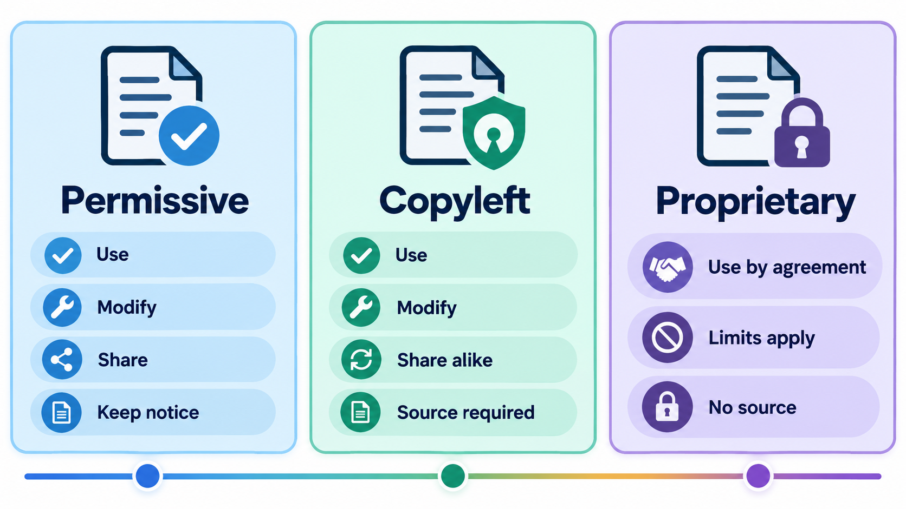
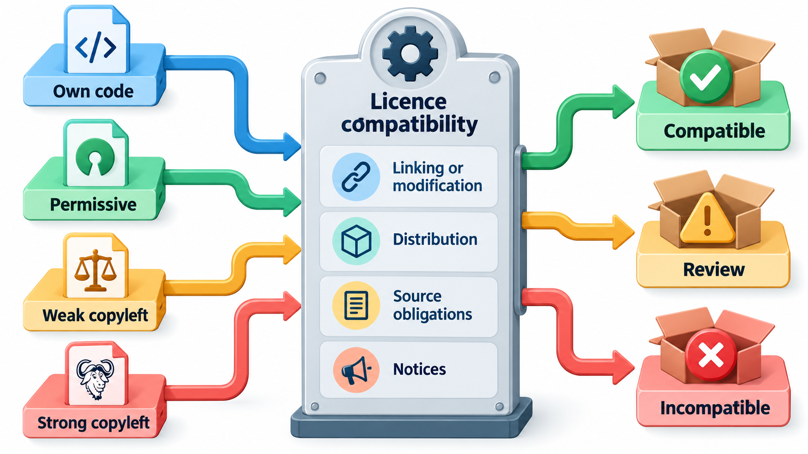
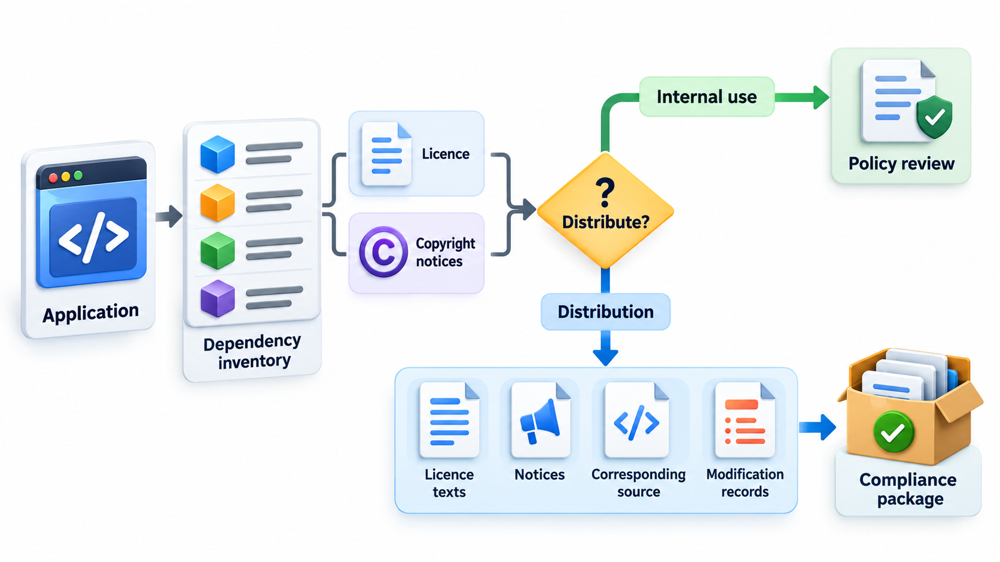
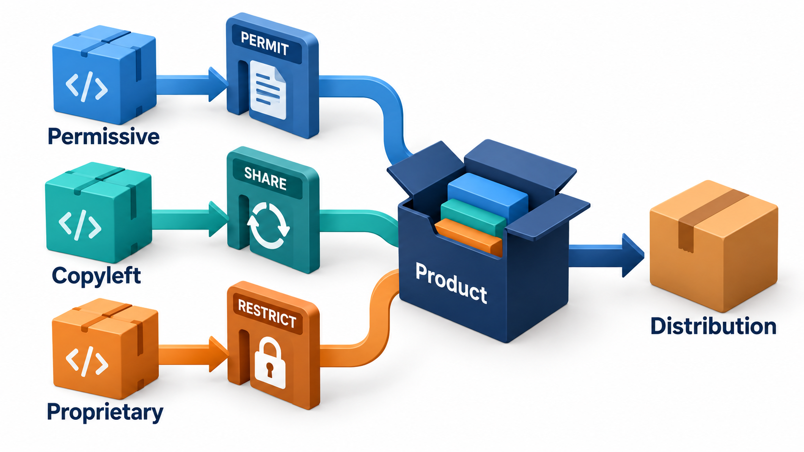
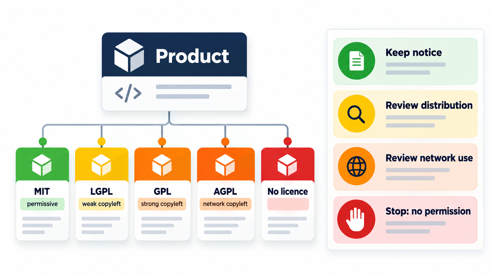

## A Licence Is Not a Technicality

Almost every program written today includes open-source components, and the licence of each one carries conditions. A licence decides who can build what on the work of others, and it can change: a project that began under a permissive licence, which lets anyone use, change and sell it, even inside a commercial service, may later adopt a stricter one. The community may then fork the last permissive version and carry on separately. Disputes like this cost everyone a lot.

**Open-source licences** are the legal permissions under which such code may be used. Knowing the basics keeps a product, and a career, out of trouble. This topic covers the main families (permissive and copyleft), what each requires, and how to check a product's dependencies.

## What "Open Source" Means

Code on the internet is protected by copyright by default, so that nobody may copy or change it without permission. A licence is that permission, with conditions. An **open-source licence** is one that meets the Open Source Definition of the Open Source Initiative: broadly, anyone may use, study, change and share the software, with no discrimination against persons or fields of use. The licences differ in what they ask in return.

They fall on a spectrum from the most permissive to the most demanding.

| Family | Examples | What it allows | What it requires |
| --- | --- | --- | --- |
| **Permissive** | MIT, BSD, Apache 2.0 | Use for any purpose, including in proprietary products; modify; distribute | Keep the copyright and licence notice. Apache 2.0 also grants a patent licence and requires a statement of changes |
| **Weak copyleft** | LGPL, MPL 2.0 | Use the library from proprietary code | Changes to the library itself must be shared under the same licence |
| **Strong copyleft** | GPL v2, GPL v3 | Use, modify, distribute | If you distribute the program, or a work based on it, you must provide the source under the GPL |
| **Network copyleft** | AGPL v3 | The same | Also applies if users interact with it over a network: you must offer the source to them |

**Copyleft** is the idea, pioneered by Richard Stallman and the Free Software Foundation, of using copyright to keep software free: anyone who builds on copyleft code must pass on the same freedoms. The GPL does this strongly. The Linux kernel is licensed under GPL version 2.

<!-- Visual: A comparison of permissive, copyleft and proprietary licences. -->

## A Real Case: A Licence Change and a Fork

In 2021 the company behind Elasticsearch, a widely used search engine, moved future versions from the permissive Apache 2.0 licence to a stricter licence meant to stop cloud providers offering it as a hosted service. Amazon responded by forking the last permissive version into a project called OpenSearch, and the two have developed separately since.

## Open Source, Free Software and Source-Available

The terms are used loosely, and the differences matter for what you may do.

| Term | Meaning | Example |
| --- | --- | --- |
| **Free software** | Software that respects four freedoms: to run, study, change and share it. A philosophy of the Free Software Foundation | GNU tools, the GPL family |
| **Open source** | Software under a licence meeting the Open Source Definition. A pragmatic label, coined in 1998 | MIT, Apache, GPL |
| **Source-available** | The source can be read, but the licence restricts use, such as stopping competing hosted services | The licences some database companies adopted after 2018 |
| **Proprietary** | Source is not shared; use is under a commercial agreement | Most commercial desktop software |
| **Public domain** | No rights reserved | Works whose copyright has expired, or dedicated by the author |

A source-available licence is not open source by the Open Source Initiative's definition, though code under it can be read and sometimes modified.

## Reading a Dependency List

The practical question for an engineer is whether the licences of the components in a product are compatible with how the product will be used. Check a list of dependencies for a product that is distributed to customers.

| Dependency | Licence | Family | Advice |
| --- | --- | --- | --- |
| fee-calc | MIT | Permissive | Fine: keep the copyright notice |
| pdf-maker | LGPL-3.0 | Weak copyleft | Usable if linked as a library; changes to the library itself must be shared |
| report-engine | GPL-3.0 | Strong copyleft | Caution: distributing it may require releasing our own code under the GPL |
| hosted-search | AGPL-3.0 | Network copyleft | Caution: offering it as a network service can also trigger source sharing |
| mystery-lib | None | None | Stop: with no licence we have no permission to use it |

The permissive library needs only that its copyright notice is kept. The GPL component is flagged: distributing a product that includes it may require releasing the whole product's source under the GPL. This is the "viral" effect critics describe, and what supporters see as the point. The AGPL one is flagged for services: if users reach it over a network, offering it counts as distribution for source-sharing purposes. The library with no licence at all is the strictest: without a licence, the default is "all rights reserved", and we have no permission. A real compliance tool reads licence information from the package files, builds this list for all of a product's dependencies, including the nested ones, and raises the cases that need review. Lawyers decide the hard ones.

## Licence Compatibility

Combining code under different licences is allowed only if the conditions can all be met at once.

| Combination | Possible? | Reason |
| --- | --- | --- |
| MIT code inside a GPL project | Yes | MIT is permissive; the combined work is under the GPL |
| GPL code inside an MIT project | Only if the whole becomes GPL | The GPL requires the combined work to be GPL |
| Apache 2.0 code inside a GPL v3 project | Yes | The licences are compatible |
| Apache 2.0 code inside a GPL v2 project | Not safely | Incompatible patent terms |
| GPL v2-only code with GPL v3-only code | No | The two sets of conditions conflict |
| Proprietary code linked with GPL code, then distributed | Generally not without releasing source | The GPL's reach extends to the combined work |

Questions like these are the reason companies keep a list of approved licences and review each new dependency before it is added.

## What You Must Do to Comply

Using open source is free of charge and not free of obligations. The common ones are:

- **Keep notices.** Preserve copyright and licence texts, often by shipping a file listing every component and its licence.
- **Provide source when required,** for copyleft code you distribute, in the way the licence specifies.
- **Pass on the same licence** for derived works under copyleft.
- **Record changes** where the licence demands it.
- **Do not use the names** of projects or authors to endorse your product.
- **Respect patent terms.** Apache 2.0 grants a patent licence and ends it if you sue over patents in the software.

The consequences of ignoring them are real. Companies have been sued by the authors of GPL code, such as the cases that forced Linksys in 2003 to release the source of its router firmware, which led to the OpenWrt project, and have had to pay settlements or open their code.

<!-- Visual: different software licences carrying different distribution obligations. -->

## Contributor Agreements

When you contribute to a project, you also need to say on what terms. Some projects require a **contributor licence agreement (CLA)**, in which you grant the project (or its steward company) the rights to use your contribution, sometimes including the right to relicense it. Others use the lighter **Developer Certificate of Origin (DCO)**, a statement added to each commit ("Signed-off-by") that you wrote the code or have the right to submit it under the project's licence. The Linux kernel uses the DCO. The distinction matters in cases like Elastic's: a company that holds the rights under a CLA can change the licence, and one that does not has to ask every contributor.

## Choosing a Licence for Your Own Project

If you release code, you should choose a licence, because without one nobody may legally use it. A rough guide:

- **MIT or Apache 2.0** if you want maximum adoption and do not mind commercial use of your code.
- **GPL** if you want improvements to come back to the community.
- **AGPL** if you want that to apply to hosted services as well.
- **Dual licensing** (a free copyleft licence plus a paid commercial one) is a business model some companies use.

Choose deliberately, and put the licence text in a `LICENSE` file at the top of the repository.

| If you want... | Consider |
| --- | --- |
| Others to use your code freely, even commercially, with credit | MIT |
| The same, plus an explicit patent grant | Apache 2.0 |
| Improvements to flow back when others distribute your code | GPL |
| Improvements to flow back even when used over a network | AGPL |
| A library that proprietary software can use, but changes shared | LGPL or MPL |
| Code to be as free as possible, no conditions | A public-domain dedication such as CC0 or the Unlicense |

<!-- Visual: a dependency tree for a product with each package tagged by licence colour, permissive green, weak copyleft yellow, strong copyleft orange and unlicensed red, with a summary list of items to review. Save as images/159_licence_tagged_dependency_tree.png. -->

## Five Misreadings of Open-Source Licences

**"Open source means no conditions."** Every licence has conditions, at least keeping the notice.

**"Open source is public domain."** The authors keep their copyright and grant permission on terms.

**"The GPL forbids commercial use."** It allows it, and asks that you share the source of what you distribute.

**"No licence file means it is free to use."** It means all rights are reserved. Ask the author, or avoid it.

**"Licences cannot change."** The owner can relicense future versions, as Elastic did. Existing versions stay under the licence they were released with.
