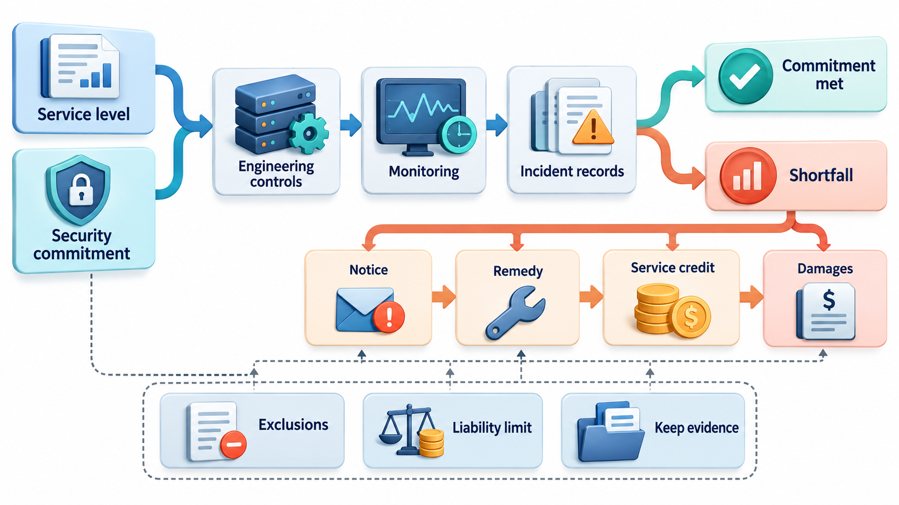
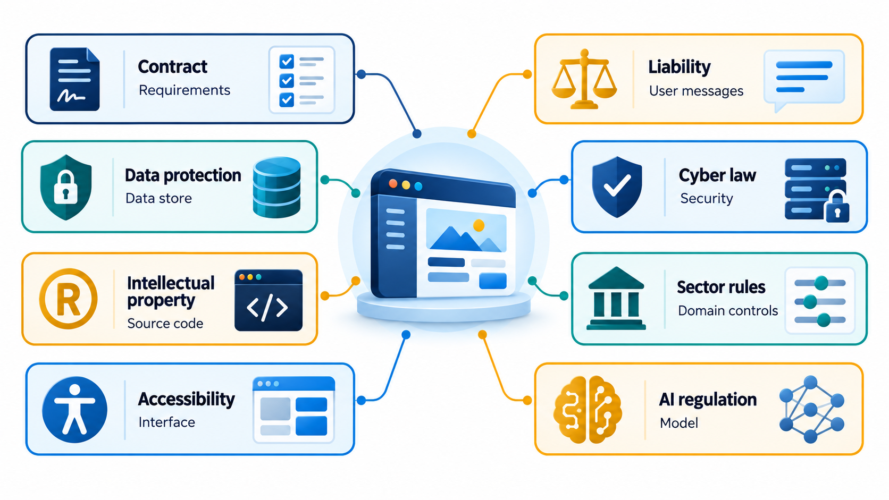
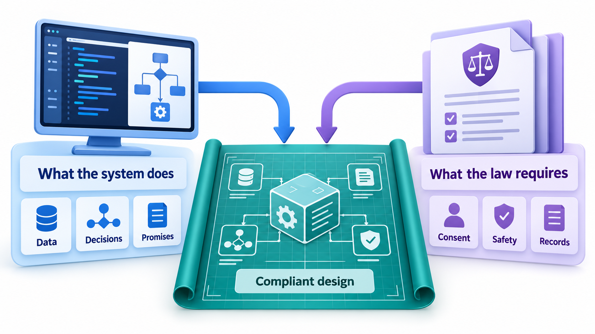
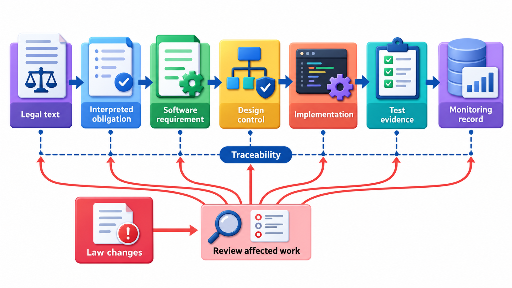
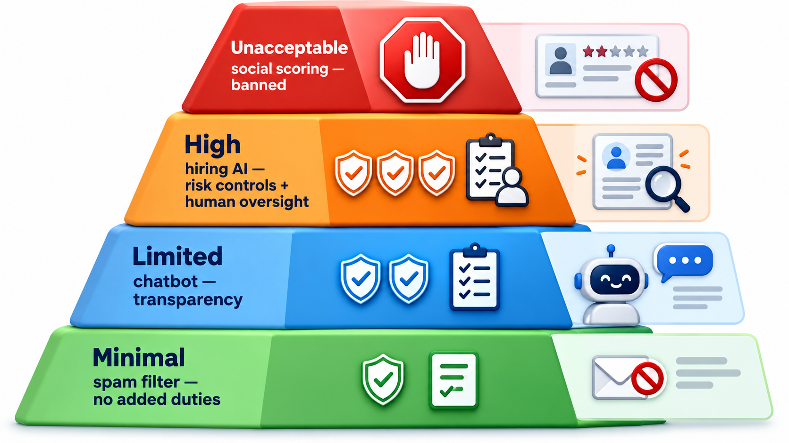

## Companies Cannot Disown What Their Software Says

Software now makes statements, takes decisions and handles money and data on behalf of organisations. A customer is told something wrong by an organisation's automated system; the organisation argues that the system is separate and responsible for its own actions. Courts have not accepted that argument: a company cannot disown what its software tells customers.

The law has been catching up. This topic gives a map of the legal ground that software engineers in India and many other countries most often cross: data protection, consumer protection, contracts, electronic transactions, and the first laws written specifically for artificial intelligence. It is an overview and not legal advice.

## Where the Law Touches Software

Several areas of law apply to what engineers build and how they build it.

| Area | What it governs | Examples |
| --- | --- | --- |
| **Contract law** | The agreements under which software is built and sold | Scope, price, delivery, warranties, acceptance, termination |
| **Liability and consumer protection** | Who pays when software causes harm or does not work | Defective products, misleading statements, service failures |
| **Data protection and privacy** | How personal data is collected and used | DPDP Act 2023 (India), GDPR (EU) |
| **Cyber law and computer misuse** | Unauthorised access, fraud and electronic records | Information Technology Act, 2000 (India) |
| **Intellectual property** | Ownership of code and its use | Copyright, patents, licences |
| **Sector regulation** | Rules for particular industries | Banking, insurance, health, aviation |
| **Accessibility and non-discrimination** | Equal access and fair treatment | Rights of Persons with Disabilities Act, 2016 |
| **AI regulation** | The development and use of AI systems | EU AI Act |

## A Real Case: The Airline's Chatbot

In 2024 a Canadian tribunal decided a case, Moffatt v. Air Canada, that was small in money and large in principle. A man whose grandmother had died asked the airline's website chatbot about bereavement fares. The chatbot told him he could buy a ticket at the full price and apply for a partial refund within ninety days after the journey. That was wrong. The airline's own policy, written elsewhere on its website, did not allow refunds for bereavement fares after travel. When the airline refused to pay, he took it to the tribunal.

The airline made an unusual argument: that the chatbot was a separate legal entity, responsible for its own statements. The tribunal rejected it, saying that the chatbot was part of the airline's website and that the airline was responsible for all the information on it, whether it came from a static page or a chatbot. It also said that the customer had no reason to check one part of the site against another. The airline was ordered to pay a little over 800 Canadian dollars in damages and fees.

| Question | The tribunal's answer |
| --- | --- |
| Is a chatbot a separate party? | No; it is part of the company's own service |
| Is the company responsible for what it says? | Yes, whatever produced the words |
| Must a customer check the answer against another page? | Not unreasonably |

The amount is trivial, and what matters is the approach. Courts and regulators are deciding that organisations that deploy software are answerable for what it does, including software whose answers they cannot fully predict. Software law and regulation covers contracts, liability, consumer protection, data protection and rules for particular sectors. The topic that follows describes the main areas and what a developer should know to raise the right questions early. It is an introduction, and real decisions need legal advice.

## India: The IT Act and Related Laws

The **Information Technology Act, 2000**, amended in 2008, is the main Indian law on electronic transactions and cyber offences. Among other things it gives legal recognition to electronic records and digital signatures, defines offences such as hacking and identity theft, makes organisations that handle sensitive data liable to compensate people if they fail to maintain reasonable security (Section 43A, added in 2008), and regulates intermediaries such as platforms. Its rules cover areas like content takedown and the handling of sensitive personal data. It is read together with the Digital Personal Data Protection Act, 2023, which is the central statute on personal data, as its rules bring it fully into effect. Sector regulators add their own requirements: the Reserve Bank of India sets rules for payment systems and bank outsourcing, the securities regulator for trading platforms, and so on.

| Law or regulator | Scope | A practical consequence |
| --- | --- | --- |
| **IT Act, 2000** | Electronic records, digital signatures, cyber offences, intermediaries | Hacking and data theft are offences; negligent handling of sensitive data can lead to compensation |
| **DPDP Act, 2023** | Personal data of individuals | Consent, purpose limitation, security safeguards, breach reporting |
| **Reserve Bank of India** | Payment systems, banks, fintech | Rules on storing payment data in India, outsourcing and incident reporting |
| **SEBI** | Securities markets and trading platforms | Technology risk and algorithmic trading controls |
| **Consumer Protection Act, 2019** | Goods and services, including e-commerce | Misleading claims, unfair terms and defective services are actionable |
| **Rights of Persons with Disabilities Act, 2016** | Equal access | Government and many services must be accessible |

## Contracts and Liability

Most software is built under a contract, and the contract decides a great deal.

- **Scope and acceptance.** What exactly is to be delivered, and how will it be judged complete? Vague scope leads to disputes. Acceptance criteria in the contract are the legal form of the requirements.
- **Warranties.** What does the supplier promise about quality, for how long?
- **Limitation of liability.** Contracts commonly cap the supplier's liability, often to the fees paid, and exclude certain kinds of loss. A court may refuse to enforce a cap in cases of gross negligence or fraud.
- **Intellectual property.** Who owns the result? What happens to the supplier's pre-existing tools?
- **Service levels.** Availability and response targets, and the credits owed if they are missed.
- **Termination and data return.** How the relationship ends, and who keeps the data.

Engineers are not lawyers, but their statements matter. Promising "it will be 99.99 per cent available" in an email, or telling a client that a feature "will definitely be done by March", can create legal expectations. Estimates should be labelled as such, and commitments should go through the people who are authorised to make them.

Liability for harm also depends on what kind of software and what kind of harm. Software that controls medical devices, vehicles or aircraft is regulated like the product it is part of. Consumer protection law in many countries makes sellers responsible for products that do not meet reasonable standards. As the Air Canada case shows, a company is generally held to what its systems say.

| Contract term | Why an engineer should care | Example |
| --- | --- | --- |
| Acceptance criteria | They define "done", and payment depends on them | "Results page loads in under 2 seconds for 95% of requests" |
| Service level credits | Missing availability costs money | 5% fee credit for each 0.1% below 99.9% |
| Liability cap | Limits the supplier's exposure | Capped at 12 months' fees |
| Warranty period | Free fixes for a time after delivery | 90 days for defects |
| Change control | Extra work is paid for | Written approval for scope changes |
| Data return | What happens to the client's data at the end | Export in a common format within 30 days |

## Regulating AI: The EU AI Act

The **EU Artificial Intelligence Act**, which came into force in August 2024 with its obligations phasing in over the following years, is the first comprehensive law on AI. It takes a **risk-based approach**: the greater the potential harm of an AI system, the stricter the rules.

- **Unacceptable risk** systems are banned: for example, social scoring of people by public authorities, and certain manipulative or exploitative practices.
- **High-risk** systems are allowed under strict conditions. They include AI used in hiring, education and exam assessment, credit decisions, essential services, law enforcement and some safety components. Providers must have risk management, good-quality data, documentation, logging, human oversight and accuracy and security standards, and must pass a conformity assessment.
- **Limited-risk** systems carry transparency duties. People must be told when they are dealing with a chatbot, or looking at synthetic media.
- **Minimal-risk** systems, such as spam filters, are not further regulated.

A teaching sketch of the idea assigns example uses to a tier.

<!-- Visual: a table of the areas of law that touch software, contract, liability, data protection, cyber law, intellectual property, sector rules, accessibility and AI, each linked by a line to the part of an engineer's day that it affects. Save as images/160_law_map.png. -->

| Use | Tier | Duty |
| --- | --- | --- |
| Government social scoring of citizens | Unacceptable | Banned |
| CV screening for hiring | High | Strict duties: risk management, data quality, human oversight, logging, conformity assessment |
| Exam proctoring that grades students | High | The same strict duties |
| Customer-service chatbot | Limited | Transparency: tell people they are dealing with an AI |
| Spam filter | Minimal | No specific duties |

The shape is the point: a *graded* set of duties tied to potential harm, not one rule for all software. A team building a hiring tool for use in Europe would need risk management, logging and human oversight from the start, and not added at the end. This is illustrative only: real classification depends on the exact text of the law and on legal advice. Other countries are developing their own approaches, and India has been consulting on AI governance.

<!-- Visual: an engineer and a lawyer on either side of a table, with a card in the middle reading what the system actually does, in plain words, and a second card reading what the law requires, with arrows meeting at the design. Save as images/160_engineer_and_counsel.png. -->

## Turning Legal Duties into Engineering Tasks

Legal rules are not engineering requirements until someone translates them.

| Legal duty | Engineering task |
| --- | --- |
| Obtain consent and allow withdrawal | A consent record per purpose; a withdraw button that stops processing |
| Protect personal data with reasonable security | Encryption, access control, logging, regular patching |
| Report breaches within a set time | Detection, an incident process, contact lists, ready templates |
| Delete data when the purpose ends | Retention settings and deletion jobs that also cover backups |
| Be accessible | WCAG AA checks in the pipeline |
| Keep records for audit | Immutable logs, retention policy |
| Human oversight of high-risk AI | A review step with authority to override, and training |
| Tell users they are dealing with AI | A clear label in the interface |

## What Engineers Should Do

- **Know the rules for your domain.** A payments engineer, a health-app developer and a game developer face different laws.
- **Design for compliance.** Logging, access control, data deletion and consent handling are easier to build in than to add.
- **Keep records.** Decisions, test results and approvals are evidence if something goes wrong.
- **Be careful what you promise,** in contracts, in documents and in what your software says to users.
- **Involve legal and compliance people early,** and learn to explain technical facts clearly to them.
- **Ask when unsure.** A short question to counsel costs less than an investigation.

<!-- Visual: four stacked tiers of a pyramid labelled unacceptable, high, limited and minimal risk, with the duties growing from the base to the top and an example use beside each tier. Save as images/160_ai_risk_pyramid.png. -->

