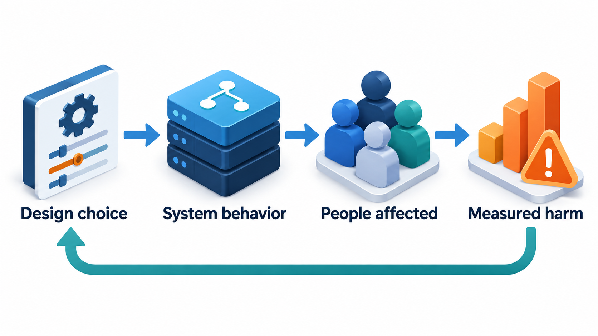
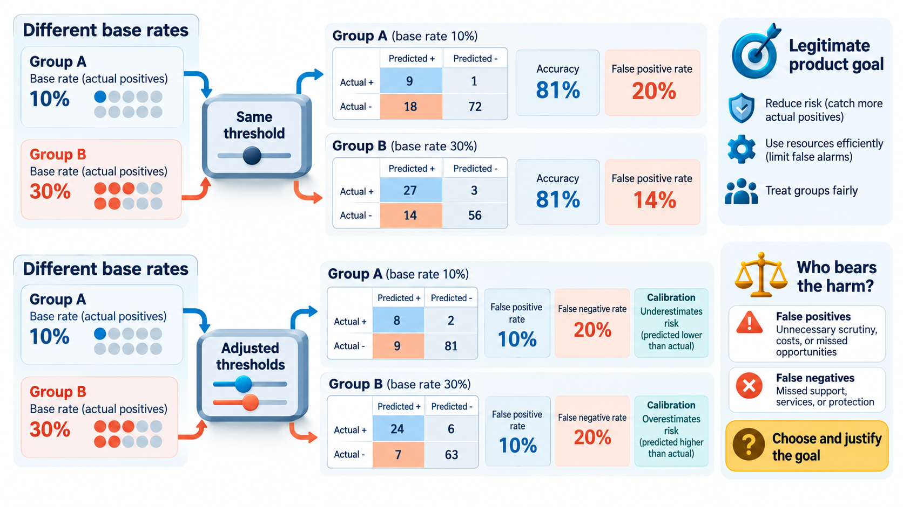
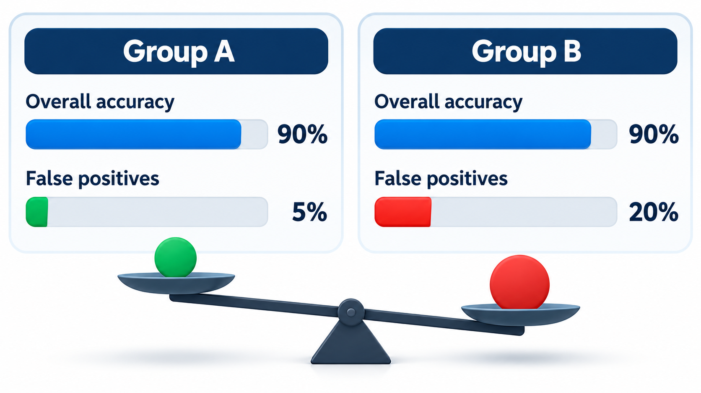
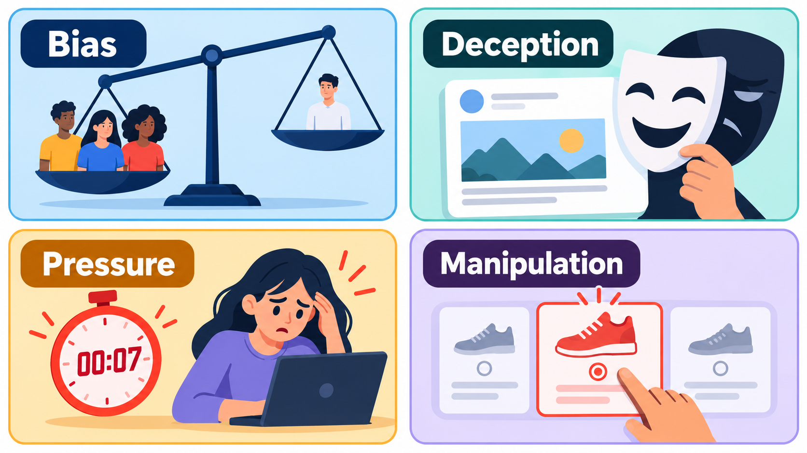
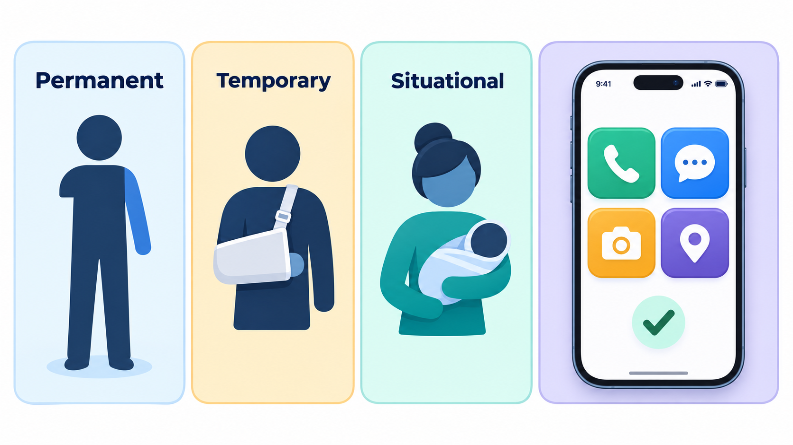

## Fair by Which Definition?

When a computer program is consulted on decisions about bail, loans, jobs, benefits or admissions, its mistakes can fall unevenly on different groups of people. A system can be equally accurate for two groups and still make its mistakes of one kind far more often for one group than the other. Both statements can be true at once: researchers have shown mathematically that when the underlying rates differ between groups, it is impossible for a prediction system to satisfy every reasonable definition of fairness at the same time.

Choosing which kind of fairness to prioritise is not a technical question with a technical answer. It is a decision about values, with consequences for real people. This topic is about the part of software engineering that is hardest to test for: whether a system treats people fairly, and what its wider effects are on society.

## Where Bias Comes From

A system can treat people unfairly even if nobody intended it. The unfairness can enter at many points.

| Source | How it arises | Example |
| --- | --- | --- |
| **Historical bias** | The data records an unfair world | A hiring model trained on past hires copies past discrimination |
| **Sampling bias** | The data does not represent everyone who will use the system | A speech system trained mostly on one accent works poorly for others |
| **Measurement bias** | What is measured is a poor stand-in for what matters | Arrests used as a proxy for crime, when policing is uneven |
| **Label bias** | The "right answers" were assigned by people with prejudices | Tagging of photos or text |
| **Aggregation bias** | One model for groups that behave differently | A medical model tuned on one population, applied to another |
| **Feedback loops** | The system's output changes the data it learns from | More patrols in a district produce more recorded crime, which justifies more patrols |
| **Deployment mismatch** | The system is used in a different context from the one it was designed for | A tool built to assist is treated as the decision |
| **Design and interface choices** | Who the system is built for, in what language, with what assumptions | A form requiring a surname and a first name |

It is not only about machine learning. Rule-based software encodes the assumptions of its authors, and a form that cannot hold a name with one word, or an address with no street number, excludes people as surely as a biased model.

<!-- Visual: how a design choice can affect people and create a measurable harm feedback loop. -->

## A Real Case: Two Claims About One Score

In 2016 the news organisation ProPublica published an analysis of COMPAS, a score used in courts in parts of the United States to estimate how likely a defendant was to commit another crime. Judges used scores like it when deciding about bail and sentences. ProPublica collected the scores given to thousands of defendants in one county in Florida and compared them with what happened in the next two years.

They found a pattern in the errors. Among defendants who did not go on to reoffend, about 45 per cent of Black defendants had been labelled high risk, compared with about 23 per cent of white defendants. Among those who did reoffend, white defendants were more often labelled low risk. The errors, in other words, fell differently on the two groups. The company that made the score, then called Northpointe, replied that the analysis had used the wrong test. By its measure, a given score meant about the same chance of reoffending whatever the person's group, so the score was fair.

Both claims were correct about the numbers, and researchers afterwards showed why. When the two groups have different rates of the outcome in the data, as they did here, it is mathematically impossible to satisfy both kinds of fairness at once, except in special cases.

| Fairness claim | What it requires | Who it favours in this case |
| --- | --- | --- |
| Equal error rates | The same share of wrongly flagged people in each group | Defendants who did not reoffend |
| Equal meaning of a score | The same chance of the outcome for the same score | Those relying on the score to predict |

The case teaches that fairness is not a single property that a system either has or lacks. Someone has to choose which definition applies to which decision, and that is a human and public choice, not a technical default. Fairness and societal impact is about asking who is affected by software and how, measuring the differences, and being open about the trade-offs made. The topic that follows describes the questions to ask and the practices that help.

## Measuring Unfairness

Because fairness has more than one meaning, teams measure several things and look at them together. Common ones are:

- **Accuracy by group.** Is the system equally right for each group?
- **False positive rate by group.** Of the people who should *not* have been flagged, how many were wrongly flagged?
- **False negative rate by group.** Of those who should have been flagged, how many were missed?
- **Selection rate by group.** What share of each group gets the favourable outcome?
- **Calibration.** Does a score mean the same thing for every group?

Take sixteen invented records from two groups, eight people each, to show what a comparison of this kind looks like. A model flags each person as high risk or not; we know whether they actually reoffended.

| | Group A | Group B |
| --- | --- | --- |
| Flagged, and did reoffend | 2 | 2 |
| Flagged, but did not reoffend | 1 | 3 |
| Not flagged, but did reoffend | 2 | 0 |
| Not flagged, and did not reoffend | 3 | 3 |
| Overall accuracy | 5 of 8, 62.5% | 5 of 8, 62.5% |
| Wrongly flagged among those who did not reoffend | 1 of 4, 25% | 3 of 6, 50% |

Both groups have an overall accuracy of 62.5 per cent. Looking only at that number, the model seems to treat them alike. The false positive rates differ sharply: a person in group B who would never reoffend is twice as likely to be labelled high risk. This is the shape of the real finding in miniature: equal accuracy hides unequal burden. The data are invented, and the point is the method. Measuring by group is the first step in finding such a gap, and deciding what to do about it is a further, human step.

## Why the Definitions Conflict

The same table shows why no model can satisfy every fairness definition. Compare two natural definitions on the invented data.

| Definition | Group A | Group B | Satisfied? |
| --- | --- | --- | --- |
| **Equal accuracy** | 62.5% | 62.5% | Yes |
| **Equal false positive rate** | 25% | 50% | No |
| **Equal selection rate** (share flagged) | 3 of 8 = 37.5% | 5 of 8 = 62.5% | No |
| **Equal precision** (of those flagged, share who reoffended) | 2 of 3 = 67% | 2 of 5 = 40% | No |

Fixing one gap tends to open another, particularly when the real reoffending rate differs between the groups (here 4 of 8 in A and 2 of 8 in B). A team cannot make all four equal at once. It must choose which matters most in the setting, and say why.

## What to Do About It

There is no single fix, and the practices fall into three groups.

**Before building.** Ask whether an automated system is appropriate at all. Who will be affected, including people who never use it? What could go wrong for them? Involve those people, or people who represent them, in the design. Use an **impact assessment**, a structured review of risks and benefits to different groups, written before the system is deployed and revisited after.

**While building.** Examine the data: who is in it, who is missing, how were the labels made. Test performance by group, and slice by the groups that matter in the context. Choose the fairness measure deliberately and record why. Where possible, use techniques that reduce disparity, such as better data, re-weighting or constraints, while being honest about the trade-offs. Keep humans in the loop for decisions that matter, with real authority to override and the time to do so.

**After deploying.** Monitor outcomes by group in production, since the world changes. Give people a way to contest a decision and to get an explanation. Plan for what happens when a problem is found: who can turn the system off?

| Stage | Practice | Output |
| --- | --- | --- |
| **Plan** | Impact assessment; consultation with affected groups | A written assessment and a decision on whether to build |
| **Data** | Data documentation: sources, gaps, label process | A "datasheet" for the dataset |
| **Model** | Evaluation by group; choice of fairness measure | A "model card" listing performance by group and known limits |
| **Deploy** | Human oversight; appeals process | Documented procedures and trained reviewers |
| **Operate** | Monitoring of outcomes by group; periodic audit | Reports and thresholds that trigger review |

## Societal Impact Beyond Fairness

Fairness is one aspect of a wider question. Software at scale changes behaviour and institutions.

<!-- Visual: two groups of people with a bar each for overall accuracy (equal) and false positive rate (unequal), with a caption "the same system, two different pictures". Save as images/161_equal_accuracy_unequal_errors.png. -->

- **Attention and wellbeing.** Engagement-driven designs can encourage compulsive use, particularly among young people.
- **Misinformation and manipulation.** Recommendation systems can amplify falsehoods and outrage because they attract attention.
- **Labour.** Automation changes jobs, and platform work changes the relation between workers and employers.
- **Privacy and surveillance.** Systems that collect data about people enable monitoring that was not possible before.
- **Access.** Who can use a service, in what language, on what device, at what cost?
- **Concentration of power.** A few platforms mediate a great deal of public life.
- **Environment.** The energy and materials used by computing.

No single engineer controls any of these. But engineers make the design choices that add up to them, and are often the first to see a problem. Asking "who could this harm, and how would we know?" is part of the job.

<!-- Visual: four common forms of software harm: bias, deception, pressure and manipulation. -->

## Inclusive Design

The positive side of the same concern is **inclusive design**: designing for the full range of people who will use the product, including those at the edges, and not for an imagined average. It brings disabled users, people with low literacy, speakers of other languages and users of older devices into the process. It treats a barrier as a defect in the design and not as a failing of the user. Its advantages are practical: products that work for the widest range of people are used by more of them.

<!-- Visual: one-handed interaction supporting permanent, temporary and situational needs. -->

