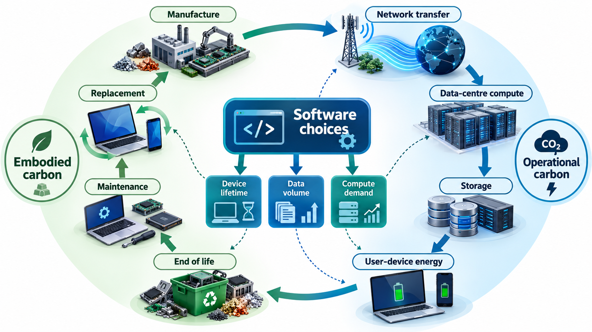
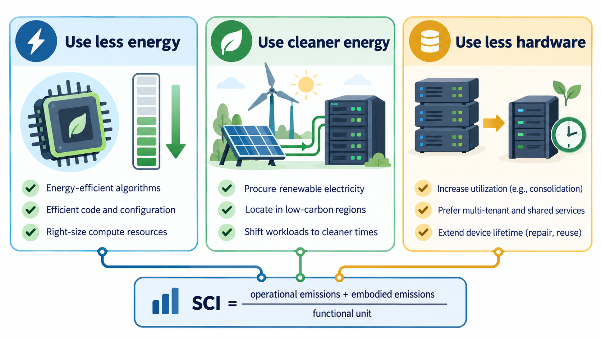
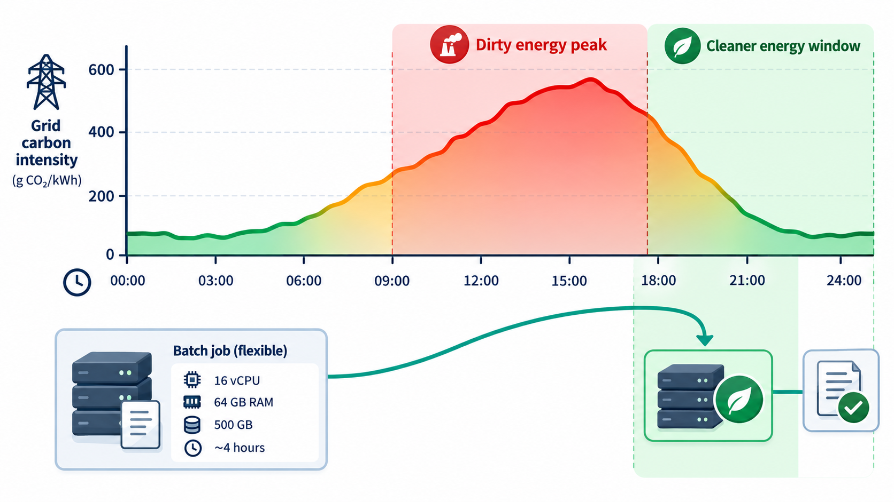
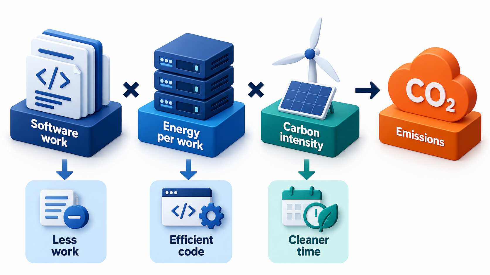
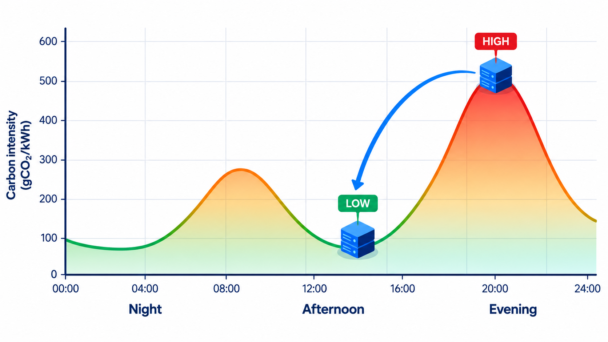

## Every Click Draws Power

When someone presses a button in an app, a chain of machines goes to work: the phone, the radio network, routers, a data centre with thousands of servers, cooling systems to keep them from overheating and the power stations behind them. Electricity is used at each step, and data centres together use somewhere around one to one-and-a-half per cent of the world's electricity, a figure that is growing as cloud services, video and artificial intelligence expand.

Electricity use becomes carbon emission to the extent that it is generated from fossil fuels. The carbon cost of the same computation can differ several times over between a grid powered largely by coal and one powered largely by hydro or solar, or between the middle of a cloudy night and a windy afternoon. Software engineers rarely see these numbers. But the choices they make, how much work the code does, where and when it runs, how long data is kept, decide how much energy is used.

**Sustainable software engineering** is the practice of building and running software so as to minimise its environmental impact, while still meeting its purpose. It is a young field, with a few well-defined ideas that already help. This topic covers the main ones, and a simple way of measuring.

## Where the Impact Comes From

Two kinds of carbon emission are associated with software.

- **Operational carbon:** the emissions from the electricity used to run the software, in devices, networks and data centres.
- **Embodied carbon:** the emissions from making the hardware in the first place: mining, manufacturing and shipping the servers, phones and laptops. For devices that are replaced every few years, this is large, and for phones it is often the larger share.

Both matter. Reducing the energy used helps the first, and making hardware last longer and use it fully helps the second.

| Part of the chain | Operational impact | Embodied impact |
| --- | --- | --- |
| **User devices** | Battery charging; screen and processor use | Manufacture of phones and laptops: often the largest part of a device's footprint |
| **Networks** | Energy to carry data | Cables, towers, routers |
| **Data centres** | Servers, storage and especially cooling | Building the servers and the facility |
| **Development** | Build servers, test runs, developer machines | Laptops and build farms |
| **AI training and use** | Large amounts of computation | Specialised processors |

## Where Waste Hides

Software wastes energy in recognisable ways.

| Source of waste | Example | Remedy |
| --- | --- | --- |
| **Idle resources** | Servers left running at 5% load overnight | Scale down; shut down unused environments |
| **Repeated work** | The same report regenerated for every request | Cache the result |
| **Needless data movement** | A page that downloads 5 MB of images to show a thumbnail | Compress and resize |
| **Polling** | An app that asks "anything new?" every second | Push notifications or longer intervals |
| **Over-provisioning** | Large servers chosen "to be safe" | Measure and right-size |
| **Inefficient algorithms** | A quadratic search over a large list | Better algorithm |
| **Forgotten data** | Years of unused logs and test data | Retention limits |
| **Always-on test environments** | Staging running 24 hours a day | Start on demand |

## Three Levers

The Green Software Foundation, an industry group, describes three principles for reducing the carbon intensity of software.

| Lever | The idea | Examples |
| --- | --- | --- |
| **Energy efficiency** | Use as little electricity as possible to do the job | Efficient algorithms, less data moved, caching, compressing images, avoiding needless polling, smaller models |
| **Hardware efficiency** | Use as little hardware as possible, and keep it busy | Right-sizing servers, higher utilisation, supporting older devices, running on shared infrastructure |
| **Carbon awareness** | Do more when the electricity is clean, and less when it is dirty | Scheduling flexible jobs for windy or sunny hours, running in regions with cleaner grids |

<!-- Visual: the three levers of green software and the software carbon intensity formula. -->

## Measuring: The Software Carbon Intensity

To improve something it helps to measure it. The Green Software Foundation defined the **Software Carbon Intensity (SCI)**, a score of the carbon emitted for each unit of work the software does. It became an international standard, ISO/IEC 21031, in 2024. The formula is:

**SCI = ((E × I) + M) per R**

where **E** is the energy used by the software (in kilowatt-hours), **I** is the carbon intensity of the electricity (grams of CO₂ per kWh), **M** is the share of the hardware's embodied carbon attributed to this work, and **R** is the functional unit: what you measure per, such as per user, per transaction or per report. The score is a rate, so that a service that grows can still show whether it is getting better.

The Software Carbon Intensity measure adds up the carbon of the electricity used (energy multiplied by the grid's carbon intensity) and the embodied carbon of the hardware, per unit of work. Apply it to a batch job that produces 1,000 reports, using half a kilowatt-hour of energy and 20 grams of embodied carbon, run at four different times of day on a grid whose carbon intensity varies.

| Time of run | Grid carbon intensity (g of CO2 per kWh) | Job emits | Per report |
| --- | --- | --- | --- |
| 02:00 | 300 | 170 g | 0.17 g |
| 09:00 | 650 | 345 g | 0.345 g |
| 13:00 (solar plentiful) | 280 | 160 g | 0.16 g |
| 19:00 (evening peak) | 720 | 380 g | 0.38 g |

The energy and embodied carbon are the same for every run, because the code and the work are identical. The job emits 160 grams if run at 1 p.m. and 380 at 7 p.m., more than twice as much, for exactly the same work. Nothing about the code changed; only the moment of running did. A report that no one needs before the next morning could wait for the cleanest hours. That is carbon awareness. The grid figures are illustrative. Real values come from services that publish the carbon intensity of the grid for each region and hour, and schedulers can use them automatically.

## Improving the Score by Reducing Energy

The same formula shows the effect of making the code more efficient. Suppose the report job is rewritten so that it caches a lookup and uses half the energy: 0.25 kWh instead of 0.5. Run again at 19:00 (720 g per kWh).

| Version | Energy | Electricity carbon | Embodied share | Total | Per report |
| --- | --- | --- | --- | --- | --- |
| Original at 19:00 | 0.5 kWh | 360 g | 20 g | 380 g | 0.38 g |
| Efficient at 19:00 | 0.25 kWh | 180 g | 20 g | 200 g | 0.20 g |
| Efficient at 13:00 | 0.25 kWh | 70 g | 20 g | 90 g | 0.09 g |

Halving the energy nearly halves the total, and combining it with a cleaner time cuts the footprint by over three quarters (from 380 grams to 90). The two levers multiply.

<!-- Visual: A flexible workload scheduled into a cleaner-energy window. -->

## What Developers Can Do

Many practical steps are both green and cost-saving, because energy is money.

- **Do less work.** Avoid unnecessary computation, polling and repeated work. Cache results. Send only the data that is needed.
- **Choose efficient algorithms** and data structures. An algorithm that is a hundred times faster uses about a hundred times less energy. The earlier guidance, to measure first and to fix the biggest costs, applies.
- **Reduce data.** Compress images and video, use modern formats, limit the size of web pages, delete data that is no longer needed. Storing data costs energy for as long as it exists.
- **Right-size infrastructure.** An idle server still uses a large share of its peak power. Switch off what is unused, scale with demand, and use shared platforms where machines are kept busy.
- **Be carbon-aware.** Schedule deferrable work, such as batch jobs, backups and model training, for cleaner times and places.
- **Choose regions and providers with cleaner power,** where latency and law allow.
- **Think about the user's device.** Heavy pages and apps drain batteries and push people to replace devices sooner. Supporting older phones lengthens their life.
- **Use smaller models.** For many tasks, a small AI model is enough and uses a fraction of the energy.
- **Measure.** Track energy and carbon alongside cost and performance.

<!-- Visual: less work, efficient code and cleaner energy reducing software emissions. -->

## Trade-offs and Honesty

Sustainability competes with other goals. Carbon-aware scheduling delays work. Higher efficiency costs development time. Some savings are small compared with the effects of the choices made by whole organisations about hardware and energy. And claims of "green" software need to be honest: measure, state what is included and avoid exaggeration. A website that shaves a few kilobytes while its sister service trains a huge model has not changed much. The goal is to make sustainability a normal quality attribute, considered in design alongside performance and security.

| Trade-off | The tension | A balanced approach |
| --- | --- | --- |
| Delay vs freshness | Waiting for clean power delays results | Defer only jobs that can wait |
| Efficiency vs effort | Optimising costs engineer time | Target the biggest consumers first |
| Region vs latency or law | The cleanest region may be far from users, or restricted by data rules | Use clean regions for batch work, not user-facing |
| Redundancy vs idle capacity | Spare servers waste power but give resilience | Right-size, and use shared spare capacity |
| Rich media vs data volume | Video and images carry data | Offer efficient formats and let users choose quality |

<!-- Visual: a daily curve of grid carbon intensity with two dips at night and early afternoon, and a flexible batch job bar sliding from the evening peak into the afternoon dip, with the emission figure falling beside it. Save as images/162_job_slides_into_clean_window.png. -->

