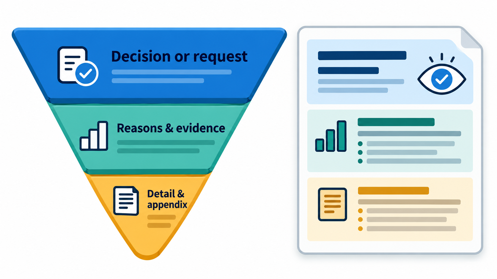
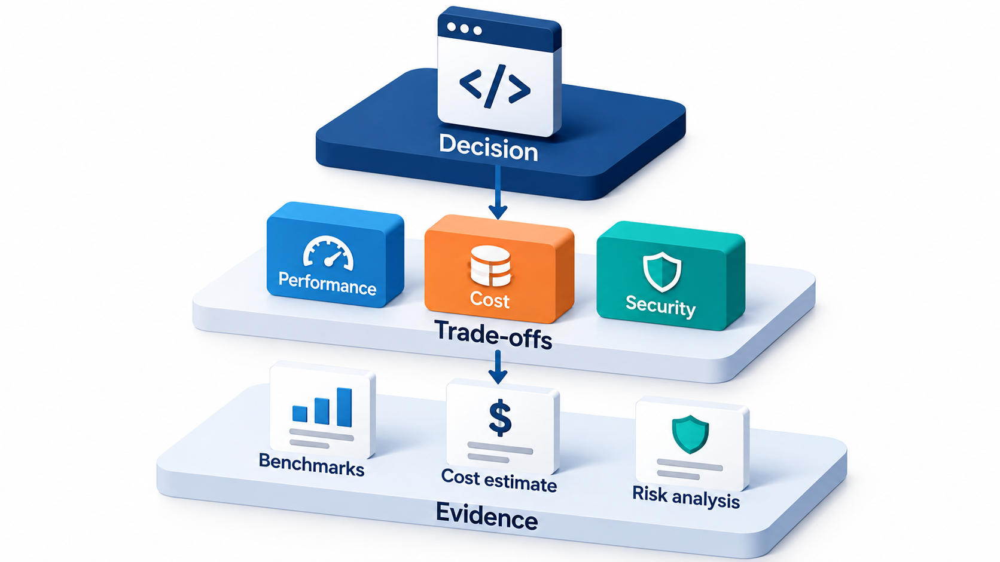
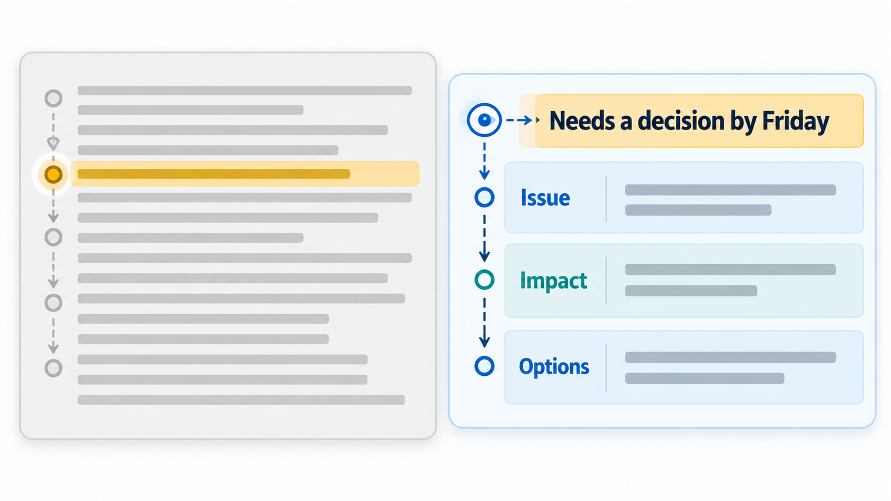
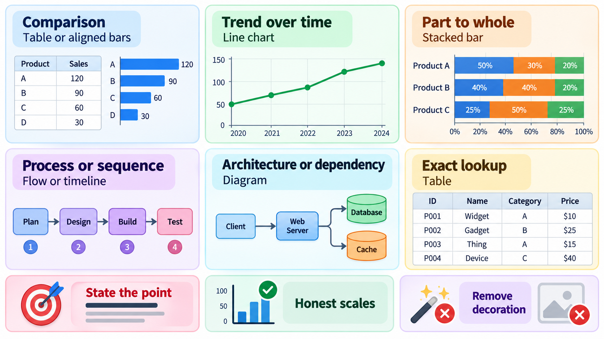
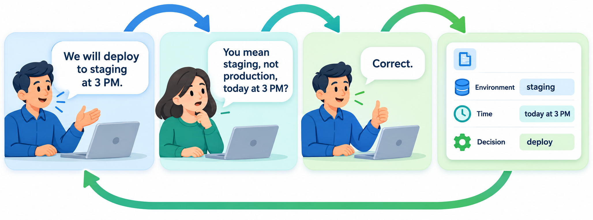

## The Quality of the Explanation Decides the Quality of the Project

Whether others can understand, evaluate, build on and trust a piece of work depends on the quality of the communication around it. The standards of the internet itself were published as modest "requests for comments", the RFCs, begun in 1969: a good one states a problem, explains the options, proposes a solution and invites criticism. The practice shows something that is true of every software project.

**Technical communication** is the craft of explaining technical ideas clearly to the people who need them, in writing and in speech. Engineers spend a great deal of their time doing it: in design documents, code review comments, tickets, bug reports, status updates and incident write-ups. Doing it well is among the most valued skills in the profession.

## Know the Reader

All good writing begins with the question: who will read this, and what will they do with it? A document for a teammate who knows the system differs from one for a manager deciding on money, or a newcomer joining next month. The same facts must be arranged differently.

- A **decision-maker** wants the conclusion, the options, the cost and the risk, quickly.
- A **fellow engineer** wants the details: the design, the reasoning, the edge cases.
- A **future maintainer** wants to know why, since the code shows what.
- A **non-technical stakeholder** wants the effect on them, in their words.

Once you know the reader, state your purpose in a sentence: "I want the team to approve this design by Friday." If you cannot, the document is not ready to write.

| Reader | They want | Lead with | Leave out |
| --- | --- | --- | --- |
| **Director** | A decision and its cost | Recommendation, cost, risk | Implementation detail |
| **Product owner** | Impact on users and dates | What changes for users; what it does to the schedule | Code-level reasoning |
| **Fellow engineer** | How it works | Design, trade-offs, edge cases | Marketing language |
| **New joiner** | How to start | Setup steps and the map of the system | History of every decision |
| **Customer** | What it means for them | What they can do now; what to do next | Internal names and jargon |

## Put the Point First

Technical readers are busy. The best structure is the **inverted pyramid** used in journalism: the most important information first, then supporting detail, then background. The first paragraph should tell the reader what the document is, what you want from them and what the answer is. A reader who stops there should still have the main point. A reader who continues gets the evidence.

<!-- Visual: an inverted pyramid that puts the decision or request before the supporting detail. -->

Layering helps too. A good document lets readers stop at the depth they need: a summary at the top, the main body, then appendices for those who want everything.

<!-- Visual: layered technical writing letting readers stop at the depth they need. -->

A short example shows the difference. A status update that buries its news:

| Version | How it reads |
| --- | --- |
| **Buried** | "Over the past week the team has been working on the payment integration. We encountered several challenges with the sandbox environment, and spent time investigating timeouts. After discussion with the vendor, we believe a configuration change may help. If this does not resolve the problem, we may need to consider an alternative approach, which could affect the launch date." |
| **Upfront** | "Launch date at risk. Payment integration is blocked by gateway timeouts in the sandbox. Need a decision by Friday: wait for the vendor's configuration fix (expected Wednesday) or switch to the second gateway (adds 8 days). Details below." |

The second version gives the reader the news, the choice and the deadline in the first four lines. The first makes the reader dig for the one fact that matters.

## Write Plainly

The aim of technical writing is understanding, not impression. A few habits help.

- **Short sentences and common words.** "Use" in place of "utilise". "Start" in place of "commence".
- **One idea per paragraph,** with the point in the first sentence.
- **Active voice** where it is clearer: "the service rejects the request", not "the request is rejected".
- **Be specific.** "Response time rose from 200 ms to 900 ms at 10:15" and not "performance degraded".
- **Define terms** the reader may not know, and use them consistently.
- **Show, don't only tell.** An example, a table or a diagram often does the work of a page of prose.
- **Cut.** Remove words that do nothing.

A crude readability check flags sentences that are long or full of long words. Take a short announcement about a database migration, in four sentences.

| Sentence (start) | Words | Words over ten letters | Verdict |
| --- | --- | --- | --- |
| We will move the fee records to the new database on Saturday night | 13 | 0 | Clear |
| Payments will stop for about two hours | 7 | 0 | Clear |
| Students can still view their balances | 6 | 0 | Clear |
| Notwithstanding the aforementioned unavailability of transactional functionality... | 15 | 9 | Hard: split it or use plainer words |

A sentence is marked hard if it has more than 20 words or more than two long words. The first three tell the reader what will happen. The fourth tells them nothing a normal person can use. It could be rewritten as "While payments are off, the accounts office should expect extra checking work afterwards." Real readability tools are more refined, and the principle is the same. The measure is a prompt to reread, not a rule.

<!-- Visual: the same update written two ways, a long paragraph that buries the news in the fourth sentence, and a short four-line version with "Needs a decision by Friday" in the first line. Save as images/163_buried_vs_upfront.png. -->

| Wordy | Plain |
| --- | --- |
| In the event that the request fails | If the request fails |
| It is recommended that the team consider utilising | The team should use |
| At this point in time | Now |
| A large number of | Many |
| Due to the fact that | Because |
| Performance was suboptimal | Responses took 900 ms; the target is 200 ms |

## The Documents Engineers Write

**Design documents and RFCs.** The main tool for proposing and deciding a technical approach. A typical structure: the problem and goals, what is out of scope, the proposed design, alternatives considered and why they were rejected, risks, and open questions. The "alternatives" section is the most useful to later readers. Circulate it for comment before building, and record the decision.

**Status updates.** Short, regular and honest. A useful shape: what was done, what is next, what is blocked or at risk, and what help is needed. Lead with anything that needs the reader's action. Do not hide bad news.

**Bug reports.** Written so that someone else can reproduce the problem: a clear title, steps, expected and actual results, environment and evidence.

**Incident write-ups.** A timeline, the impact, the causes, what went well and badly and the actions, written without blame.

**Code review comments.** Specific, kind and explained, separating requirements from preferences.

**README and documentation.** Written for the first-time user, tested by following it yourself.

**Commit messages and pull request descriptions.** A short summary line, then why the change was made. Future maintainers rely on them.

**Emails and chat.** Subject lines that say what the message is about; one request per message; enough context to be understood without a long thread.

| Document | Reader | Key test of quality |
| --- | --- | --- |
| Design document | Reviewers and later maintainers | Can someone judge the design and see why alternatives were rejected? |
| Status update | Managers and stakeholders | Does the first line say whether things are on track? |
| Bug report | Developers | Can another person reproduce it in five minutes? |
| Commit message | Future maintainers | Does it explain why, not just what? |
| README | New users | Can a stranger get started without asking? |
| Email request | Busy colleague | Is the ask clear in the first two lines? |

## Using Visuals

A diagram or table often explains more quickly than text. Some principles apply.

| Principle | Example |
| --- | --- |
| **One message per visual** | A diagram of the data flow, not of every component |
| **Label everything** | Name the boxes and arrows; define symbols |
| **Make the order readable** | Left to right or top to bottom |
| **Say what to notice** | A caption that states the point |
| **Keep it consistent** | The same shape means the same thing throughout |
| **Prefer a table for comparisons** | Options against criteria |

## Speaking and Meeting

Spoken communication matters as much. In a meeting, state the purpose and the decision needed, keep to the time, and record outcomes and owners afterwards. In a presentation, tell the audience what you want from them, show a few clear visuals and leave out most of the detail. When explaining to someone less technical, begin with what matters to them and use analogies, and check that they have understood by asking them to say it back.

<!-- Visual: confirming a shared understanding by restating a request and recording the decision. -->

