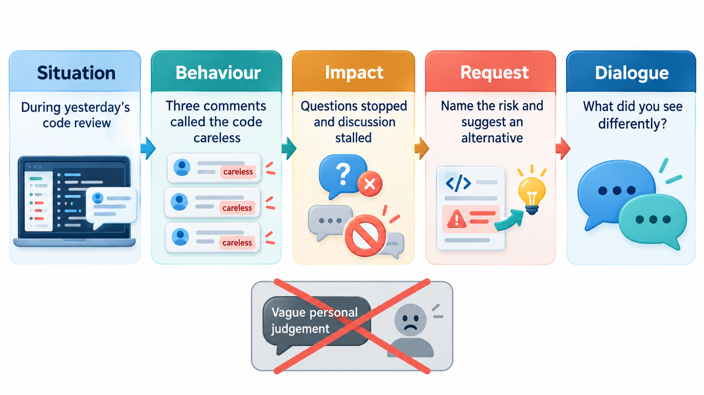
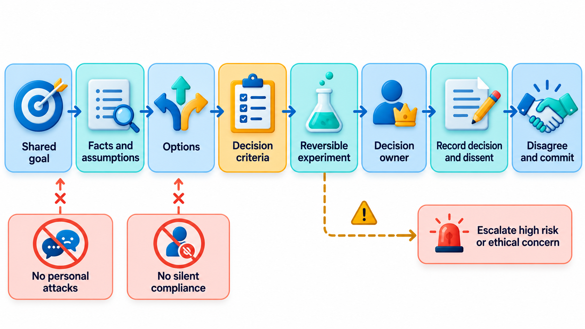
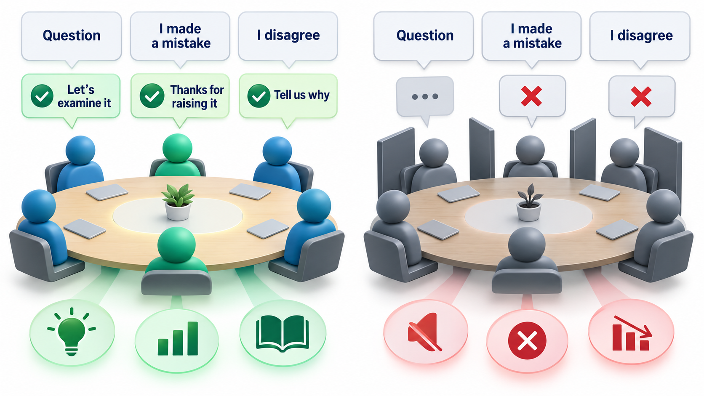
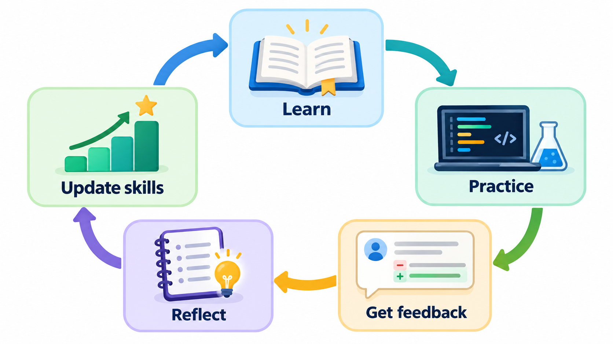
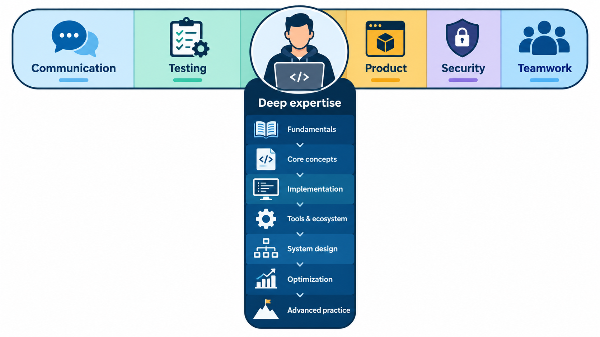

## The Best Teams Are Safe to Disagree In

What makes some teams much better than others? The obvious ideas do not explain it: not the cleverest individuals, not shared interests, not the right mix of skills or the right manager, not sitting in the same place. What does is much less obvious. The teams that do best are those in which members feel able to take risks without being embarrassed or punished: to admit a mistake, ask a question that might sound foolish, propose a half-formed idea or disagree with the group. That feeling is called **psychological safety**.

Software is made by teams. Few projects of any size are built by one person, and the speed and quality of the work depend on how well people work together: how they talk, give and take feedback, handle disagreement, share knowledge and make decisions. This topic covers the human side of engineering, which often decides whether a project succeeds.

## Psychological Safety

Psychological safety, in Edmondson's definition, is a shared belief that the team is safe for interpersonal risk-taking. It is not about being comfortable or always nice. A psychologically safe team can have sharp disagreements, high standards and hard conversations, because people trust that they will not be humiliated for speaking up.

Its importance in engineering is practical. Problems get reported early when people are not afraid of the response. Mistakes are admitted and learned from when they are not hidden. Junior members ask the questions that reveal unclear designs. Dissenting views surface before a bad decision is made, and not after the system fails. The opposite is a team in which people stay quiet, and problems appear only when they have become disasters.

| In a safe team | In an unsafe team |
| --- | --- |
| "I broke the build; here is what I learned" | The build breaks and nobody knows who did it |
| "I don't understand this part. Can someone explain?" | The question is never asked and the misunderstanding ships |
| "I disagree with this design, and here is why" | Doubts are voiced in the corridor, not the meeting |
| "I'm behind and need help" | Delay is hidden until the deadline |
| Near misses are shared | Near misses are hidden |
| People volunteer for hard work | People avoid anything that might fail visibly |

A short survey gives a quick way to take a team's temperature. Members rate statements on a scale from 1 (strongly disagree) to 5 (strongly agree). Negative statements are reversed, because strong agreement with a negative statement is a bad sign. Take five members' ratings.

| Statement | Average rating | Reading |
| --- | --- | --- |
| If I make a mistake on this team, it is not held against me | 4.2 | Healthy |
| Members of this team are able to bring up problems and tough issues | 4.0 | Healthy |
| It is difficult to ask other members of this team for help (reversed: 6 minus the average of 2.2) | 3.8 | Acceptable |
| It is safe to take a risk on this team | 3.4 | Talk about this as a team |

The number is less important than the conversation that follows. A team that discusses why taking risks feels unsafe can usually find specific causes, such as how a past mistake was treated. Anonymity helps the data to be honest. The survey is a way to start a talk, and not a score to rank teams.

## A Real Case: What Google Found

In 2012 Google began a research project, called Project Aristotle, to find out what made some of its teams more effective than others. The company had a great deal of data, and its managers expected that the answer would be a recipe: put the right mix of skills, the most experienced leaders or the most talented individuals together and the team would perform. Researchers studied more than a hundred and eighty teams, looking at their make-up, how they worked, how often they met and how they were led.

The obvious ideas did not explain the differences. Teams of friends did no better than teams of colleagues, and the seniority and qualifications of members did not predict success. What did, more than anything else, was how members felt about speaking up. On the best teams, people believed they could ask a question, admit a mistake or disagree without being embarrassed or punished. This is called psychological safety, a term that came from the Harvard researcher Amy Edmondson, who had found a similar pattern years earlier in hospital teams: the best teams reported more mistakes, not fewer, because they felt it was safe to do so. The project found four other factors that mattered: team members could depend on one another, goals and roles were clear, the work meant something to them, and they believed that it made a difference.

| Factor | What it looks like in a software team |
| --- | --- |
| Psychological safety | A junior developer can say "I do not understand this design" in a review |
| Dependability | Work promised for Friday arrives on Friday, or the team hears early |
| Structure and clarity | Everyone knows who owns what, and what done means |
| Meaning | The team knows who will use what it builds |
| Impact | Work is seen to matter to the organisation |

This is why this topic treats collaboration as a set of practices, such as blameless reviews, clear agreements and respectful disagreement. They build the safety that Google's data showed to matter most. A team can have good tools and bright people and still fail if the people cannot afford to tell each other the truth.

## How Leaders and Members Build Safety

Safety is made by small repeated behaviours.

| Behaviour | Effect |
| --- | --- |
| A leader says "I might be wrong; what am I missing?" | Others feel permitted to challenge |
| Thanking someone who reports a problem | Reporting is rewarded |
| Treating mistakes as information in blameless reviews | Mistakes are discussed openly |
| Inviting quieter members to speak | Different views are heard |
| Disagreeing with ideas without attacking people | Debate stays productive |
| Admitting your own mistakes first | Sets the norm for the team |

One harsh reaction can undo months of building trust, which is why the response to the first piece of bad news matters so much.

## Giving and Receiving Feedback

Feedback is the way a team improves, and also the place where it can go wrong.

**Giving it.**
- Be specific and about the work: "this function does three things, which makes it hard to test" and not "your code is messy".
- Say what was good as well, and say it honestly.
- Separate what must change from what is a preference.
- Ask questions where you are unsure. "What happens here if the list is empty?" invites an answer.
- Give it soon and privately for personal matters, publicly for praise.

**Receiving it.**
- Listen to the end before replying.
- Assume good intent, and look for the useful part, even in clumsy feedback.
- Ask for examples if you do not follow.
- Say thank you. It makes people willing to say hard things again.
- Decide afterwards what to do, and say so.

| Weak feedback | Strong feedback |
| --- | --- |
| "Your design is confusing." | "I couldn't tell where payment retries happen. A diagram of the flow would help me." |
| "Good job." | "The way you split the fee rules into one module each made the change easy to review." |
| "This is wrong." | "This returns zero for an empty list, but the spec says an error. Which do we want?" |
| "You're always late with reviews." | "Several reviews waited two days. Can we agree on a first response within a day?" |

## Handling Conflict

Disagreement is normal in a team of capable people, and often healthy. Conflict about ideas improves decisions. Conflict about people damages them. A few principles keep it productive.

- **Argue about the problem, not the person.** Ground claims in evidence: data, a prototype, a benchmark.
- **Understand before you rebut.** Restate the other person's position until they agree you have it right.
- **Look for the interests behind positions.** Two people arguing about a database may both want reliability.
- **Disagree early, in the open.** A concern raised in a design review costs less than one raised after the code is written.
- **Bring in a neutral party** when two people are stuck, such as a lead or a facilitator.
- **Repair afterwards.** A short conversation after a heated one can restore trust.

| Type of conflict | Example | Useful response |
| --- | --- | --- |
| **About a task** | Which database to use | Compare against criteria; try a small experiment |
| **About process** | Whether to review every change | Agree a working rule and review it later |
| **About relationships** | Resentment over credit | Talk privately; involve a lead if needed |
| **About values** | Speed versus quality | Make the trade-off explicit; let the accountable person decide |

## Disagree and Commit

A team cannot debate for ever. At some point a decision must be made, and often some members still prefer another course. The practice called **disagree and commit**, associated with Amazon and Intel, asks them to state their disagreement clearly, and then, once the decision is made, to support it fully. It works only if the dissent has really been heard and recorded, and if the decision is revisited when evidence shows it was wrong. Without the first, people feel ignored. Without the second, a poor decision is carried out loyally.

<!-- Visual: a team around a table with speech bubbles that show a question, an admitted mistake and a disagreement, each with a warm response, and a second table where the same bubbles are met with silence and crossed arms. Save as images/164_safe_and_unsafe_table.png. -->

## Working Together Day to Day

- **Share the knowledge.** Pair on difficult work, rotate review duties and write things down. The aim is that no one person is indispensable.
- **Make work visible.** A board or tracker showing who is doing what avoids duplication and lets people offer help.
- **Agree how you work.** A short working agreement on code review time, communication channels and how decisions are made saves repeated arguments.
- **Help each other.** Time spent unblocking a colleague is usually repaid.
- **Hold retrospectives** that lead to actual changes.
- **Respect differences** of background, working style, time zone and experience. Include remote members in discussions on equal terms.
- **Celebrate progress,** and handle failure without blame.

| Working agreement item | Example |
| --- | --- |
| Core hours for overlap | 11:00 to 15:00 in all time zones |
| Review response time | First response within one working day |
| Decision record | Important decisions written in the project wiki |
| Meeting rules | Agenda in advance; notes and owners afterwards |
| Communication channels | Chat for quick questions; tickets for tasks; documents for decisions |
| Help policy | Ask after 30 minutes of being stuck |

<!-- Visual: A continuous loop of learning, practice, feedback and reflection. -->

## Teams Over Time

Teams go through stages, as Bruce Tuckman described in 1965: **forming** (polite and uncertain), **storming** (disagreements as roles and ways of working are settled), **norming** (agreements form), and **performing** (the team works well together). A team that meets conflict in the storming stage has not failed. It is part of the process, and handling it openly leads to the later stages. Changes of membership send a team part of the way back.

| Stage | What it feels like | What helps |
| --- | --- | --- |
| **Forming** | Polite, unsure of roles | Clear goals; introductions; a working agreement |
| **Storming** | Friction over approach and leadership | Open discussion; clear decision rules |
| **Norming** | Habits and trust form | Reinforce what works; keep feedback flowing |
| **Performing** | Smooth, productive | Protect the team; keep challenging itself |
| **Adjourning / change** | A member joins or leaves | Hand-over, welcome, and a brief reset |

<!-- Visual: T-shaped skills combining broad engineering knowledge with deep expertise. -->

