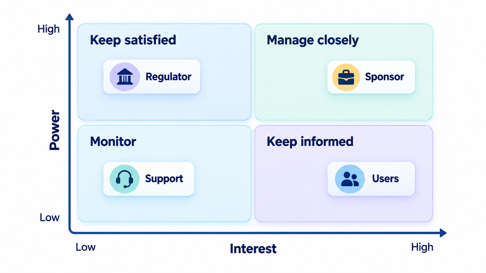
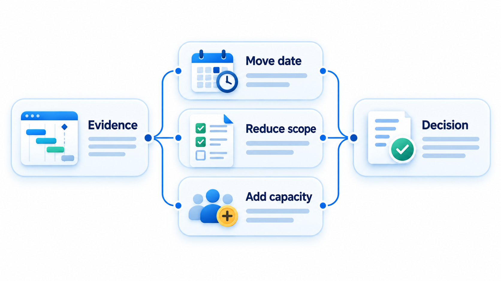
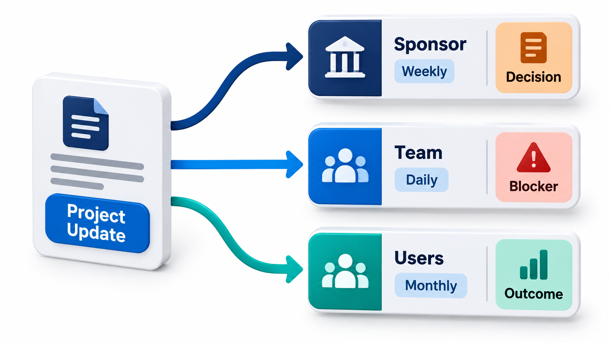
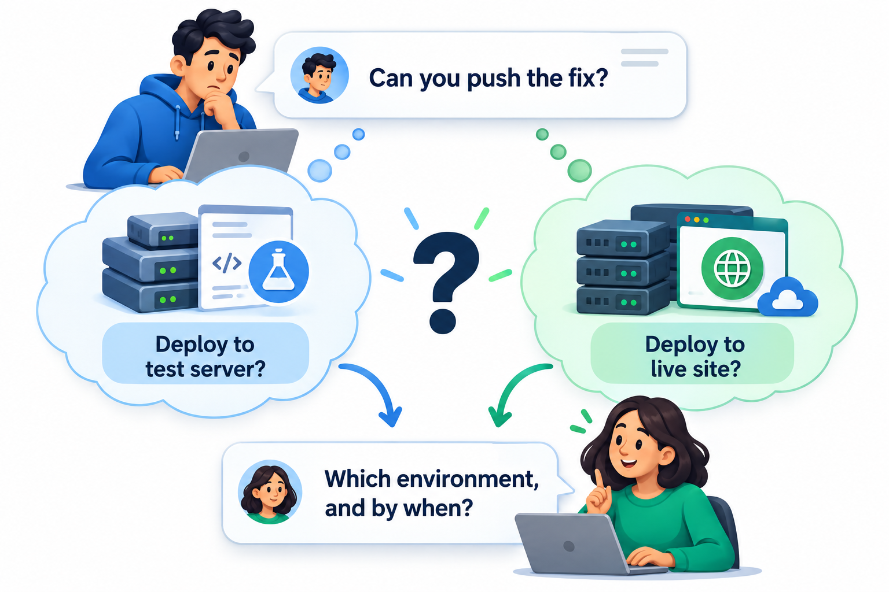
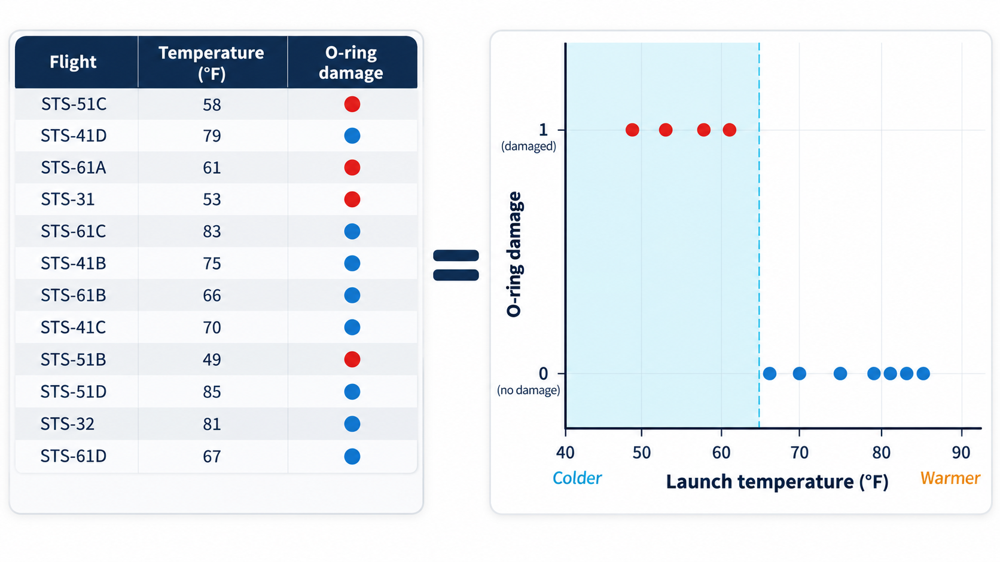

## The Truth Is Not Enough; It Must Be Understood

The technical truth is not enough. It has to be conveyed to the people who decide, in a form they can use, and often against the pressure of time, money and hope. Engineers who hold the evidence for a risk can fail to persuade, if the evidence is presented as a list of problems and not as the one picture that makes the pattern plain.

Every software engineer faces some version of this problem. **Stakeholder communication** is the skill of conveying the technical truth to the people who decide. This topic is about explaining trade-offs, managing expectations and saying no without ending the conversation.

## Who the Stakeholders Are

A **stakeholder** is anyone with an interest in or influence over the project: the sponsor who pays for it, the users, the managers above you, other teams that depend on yours, customers, regulators and support staff. They differ in what they care about and how much they know. A map of power and interest helps to decide how often and in what way to speak to each.

| Stakeholder | Power | Interest | Likely concern | How to engage |
| --- | --- | --- | --- | --- |
| **Sponsor** | High | High | Cost, date, value | Regular concise updates; decisions framed as options |
| **Users** | Low to medium | High | Whether it helps them | Demos, feedback sessions |
| **Senior management** | High | Medium | Risk, reputation | Short summaries; flag risks early |
| **Dependent teams** | Medium | High | Interfaces and dates | Shared plans; early notice of change |
| **Regulators** | High | Variable | Compliance | Formal evidence; planned contact |
| **Support staff** | Low | High | What they will have to handle | Training, release notes, early access |

<!-- Visual: stakeholders mapped by power and interest. -->

## A Real Case: The Night Before the Challenger Launch

On the evening of 27 January 1986, the night before the planned launch of the space shuttle Challenger, engineers at Morton Thiokol, the company that made the shuttle's solid rocket boosters, held a telephone conference with NASA. The forecast for the next morning was unusually cold, around freezing, far colder than any previous launch. Some of the engineers, notably Roger Boisjoly, feared that the rubber O-ring seals between sections of the boosters would stiffen in the cold and fail to seal, letting hot gas escape. They had seen signs of seal damage on earlier flights.

They argued their case with a set of charts that listed the damage on a number of flights, one flight per line, with the temperature mentioned alongside among many other details. NASA's managers were not convinced by the evidence, which did not look like a clear pattern, and asked Thiokol to reconsider. During a break in the call, a company manager told an engineer, in effect, to take off his engineering hat and put on his management hat. The company changed its recommendation and the launch went ahead. Seventy-three seconds after lift-off, the shuttle broke apart and all seven crew members were killed. The investigation found that a seal had failed, as the engineers had feared.

The data that would have settled the question was there. Plotted on one chart, with the temperature of each launch on one axis and the amount of seal damage on the other, it would have shown that every flight with serious damage had been cold, and that the forecast temperature was far outside anything that had been tried. The statistician and designer Edward Tufte later analysed the charts at length and made this point forcefully.

| What the engineers did | What would have communicated the risk |
| --- | --- |
| Listed problems flight by flight | One chart of damage against temperature |
| Mixed the key fact among many details | One message stated at the top |
| Argued about uncertainty | Said plainly what was known, what was not, and what they recommended |
| Spoke to people who needed to decide | Framed the recommendation in terms of the decision-makers' risk |

Stakeholder communication is the work of making sure the people who need to understand something actually do, and can act on it. This topic covers how to adapt a message to its audience, how to present evidence so that the conclusion is visible, and how to raise a concern so that it is heard.

## Speak Their Language

A recurring mistake is to explain the work in the engineer's terms. "We have to refactor the persistence layer" means nothing to a finance director. "A week of work now will cut the time to add new payment methods from six weeks to one" does. Translate each technical matter into the things the listener cares about: money, time, risk, customers, reputation.

| Technical statement | In the listener's terms |
| --- | --- |
| "We need to refactor the persistence layer" | "A week now will cut the time to add new payment methods from six weeks to one" |
| "The database has no failover" | "If the server fails, the site is down until we repair it, perhaps for a day; a standby costs Rs 8,000 a month" |
| "We have technical debt in the fee module" | "Every fee change takes three days instead of one, and it caused our last two payment errors" |
| "We need to upgrade the library" | "The current version stops receiving security fixes in March" |
| "Test coverage is 40%" | "Most of the payment code is checked only by hand, so mistakes reach students" |

Useful questions before any conversation:

- What does this person already know?
- What do they care about most?
- What decision, if any, do I need from them?
- What do I want them to remember afterwards?

Lead with the point. State the situation, the decision needed and your recommendation, and then give the evidence. Busy people read the first lines.

## Show the Evidence Clearly

The Challenger story is a lesson in presenting data. If your argument rests on a pattern, show the pattern. A well-chosen chart or table often communicates in seconds what a page of text cannot. A good display puts the comparison that matters front and centre, labels it clearly and leaves out what distracts. If you have a recommendation and the data to support it, present them together.

| Weak presentation | Strong presentation |
| --- | --- |
| A table of 24 launches with many columns | One chart: damage against temperature, with the cold flights marked |
| "Performance has degraded" | A line of response times with the date of the release marked |
| "Many bugs were found" | A bar chart of defects by module, with the worst three labelled |
| A page of risks in alphabetical order | A short list ranked by likelihood and impact, with owners |

<!-- Visual: evidence leading to explicit schedule, scope or capacity choices. -->

## Explain Trade-offs by Offering Options

Stakeholders rarely want a lecture on technical difficulty. They want to know what their choices are and what each would cost. A good habit is to present **two or three options**, with the consequences of each stated in terms they care about, and your recommendation. Take a late project. The sponsor's priorities are weights: cost counts 2, the date 3 and risk 3. Each option is scored from 1 (poor) to 5 (good) on each factor.

| Option | Cost | Date | Risk | Weighted score |
| --- | --- | --- | --- | --- |
| A: cut two features, keep the date | 4 | 5 | 4 | 35 |
| B: keep all features, move the date by 6 weeks | 3 | 1 | 4 | 21 |
| C: add 4 developers, keep everything | 1 | 3 | 2 | 17 |

The recommendation is A. But the recommendation must add a reminder that matters as much as the number: say what the sponsor gives up, as well as what they get. The two features lost are a real cost, and the sponsor should hear it from you, not discover it later. The scores are judgements and the weights are the sponsor's. Showing them lets the sponsor disagree with a weight, which is a more productive argument than disagreeing with a conclusion. Presenting options respects the sponsor's authority to decide, and protects you from the charge that you hid a choice.

## The Iron Triangle in Conversation

Most project trade-offs come down to three things that cannot all be fixed at once.

| Fixed | Flexible | What the conversation sounds like |
| --- | --- | --- |
| Scope and date | Cost (add people) | "We can keep both if we add developers, but adding people to a late project often slows it, so the risk rises" |
| Scope and cost | Date | "It can be done within budget if we move the date to the end of March" |
| Date and cost | Scope | "By the date, with this team, we can deliver these four features and defer the other two" |
| Quality as a hidden fourth | | "We can ship all of it by the date, but that means skipping the load test, and the risk of failure on results day is high" |

The fourth line is the one stakeholders should hear spelled out. Quality is the quiet casualty when the other three are fixed.

## Managing Expectations

Many conflicts with stakeholders arise because expectations were never set. Some habits help.

- **Give ranges, not false precision.** "Between eight and twelve weeks, and we will narrow it after the first month" is more honest, and more useful, than a date that will be missed.
- **Say what you know and what you don't.** Confidence beyond the evidence erodes trust when it proves wrong.
- **Communicate regularly,** including when there is nothing dramatic to say. Silence is read as trouble.
- **Report bad news early.** Problems shrink if they are raised sooner, and a surprise at the end destroys credibility.
- **Make agreements visible.** After a meeting, write down what was decided and who will do what. This catches misunderstandings while they are cheap to fix.
- **Do not over-promise.** A smaller commitment that is kept is worth more than a larger one that is not.

| Situation | Poor approach | Better approach |
| --- | --- | --- |
| Estimate requested | "Six weeks" | "Six to nine weeks; the main uncertainty is the payment integration" |
| Problem found | Say nothing until it is fixed | "We found an issue on Tuesday; it may cost three days; we will confirm on Thursday" |
| Scope change requested | "Sure" | "Yes, and it will move the date by two weeks, or we can drop feature X" |
| Delay unavoidable | Announce on the due date | Tell the sponsor as soon as the delay is likely |

<!-- Visual: A communication plan matching each stakeholder with what they need and how often. -->

## Saying No With Options

Sometimes the right answer to a request is no. A bare refusal ends the conversation and damages the relationship. A better response says no to the request as stated, and yes to the need behind it.

- **Understand the need.** Ask what the request is for. A request for a feature in two weeks may really be a request to have something for a demo.
- **Explain the cost in their terms.** "To do that, we would have to drop the payment fix, and some students could be charged twice."
- **Offer alternatives.** "We can't deliver all of it by Friday. We can deliver the report without the export, or both by the 20th."
- **Let them decide the trade-off,** when it is theirs to make.
- **Escalate calmly** if the request would be unsafe, illegal or unethical, as a matter of professional ethics: state the concern, the evidence and the alternatives.

The Challenger engineers said no and were overruled. The lesson is not that they should have been louder. It is that how a technical concern is framed, presented and escalated determines whether it is heard.

<!-- Visual: an ambiguous request producing two different interpretations that confirmation would have exposed. -->

## Difficult Conversations

Some stakeholder conversations are harder than others, and a plan helps.

<!-- Visual: one chart of O-ring damage plotted against launch temperature showing damage only on cold flights, beside the table of the same facts that was actually presented, with a note "the same evidence, only one of them makes the point". Save as images/165_chart_that_makes_the_point.png. -->

| Situation | Approach |
| --- | --- |
| **Delivering bad news** | State it plainly and early; give the impact, what you are doing and what you need |
| **A stakeholder insists on an unrealistic date** | Show the evidence, offer scope options, record the risk in writing |
| **Conflicting stakeholders** | Bring them to a shared meeting; make the conflict and trade-off visible; ask the sponsor to decide |
| **A stakeholder who disappears** | Send short written summaries with a deadline for objections; escalate if needed |
| **A mistake of your own** | Own it, explain the cause and the fix, and say what will change |
