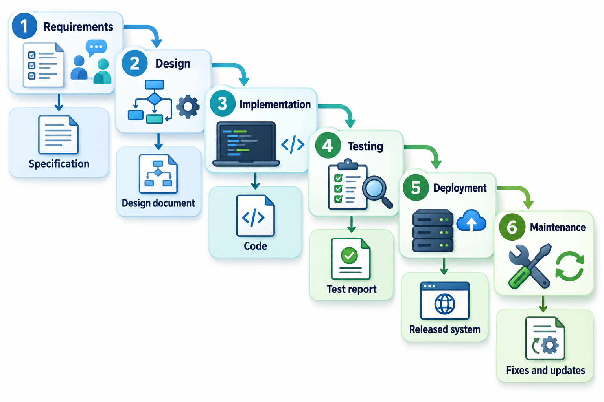
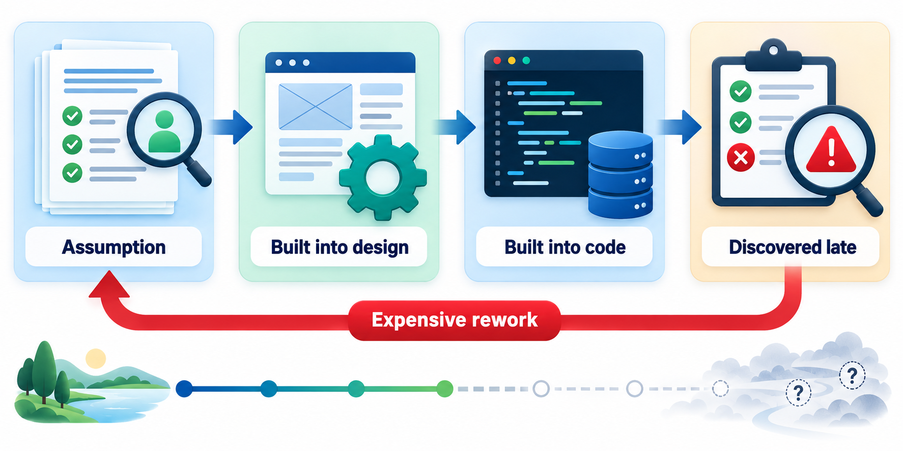
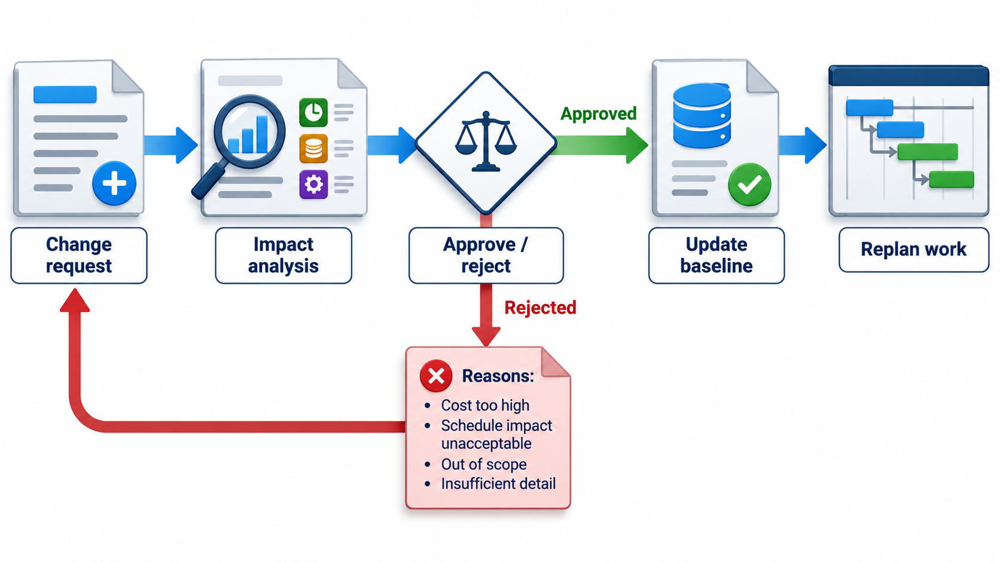
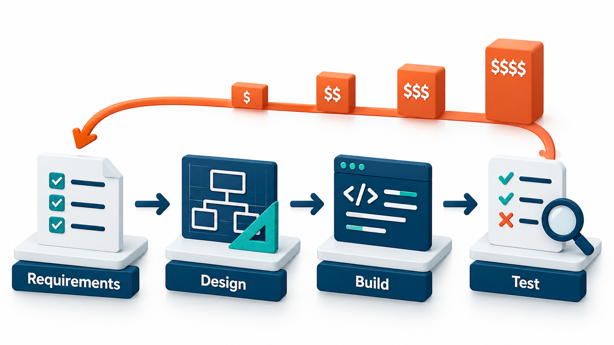
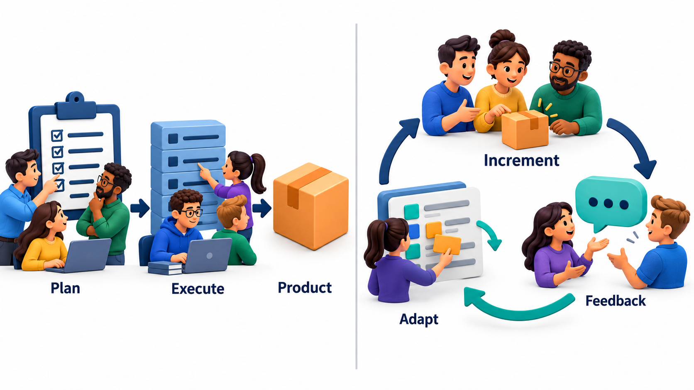

## Finish One Floor Completely Before Starting the Next

The simplest way to organise any large piece of work is to do it in order: decide what is wanted, plan it, build it, check it, hand it over. Each stage is finished and approved before the next begins, and nobody goes back unless something has gone badly wrong. Building a house works this way because the foundations must exist before the walls, and the walls before the roof.

Applied to software, this idea is called the **waterfall model**, named for the way each phase feeds the next like water falling down a staircase. It is a **sequential process**: each phase is completed, reviewed and signed off before the next begins. It works well in some situations and fails badly in others, and the aim of this topic is to see which.

To understand any process model, it helps to ask what problem it was designed to solve. The waterfall was an answer to chaos. Before such models were common, teams often started coding with only a vague idea of what was wanted, discovered problems as they went, and finished late with a tangle nobody understood. The waterfall's remedy was order: think first, write it down, get agreement, then build. For its time, and for problems of a certain kind, this was a large improvement. Its limitation is not that order is bad, but that it assumes the thinking can all be done before the building starts.

## How the Waterfall Is Laid Out

A waterfall project moves through a fixed order of phases. Each phase produces a document or a product that the next phase takes as its starting point, and a **gate** (a review and a sign-off) stands between them.

| Phase | What happens | What is handed on |
| --- | --- | --- |
| **Requirements** | The team and the customer agree on what the system must do | A requirements specification, signed by the customer |
| **Design** | The team decides how to build it | Architecture and detailed design documents |
| **Implementation** | Programmers write the code to the design | Source code, unit-tested modules |
| **Testing** | The whole system is checked against the requirements | Test results, a list of defects |
| **Deployment** | The system is installed for the users | A released system with manuals |
| **Maintenance** | Faults are fixed and small changes are made | Patches and revised versions |

The assumption behind the model is that it is cheaper to think than to rebuild, so the team should do all its thinking about requirements before design and all of its design before coding. If that is possible, the approach is efficient. Nothing is built twice, the documents make the plan visible, new team members can read their way in, and a customer can be shown a fixed price and date.

<!-- Visual: six boxes in a staircase from requirements to maintenance, each with a gate between it and the next and the document handed over beneath. -->

## What Happens Inside Each Phase

The phase names are familiar, but the model gives each a specific meaning and a specific way of being finished.

**Requirements.** Analysts work with the customer and users until the needs are written down in a specification. The specification is reviewed line by line. The phase ends only when the customer signs it, because everything after it rests on its being right. Changes after the signature go through formal change control.

**Design.** Architects and senior engineers turn the specification into a plan for the system. They decide the major parts, how data is stored, how the parts communicate, and then describe each part in enough detail that a programmer can build it without asking questions. The design is reviewed against the specification to make sure that every requirement has a home in it.

**Implementation.** Programmers build each part to the design. Because the design is detailed, programmers are expected to follow it rather than reinvent it. Each part is tested by its author before it is passed on.

**Testing.** The parts are brought together and the whole system is tested against the specification. Defects are logged, fixed and retested. The phase ends when the agreed criteria are met, for example that no serious defects remain open.

**Deployment.** The system is installed, data is moved across, users are trained and the old way of working is retired. A formal acceptance by the customer often releases the final payment.

**Maintenance.** After release, faults are repaired and small changes are made, each handled as a mini-project through the same stages.

Notice how much of the model's strength lies in its paperwork. Every phase leaves a document that a stranger could read. For a team with high staff turnover, a government contract that will be audited, or a safety certificate that must be earned, this record is not a burden but the whole point.

## What the Model Does Well

It is easy to list the waterfall's faults, and fair to list its virtues first.

| Strength | Why it matters |
| --- | --- |
| **Clear structure** | Everyone knows what phase the project is in and what is expected next |
| **Easy to plan and cost** | With the requirements fixed, effort can be estimated and a price quoted |
| **Strong documentation** | New team members and future maintainers can read their way in |
| **Easy to manage** | Milestones are obvious, so progress is simple to report |
| **Suits specialist teams** | Analysts, designers, programmers and testers can each work in their own phase |
| **Natural fit for contracts** | Phases map onto payments and acceptance points |

These virtues explain why the model has survived long after it was declared out of date. For the right kind of project they are exactly what is needed.

## When the Waterfall Works

The sequential approach is a good fit when the conditions behind its assumption actually hold.

- **The requirements are known and stable.** A payroll system that must follow a law that will not change this year, or a port of an existing program to a new platform, can be specified in full before work starts.
- **The cost of a mistake is high and late change is not allowed.** Regulated work such as aircraft, medical devices and railway signalling needs documents and evidence from every phase. The paperwork is not a ritual; it is how an authority is shown that nothing was skipped.
- **The technology is well understood.** If the team has built ten similar systems, the risk of a design surprise is low.
- **The contract demands a fixed scope, price and date.** Many public tenders require this, and the waterfall's phases map directly onto payment milestones.
- **The customer cannot be available.** When users are far away or unavailable during development, a thorough specification at the start is the only way to capture their needs.

In these circumstances, the model's weaknesses are small and its strengths are real. The trouble comes when a team applies it to a problem that does not fit.

## Why It Fails When Requirements Move

The weakness is built into the staircase. Feedback from the real world arrives late. The customer sees working software for the first time at the end, and by then the cost of any misunderstanding has multiplied through every phase built on top of it.

To see the effect in numbers, take a project whose phases last 4 weeks (requirements), 6 weeks (design), 12 weeks (coding) and 6 weeks (testing). Suppose a requirement turns out to be wrong. Everything built on top of it must be redone, so the rework equals all the work from the start up to the phase in which the mistake is found.

| Mistake found during | Work resting on the wrong requirement | Rework |
| --- | --- | --- |
| Requirements | Requirements only | about 4 weeks |
| Design | Requirements and design | about 10 weeks |
| Coding | Requirements, design and coding | about 22 weeks |
| Testing | Everything built so far | about 28 weeks |

A mistake caught while the requirements are still being written costs 4 weeks. The same mistake found in testing costs 28, seven times as much, and the project is nearly as long again. The numbers are a simplification, since not all the work needs redoing, but the shape is accurate. In a sequential model the customer's first real feedback comes when the most work depends on getting it right.

Several other weaknesses follow from the same root.

- **Late integration.** The parts are built separately and joined near the end, when problems between them are hardest to untangle.
- **Late testing.** The system is first tested as a whole when little time remains, so serious faults threaten the date.
- **Customers cannot know what they want in advance.** People often cannot say what they need until they see something working, so a signed specification can be a confident record of a misunderstanding.
- **Idle and overloaded phases.** Testers wait while programmers build, then face a flood at the end. The schedule is crushed exactly where the risk is highest.
- **Progress is hard to see.** Until testing, there is no working software, so "90 per cent done" may be a hope and not a fact.

<!-- Visual: a mistaken requirement entering at the top of the waterfall, flowing down through design, coding and testing, and being discovered at the bottom with arrows going all the way back up labelled "rework". -->

## Change Control Makes It Slow, On Purpose

Waterfall projects do accept changes, but through a formal route. A change request is written, its impact on every document is assessed, a committee approves or refuses it, and the affected phases are revised. That is not bureaucracy for its own sake. When each phase depends on documents from the last, an uncontrolled change in one place can quietly invalidate work in several others.

The result, however, is a model that treats change as an exception. If the business world changes every month, the process is fighting its environment. That mismatch is the reason that iterative and agile approaches exist: they treat change as normal and build a way to absorb it.

<!-- Visual: a change made late in the project travelling backward through the earlier phases, each one reopened for rework. -->

## Making the Waterfall Safer

Teams that must use a sequential process, because of a contract, a regulator or an organisation's habits, have developed ways to soften its weaknesses.

- **Prototype the risky parts early.** A quick model of the screens, or a small test of a difficult technology, gives early feedback without abandoning the overall plan.
- **Overlap phases.** Allow design to begin on the stable parts of the specification while the rest is still being finalised.
- **Deliver in stages.** Split the system into releases, each going through the full sequence. This is a step towards the incremental approach.
- **Review continuously.** Include users and testers in the review of requirements and design, so that mistakes are caught before sign-off.
- **Plan test cases early.** Write the acceptance and system tests during the requirements phase, so that vague requirements are discovered while they are cheap to fix.
- **Allow feedback loops.** Many practical versions let a phase return briefly to the one before it, with the changes recorded, instead of pretending that no one ever goes back.

These adjustments keep the model's order while admitting what experience shows: that nobody gets everything right the first time.

## Waterfall Is Used More Than the Fashion Suggests

It would be wrong to treat the waterfall as extinct. Many teams use it for parts of larger projects, for example a hardware-bound component whose interface must be frozen early. Fixed-price contracts often impose its shape. And some teams run an "agile" process that is, in practice, a mini-waterfall inside each sprint, with requirements written, then design, then code, then testing, in sequence. What matters is not the name on the process but whether feedback arrives early enough to be useful.

A fair way to judge the model is to ask two questions of a project. How likely is it that the requirements will change between the start and the end? And how costly is a mistake that is found late? If change is unlikely and late mistakes are very expensive, sequence and documents earn their keep. If change is likely and the customer can see and react to early versions, the same sequence becomes a liability.

<!-- Visual: A plan-driven sequence compared with short adaptive delivery cycles. -->

## Five Misreadings of the Waterfall Model

**"The waterfall was designed as the ideal process."** The staircase diagram was first drawn in a 1970 paper by Winston Royce as an example of a risky approach, and he then argued for changes to it. The industry kept the picture and forgot the warnings.

**"Waterfall means no iteration at all."** Even strict waterfall projects loop back when a defect is found. The difference is that loops are expensive, exceptional and controlled, where agile loops are cheap and constant.

**"Waterfall is always worse than agile."** When requirements are stable, risk is high and regulation demands evidence, it can be the better fit. The model fails when its assumption of stable requirements does not hold.

**"Documents are the point."** Documents are a means of passing understanding along. A project that produces perfect documents and the wrong product has followed the process and failed.

**"You can finish all the thinking up front."** For some problems you can, for many you cannot, because people often discover what they want only when they see something working. The model works when this discovery has already happened.
