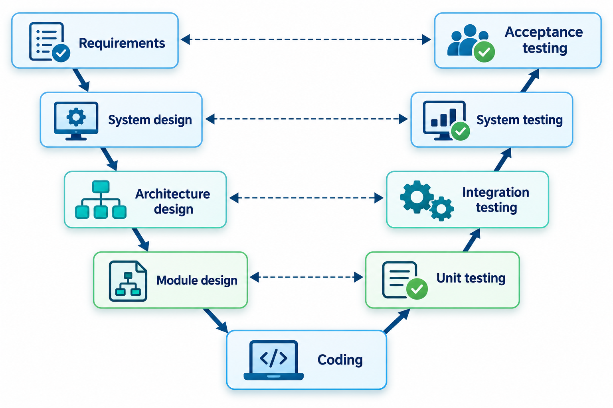
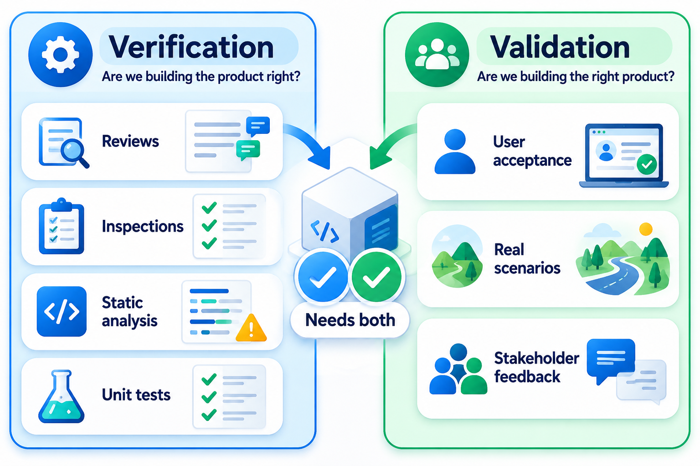
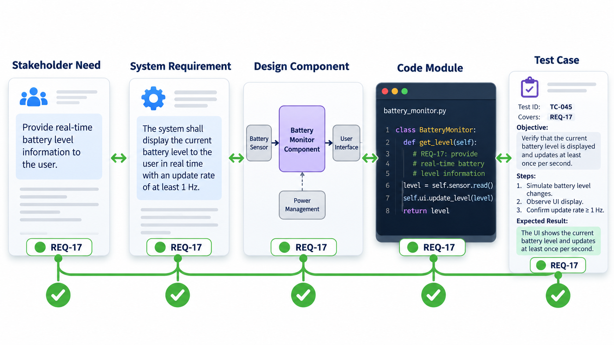
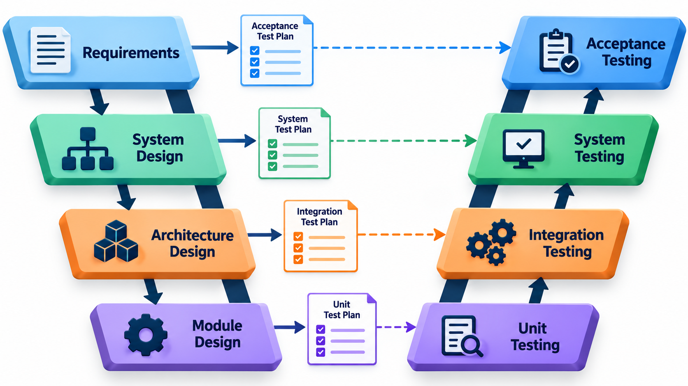
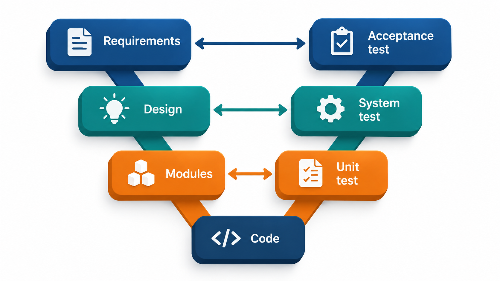

## For Every Thing You Build, What Will You Check It Against?

Anything built for a customer eventually has to be shown to be what the customer asked for. The most reliable way to do that is to decide how each part will be checked at the same moment you decide what the part is. A requirement that no one can think of a way to check is a warning sign that it is vague. A check that proves no particular requirement is a warning sign that it is wasted effort.

That discipline of pairing every stage of building with a matching stage of checking is the heart of the **V-model**. It is a development model for situations where it must be possible to show, afterwards, that the system is what was asked for, which is why it is common in aviation, medical devices and other regulated fields.

Consider how an inspector from a regulator works. They do not simply ask whether the tests passed. They pick a requirement, such as "the system shall warn the pilot if altitude falls below the set limit", and ask to be shown which design element implements it, which code realises that design, and which test demonstrates it. Then they pick a test and ask the reverse: which requirement is this proving? A test that proves nothing in particular is suspect. A requirement that no test proves is a hole. The V-model is a way of organising work so that such questions can always be answered.

## The Shape of the V

The model takes the waterfall's sequence and bends it. The left arm of the V goes down through the stages of specification and design, each more detailed than the one above. The point at the bottom is coding. The right arm goes up through the stages of testing, each larger in scope than the last. The key idea is the horizontal link: each level on the left is paired with a level on the right that checks it.

| Left arm (specify and design) | Paired with | Right arm (test) |
| --- | --- | --- |
| **Business or user requirements**: what the users need | checked by | **Acceptance testing**: does it meet the need, with the customer's eyes on it |
| **System requirements**: what the whole system must do | checked by | **System testing**: does the whole system behave as specified |
| **Architecture design**: the main parts and how they connect | checked by | **Integration testing**: do the parts work together |
| **Module design**: how each part works inside | checked by | **Unit testing**: does each small piece do its job |
| **Coding** (the bottom of the V) | | |

The pairing matters because it moves the thinking about tests to the beginning. While the team writes the system requirements, it also writes the system test plan, since writing "the system shall do X" is the same moment to ask "and how would we check X?". A requirement that cannot be checked gets discovered while it is still a sentence, which is the cheapest time to fix it.

<!-- Visual: a V with specification stages descending on the left, coding at the bottom, and testing stages ascending on the right, with horizontal arrows pairing each level. -->

## Walking Down and Up the V

It helps to follow one requirement through the whole shape. Take a fee system with the user need "students must be able to pay their fees online and get a receipt".

| Stage on the left | What is produced | Matching stage on the right | What is checked |
| --- | --- | --- | --- |
| User requirement | "Students pay online and receive a receipt" | Acceptance test | Real students pay a real fee and receive a receipt they find acceptable |
| System requirement | "The system shall accept card and UPI, record each payment once, and issue a numbered receipt within 10 seconds" | System test | The whole system, running together, meets each of those statements, including the 10 seconds |
| Architecture design | Payment service, receipt service and ledger, with defined messages between them | Integration test | The payment service really passes a payment to the receipt service and the ledger in the form they expect |
| Module design | The payment service validates the amount, calls the gateway and records the result | Unit test | The validation rejects a zero amount, the recording step stores exactly one entry per payment |
| Coding | The source files | | |

Two things stand out. The test plans for the right arm can be written as the left arm is being written, because each is derived from its partner. And the levels of detail match: a unit test never needs to know about the college's wish for online payments, and an acceptance test never needs to know how the ledger stores its rows.

## Verification and Validation Are Different Questions

The V-model leans on two words that sound alike and ask different questions.

**Verification** asks "are we building the product right?" It checks that each stage's output matches the specification of the stage before it. A design review that confirms the design covers every system requirement is verification. So is a unit test that confirms a module behaves as its design says.

**Validation** asks "are we building the right product?" It checks that the finished thing satisfies the real needs of its users. Acceptance testing with the customer is validation. A system can be fully verified and still not validated: it may meet every line of a specification that was itself wrong.

The distinction is practical. If a product fails verification, the fix is in the construction. If it fails validation, the fix may be in the requirements, and the damage is bigger.

A common picture is that verification runs along the V, between each specification and the work built from it, while validation runs across the V, from the user's real need on the left to the finished system on the right. The model therefore gives a team both checks at every level, which is its principal value.

<!-- Visual: two arrows. Verification: specification to product, "built right?". Validation: user need to product, "right product?". -->

## Traceability: The Thread Through the V

A regulator or reviewer following a requirement is following a **trace**: a chain of links from a requirement to the design, the code and the tests. Keeping those links is what the V-model is built for, and it is the main difference from a plain waterfall. A table recording which tests cover which requirements is called a **traceability matrix**.

A small version of the matrix for a fee system looks like this. Each requirement should be checked by at least one test at a matching level.

| Requirement | Test that checks it | Level |
| --- | --- | --- |
| R1 Login | T1 Login works | System |
| R2 Pay fee | T2 Fee is added up correctly | Unit |
| R2 Pay fee | T3 Paying and receipt work together | Integration |
| R3 Receipt | T4 Receipt shows the date | Unit |
| R4 Refund | None | Not checked |

R2 is covered twice, by a unit test and an integration test, which is a healthy sign. R1 and R3 have at least one test each. R4, the refund, has no test at all. In a real project this empty cell is exactly what a reviewer looks for, and finding it before release is the point of the model. A real matrix has hundreds of rows and lives in a tool, but the question it answers is the one in these five rows: which requirement does each test prove, and which requirement has no test?

The matrix also answers questions after the project is under way. If a requirement changes, the matrix shows which design elements, code and tests are affected, so that nothing stale is left behind. If a test fails, it shows which requirement is at risk. Traceability turns a pile of documents into a connected structure that can be examined and trusted.

## Test Planning at Each Level

Because each level of testing is derived from a level of specification, each has its own purpose and its own kind of test.

| Test level | Derived from | Typical performed by | Looks for |
| --- | --- | --- | --- |
| **Unit** | Module design | The developers who wrote the module | Logic errors, boundary mistakes, wrong results inside one piece |
| **Integration** | Architecture design | Developers and testers together | Mismatched interfaces, wrong assumptions about what a partner sends or expects |
| **System** | System requirements | An independent test team | Behaviour of the whole product, including speed, load and security |
| **Acceptance** | User requirements | The customer or their representatives | Whether the product is fit for the real purpose |

The upper levels depend on the lower. A system test that fails because a basic calculation is wrong is a poor use of a system test; the unit tests should have caught it. A well-run V-model project therefore finds most faults at the lowest level possible, where they are cheapest to locate and fix, and keeps the expensive upper-level tests for the problems only they can reveal.

## Where the V-Model Fits, and Where It Does Not

The V-model keeps the waterfall's strengths: clear stages, documents, a plan, and a stage gate before moving on. It improves on it by forcing the question "how will we know?" at every level. It is common in safety-critical and regulated industries such as automotive, aerospace, medical devices and railways, and in Germany it was long a standard for government projects.

It also keeps the waterfall's weakness. The left arm still assumes that requirements and design can be settled before the code is written, and the right arm still arrives late. If the real world changes after the requirements are signed, a change has to climb back up the left arm and then pass down the whole V again, and the test plans at each level need updating too. A project with fast-changing needs will find that the model's greatest strength, its rigour, is its greatest cost.

For that reason, many organisations use V-model thinking inside iterative work. The team may build in short cycles but still keeps the pairing: every requirement has an acceptance test, every interface has an integration test. The discipline survives even when the strict sequence does not.

<!-- Visual: each development stage on the left linked by a horizontal arrow to the test stage that checks it on the right. -->

