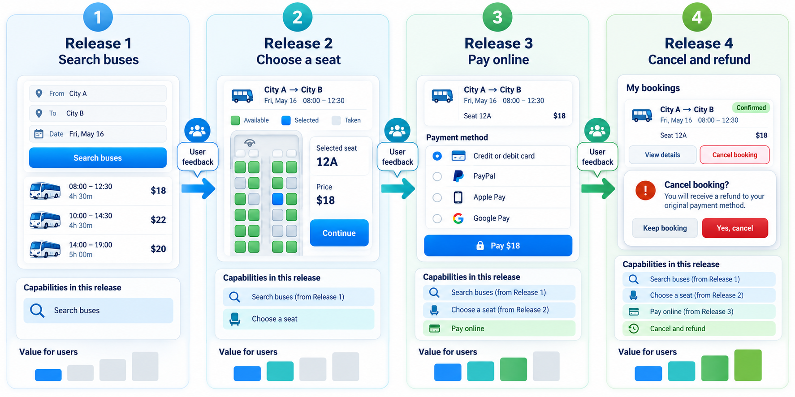
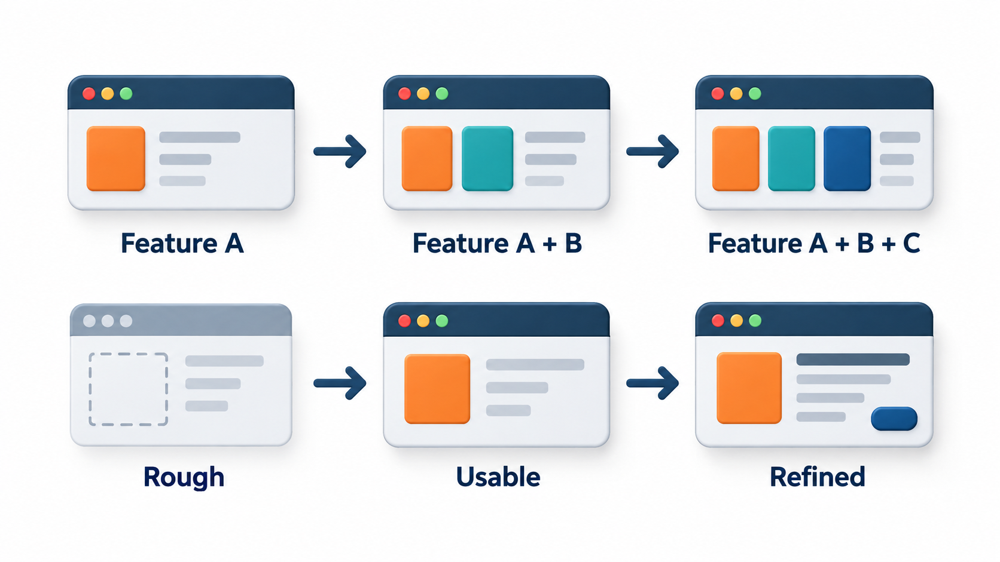
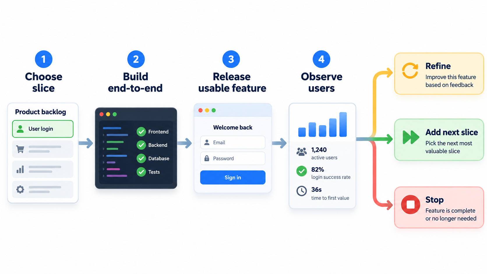
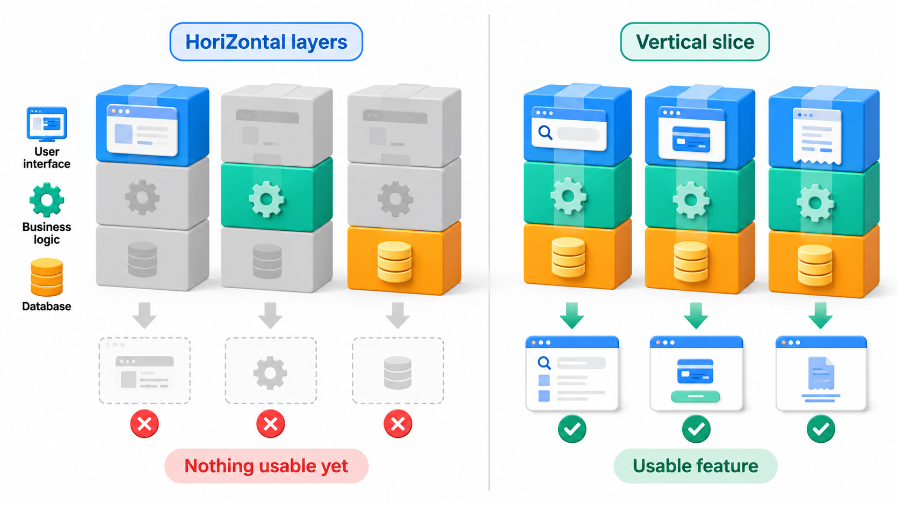

## A Little at a Time, and Then Again

Two of the most useful words in software process are *incremental* and *iterative*, and they are constantly confused. Both are ways of avoiding a single enormous delivery that is judged only at the end. If a team builds everything and shows it once, every misunderstanding it made at the start is discovered when it is most expensive to fix. If it delivers in small pieces and keeps improving them, the same misunderstanding is discovered in weeks.

**Incremental** and **iterative** development are two separate ideas for getting that early feedback, and good teams use both.

The underlying observation is simple. People are poor at predicting what they will want, and engineers are poor at predicting how long things will take. Both kinds of error shrink dramatically once something real exists. A prediction made on paper in January is a guess; the same question answered by a working screen in March is a fact. Incremental and iterative development are ways of converting guesses into facts early, and of paying for each fact in small instalments instead of one large bill at the end.

## Two Ideas That Sound Alike

The two words answer different questions, and good teams use both.

**Incremental development** answers: *in what pieces do we deliver?* The system is built and released in slices, and each slice is a working, usable part of the final product. The first increment might let a student log in and see fees. The second adds payment. The third adds receipts. At each stage, the part that exists is finished and usable.

**Iterative development** answers: *how do we improve what we have?* The team builds something, gets feedback, and goes round again to improve the same thing. The first version of the fee screen is crude. The second, after watching students use it, is clearer. The third handles the mistakes the second still allowed.

A team can be incremental without being iterative, by building piece after piece and never going back. It can be iterative without being incremental, by refining one whole system in repeated passes. Most practical processes mix both: they deliver in slices and improve each slice using feedback.

| | Incremental | Iterative |
| --- | --- | --- |
| The question | What do we add next? | How do we make this better? |
| Each cycle produces | A new, usable piece of the system | A better version of something already there |
| Risk it reduces | Delivering nothing for a long time | Building the wrong thing, or building it badly |
| Typical measure | Features working in users' hands | Quality, fit and feedback received |

<!-- Visual: two rows. Top, incremental: a picture assembled slice by slice, each slice finished. Bottom, iterative: a rough sketch refined into a clearer picture over three passes. -->

## What Delivering in Slices Buys

The first benefit is **value earlier**. A feature that reaches users in month three is already helping in months four to twelve. A feature that waits until month twelve has helped no one. Consider a fee-management system with four features, each worth Rs 10,000 a month once it is in users' hands, over a year. Delivered in slices, the features reach users at different times. Delivered all together, nothing is live until the end.

| Feature | Ships in month | Months live by month 12 | Value earned |
| --- | --- | --- | --- |
| Login | 3 | 9 | Rs 90,000 |
| Fee payment | 5 | 7 | Rs 70,000 |
| Receipts | 8 | 4 | Rs 40,000 |
| Reports | 12 | 0 | Rs 0 |
| **Total, delivered in slices** | | | **Rs 2,00,000** |
| **Total, everything delivered in month 12** | | | **Rs 0** |

Login, live for nine months, has earned Rs 90,000 by itself. Reports, shipped in month twelve, has earned nothing yet. In the all-at-once version nothing ships until month twelve, so the value by then is zero. The numbers are made up, and equal monthly values are a simplification. The pattern is real: delivery in slices starts the clock on value sooner, and it puts working software in front of users while changes are still cheap.

Slices bring three further benefits beyond early value.

- **Early risk reduction.** The first increment exercises the whole path from screen to storage to release. Problems with the technology, the deployment or the team's assumptions surface in the first weeks and not the last.
- **A usable product if money runs out.** If the budget is cut at month eight, a team that has delivered in slices has a working system with the most valuable features. A team that built layer by layer has an unfinished pile.
- **Users learn too.** Once people use the first increment, they discover what they actually need, and the later increments can be shaped by that discovery.

<!-- Visual: a timeline over twelve months with four features landing at months 3, 5, 8 and 12, and a shaded area under each showing the value earned afterwards, against a single block arriving at month 12. -->

## Choosing What Goes in Each Increment

Which slice should come first? Teams use three considerations together.

| Consideration | The question | Effect on order |
| --- | --- | --- |
| **Value** | Which feature helps users or the business most? | Build high-value features early |
| **Risk** | Which part is most uncertain or most likely to fail? | Build risky parts early, while there is time to change course |
| **Dependency** | What must exist before something else can work? | Build foundations before what rests on them |

Often the first increment is chosen not for its value but for what it proves: a thin path through the whole system that shows the main parts can talk to each other, sometimes called a *walking skeleton*. It does almost nothing useful, but it demonstrates that the design hangs together, that the build and release process works, and that the team can deliver. Later increments add flesh.

A useful discipline is to be able to describe each increment in one sentence of user value: "a student can log in and see their balance", not "the database layer is complete". If an increment cannot be described that way, it probably is not a vertical slice.

## What Going Round Again Buys

The second benefit belongs to iteration: **each pass fixes what the last one got wrong**. Nobody gets a fee screen right the first time. Real users hesitate in places the designer did not expect. If the team learns that after the first release, it can repair the screen in the next one.

<!-- Visual: Incremental delivery adds working capability while iteration improves the same capability. -->

The usual shape of this improvement is easy to describe. Suppose a feature starts at 40 out of 100 on some measure of how well it fits its users, and each round of feedback closes half of the remaining gap.

| After | Fit with users (out of 100) | Gain in this round |
| --- | --- | --- |
| First version | 40 | n/a |
| Iteration 1 | 70 | 30 |
| Iteration 2 | 85 | 15 |
| Iteration 3 | 92.5 | 7.5 |
| Iteration 4 | 96.25 | 3.75 |

The first round brings the largest gain, 30 points, and the fourth only 3.75. The early rounds are the most valuable, and the later ones show diminishing returns. This matters for planning: a team can stop iterating when the next round no longer pays for itself, and it should not wait for perfection. Real gains are less regular than this, and some rounds reveal a bigger problem, but repeated feedback tends to converge on something better.

## What One Cycle Looks Like

In an incremental, iterative project the same small set of activities is repeated in every cycle. A cycle is usually a fixed length, often two to four weeks, and in each one the team does a miniature version of the whole life cycle.

1. **Plan the cycle.** Choose the features or improvements to take on, based on value, risk and what was learned last time.
2. **Design just enough.** Work out how to build what was chosen, without designing the whole system again.
3. **Build and test.** Implement the chosen work and test it, including checking that it has not broken what already existed.
4. **Integrate and release.** Add the work to the product and, ideally, put it in front of real users or a stand-in for them.
5. **Review and learn.** Look at what the users did, what the team learned, and what to change in the plan and the process.

Notice the last step. A cycle that ends without review has delivered features but no learning, and most of the value of the approach is the learning. The review is where the plan for the next cycle is changed, which is the essence of working iteratively.

## Slices Must Be Vertical

A common mistake is to cut an increment by *layer* instead of by *feature*. A team builds all the database tables first, then all the business logic, then all the screens. After six months it has three finished layers and nothing a user can touch. This is the waterfall in disguise.

A good increment is a **vertical slice**: a thin piece that goes through every layer, from screen to storage, and gives a user something real to do. "A student can log in and see their fee balance" is a vertical slice, even though the screen is plain and the storage holds a single table of fees. It is small, but it works end to end, which means it can be shown, tested and corrected.

<!-- Visual: a layered system drawn as horizontal bands (screens, logic, database). A horizontal cut labelled "build one layer at a time: nothing usable" beside a vertical cut labelled "one thin feature through all layers: usable". -->

## Frameworks That Use These Ideas

Many well-known processes are built on incremental and iterative thinking, differing mainly in how long the cycle is and how it is governed.

| Approach | How it uses the ideas |
| --- | --- |
| **Incremental model** | The requirements are agreed at the start, but the system is designed, built and delivered in successive increments |
| **Iterative or evolutionary model** | A rough version is built first and refined through repeated cycles until it satisfies the users |
| **Rational Unified Process** | Work is organised in four phases (inception, elaboration, construction, transition) with iterations inside each, and risk handled early |
| **Scrum and other agile methods** | Fixed short cycles produce a potentially releasable increment every time |
| **Continuous delivery** | Each small change is built, tested and made ready for release automatically |

You will meet several of these in the topics that follow. What they share is the rhythm: build a little, check it with the real world, and use the answer to decide what to do next.

## The Costs to Be Honest About

Incremental and iterative development are not free. Each increment has to be integrated with the previous ones, so the design must allow adding pieces without rewriting what exists. The team must test repeatedly, which is why such teams tend to automate their tests. Early increments may be thrown away or reworked as understanding improves. And managers have a harder question to answer than "are we on schedule?", which is "what is the most valuable thing to do next?".

There is also a risk specific to the approach. When a team adds piece after piece without ever stepping back, the structure can erode: each increment makes a small shortcut to fit, and after twenty cycles the design is a patchwork. The remedy is to treat tidying as part of every cycle, so that the structure is kept fit for the next slice. Iteration should apply to the design as well as to the features.

The trade is worthwhile because the alternative's costs are hidden until late. Both approaches turn a risk that surfaces at the end into a smaller risk that surfaces every few weeks.
