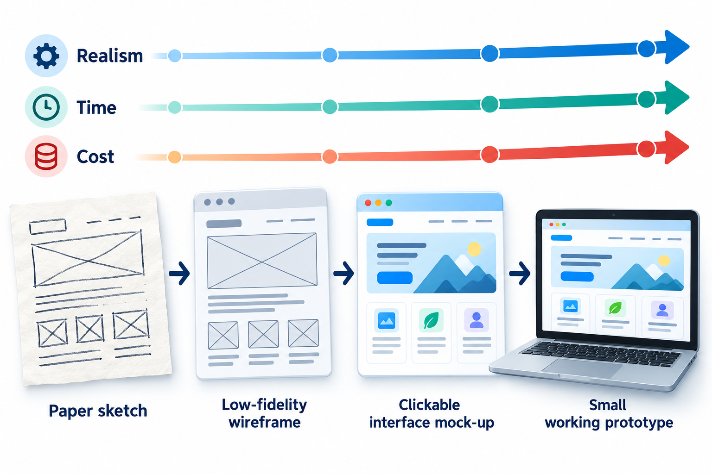
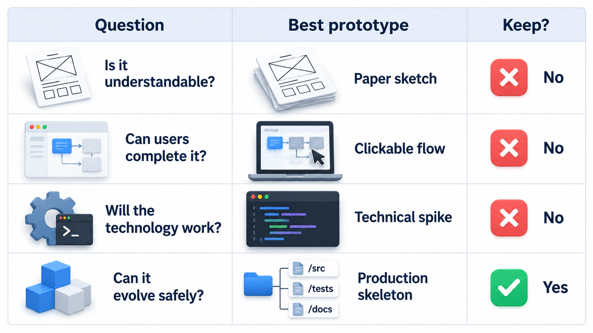
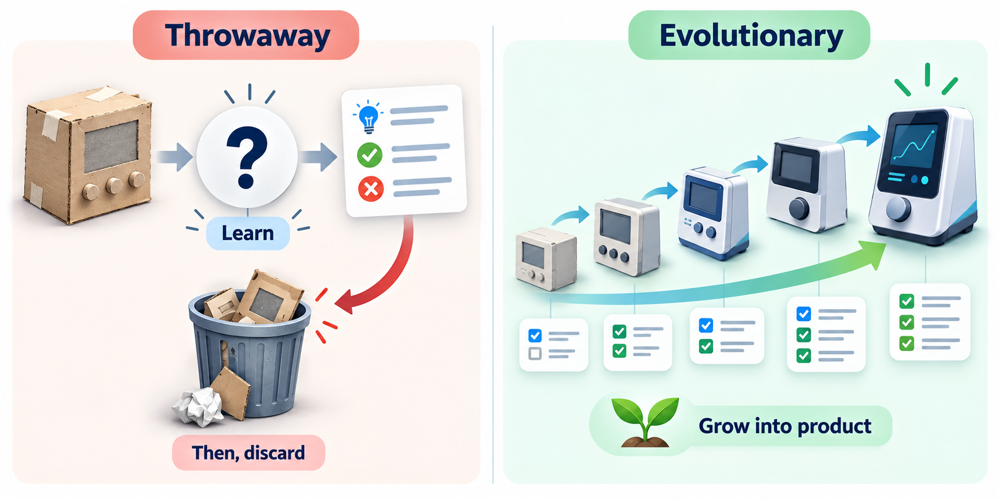
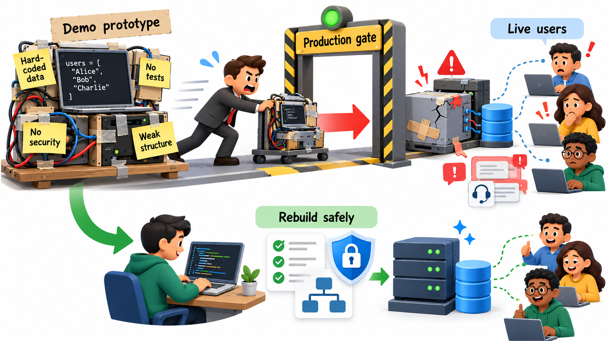
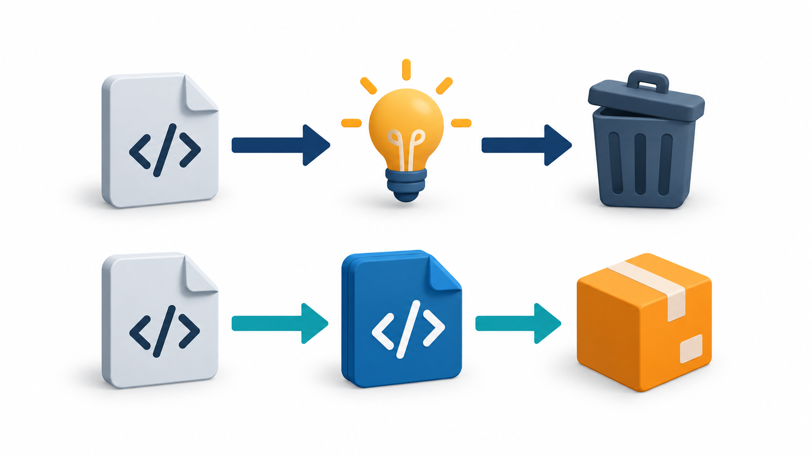

## Sketch First, Build Later

Architects make a model before they pour concrete. Car makers shape a clay version before they cut steel. The model is cheap, so mistakes in it cost almost nothing, and people can point at it and say "not like that". Software has the same need, and an even stronger one, because users often cannot say what they want until they see something.

A **prototype** is a cheap, partial version of a product made to answer a question. The question might be "does anyone want this?", "will people understand this screen?" or "can we build the hard part at all?". Prototyping is the practice of building something quickly to learn something, and the process models around it differ mainly in what happens to the prototype afterwards.

The need for prototypes comes from a basic difficulty in software: the requirements that people state are not the requirements that they have. Ask a college registrar what a results portal should do and you will get a sensible list. Show them a rough version, and within minutes they will say "oh, but we also need to show the re-evaluation status" or "students will not find this button". The information was always in their heads; the prototype was what brought it out. Prototyping is therefore a way of discovering requirements, not only of illustrating them.

## What a Prototype Is For

A prototype is a means of reducing uncertainty before committing to a full build. Different prototypes answer different questions.

| Question | What a prototype might be |
| --- | --- |
| Do users want this? | A landing page, a video, or a paper sketch shown to ten people |
| Will users understand the screens? | A clickable mock-up with no code behind it |
| Can we build it at all? | A small program that tests the hardest technical step |
| Will the idea scale or perform? | A rough build run against realistic loads |

They sit along a scale from cheap and rough to expensive and realistic: a drawing on paper, a clickable set of screens, a working program with a few real features. The earlier on the scale the prototype sits, the cheaper it is to make and to throw away, and the less it can tell you about how the real thing will behave. A good team uses the cheapest prototype that can answer the question it has.

<!-- Visual: a spectrum from paper sketch to clickable mock-up to working prototype, with realism, time and cost rising along it. -->

## Kinds of Prototype by Fidelity and Purpose

Prototypes are described by two features: how closely they resemble the final product (their *fidelity*) and what question they serve.

| Kind | Fidelity | What it is | Best for |
| --- | --- | --- | --- |
| **Paper or whiteboard sketch** | Very low | Hand-drawn screens, moved around on a table | Early exploration of layout and flow, cheap enough to draw ten alternatives |
| **Wireframe** | Low | Plain boxes and labels showing structure of screens | Agreeing what goes on each screen without arguing about colours |
| **Clickable mock-up** | Medium | Linked screens that look real but do nothing behind them | Testing whether users can find their way |
| **Wizard of Oz** | Medium | A screen that appears automatic but is secretly operated by a person | Testing whether people want a service before building the machinery |
| **Technical spike** | Not visual | A small program that tests one hard technical question | Answering "can we do this, and how fast?" |
| **Working prototype** | High | A functioning version of some real features | Testing performance, integration and realistic use |

The Wizard of Oz is worth a note because it shows the point of prototyping so clearly. A team wondering whether students will use an automatic answer service can set up a chat window and have a staff member type the replies. If students use it eagerly, the idea is worth the large expense of automation. If they ignore it, the team has saved months. The point is to learn about the user's behaviour, not to build the technology.

## Throwaway or Evolutionary

Once a prototype has done its job, a team must decide what to do with it. There are two traditions.

A **throwaway prototype** (also called a rapid or exploratory prototype) is built to learn and then discarded. The code is written fast and loosely, without worrying about structure, tests or security, because it will not survive. Its value is the knowledge it leaves behind: what users said, what turned out to be hard, which assumptions were wrong. Then the real system is built properly with that knowledge.

An **evolutionary prototype** is the first version of the actual system. It is built reasonably well from the start, shown to users, and improved in cycles until it becomes the finished product. Nothing is thrown away; each version builds on the last. This approach is natural when the requirements are expected to keep changing, because the system is always working and always being shaped by feedback.

| | Throwaway | Evolutionary |
| --- | --- | --- |
| Purpose | Learn, then discard | Grow into the product |
| Quality of the code | Rough, on purpose | Good enough to keep and extend |
| What survives | The lessons | The software |
| Best for | Unclear requirements, risky ideas | Needs that keep changing |
| Main danger | It is kept and shipped | Early shortcuts become permanent |

<!-- Visual: two paths. Throwaway: prototype leading to lessons and then a new, separately built product. Evolutionary: prototype strengthened through cycles into the final product. -->

## Running a Prototyping Cycle

A prototype is only useful if it is used to learn something. A disciplined cycle has five steps.

1. **State the question.** Write down what you want to find out, for example "can a first-year student pay a fee without help?". A prototype built without a question tends to grow into a product by accident.
2. **Build the cheapest thing that can answer it.** Choose the lowest fidelity that works. If a paper sketch can answer the question, do not build software.
3. **Put it in front of real users.** Not colleagues, not the person who ordered it: people like those who will use the finished product. Watch what they do rather than only asking what they think.
4. **Record what you learned.** Note where users hesitated, what they misunderstood and what they asked for. Count how many people had each problem.
5. **Decide what to do.** Change the design, build a better prototype, move to real development, or abandon the idea. Stopping is a legitimate and valuable result.

The cycle may repeat several times, each pass with a sharper question and a more realistic prototype. The earlier passes are cheap and broad; the later ones are more expensive and narrow.

## Is a Prototype Worth Its Cost?

Because a prototype costs time, it is fair to ask when it pays for itself. The answer depends on how likely it is that the idea is wrong and how much a wrong full build would cost. Take a two-week prototype in front of a twelve-week product, with a 60 per cent chance that users will not want the product.

| Plan | What is wasted if the idea is wrong | Expected weeks wasted |
| --- | --- | --- |
| Build the full product straight away | All 12 weeks | 0.6 x 12 = 7.2 |
| Test the idea with a prototype first | Only the 2-week prototype | 0.6 x 2 = 1.2 |

On average the prototype saves 6 weeks. The saving shrinks when the idea is almost certainly right, because then the prototype is a cost with nothing to find. That is the rule of thumb: prototype when the uncertainty is high and a wrong build would be expensive. The numbers are invented for the example.

## The Danger: The Prototype That Became the Product

The most common failure in this area is not building a poor prototype. It is *keeping* one. A throwaway prototype is written fast, usually with no tests, little structure and shortcuts that nobody documented. It works well enough to demo. Someone with a deadline says "this already works, can we just ship it?", and the demo becomes the foundation of a product.

The cost appears later: code nobody can safely change, security holes, performance problems, and a team that has to keep a structure that was never designed. If a team builds a throwaway prototype, it should agree up front that it will be thrown away, and say so to everyone who will see it. Marking the prototype clearly as such, and not giving it a name that sounds like a real product, helps people remember.

If the team wants to keep the work, the right model is evolutionary: build it with enough quality to last from the beginning, accept that the first version will be slower to build, and keep tests as the safety net for later change.

<!-- Visual: a rough prototype labelled "demo" being carried across a line into "production" with warning labels such as "no tests", "hard-coded values", "no security", "no structure". Save as images/11_prototype_becomes_product.png. -->

## Other Limits and Cautions

Beyond that main danger, prototyping has several known pitfalls.

- **The prototype creates false expectations.** A convincing demo makes stakeholders believe the product is nearly finished. Explain clearly what is missing: security, data, error handling, speed with many users.
- **Feedback follows the polish.** If the prototype is highly polished, reviewers comment on colours and wording. If it is rough, they comment on the idea. Choose the fidelity to draw the feedback you need.
- **The wrong users give the wrong answers.** Feedback from the sponsor's friends does not predict the behaviour of strangers. Test with people who resemble the real users.
- **Endless prototyping.** A team can keep refining prototypes to avoid the harder work of committing. Set a limit on the number of cycles or the time, and decide.
- **Hidden costs.** Rough prototypes ignore the difficult parts: integration with existing systems, large data, security rules. A smooth prototype can hide a hard build.

## Prototypes Inside Other Processes

Prototyping is rarely a complete process on its own. It is usually a step inside another one. A waterfall project may use a prototype to settle the requirements before signing them. A spiral project builds a prototype in the early turns to reduce its biggest risks. An agile team treats each early sprint as a prototype that real users see. In each case, it is the same technique: find the most important uncertainty and build the cheapest thing that can resolve it.

<!-- Visual: a prototype feeding two choices, discard it and keep the lessons, or strengthen it into the product. -->

