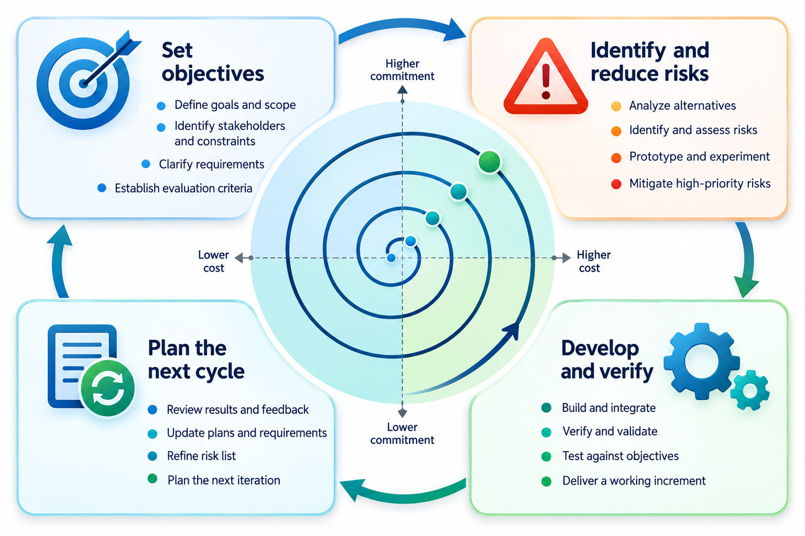
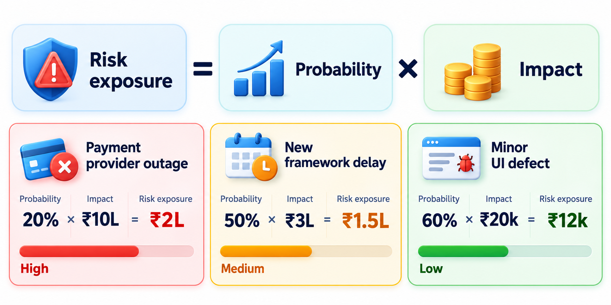
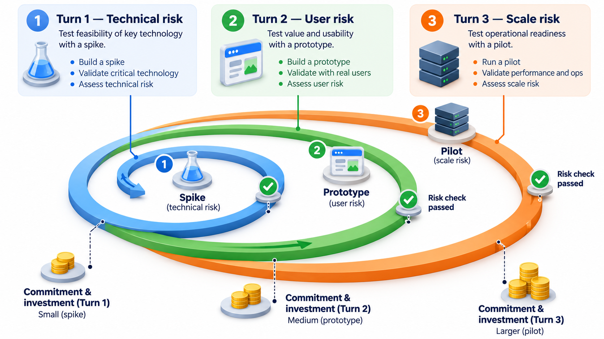
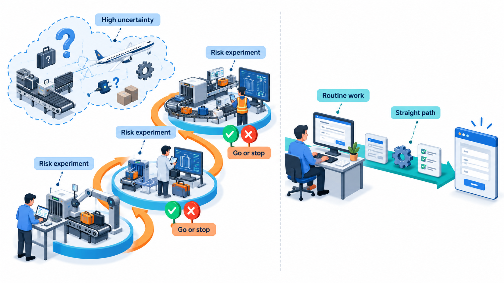
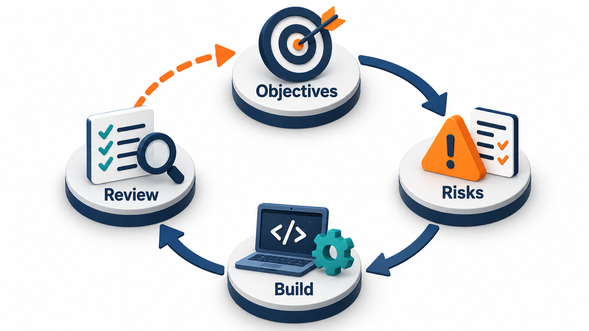

## Find the Scariest Thing First

Every project has something that could sink it: a technology nobody has used before, a rule users may refuse to accept, an integration that might simply not work. A sensible team does not leave that unknown until the end, when most of the money is spent. It goes after the scariest thing first, cheaply, and finds out whether the project is even possible.

The **spiral model**, proposed by Barry Boehm in 1986, is a process organised around that habit. It is a way of building where what you do next is decided by the biggest risk you currently face, and each turn asks one blunt question: what is the most likely way this will fail, and can we find out cheaply before we commit?

Other models are driven by something else: the waterfall by the order of documents, the incremental model by the order of features, prototyping by uncertainty about the requirements. The spiral is driven by *risk*, a word with a precise meaning here. A risk is something that might happen and would hurt if it did. Managing a project then becomes the task of keeping the overall risk low enough to continue, and of spending effort where it reduces the risk most.

## One Turn of the Spiral

The model is drawn as a spiral that starts at the centre and winds outwards. Each full turn is a cycle of four activities, and the distance from the centre stands for the money and effort spent so far.

| Quadrant | What the team does | Example for a rural-clinic diagnosis app |
| --- | --- | --- |
| **1. Set objectives** | State what this turn is trying to achieve, and what limits apply | "Find out whether photo analysis is accurate enough to be useful" |
| **2. Identify and reduce risks** | List what could go wrong and choose the cheapest way to learn more | Test an existing image tool on 500 sample photos |
| **3. Develop and test** | Build just enough to answer the question | A small prototype checked by eye specialists |
| **4. Review and plan** | Decide whether to go on, change direction or stop, and plan the next turn | If accuracy is good, plan a round on the app. If not, stop or change course |

The early turns are cheap and small. The big spending comes later, only after the dangerous questions have been answered. If the answer to the first turn is "this cannot work", the project stops having spent very little. Compare this with a sequential process, where the same discovery might come after most of the money is gone.

<!-- Visual: a spiral starting at the centre, divided into four quadrants (objectives, risks, develop and test, review and plan), with the radius labelled "cost so far". -->

## The Kinds of Risk a Project Faces

Before risks can be ranked they must be found, and it helps to know the usual families.

| Family | Examples | A typical way to reduce it |
| --- | --- | --- |
| **Technical** | A new technology may not scale; two systems may not integrate | Build a small experiment of the hard part |
| **Requirements** | Users may not want it, or may want something else | Prototype and show users |
| **People** | A key person may leave; the team may lack a skill | Share knowledge, train, hire early |
| **Schedule and cost** | The estimate may be wildly optimistic | Estimate in ranges; deliver the first slice and measure |
| **External** | A supplier may be late; a law may change; a partner may withdraw | Agree alternatives; watch the external world |
| **Operational** | The software may fail in use, or be insecure | Early testing, reviews, security analysis |

A project team can find risks by asking "what would make us regret this plan?" in different directions: about the technology, the users, the people, the date, the money and the world outside. A list produced in half an hour by people who know the project is better than a sophisticated tool used by a stranger.

## Risk Is Given a Number

The model works because risk can be put into numbers, even rough ones. The usual measure is **risk exposure**: the chance that something goes wrong multiplied by the damage it would do. A risk with a 40 per cent chance of costing 20 lakh rupees has an exposure of 8 lakh. A risk with a 20 per cent chance of costing 8 lakh has an exposure of only 1.6 lakh. The numbers are estimates and only need to be good enough to rank the risks.

<!-- Visual: three risks plotted by probability and cost of damage, with the exposure of each written beside it and the biggest circled. -->

With exposure measured, the plan for each turn is mechanical: attack the risk with the highest exposure first. Take a rural-clinic diagnosis app with three risks.

| Risk | Chance | Damage (lakh rupees) | Exposure |
| --- | --- | --- | --- |
| Photo analysis is not accurate enough | 40% | 20 | 8.0 |
| Villages have poor network | 20% | 8 | 1.6 |
| Health workers do not trust the app | 30% | 12 | 3.6 |

The total exposure is 13.2 lakh. Each turn removes the biggest risk still open.

| Turn | Risk tackled | Exposure removed | Exposure left |
| --- | --- | --- | --- |
| 1 | Accuracy | 8.0 | 5.2 |
| 2 | Trust | 3.6 | 1.6 |
| 3 | Network | 1.6 | 0 |

Turn one removes more than half the total. After two turns only 1.6 lakh remains. The logic of the model is on show: the order of work is set by exposure, not by what is most fun or easiest to build. In a real project each turn also changes the other risks, but the ranking method stays the same.

## What to Do With a Risk

Once a risk is ranked, there are four basic responses, and the spiral's second quadrant is about choosing among them.

| Response | What it means | Example |
| --- | --- | --- |
| **Avoid** | Change the plan so the risk cannot occur | Drop the feature that depends on an unproven technology |
| **Reduce** | Lower the chance or the damage | Build a prototype of the hard part before committing |
| **Transfer** | Pass the risk to someone better placed to bear it | Buy a proven component; buy insurance; fix the price in a contract |
| **Accept** | Decide the risk is tolerable and carry on, with a plan if it happens | Accept that one minor feature may slip |

The choice depends on exposure and cost: a response should cost less than the exposure it removes. A risk with an exposure of one lakh is not worth a three-lakh prototype, but an exposure of eight lakh justifies a two-lakh experiment. A good project keeps a short *risk register*, a list of the main risks with their exposure, the chosen response and an owner, and reviews it at the start of each turn.

## A Project Through Three Turns

To see the model in action, follow the clinic app. The team's goal is an app that lets village health workers photograph skin conditions and receive guidance.

**Turn 1: is it feasible?** The biggest risk is that image analysis is simply not accurate enough. The team spends three weeks testing an existing tool on 500 photographs labelled by specialists. Result: accuracy is good for four common conditions and poor for the rest. Review: continue, but narrow the scope to the four conditions. Money spent: small.

**Turn 2: will people trust it?** The next risk is that health workers will ignore guidance from a phone. The team builds a clickable prototype and takes it to twelve workers, who say they would use it only if it shows how confident it is and lets them call a doctor. Review: add a confidence display and a call option to the plan.

**Turn 3: will it work offline?** The last major risk is the poor network. The team builds a working version of the core flow that stores photos on the phone and sends them later. Field test: it works. Review: the main risks are now low, so the project moves to ordinary incremental development with the full team.

At no point did the team commit large money before the dangerous questions were answered. If turn 1 had shown the analysis to be unusable, the project would have stopped after three weeks.

## When Risk Should Drive the Plan

Risk-driven planning pays off when there are big unknowns. It is a strong fit for projects with a new technology the team has never used, a large investment that cannot be undone, a novel kind of user, or a safety or security concern. It suits situations where a wrong guess in one area, such as accuracy, would make everything else pointless.

It is a poor fit for routine work. If the team has built ten similar systems, a formal risk analysis each turn is overhead. The spiral also needs people who can assess risks honestly. A manager who does not want to hear that the central idea may not work will ask for a different list of risks, and the model then provides a cover of method for an optimistic plan.

| Strength | Limitation |
| --- | --- |
| Finds fatal problems early and cheaply | Needs skilled, honest risk assessment |
| Gives a rational basis for stopping or changing course | Can feel vague and open-ended to a customer who wants a fixed price |
| Combines well with prototyping and incremental delivery | Adds management overhead that small, routine projects cannot justify |
| Treats the project as a series of decisions, not one commitment | Hard to fit into a fixed-price contract |

<!-- Visual: two projects side by side. A new-technology project with large unknowns and a risk review at the end of each turn, and a routine project with no unknowns following a straight path. -->

## What the Spiral Gave to Other Processes

Most modern processes quietly borrow from the spiral. An agile team that builds a thin end-to-end slice first to prove the architecture is doing a spiral turn. A team that tests the hardest integration at the start of the project does too. The Unified Process, a later iterative framework, puts risk reduction in its second phase. The model's lasting contribution is the habit: before you commit more money, name what could kill the project and spend a little to find out.

It is best seen not as a rival to the other models but as a lens over them. Any model can be improved by asking, at each stage, what the biggest risk is and what the cheapest test of it would be.

<!-- Visual: one spiral turn with its four activities, objectives, risk reduction, build and review, ending in a go or stop decision. -->

