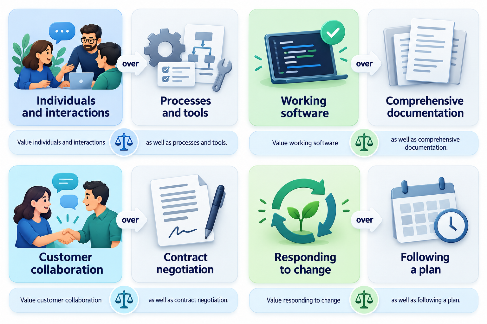
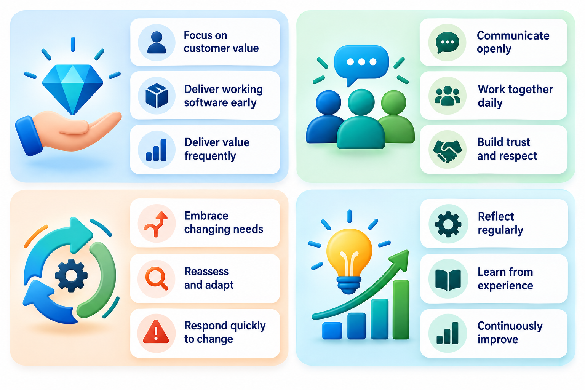
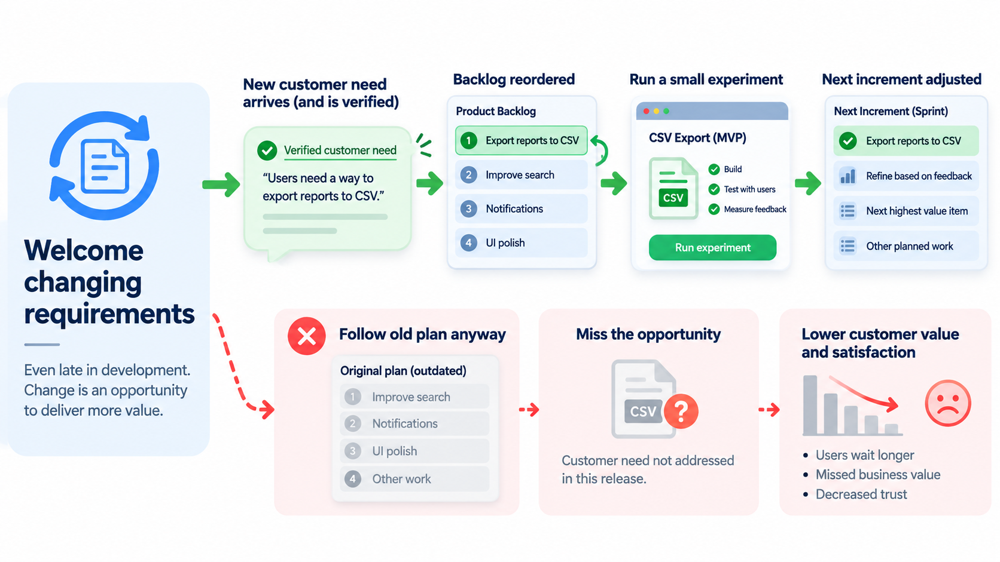
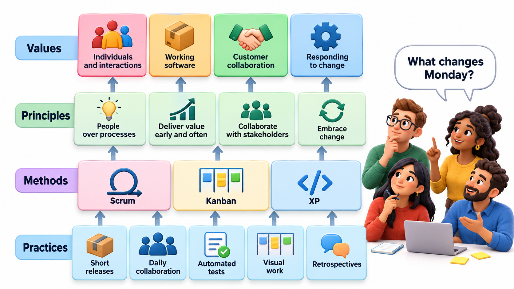
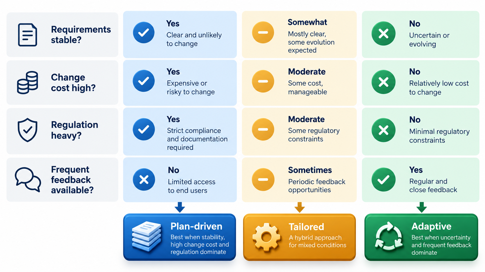

## Four Sentences, Each With the Word "Over"

Most software process documents run to hundreds of pages. The statement that reshaped modern practice fits on one. The **Agile Manifesto** has four lines of values and twelve short principles behind them, and its central trick is the phrase *this over that*: it does not ban anything, it says what to prefer when two good things conflict.

That makes it easy to quote and easy to misunderstand. The common summary, "agile means no documentation and no plans", is wrong. The words are precise, and the details are where the meaning lies, so this topic reads the manifesto closely.

It helps to know the situation it answered. By the end of the 1990s, many software teams were following heavy, document-first methods that assumed requirements could be fixed at the start. The assumption often failed. Requirements changed faster than the plan, long delivery cycles ended with software nobody wanted, and documents were out of date by the time they were signed. A group of practitioners who had each been trying lighter methods met to find what their approaches had in common, and wrote down what they agreed on. The manifesto is a statement of shared beliefs, not a method; it describes an attitude towards the work.

## The Four Values and the Word "Over"

The manifesto states its values in a particular form: *this over that*. And it says plainly that while there is value in the items on the right, the items on the left are valued more.

| We value more | Over | What this means in practice |
| --- | --- | --- |
| **Individuals and interactions** | Processes and tools | A team that talks every day and trusts each other beats a team with a perfect tool and no conversation |
| **Working software** | Comprehensive documentation | Progress is measured by what runs and what users can try, not by pages written |
| **Customer collaboration** | Contract negotiation | Work with the customer continuously to find what is needed, instead of defending the original agreement |
| **Responding to change** | Following a plan | A plan is a guide that is updated as the team learns; changing course is not failure |

Read each row twice. The right-hand items are not banned. A team still needs a process, documents, contracts and plans. The statement is about what to do when they conflict: when the plan says one thing and the customer's reality says another, the plan gives way. When a long document is the only evidence of progress, but a running demo would be better evidence, choose the demo.

The word *comprehensive* in the second row deserves attention. The manifesto does not say "no documentation". It says that comprehensive documentation, written because the process demands it, is less valuable than working software. A short, useful README, an architecture sketch and a clear set of acceptance criteria are all in the spirit of the manifesto.

<!-- Visual: four horizontal balances, each with the item valued more on the heavier left side and the item on the right still present but lighter. -->

## The Values When They Collide

The values become clear in a conflict. Here are four situations a team might face, and how each value points.

| Situation | What a plan-first reading says | What the agile value says |
| --- | --- | --- |
| A tester and a developer disagree about a bug report | Follow the defect procedure and escalate through the form | Talk now, at a desk or on a call, and settle it in five minutes |
| The project is two weeks from the end, and the team has not written the detailed design document | Stop and write it, because the process requires it | Ask who will read it. If nobody, put the effort into the working software and a short note of the key decisions |
| The customer asks for a feature not in the contract, which would be more useful than one that is | Refuse, or raise a formal change request that takes a month | Discuss openly, agree what to swap, and record it in a line |
| A competitor launches something that changes the market | Stick to the plan, since it was approved | Review the plan this week and change the next piece of work |

Each time, the agile reading favours the shorter loop between people and reality. This is the common thread in the four values: reduce the distance between the person who knows something and the person who needs to act on it.

## Twelve Principles in Four Groups

The values are the headline. The twelve principles are the explanation, and they are more concrete. They fall naturally into four groups.

| Theme | The principles in plain words |
| --- | --- |
| **Deliver value early and often** | Satisfy the customer through early, continuous delivery. Deliver working software frequently, in weeks rather than months. Working software is the main measure of progress. |
| **Welcome change** | Accept changing requirements, even late, because change can give the customer an advantage. Keep a pace that can be kept up indefinitely. |
| **Work as people, together** | Business people and developers work together daily. Build projects around motivated individuals and trust them. Face-to-face conversation is the best way to share information. Self-organising teams produce the best designs. |
| **Keep improving** | Continuous attention to technical excellence and good design improves agility. Simplicity, the art of maximising the work not done, is essential. At regular intervals the team reflects on how to become more effective and adjusts. |

Some of these are quietly demanding. "A sustainable pace" means no routine heroics and no death marches of late nights. "Simplicity, the art of maximising the work not done" says that the cheapest feature is the one that is never built. "Technical excellence" means that agile is not a licence for sloppy code: a team that changes direction every two weeks needs code that is easy to change.

<!-- Visual: the twelve principles arranged in four groups around the manifesto: deliver value, welcome change, people together, keep improving. -->

## What Each Group Asks of a Team

Reading the principles as demands makes their consequences clearer.

**Deliver value early and often.** The team must be able to produce something usable every few weeks. That is only possible if work is cut into small slices, the product is kept in a releasable state and testing is done continuously, not at the end. A team that cannot do this will find that the principle exposes the weaknesses in its process.

**Welcome change.** Change is treated as an opportunity because the team is organised to absorb it cheaply. This requires code that is easy to modify, automated tests that catch breakages and a habit of planning only a short distance ahead. A team that welcomes change in words but has a design that breaks when touched will find the principle painful.

**Work as people, together.** The customer's representative is part of the team's daily life, not a distant approver. Decisions are made by the people closest to the work. This demands trust and communication skills as well as technical ones, and it depends on a team being small enough to talk.

**Keep improving.** At regular intervals the team looks at how it works and changes something. This is not a luxury but the way the other principles stay alive, because the practices that suit one team in one year will not fit the next.

## Agile Is a Mindset, Not a Method

A frequent confusion is between **agile**, which is a set of values, and the named methods such as Scrum, Kanban and Extreme Programming. The manifesto says nothing about sprints, standing meetings, story points or boards. Those belong to the methods, which are different attempts to put the values into practice. A team can be doing Scrum and not be agile in the manifesto's sense: if it holds every ceremony but refuses to change its plan, never talks to its users and ships once a year, it has the rituals and none of the values.

The reverse also happens. A small team with no named method that talks to its customer daily, ships every week and changes course quickly is more agile than a certified Scrum team that has become a reporting routine. The test is not the vocabulary. It is the behaviour: do we get feedback early, do we respond to it, and do we take care of our people and our code?

<!-- Visual: a ladder with the values at the top, principles below, named methods (Scrum, Kanban, XP) below those, and team practices at the bottom, labelled with the question "what did we actually change?". -->

## Plan-Driven and Agile Compared

The two traditions are often presented as opposites, but they are better understood as different bets about how to deal with uncertainty.

| Aspect | Plan-driven approach | Agile approach |
| --- | --- | --- |
| Main bet | The future can be predicted well enough to plan in detail | The future cannot be fully predicted, so plan lightly and adapt |
| Requirements | Gathered and fixed early | Discovered and refined throughout |
| Delivery | One main release at the end | Frequent small releases |
| Documentation | Detailed, produced by phase | Just enough, kept current |
| Customer role | Defines needs at the start and accepts at the end | Takes part throughout |
| Change | Controlled and exceptional | Expected and welcomed |
| Success measure | Delivered on plan | Value delivered to users |
| Works best when | Requirements are stable and the cost of error is high | Requirements are unclear or changing and feedback is possible |

Neither bet is always right. The skill lies in matching the approach to the situation, and in knowing that most real projects use a mixture.

## Why the Values Resonated

The manifesto was a response, not an invention. The pressures behind it were familiar: requirements that changed faster than the plan, long delivery cycles that ended with software nobody wanted, and documents that were out of date by the time they were signed. For businesses on the early web, release cycles of a year or more were not survivable.

That context explains why the values work best where uncertainty is high and feedback is possible. The manifesto is less obviously right for a bridge or a pacemaker, where change after the fact is costly and evidence must be documented. In those settings teams adapt the ideas rather than adopting them whole, since the right amount of process depends on the project.

## Honest Criticisms

Agile practice has also drawn fair criticism, and a student should know it.

- **Ritual without substance.** Many organisations adopt the vocabulary (stand-ups, sprints, boards) without the values, producing what is often called "agile in name only".
- **Short-term thinking.** A team that plans only two weeks ahead can neglect architecture and long-term maintainability, accumulating design debt.
- **Poor fit for fixed-price contracts.** Customers who need a fixed scope, date and price may find the open-ended approach hard to buy.
- **Dependence on skilled, available people.** The approach assumes a capable, empowered team and a customer who has time to take part. Where these are missing, it struggles.
- **Scaling.** Practices designed for a team of seven are hard to extend across a hundred developers and many teams.

None of these shows that the values are wrong. They show that the values need supporting practices and honest adaptation, which is why agile teams add technical practices, scaling approaches and process tailoring to the values.

## Five Misreadings of the Agile Manifesto

**"Agile means no documentation."** The manifesto prefers working software over *comprehensive* documentation. Useful documentation, kept short and current, is welcome. What is discouraged is paperwork that exists to satisfy a process.

**"Agile means no planning."** Agile teams plan constantly, in smaller pieces and more often. What they avoid is treating a plan made at the start as a promise that cannot change.

**"Agile means developers can do whatever they like."** The values are demanding: close cooperation with the customer, quality, a sustainable pace and regular reflection. Agile removes a lot of ceremony and adds a lot of accountability.

**"Doing Scrum or Kanban makes a team agile."** The methods are ways to practise the values. A team can follow the rituals and ignore the values, and the result is called "agile in name only".

**"Agile is a speed-up trick."** The aim is to deliver the right thing and to learn sooner, not to type faster. Teams that adopt it only to cut time often find it exposes how much of their schedule was waiting and rework.
