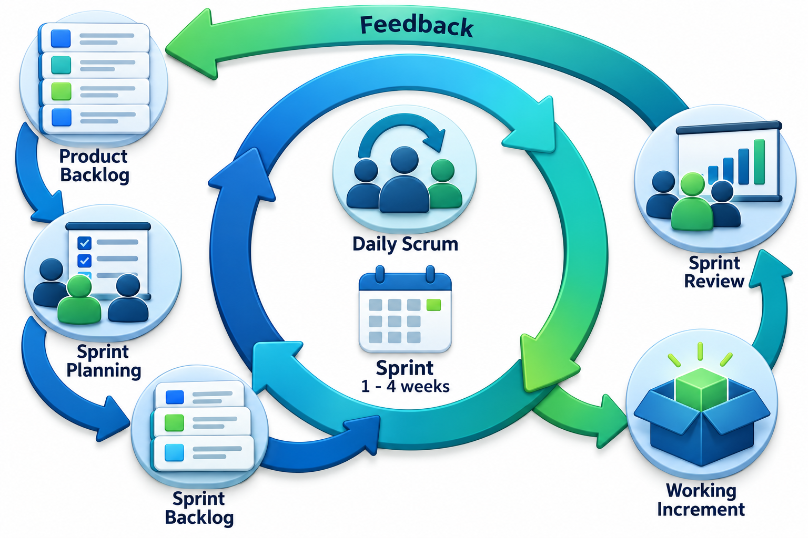
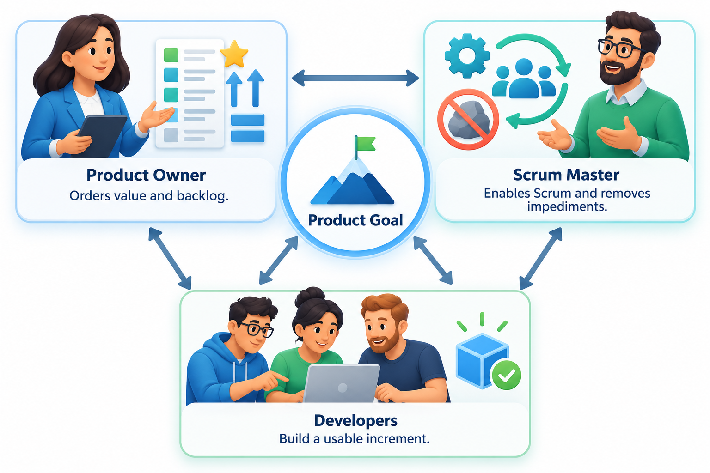
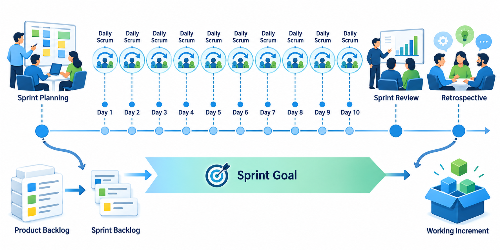
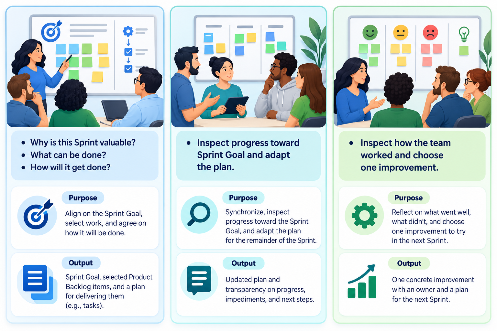
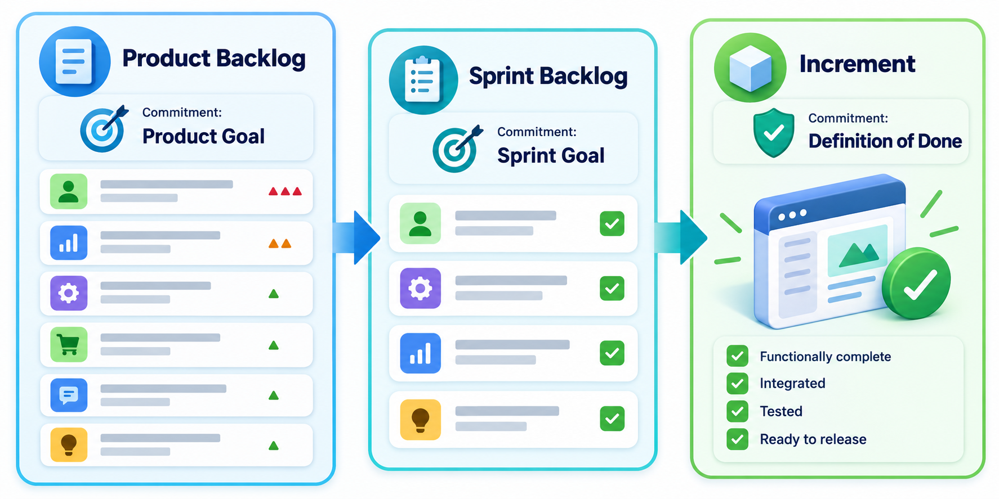
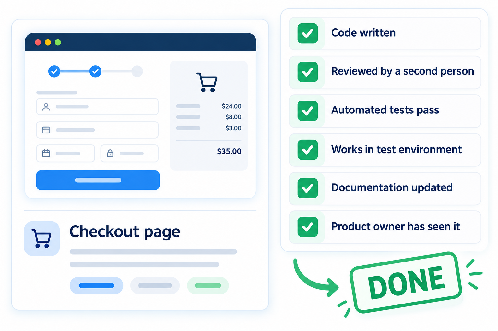
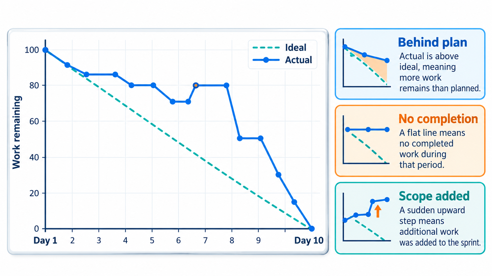

## What If a Team Planned Only Two Weeks at a Time?

Long plans go wrong because the world changes while the plan stays still. A team that commits to six months of work finds out in month five that month one was a mistake. A team that plans only the next two weeks, shows what it built, and then plans the next two, can correct course constantly. That is the idea behind **Scrum**, the most widely used agile framework.

Scrum is deliberately small. Its official description, the *Scrum Guide*, runs to about a dozen pages, because it prescribes only a handful of roles, events and artefacts and leaves nearly everything else, including how to build the product, to the team. This topic walks through all three, and the rule that ties them together: the **sprint**.

A framework is different from a method. A method tells you exactly what to do in each situation. A framework gives you a structure and a set of rules within which you work out the details yourself. Scrum is a framework in this sense. It does not tell you how to write code, how to test or how to design; it tells you how to organise the work of a team so that progress can be seen and the plan can be corrected regularly.

## The Idea Underneath: Empirical Control

Scrum rests on **empiricism**: knowledge comes from experience, and decisions are made on what is observed, not on what was predicted. Three ideas express it.

| Idea | What it means | How Scrum supports it |
| --- | --- | --- |
| **Transparency** | The things that matter are visible to everyone who needs to see them | A shared backlog, a visible sprint board, an agreed definition of done |
| **Inspection** | The team looks at its work and its progress often enough to notice problems | Daily scrum, sprint review, sprint retrospective |
| **Adaptation** | When inspection shows a problem, something is changed at once | The backlog is reordered, the plan is updated, the process is adjusted |

If any of the three is missing, the loop breaks. Without transparency there is nothing reliable to inspect. Without inspection, problems stay hidden. Without adaptation, inspection is only observation. Every rule of Scrum can be traced to one of these.

## The Sprint: A Short Box of Time

Everything in Scrum happens inside a repeating time-box called a **sprint**, usually one to four weeks long, most often two. At the start of the sprint the team commits to a goal and a set of work. During the sprint, the goal stays fixed and the scope is adjusted as the team learns. At the end the team shows a working piece of the product, and then the next sprint begins at once.

The fixed length is the point. It forces the team to break work into pieces that fit, gives stakeholders a regular chance to see progress, and provides a steady rhythm for feedback and planning. Because the sprint is short, a wrong turn can cost two weeks and not two quarters.

Scrum protects the sprint with a few rules. No change is made that would endanger the sprint goal. Quality does not drop: the definition of done does not get relaxed to fit more work in. And the scope may be clarified and renegotiated with the product owner as more is learned, but the length of the sprint does not change. The sprint is a promise, and the rules exist to keep it.

<!-- Visual: a sprint as a loop: product backlog, sprint planning, the sprint with daily scrums, an increment, sprint review, and sprint retrospective feeding the next sprint. -->

## Three Accountabilities

Scrum names three roles, which it calls accountabilities.

- **The Product Owner** is accountable for the value of the product. They manage the list of work, called the product backlog, decide what matters most, and answer to the stakeholders. There is one product owner per product, and the team follows their ordering of the backlog.
- **The Developers** are the people who do the work of building a usable increment each sprint. "Developers" in Scrum means everyone doing the work, including programmers, testers and designers. They decide how to build what has been chosen, and they own the sprint plan.
- **The Scrum Master** is accountable for the team's use of Scrum and its effectiveness. They teach the framework, remove obstacles, and protect the team from interruptions. They do not manage the developers; the role is closer to a coach.

The three share one **product goal**, the long-term aim the team is working toward. A team of up to about ten people is the usual size, small enough that everyone can talk to everyone.

The division of authority is deliberate. The product owner decides *what* and *in what order*, because they are closest to the customer. The developers decide *how* and *how much fits in a sprint*, because they know the work. The Scrum Master decides nothing about the product but looks after the *process*. Each of the three has a reason to resist pressure from the others: the developers can say "that will not fit", the product owner can say "this matters more", and the Scrum Master can say "we are drifting from the framework".

<!-- Visual: Product Owner, Scrum Master and Developers as three circles overlapping around the shared product goal, each with the question they own. -->

## Five Events, One Purpose Each

Scrum's events are short meetings with one job each. The sprint itself is the container for the others.

| Event | When | Purpose |
| --- | --- | --- |
| **Sprint planning** | Start of the sprint | Choose what to build this sprint, write the sprint goal, and agree how to start |
| **Daily scrum** | Every day, 15 minutes | Developers check progress toward the goal and plan the next 24 hours |
| **Sprint review** | End of the sprint | Show what was built to stakeholders, collect feedback, and adjust the backlog |
| **Sprint retrospective** | After the review | The team inspects how it worked and picks one or two improvements to try |

<!-- Visual: a two-week sprint timeline showing planning on day one, a daily scrum every morning, and the review and retrospective on the last day. -->

The events are about inspection and adaptation: look at the actual state of the work, and change what you do. The sprint review inspects the product. The retrospective inspects the process. The daily scrum inspects the plan.

<!-- Visual: Scrum events separated by the distinct decision each event supports. -->

A 15-minute daily scrum is one of the most-abused events. It is meant for the developers, not for reporting to a manager. If it turns into a status meeting where each person recites what they did, the team has lost the point, which is to notice early that the sprint goal is in danger.

## What Happens in Sprint Planning

Planning answers three questions. *Why* is this sprint valuable? The product owner proposes how the product could increase in value, and the team agrees a **sprint goal**. *What* can be done? The developers select items from the top of the backlog that they believe they can finish, judging by past sprints. *How* will the chosen work get done? The developers break the items into tasks and make a plan. A planning meeting for a two-week sprint usually takes a few hours; the time-box grows with the length of the sprint.

## What Happens in the Review and the Retrospective

The review is a working session, not a presentation. The team shows what is done, stakeholders react, and the group discusses what to do next, which may change the backlog. It should include people who can say whether the product is going in the right direction. The retrospective that follows is private to the team. It asks what went well, what did not, and what to try next sprint, and it should end with one or two specific changes, put into the next sprint's plan so that they actually happen.

## Three Artefacts and Their Commitments

Scrum has three artefacts, each paired with a commitment that makes it concrete.

| Artefact | What it is | Its commitment |
| --- | --- | --- |
| **Product backlog** | The ordered list of everything that might be needed in the product | **Product goal**: the long-term objective that gives the backlog a direction |
| **Sprint backlog** | The items chosen for this sprint, plus the plan to deliver them | **Sprint goal**: the single purpose of this sprint |
| **Increment** | The usable result of the sprint, added to all earlier increments | **Definition of done**: the shared checklist that says when work counts as complete |

The definition of done is what keeps an increment honest. An item that is "almost done", coded but not tested, does not count. It goes back to the backlog and does not enter the team's measure of progress. This keeps the whole increment in a state that could be released.

<!-- Visual: the product backlog, sprint backlog and increment as three stacked boxes, each paired with its commitment: product goal, sprint goal, definition of done. -->

## Looking After the Backlog

The product backlog is never finished. New ideas, bugs and requests arrive constantly, and the product owner orders them by value, risk and dependency. Items near the top must be small and clear enough to be started; items far down can stay vague. The team spends a little time each sprint on **backlog refinement**: breaking large items into smaller ones, adding detail and estimating them. A well-refined top of the backlog makes planning short and sprints smooth. A neglected backlog turns planning into long, confused argument.

<!-- Visual: A feature passes a shared quality checklist before it can be called done. -->

Items are commonly written as user stories, which say who wants what and why, and are estimated in relative units such as story points. The points are a measure of size compared with other items, not of hours, and they are used by the team for its own planning.

## Reading a Burndown Chart

A common way to see whether a sprint is on course is the **burndown**: the amount of work remaining, drawn against time. The ideal line goes from the committed amount on day zero straight down to zero on the last day. The actual line shows what the team has really finished. Take a ten-day sprint with 40 story points of work.

| Day | Ideal points left | Actual points left | Status |
| --- | --- | --- | --- |
| 0 | 40 | 40 | On track |
| 2 | 32 | 38 | Behind |
| 5 | 20 | 31 | Behind |
| 8 | 8 | 12 | Behind |
| 10 | 0 | 0 | Finished |

The ideal line is simply the committed 40 points spread evenly over ten days. The team is behind it for most of the sprint, by 6 points on day 2 and by 11 on day 5, then catches up in the last days and finishes on time. That is a very common shape because work is uneven: items finish in lumps. A burndown is only a signal. Being behind on day 5 is a reason to talk about the sprint goal and perhaps to drop a lower-priority item, which is exactly what the daily scrum is for.

<!-- Visual: a burndown chart with a straight ideal line and a stepped actual line that stays above it in the middle and meets zero on day 10. -->

## Velocity and Forecasting

After a few sprints a team knows roughly how many story points it finishes in one. That number is its **velocity**. If the team has finished 21, 18, 24 and 21 points in its last four sprints, it can reasonably forecast about 21 for the next, and can say that a backlog of 210 points is about ten sprints away, with a range. Velocity is a planning aid for the team that produces it. It is not a score. Comparing teams by velocity, or asking a team to raise it, makes people inflate estimates and tells nobody anything about value delivered.

## A Sprint in Practice

To see how the pieces fit, follow one two-week sprint of a college fee-portal team.

| Day | What happens |
| --- | --- |
| 1 | Planning. The product owner proposes the goal "students can see their dues and pay by UPI". The developers choose five backlog items, the largest being the payment flow, and plan the first tasks |
| 2 to 9 | Each morning a 15-minute daily scrum. On day 4 the team learns the payment gateway's test environment is down; the Scrum Master takes the problem to the vendor, and the team starts the dues screen meanwhile. On day 6 the developers see they are behind and agree with the product owner to defer the receipt download to a later sprint |
| 10 | Review. Staff from the accounts office try the dues screen and payment flow. They ask for the receipt to include the course name; the product owner adds that to the backlog |
| 10 | Retrospective. The team notes that the gateway problem cost two days and agrees to ask for a test account earlier in future. It adds one automated check to its definition of done |

Notice what the sprint did. The goal stayed fixed, the scope flexed, a problem was spotted and handled in days, real users reacted to real software, and one small process improvement was committed.

## What Scrum Deliberately Leaves Out

Scrum prescribes no engineering practices. It does not say how to write tests, how to design or how to release. It also does not describe how to scale across many teams, how to gather requirements in depth, or how to handle fixed-price contracts. A team that adopts Scrum and nothing else will find that the framework quickly exposes its weaknesses: if the definition of done requires testing and the team has no automated tests, each sprint ends with a mad rush. That is not a flaw in Scrum. Exposing such problems is what it was built to do, and the team is expected to fix them using other practices.

## When Scrum Goes Wrong

Several failure patterns appear often enough to have names.

- **Scrum-but.** "We do Scrum, but we skip the retrospective" or "but the manager assigns the tasks". Each omission removes part of the feedback loop.
- **The mini-waterfall.** Each sprint is run as analysis, design, coding and testing in sequence, so testing is squeezed into the last two days and nothing is really finished.
- **A product owner who is absent or overruled.** The team gets no direction, or its backlog is rearranged by executives mid-sprint.
- **A Scrum Master who acts as a project manager.** Tasks are assigned from outside and the team stops owning its plan.
- **Velocity worship.** Managers use story points to compare or pressure teams, and estimates inflate.

Each of these returns to the same cause: keeping the form of Scrum while losing the transparency, inspection and adaptation that give it its point.

## Five Misreadings of Scrum

**"Scrum is a list of meetings."** The events are a means of inspection. A team that runs every meeting but never changes its plan or its process is practising a ritual, not Scrum.

**"The Scrum Master is the team's manager."** The Scrum Master serves the team by coaching and removing obstacles. They do not assign tasks or approve work.

**"A sprint can be extended if we are not finished."** The time-box is fixed. If the work does not fit, the scope is renegotiated with the product owner. Moving the date turns the sprint into a deadline-free stretch and loses the rhythm.

**"The product owner can add work to the sprint at any time."** The sprint goal is protected so that the team can focus. New ideas go onto the product backlog and are chosen at the next planning event. Only the product owner can cancel a sprint, and that is rare.

**"Velocity measures how good a team is."** Velocity is how much a particular team tends to finish in a sprint, used for its own planning. Comparing velocities across teams, or setting targets for them, makes people inflate the estimates and tells nobody anything.
