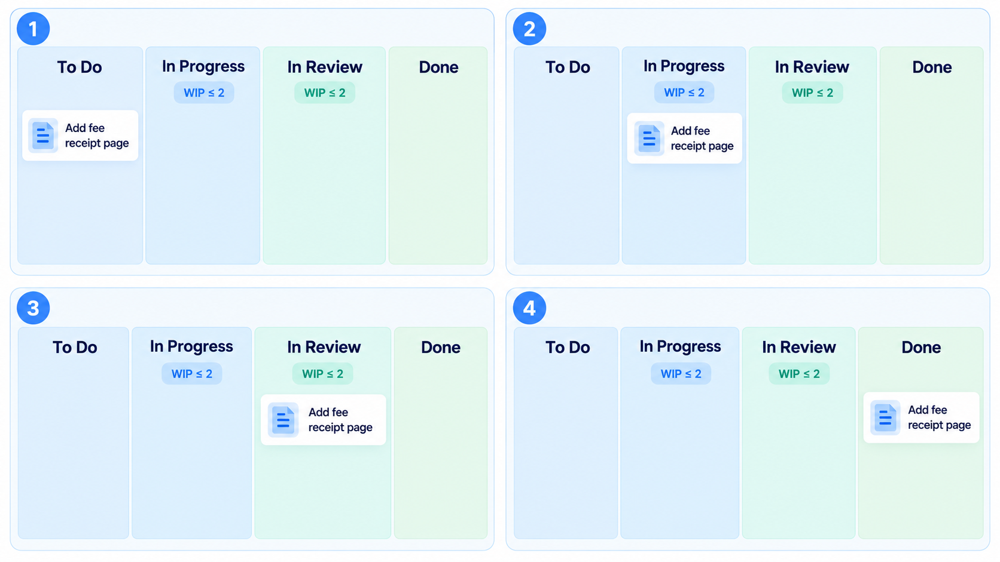
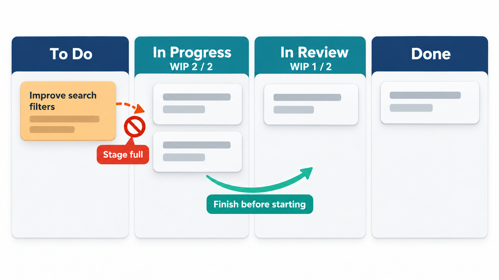
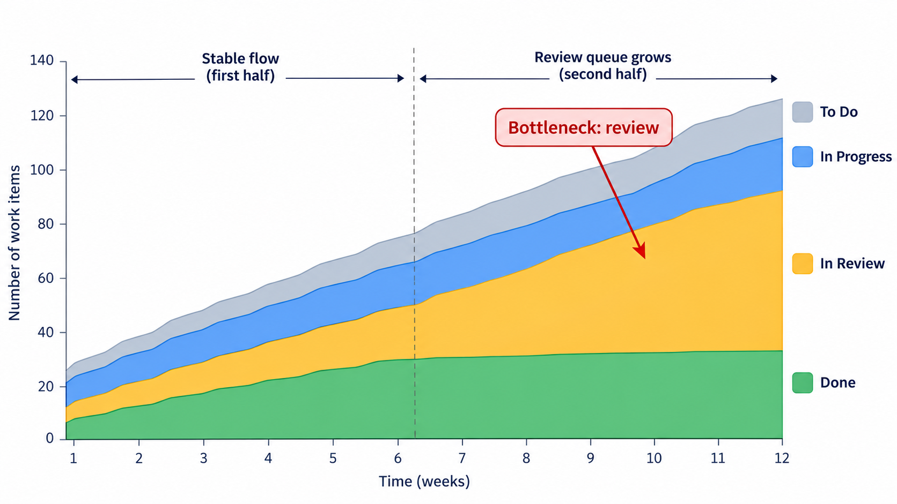
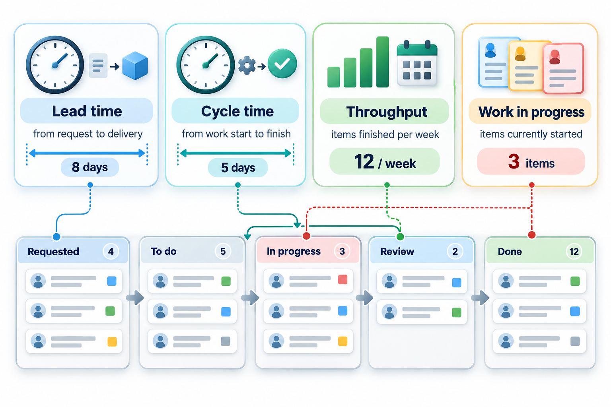
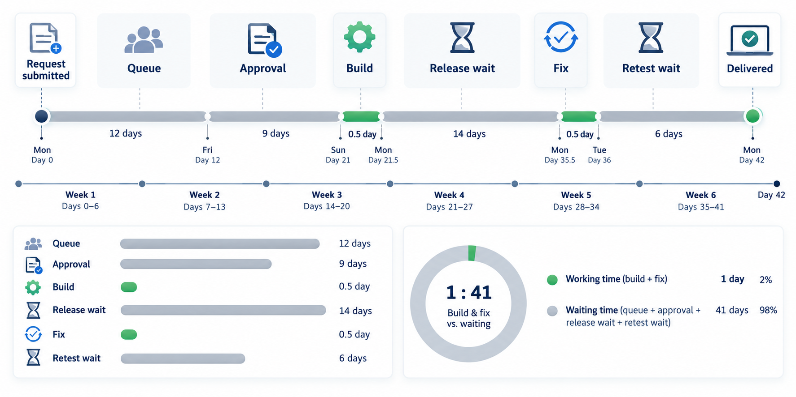
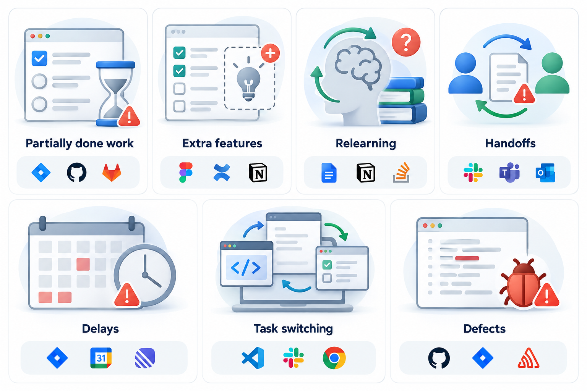

## Why Starting Less Gets More Finished

Most teams assume the way to deliver more is to start more. Everyone looks busy, every request has been picked up, and yet very little is finished. Work sits half-done, waiting for a decision, a colleague or a test, while new work keeps arriving. The way out is counter-intuitive: limit how much may be in progress at once, and give priority to finishing over starting.

That idea, borrowed from the way factories pull parts forward only when the next stage needs them, is the heart of **Kanban**, the Japanese word for "signboard", and of the thinking behind it, called **lean**. A team usually gets work done *faster* by starting *less* of it.

The idea has a name in manufacturing: a **pull system**. In a push system, work is started whenever it arrives or whenever someone is free, and it is pushed forward whether or not the next stage is ready. Piles form wherever one stage is slower than the one before. In a pull system, a stage takes new work only when it has room, so a pile can never grow beyond a set size, and a stage that is overloaded signals the problem immediately because the stages before it stop. Kanban applies this to knowledge work: nothing is started until there is room to finish it.

## The Board Makes Work Visible

A Kanban board is a set of columns, one for each stage in the life of a ticket. A typical board has *To Do*, *In Progress*, *In Review* and *Done*, the same statuses a team sees in a tool such as ClickUp, Jira or Trello. Each piece of work is a ticket (a card) that moves across the board from left to right as it progresses. The board is simple, but it does something that most teams do not have: it shows, at a glance, where all the work is, and where it is piling up.

Piles are the information. If *In Review* holds eight tickets and *In Progress* holds two, the problem is not that people start work too slowly. It is that finished work is waiting for sign-off. A team looking at that board can discuss the real constraint, and not just the symptoms.

<!-- Visual: a ticket-tracking board with four columns, To Do, In Progress, In Review and Done. Show one ticket, for example "Add fee receipt page", moving left to right through the columns in four numbered snapshots, with a WIP limit number above In Progress and In Review. Stage progression only, no code or pull-request imagery. Save as images/15_ticket_stage_board.png. -->

## Following One Ticket Across the Board

To see what the stages mean, follow a single ticket, "Add fee receipt page", on a college team's board.

| Stage | What is true of the ticket | Who acts | What moves it on |
| --- | --- | --- | --- |
| **To Do** | It is described, ordered by priority and ready to start | The product owner or team lead chooses its place in the list | A team member has room under the In Progress limit and pulls it |
| **In Progress** | Someone is working on it now, with a name on the card | The person who pulled it | The work is finished and the person believes it meets the agreed checklist |
| **In Review** | A second person checks it against the checklist and tries it | A reviewer, not the author | The reviewer accepts it, or sends it back to In Progress with a note |
| **Done** | It meets the agreed definition of done and is available to users | Nobody: it is finished | The ticket leaves the board and is counted in throughput |

Two things are worth noticing. A ticket can move backwards, from In Review to In Progress, when the check finds a problem. And the board is more than a record: moving a card is a promise, to others, about the state of the work. A card in Done that is not really done misleads everyone who relies on the board.

## Designing the Columns

Columns should match the real stages work passes through, not an idealised process. A support team might use *New*, *Investigating*, *Waiting for customer*, *Fixing* and *Resolved*. A content team might use *Idea*, *Draft*, *Edit*, *Approve* and *Published*. A good board has between four and eight columns. Fewer hides where work waits; more makes the board a chore to maintain.

Teams often split a column into *doing* and *done* sub-columns, so that finished work waiting for the next stage is visible as a queue and not hidden inside the stage that made it. They also write down, for each column, an **explicit policy**: what has to be true of a ticket for it to enter this column and to leave it. Policies are the team's rules written where everyone can see them, and they replace unspoken assumptions about what "ready" or "done" means.

## Limits on Work in Progress

The feature that distinguishes Kanban from a simple task board is the **work-in-progress limit**, or WIP limit: each column has an upper bound on how many cards may sit in it. When a column reaches its limit, nobody may pull a new card into it. If *In Progress* has a limit of four and four cards are already there, a developer who finishes a task cannot start a fifth. They must help move something to done first.

This feels backwards the first time. Surely a free person should start something? But a person with spare capacity can help finish what is already in flight: check a colleague's finished ticket, test a feature, unblock a stuck item. Starting new work when the system is already full only makes everything wait longer.

The reasoning is a piece of arithmetic known as **Little's law**: the average time an item spends in the system equals the number of items in the system divided by the rate at which items leave it. Twelve items in progress and a team that finishes four a week means each item takes, on average, three weeks. Cut the work in progress to four, and with the same speed each item takes one week.

Here is a board checked against its limits, and Little's law applied to what is on it.

| Column | Tickets now | Limit | Status |
| --- | --- | --- | --- |
| To Do | 9 | none | Fine |
| In Progress | 5 | 4 | Over the limit: stop starting, start finishing |
| In Review | 3 | 3 | At the limit |
| Done this month | 16 | none | Fine |

*In Progress* holds five tickets against a limit of four, so the team should stop pulling new work. *In Review* is exactly at its limit of three, which is allowed, but it means any further finished work must wait until a ticket is signed off.

The tickets started but not finished are 5 plus 3, which is 8. Sixteen finished tickets in a month is 4 a week. Dividing the two gives 8 / 4 = 2 weeks for an average ticket. If the team brought *In Progress* back to its limit, the figure would fall to 1.75 weeks without anyone working faster.

<!-- Visual: the In Progress column at its WIP limit with a new ticket waiting in To Do, unable to enter until one ticket moves on to In Review. Stage progression only. -->

## Why Being Busy Slows Everything Down

A deeper reason why limits help comes from queues. When a stage works at close to full capacity, any variation in the arriving work creates a queue, and the queue grows sharply as utilisation approaches 100 per cent. Anyone who has seen a road at 95 per cent capacity knows the effect: a small incident makes everyone stop.

| How busy the stage is | Waiting time compared with the work time |
| --- | --- |
| 50% | About the same as the work itself |
| 80% | About 4 times as long |
| 90% | About 9 times as long |
| 95% | About 19 times as long |

The figures come from a simple queueing relation and are illustrative, but the shape is real. A team that fills every hour of every person's week has no slack to absorb a surprise, so every urgent request becomes a pile-up. Leaving a little slack, and limiting work in progress, is not wasting capacity. It is what keeps work moving. Managers who judge teams by how busy they look usually produce the opposite of what they want.

## Where the Bottleneck Is

In any flow, one stage is the slowest, and it sets the pace of the whole. This is the **bottleneck** or constraint. Improving a stage that is not the bottleneck changes nothing about the output: making developers faster does not help if reviews take longer than coding. Kanban boards find the bottleneck by showing where work piles up. The usual cycle of improvement is simple.

1. Find the stage where work waits (the pile).
2. Make sure that stage is never idle and is not wasting effort on low-value work.
3. Move other work to relieve it, for example by sharing the review work.
4. Raise its capacity only after that, if still needed.
5. Look for the next bottleneck, because there always is one.

A **cumulative flow diagram** shows this over time. It plots, for each stage, how many items have reached it by each day. Bands that stay parallel mean smooth flow; a band that widens means a growing pile in that stage. Teams read it as a weather chart for their process.

## Measuring Flow

Kanban teams track a few simple numbers to see how work moves.

| Measure | What it is | Why it matters |
| --- | --- | --- |
| **Lead time** | From a request being made until it is delivered | What the customer experiences |
| **Cycle time** | From work starting until it is delivered | How long the team itself takes |
| **Throughput** | Items finished per week | The team's pace |
| **Work in progress** | Items started but not finished | The thing the team can control directly |

Lead time includes the wait in the queue, which is often the largest part. A team with a two-day cycle time and a five-week backlog has a lead time of over five weeks, and a customer looking at it sees a slow team, however fast the work itself is.

Teams use these numbers to make forecasts without estimating each ticket. If tickets usually finish within five days, nine times out of ten, then a new ticket can be promised in five days with reasonable confidence. This is often more accurate than estimating each item in advance, because it uses what actually happens.

<!-- Visual: a timeline for one item showing the wait in the backlog (lead time starts), the moment work begins (cycle time starts), and delivery, with the two measures drawn as brackets. -->

## Handling Different Kinds of Work

Not all tickets are equal. Many teams give each kind of work a **class of service**: its own rule for how it moves.

| Class | Example | How it is treated |
| --- | --- | --- |
| **Urgent** | A fault stopping all users from paying | May jump the queue; a separate lane with a very small limit |
| **Fixed date** | A change that must be live before a legal deadline | Started in time to finish by the date |
| **Standard** | Ordinary features and fixes | Taken in priority order |
| **Improvement** | Tidying code, upgrading a tool | Allowed a share of the capacity so it is not always starved |

The danger is that everything becomes urgent. A rule that limits urgent items to one at a time, and tracks how often they occur, keeps the lane honest.

## Lean: Remove the Waiting

The word **lean** comes from the study of Toyota's manufacturing methods, and it was applied to software by Mary and Tom Poppendieck in the early 2000s. Its core question is: *which of our time creates value for the customer, and what is everything else?* Everything else is **waste**, and the aim is to remove it.

The Poppendiecks described seven kinds of waste in software, each matching a form of waste in a factory.

| Waste | What it looks like in software |
| --- | --- |
| **Partially done work** | Code written but not tested or released, like unsold stock that loses value as it ages |
| **Extra features** | Features nobody asked for, which still have to be built, tested and maintained |
| **Relearning** | Rediscovering something the team already knew because it was never written down |
| **Handoffs** | Work passed between people, with understanding lost at each step |
| **Delays** | Waiting for approvals, environments, answers or releases |
| **Task switching** | People juggling several things, losing time at every change of focus |
| **Defects** | Faults that must be found, reported, fixed and retested |

Draw out the whole path of one request, from the customer's first message to the release, and mark every period in which nobody is working on it. In most organisations, that picture is mostly waiting. A request that takes six weeks to deliver is often being worked on for a day or two.

<!-- Visual: a value stream for a six-week request: a few short blocks of active work separated by long grey blocks of waiting, labelled with the reasons (queue, approval, test environment, release slot). -->

The practical response is to look at the longest gaps first. Making developers type faster saves minutes. Removing a four-day approval step saves four days.

Lean thinking adds principles beyond waste removal: build quality in so that defects are prevented and not found later; decide as late as responsibly possible, so that decisions use more information; deliver as fast as possible; respect and empower the people who do the work; and look at the whole flow, not one department's slice. Together they describe a way of running work in which the aim is a smooth, quick stream of value.

<!-- Visual: the seven wastes of software development listed as seven labelled boxes. -->

## Kanban Versus Scrum

The two are often compared, and a short table shows how they differ.

| | Scrum | Kanban |
| --- | --- | --- |
| Rhythm | Fixed-length sprints | Continuous flow, no sprints |
| Commitment | A sprint goal each cycle | A limit on work in progress |
| Roles | Product Owner, Scrum Master, Developers | None prescribed |
| Changes during the cycle | Protected inside a sprint | Allowed at any time, if the limits allow |
| Typical fit | Building a product in planned slices | Support, operations and a steady stream of small requests |

Many teams combine the two, sometimes called Scrumban: sprints for planning, plus a board with WIP limits for flow. The point is not which label to use, but to see where work waits and to reduce it.

A reasonable way to start is to draw the board of what the team already does, without changing any rule. Then add limits gradually, tighten them as the team gets used to finishing before starting, and review the board's measures regularly. Kanban is designed to be adopted by evolution rather than revolution, which is one reason it spreads easily into teams with an existing way of working.
