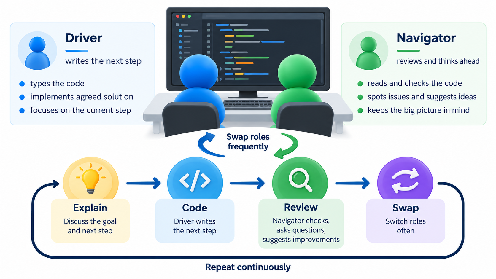
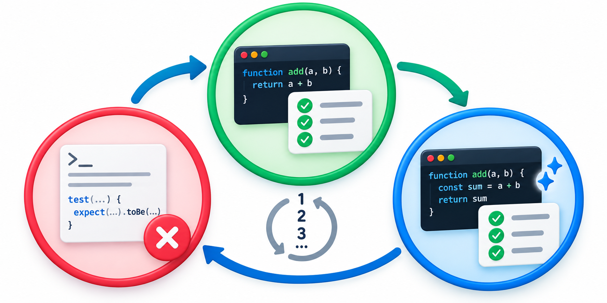
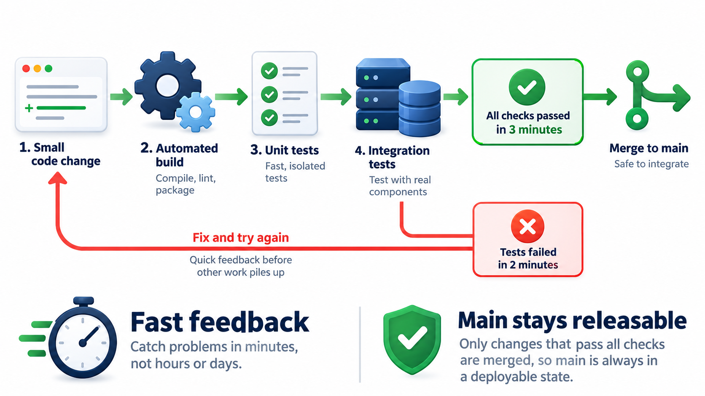
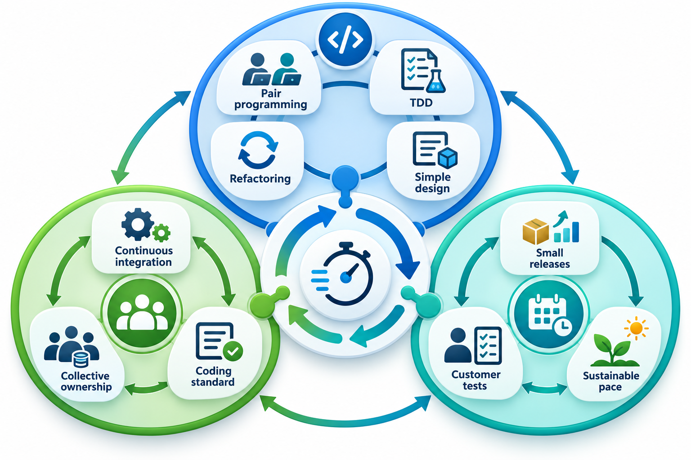
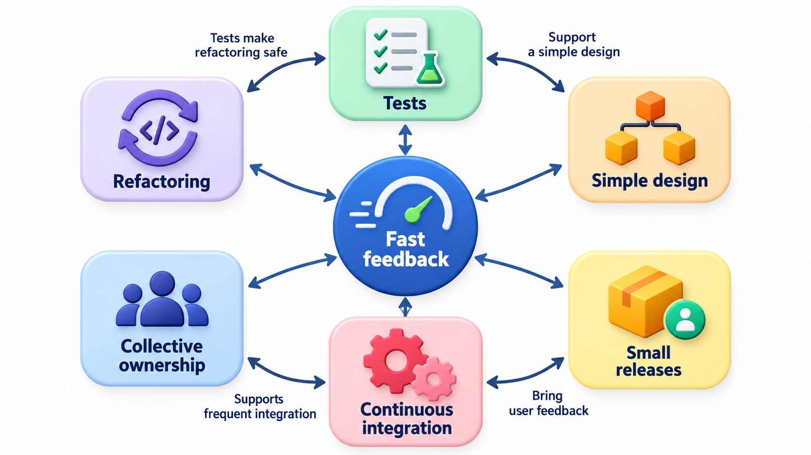
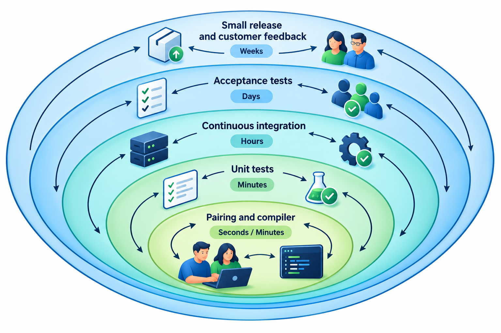

## Turning Every Good Habit Up to Maximum

If reviewing work is good, review it all the time. If testing is good, test everything, and test first. If short cycles are good, make them very short. If feedback from customers is good, put the customer in the room. **Extreme Programming**, or XP, takes each practice that experienced teams already value and pushes it as far as it will go, which is where the word *extreme* comes from.

XP is not a framework for organising meetings like Scrum. It is a collection of engineering practices, and it is the part of the agile family most concerned with how the work is actually done. This topic covers the ones that matter most.

The reasoning behind XP is an observation about the cost of change. Traditional wisdom held that changes grow dearer the later they are made, so the sensible course is to think carefully before building. XP's founders asked what would happen if the cost of change could be kept low for the whole life of a project. Then it would be better to build a little, learn, and adjust, than to try to settle everything in advance. Each XP practice is a way of keeping change cheap: tests that catch breakage, small steps that limit damage, clean design that is easy to alter, and a team that talks.

## Values Behind the Practices

XP states five values, and the practices follow from them.

| Value | What it means | A practice that expresses it |
| --- | --- | --- |
| **Communication** | Everyone shares what they know, openly and often | Pair programming, an on-site customer, daily meetings |
| **Simplicity** | Do the simplest thing that works for now | Simple design, no features built "just in case" |
| **Feedback** | Find out quickly whether you are right | Tests, continuous integration, short releases |
| **Courage** | Be willing to change, delete and tell the truth about progress | Refactoring, throwing away code that no longer helps |
| **Respect** | Value each person's contribution and wellbeing | A sustainable pace, collective ownership |

The values matter because the practices can be misapplied. A team that pairs only because it was told to, and shares nothing, has the form of pair programming without communication. Asking which value a practice serves is a good test of whether it is being practised or only performed.

## Pair Programming

In **pair programming**, two programmers work at one computer on the same task. One, the *driver*, types. The other, the *navigator*, reads what is being written, thinks ahead, spots mistakes and keeps the goal in view. They swap roles often, every few minutes or every half hour.

It sounds like half the output for twice the cost. The claim for the practice is different. Mistakes are caught as they are typed, which is the cheapest moment, and the design gets argued about before it is written. Knowledge spreads, because every piece of the system is understood by at least two people. New team members learn faster. And a pair is harder to distract than a single person. Studies on whether pairing pays have given mixed results: it tends to help most on hard, unfamiliar or risky work and least on routine tasks.

Pairing also changes behaviour. A person who knows a colleague is watching is less likely to take a shortcut they would be embarrassed to explain. The conversation forces ideas to be put into words, which often exposes a weakness in them. Teams commonly rotate pairs, so that over a few weeks everyone has worked with everyone, and no knowledge is trapped in one head.

## Test-Driven Development

XP's most widely adopted practice is **test-driven development**, or TDD. The cycle is three steps, repeated in minutes.

1. **Red:** write a small test for something the code should do. Run it. It fails, because the code does not exist yet.
2. **Green:** write the least code that makes the test pass.
3. **Refactor:** tidy the code, using the tests as a safety net to prove nothing broke.

The failing test is important, because a test that has never failed has never proved it can catch anything. Consider a library's late-fee rule: 5 rupees for each day late, up to a limit of 100. The team first writes four checks, each pairing a number of days late with the fee it expects: 0 days costs 0, 3 days costs 15, 20 days costs 100, 50 days costs 100.

| Step | What the team has | Checks passing | What it tells them |
| --- | --- | --- | --- |
| Red | An empty first attempt that charges 0 for everything | 1 of 4 | Only the on-time case passes; the failures say what is missing |
| Green | The real rule: nothing on time, 5 rupees a day, capped at 100 | 4 of 4 | The rule now does what the checks describe |
| Refactor | Tidied structure, same behaviour | 4 of 4 | If tidying broke the rule, the checks would say so immediately |

Writing the checks also made the team decide what happens at 20 and 50 days before anything was built. In TDD the checks come first because they define what "done" means.

TDD does three jobs at once. It is a *design* tool, because writing the test first forces a decision about how the code will be used. It is a *safety net*, because the growing collection of tests catches breakage the moment it happens. And it is *documentation*, because the tests show by example what the code is meant to do. The cost is that the tests must be kept clean and fast, since a slow or fragile test suite stops being run.

<!-- Visual: a three-stage cycle: red (a failing test), green (the least code to pass), refactor (tidy with the tests as a net), with arrows returning to red. -->

## Continuous Integration

In **continuous integration**, every programmer merges their work into the shared codebase several times a day, and each merge triggers an automatic build and test run. If it fails, fixing it is the team's first priority. The alternative is for each person to work alone for weeks and merge at the end, which leads to the dreaded "integration week": hundreds of conflicts, hidden clashes, and nobody sure whose change broke what.

The practice relies on the others. Without tests, a build that passes proves little. Without small changes, a failed build is hard to diagnose. And without a team habit of keeping the main line healthy, the signal means nothing.

The arithmetic of integration explains why frequency matters. If two people each change many parts of the system over three weeks, the number of places where their changes might clash is large and the clash is hard to understand. If each integrates every few hours, the changes are small, the clash is in a few lines, and the cause is obvious because only a little has changed. The pain of integration shrinks as its frequency rises, which is why XP says to do it more often precisely when it hurts.

## Small Releases

XP puts working software in front of the customer very often: every week or two, and in some teams many times a day. The point is feedback. A small release is easy to test, easy to understand and easy to undo, and each one tells the team whether it is going in the right direction. A team that releases once a year makes twelve months of decisions before it finds out whether any were wrong.

## The Planning Game

Planning in XP is a game with two players who each have decisions the other cannot make. The *customer* (or their representative) decides what is valuable and in what order; the *developers* estimate how long each piece will take and how much they can do. Neither side overrules the other.

| Step | Customer decides | Developers decide |
| --- | --- | --- |
| Release planning | Which stories matter most for the next release | How long each story will take, roughly |
| Iteration planning | Which stories go into the next one or two weeks | How many stories fit, given what they finished last time |
| During the iteration | Answers questions and clarifies | How to build, and whether the plan is on track |
| After each iteration | Reviews the working software and reprioritises | Updates their estimates using what they have learned |

Stories are short descriptions of what a user wants, written on cards. The team uses its **velocity**, the amount it finished in previous iterations, to decide how much to take next. Because the plan is revised every week or two, a mistake in estimation costs at most one iteration and is corrected by the next.

## Refactoring and Simple Design

**Refactoring** is improving the structure of code without changing what it does. XP asks the team to refactor continuously, a little each time, so that the code does not rot. Without tests this would be dangerous, since each change might break something. With tests it is routine.

**Simple design** is guided by four rules, applied in order of importance: the code passes all its tests; it expresses the intentions of the programmer clearly; it contains no duplication; and it has the fewest classes and methods that satisfy the first three. The effect is to build only what is needed now, and to leave the structure clean so that the next thing is easy to add. The temptation to build "just in case" features is resisted, because most imagined futures never arrive and the extra code must be maintained either way.

## Collective Ownership and Shared Standards

Under **collective ownership**, nobody owns a file, and anyone may change any code, anywhere, if they leave the tests passing. This is only safe because of the other practices: the tests protect the code, pairing spreads understanding, and continuous integration catches clashes. The benefit is that a team does not wait for one person to be free, and no module becomes a private fortress that only one person dares touch.

A shared **coding standard** makes this workable. When all the code looks the same, a person moving between files does not have to adjust to a new style, and discussion about layout disappears. A shared *metaphor* or story about how the system works, such as "the fee system is a ledger with entries", gives everyone a common picture to reason from.

## Other Practices in the Set

XP's original list is longer: a *planning game* in which customers and developers agree on what to build next, an *on-site customer* who is available to answer questions, a *coding standard* so that code looks the same whoever wrote it, a *sustainable pace* with no habitual overtime, and a shared *metaphor* for the system. Teams today seldom adopt the whole list. Pair programming, TDD, continuous integration and small releases are the most commonly borrowed, and each works better because of the others.

The sustainable pace deserves a note. XP holds that tired people make more mistakes and that chronic overtime lowers quality and drives out good people. The rule is not about comfort but about outcomes: a team that works sensible hours for years delivers more, and more reliably, than one that sprints until it breaks.

<!-- Visual: the XP practices arranged in three rings (coding, team, planning) around the central idea of rapid feedback. -->

## How the Practices Hold Each Other Up

The practices are not independent options. Each covers a weakness in another, which is why adopting one alone often disappoints.

| Practice | What it needs from the others | What it gives to the others |
| --- | --- | --- |
| **Refactoring** | Tests, so that changes can be checked | Clean design, so that tests and new features are easy |
| **Collective ownership** | Tests, pairing and continuous integration | Freedom to fix anything without waiting |
| **Small releases** | Continuous integration and automatic tests | Rapid feedback on the planning game |
| **Simple design** | Refactoring, to correct it as needs grow | Less code to test, review and understand |
| **Pair programming** | A shared standard and ownership | Spread knowledge and fewer mistakes |
| **Sustainable pace** | Small steps and a realistic plan | Alert people who make fewer errors |

Take away tests and refactoring becomes dangerous, ownership becomes reckless and releases become frightening. Add them back and the rest fall into place. This is the reason many teams begin with test-driven development and continuous integration, which form the base on which the other practices stand.

## Feedback Loops at Every Scale

What links the practices is **feedback at many speeds**. A unit test answers in seconds whether a function works. Pair programming answers in minutes whether the design makes sense. Continuous integration answers in hours whether the change fits with everyone else's. A small release answers in days whether the feature helps users. The planning game answers in weeks whether the team is building the right things. XP's idea is to make each loop as short as possible, because the shorter the loop, the cheaper a mistake is to fix.

<!-- Visual: nested loops of increasing size labelled with their durations: test (seconds), pair (minutes), build (hours), release (days), plan (weeks). -->

## Where XP Fits

XP suits small teams, working on software whose requirements change, with a customer who can be reached and an organisation willing to let the team work its way. It is harder to apply when the team is large and dispersed, when the customer is distant, when a contract fixes scope in advance, or when regulation demands heavy documentation. Even then, individual practices travel well. Almost every modern engineering organisation uses automated tests and continuous integration, and many use pair or mob programming for difficult work. XP's lasting contribution is less the full package than the proof that these practices, taken seriously, reduce the cost of change enough to make constant adjustment affordable.

## Five Misreadings of Extreme Programming

**"Pair programming halves productivity."** Output per hour of typing falls, but errors, rework and handover costs fall too. The evidence says it pays on difficult work and less so on routine work.

**"TDD means writing all the tests before the code."** It means one small test at a time, in a loop of minutes. Writing a hundred tests up front is not TDD.

**"Having tests means no design is needed."** TDD gives feedback on design, but it does not do the designing. Tests that are written without thought can lock in a poor structure.

**"Collective ownership means anyone can break anything."** It is safe only with tests, continuous integration and review. Without them, free access to the code simply spreads mistakes faster.

**"XP is only for small teams of programmers."** Many of its practices, such as automated tests and continuous integration, are standard in large organisations. The full set is best suited to small, co-located teams, but the ideas have travelled far.
