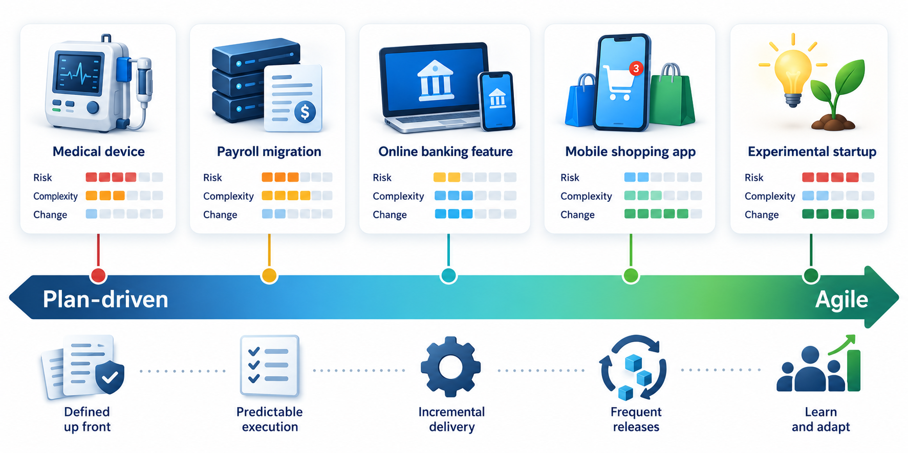
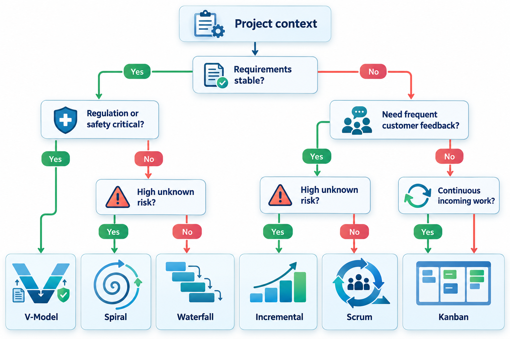
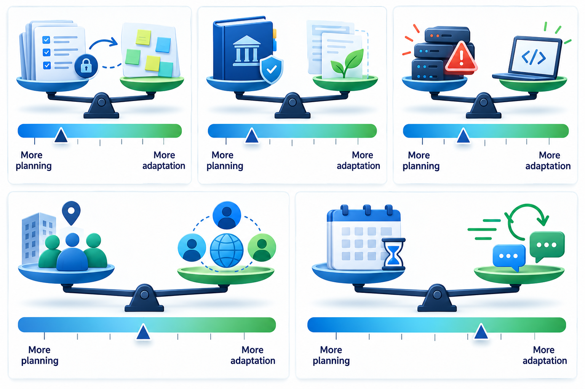
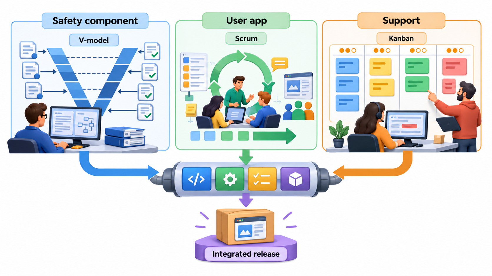
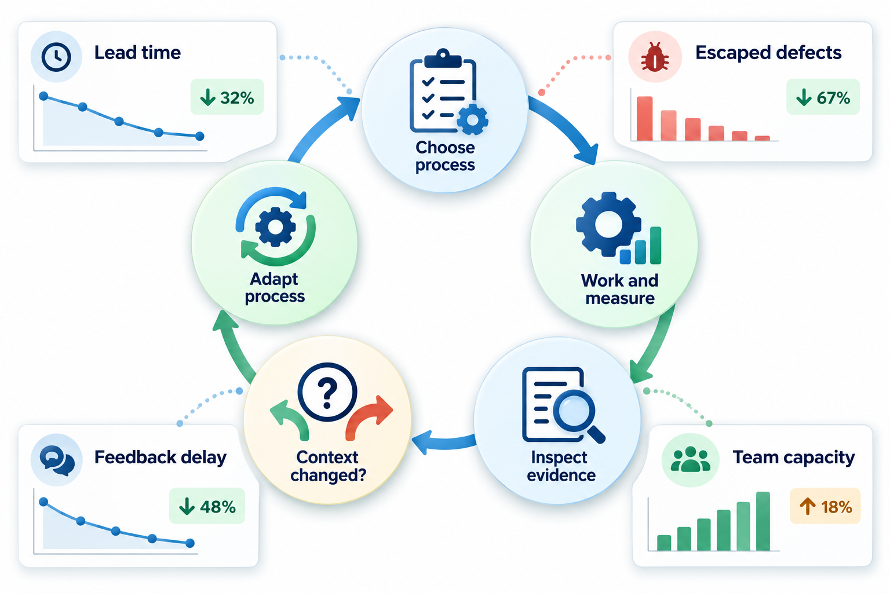

## Choosing Shoes for the Terrain

Nobody wears the same shoes to climb a mountain, run a race and attend a wedding. The right pair depends on the ground, the distance and the occasion. Software process is the same. Waterfall, V-model, Scrum, Kanban and the rest are not ranked from worst to best; each is suited to certain ground, and the skill lies in reading the terrain of the project in front of you.

This topic gives the questions to ask about a project and a way to turn the answers into a starting point. The first choice is rarely the last, because a team can adjust it as it learns.

A graduate joining a company will usually find the process already chosen, so it is tempting to think that choosing is someone else's job. It is not entirely. Engineers who understand why a process was chosen can tell when it has stopped fitting, can suggest sensible adjustments, and can avoid the two commonest errors: following a ritual that no longer does anything, and dropping a practice that was quietly protecting the project. The ability to read a project and say which kind of process it needs is one of the more valuable judgement skills in the profession.

## A Quick Recap of the Models

Before choosing, it helps to have the alternatives in one place.

| Model | Main idea | Best when | Main weakness |
| --- | --- | --- | --- |
| **Waterfall** | Finish each phase, with documents, before the next | Requirements are stable and well understood | Feedback arrives late |
| **V-model** | Pair every build stage with a test stage | Evidence of correctness must be shown to a regulator | Heavy, and slow to absorb change |
| **Incremental** | Deliver the system in usable slices | Value should reach users early | Needs a design that accepts new pieces |
| **Prototyping** | Build something cheap to learn | Requirements are unclear | A prototype may be kept and shipped |
| **Spiral** | Let the biggest risk decide the next step | There are large technical or business unknowns | Needs honest risk assessment |
| **Scrum** | Short sprints with fixed roles and events | A team builds a product in planned slices | Silent on engineering practice; hard to scale |
| **Kanban** | Visualise work and limit work in progress | Work arrives as a stream | Gives little structure for planning large projects |
| **XP** | Engineering practices that make change cheap | Small teams in changing conditions with a reachable customer | Hard with large or distant teams |

None of these is complete. Each answers a different weakness in the others, which is why mixtures are common.

## The Questions That Decide

No process wins on every project. The right one depends on a handful of facts, and a team that answers them honestly narrows the choice quickly.

| Question | If the answer is... | ...it points toward |
| --- | --- | --- |
| **How stable are the requirements?** | Stable and well understood | A plan-driven process such as waterfall or V-model |
| | Unclear or likely to change | An iterative or agile process |
| **How much risk is there?** | Big technical or market unknowns | A risk-driven or prototype-first approach, such as the spiral |
| **Can the customer take part?** | Available regularly | Scrum, XP or another close-collaboration method |
| | Distant or only at milestones | More written specification and formal sign-offs |
| **Is there regulation?** | Evidence must be shown to an authority | V-model or documented iterative process with traceability |
| **How big is the team?** | A handful of people | Light, conversation-based methods |
| | Dozens or hundreds | Added coordination, and perhaps a scaled framework |
| **What does failure cost?** | Annoyance | Light process |
| | Money, safety or reputation | More review, more testing, more records |
| **What kind of work is it?** | Building a new product in slices | Scrum or XP |
| | A steady stream of fixes and requests | Kanban |

No row decides alone. A project with unstable requirements and heavy regulation, such as a new medical device, cannot use either extreme. It will need to mix: agile-style cycles inside a framework that keeps the documents and traceability a regulator demands.

<!-- Visual: Software projects positioned along a spectrum from plan-driven to agile. -->

## Five Dimensions of a Project

Researchers who compared plan-driven and agile methods suggested that a project can be placed on five dimensions, and that the placement tells you which approach it will tolerate.

| Dimension | Leans plan-driven | Leans agile |
| --- | --- | --- |
| **Size** | Large teams and long projects | Small teams and short cycles |
| **Criticality** | Failure causes serious harm or loss | Failure causes inconvenience |
| **Dynamism** | Requirements stay the same | Requirements change often |
| **Personnel** | A mix of skills, with many junior people needing guidance | Experienced, self-directing people |
| **Culture** | Comfort with order, rules and clear roles | Comfort with change and shared responsibility |

A project close to one end on all five has an easy decision. Most are mixed, such as a small, experienced team (agile) building safety-critical software (plan-driven), and for those the answer is a deliberate blend: perhaps short cycles and daily collaboration, with rigorous reviews, traceability and independent testing added where the risk demands it.

## A Scoring Sketch

Teams sometimes make the questions explicit with a small scoring exercise. The idea is to rate how strongly each fact applies to the project, rate how well each process suits each fact, and see which process scores highest.

<!-- Visual: a decision tree starting from "are the requirements stable?" and branching on risk, regulation and customer availability to waterfall, V-model, incremental, Scrum, spiral and Kanban. -->

Rate three facts from 0 (not at all) to 2 (strongly): how much the requirements are changing, how available the customer is, and how heavy the regulation is. Two projects might come out like this.

<!-- Visual: Project factors shifting the appropriate balance between planning and adaptation. -->

| Project | Changing requirements | Customer available | Regulation |
| --- | --- | --- | --- |
| Tutoring start-up | 2 | 2 | 0 |
| Hospital device | 0 | 1 | 2 |

Then rate how well each process suits a project where each fact is strong, and multiply the project's rating by the process's suitability for each fact and add them up.

| Process | Suits changing requirements | Suits available customer | Suits regulation | Tutoring start-up score | Hospital device score |
| --- | --- | --- | --- | --- | --- |
| Waterfall | 0 | 0 | 2 | 0 | 4 |
| V-model | 0 | 1 | 2 | 2 | 5 |
| Scrum | 2 | 2 | 0 | 8 | 2 |

The tutoring start-up, with shifting requirements and a founder available daily, gets 8 for Scrum against 0 for waterfall. The hospital device, with fixed rules and a regulator, gets 5 for the V-model against 2 for Scrum. The scores are crude and the weights are guesses, so this is not a decision procedure. Its value is that the team has to say what it believes about each fact, and a disagreement about a number shows a disagreement about the project that had not yet been spoken.

## Three Projects, Three Choices

Working through a few cases shows how the reasoning goes.

| Project | The relevant facts | A reasonable process |
| --- | --- | --- |
| **A college results portal**, needed in three months, used by 20,000 students on one day, with a registrar who knows the rules well | Requirements fairly clear, strict date, high peak load, one available customer | Incremental delivery with short iterations, strong performance testing early, and a risk review of the peak-load scenario; a light V-style pairing of requirement to test for the results calculation |
| **An insulin pump controller** | Fixed rules, regulated, very costly failure, hardware dependent | V-model with full traceability and independent verification; short iterative cycles inside each stage only where the regulator allows |
| **A campus helpdesk tool**, with a stream of small requests from staff and students | Work arrives continuously, priorities change daily, small team | Kanban with limits and a visible board; a short review each week; documentation kept to a minimum |

Each choice follows from the facts, and none would suit the others. A team that applied the pump's process to the helpdesk would never ship; one that applied the helpdesk's to the pump would never be approved.

## Hybrid Approaches Are the Norm

Real organisations seldom use a textbook process. A bank might run its mobile app with Scrum while its core accounting system follows a stage-gated plan. A defence contractor might build in iterations but produce the documents a customer's contract demands at fixed milestones. A product company might plan the year on a roadmap, run quarters as goals, and work in two-week sprints. Combining styles is not a sign of indecision. It reflects that different parts of a project have different risks.

What matters in a hybrid is to know why each part works the way it does, so that people do not carry a ritual over to a place where it adds nothing.

<!-- Visual: one project with three zones: a safety-critical component following a V-model, a user-facing app in short Scrum sprints, and a support stream on a Kanban board, joined by an integration line. -->

## Tailoring: Starting From a Process and Adjusting It

Choosing is rarely the end. A team usually **tailors** a chosen process: it keeps what pays for itself and drops or shortens what does not. A two-person team may skip a formal sprint review and show the work over a call. A team with a distant client may add a written weekly summary. The test for any piece of process is whether the team can name the problem it solves. If it cannot, the piece is a candidate for removal.

Tailoring also never stops. The first choice is a hypothesis. After a few weeks, the team should look at results such as how often it finishes what it plans, how long defects take to find, and how the customer feels, and change the process if the evidence says so.

A sensible way to tailor has four steps.

1. **Start from a known baseline.** Take an established process as it is described, run it faithfully for a few cycles, and learn why its parts exist.
2. **Find the friction.** Notice which parts cause delay, confusion or resentment, and which gaps let problems through.
3. **Change one thing at a time.** Adjust a single element, agree how to tell whether it helped, and give it a fair trial.
4. **Write down the result.** Record what was changed and why, so that the next team member does not undo it or repeat the experiment.

Tailoring in the other direction matters too. Teams under pressure often strip out the practices that look slow, such as reviews, tests and retrospectives, and are then surprised by quality problems. A good test before removing anything is to ask what failure the practice was preventing, and whether that failure has become less likely or only less visible.

<!-- Visual: a loop that measures the results of the chosen process, reviews them, and revisits the choice when conditions change. -->

## Signs That the Process Does Not Fit

A process that fits produces few complaints and steady output. These are warning signs that it does not.

| Sign | What it may mean |
| --- | --- |
| Meetings that nobody can explain the purpose of | A ritual has outlived its reason |
| Documents written and never read | The process demands paper that no reader needs |
| Surprises at the end of every cycle | Feedback is arriving too late |
| Constant firefighting and overtime | The plan is unrealistic, or quality checks are missing |
| People working around the process | The process is slowing them without protecting anything |
| Defects found by customers, not by the team | Verification is too thin for the risk |

Treat these as questions and not as blame. In most cases the process was a reasonable fit when it was chosen and the project has since changed.

## Five Misreadings of Process Choice

**"There is one best process."** The best process depends on the project's requirements, risks, people and rules. A method that suits a start-up can be wrong for a hospital.

**"Agile is modern, so everything should be agile."** Agile suits uncertain, changeable work with available customers. For stable, regulated or safety-critical work, plan-driven elements may be required.

**"Choose a process once at the start."** Projects change. A prototype becomes a product, a small team grows, a regulation arrives. The choice should be revisited.

**"Hybrid means confusion."** A hybrid that is chosen deliberately, with each part matched to its risk, is a deliberate design. Confusion comes from mixing without reasons.

**"The scoring sheet decides."** The numbers organise a discussion. If the sheet suggests something that everyone who knows the project finds absurd, trust the discussion and find out what the sheet is missing.
