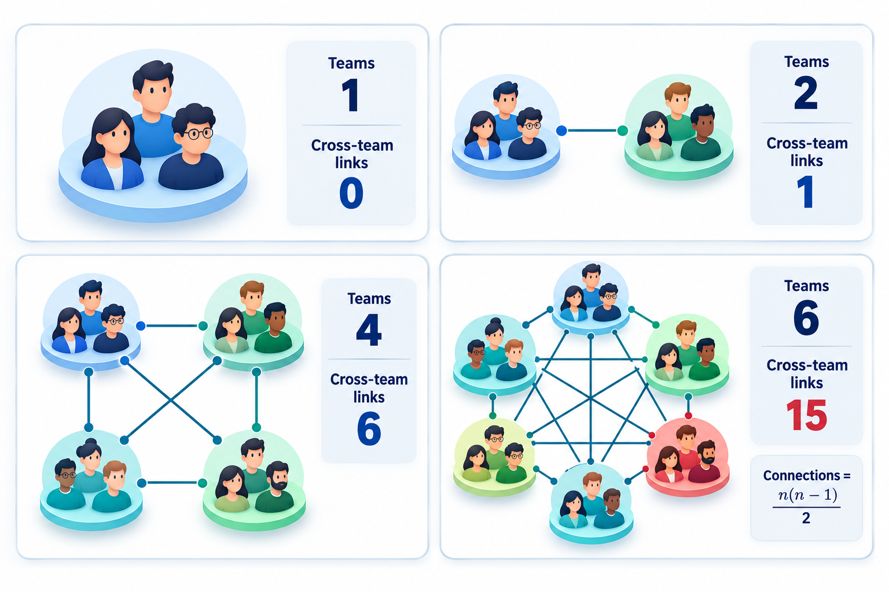
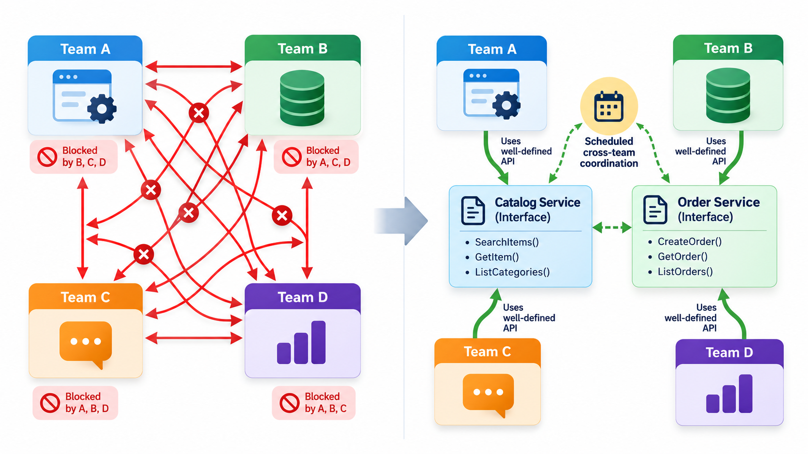
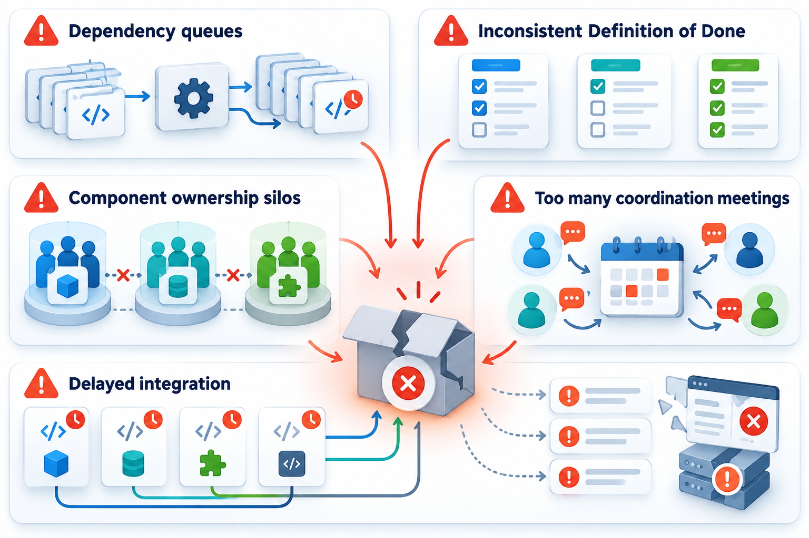
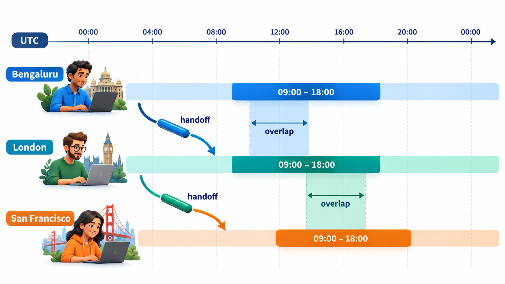

## One Team Can Talk; Ten Teams Must Coordinate

A single agile team of seven or eight people runs on conversation. Everyone knows what everyone else is doing, and a question is answered across the table. That works so well that organisations want more of it, and add teams. But the thing that made the first team fast, easy conversation, does not scale by simply repeating it.

This topic is about what changes when many teams share one product, and when the teams are spread across cities and time zones. The hard part of both is not the structure that is drawn on a chart; it is the coordination problem the structure is trying to solve.

Large products are not exotic. A bank's mobile app, a national exam portal or a ride-hailing platform each needs dozens or hundreds of engineers, and no single team of eight can build them. Yet the practices of small-team agile, such as daily conversation, a shared backlog and a quick demonstration every few weeks, all rely on a group small enough to talk. The challenge of scale is therefore to keep as much of that closeness as possible while letting many teams work on one thing.

## What Changes When One Team Becomes Many

A single agile team of seven or eight can coordinate by talking. Everyone knows what everyone else is working on. Add more teams working on the same product, and several things stop being true.

- **The number of conversations explodes.** Among n teams there can be n times (n minus 1), divided by two, pairs that need to coordinate. Four teams have 6 pairs, ten teams have 45.
- **Dependencies appear.** One team's feature needs a change from another team's component. Work waits.
- **Priorities collide.** Each team wants its own backlog items first, and someone has to decide across teams.
- **Integration becomes a project in itself.** The pieces from many teams must fit together into a release that works.

Scaling frameworks are different answers to these four problems. None removes the cost of coordination. The best of them aim to reduce how much coordination is needed.

<!-- Visual: one team of seven with a few communication lines, beside ten teams with dozens of lines between them, labelled with the number of pairs. -->

## Dependencies: The Real Enemy of Scale

Most of the pain of scaling comes from dependencies, so it pays to be precise about them.

| Kind of dependency | Example | Usual remedy |
| --- | --- | --- |
| **Work waits for another team** | The mobile team needs a new endpoint from the payments team | Agree the interface early; let the dependent team start with an agreed stand-in |
| **Shared component** | Several teams change the same module and clash | Give the component an owner, or assign it to a platform team |
| **Shared knowledge** | Only one team understands the ledger rules | Spread knowledge through rotation and writing |
| **Release coupling** | Two teams' features must ship in the same release | Design features so they can ship independently, behind switches |
| **Shared environment** | One test environment used by everyone | Provide environments on demand |

The most effective remedy is not better coordination but fewer dependencies. A team that can take a feature from idea to release without needing another team's help is called a *feature team* or *stream-aligned team*. It owns a slice of the product from the screen to the storage, so its work does not queue behind others. Creating such teams usually means changing how the product is divided, which is a question about the software's structure as well as the organisation chart. Teams tend to produce software shaped like their communication lines, so reshaping teams and reshaping architecture have to be done together.

## Ways of Coordinating

Organisations use a range of mechanisms, from light to heavy. The lighter ones should be tried first.

| Mechanism | What it is | When it suits |
| --- | --- | --- |
| **Scrum of Scrums** | A representative from each team meets regularly to share progress and surface dependencies | Up to about five or six teams with moderate dependencies |
| **Shared backlog and priorities** | All teams draw from one ordered list owned by one person or group | Teams building one product |
| **Joint planning event** | Teams plan the next period together in one room or call and map their dependencies | Many teams with real dependencies |
| **Common cadence** | All teams start and end their cycles on the same days | Integration is frequent |
| **Communities of practice** | People with the same skill meet across teams to share methods | Keeping standards without a central authority |
| **Architecture guidance** | A small group sets shared rules and interfaces | Preventing a patchwork of incompatible parts |

A useful rule is to use the least coordination that the dependencies require. Each added meeting or role has a cost in time and in reduced autonomy, and a framework that applies all of them to a problem that needs one produces more process than progress.

## Two Frameworks at Overview Level

Two frameworks are widely discussed, and they are almost opposite in style.

**SAFe**, the Scaled Agile Framework, adds structure for large organisations. Teams are grouped into an *Agile Release Train*, a long-lived team of teams that plans and delivers together. Every eight to twelve weeks, the train holds a joint planning event where all the teams agree on objectives and surface their dependencies. SAFe also adds layers for programmes and portfolios, so that strategy and funding connect to the teams. It is popular with big enterprises that need a recognisable structure, and critics say it adds a lot of process.

**LeSS**, Large-Scale Scrum, takes the opposite stance: keep Scrum as it is, add as little as possible, and push the organisation to simplify. Many teams, usually of about eight people, work from one product backlog with one product owner, in one shared sprint, and deliver one combined increment. It aims to avoid creating coordinating layers at all, and it assumes the organisation is willing to reshape itself to fit.

| | SAFe | LeSS |
| --- | --- | --- |
| Approach | Add roles and events for coordination | Keep Scrum, remove layers |
| Planning rhythm | Joint planning every 8 to 12 weeks | One shared sprint planning |
| Backlog | Hierarchy of levels | One product backlog |
| Typical user | Large enterprises with many programmes | Organisations ready to change their structure |

Neither is the right answer for every case. The useful skill is to recognise which problem a framework is meant to solve and to adopt only what answers a problem you really have. Some companies have published descriptions of how they organise their own teams, with small autonomous groups and shared communities of practice. Such accounts are best read as snapshots of one company at one time, useful for the problems they identify and not as templates to copy.

<!-- Visual: several Scrum teams drawn feeding a single shared product backlog and producing one integrated increment at the end of a shared sprint. -->

## Common Ways Scaling Goes Wrong

Scaling efforts fail in recognisable ways. Teams adopt the new vocabulary without changing how decisions are made, so the same slow approvals continue under new names. Organisations scale before the single team works well, so the problems of each team multiply. Dependencies are managed with meetings and not removed by design, so the teams spend their time in coordination. And leaders measure agility by the number of teams that have been trained, not by how fast value reaches the customer.

The strongest remedy is often to reduce dependencies. Teams that own a whole slice of the product, from user interface to database, can work in parallel without waiting. That is a design question as much as a process question, and it is why architecture and team structure are tied together.

<!-- Visual: common failure patterns in scaled agile: new names with old decisions, scaling too early, managing dependencies by meetings, counting trained teams. -->

## Distributed Teams and the Clock

Many teams are not in one room. A team might have members in Bengaluru, London and San Francisco, and the cost of that spread shows up first in the clock. People can talk in real time only during the hours when their working days overlap, and those hours are few.

Take a 09:00 to 18:00 working day in each city and convert it to a common clock, UTC. Bengaluru is 5.5 hours ahead of UTC, London is level with it in winter, and San Francisco is 8 hours behind.

| City | Working day in UTC | Shared with Bengaluru |
| --- | --- | --- |
| Bengaluru | 03:30 to 12:30 | n/a |
| London | 09:00 to 18:00 | 09:00 to 12:30, so 3.5 hours |
| San Francisco | 17:00 to 02:00 (next day) | None, so 0 hours |

Bengaluru and London share 3.5 hours, enough for a daily meeting and some pairing. In summer, when London is an hour ahead, it rises to 4.5 hours. Bengaluru and San Francisco share none at all. A team spread this far cannot rely on meetings in normal hours, and has to work in a different way.

<!-- Visual: three horizontal bars for the working days (09:00 to 18:00) of Bengaluru, London and San Francisco placed on a shared UTC axis, with the overlap between each pair shaded. -->

## Working Across Time Zones

Teams with little or no overlap do not stop being agile, but they shift their habits. They write more down: decisions, reasons and the state of unfinished work. They prefer **asynchronous** communication, such as clear written updates and recorded demos, to meetings, and use the small overlap for things that need a conversation. They plan work in handoffs: what one site finishes at the end of its day becomes the next site's start, a pattern sometimes called follow-the-sun. And they invest in trust, because the cheap ways to build it, such as lunch together, are not available.

A frequent mistake is to hold every meeting at a time that suits the headquarters, so that one site always meets at 11 pm. That is unfair, and it wears down the people who carry it. Rotating the inconvenience is a small and visible sign that the whole team counts.

## Other Difficulties of Distance

Time is only the first difficulty. Distance brings others, and each needs a deliberate answer.

| Difficulty | How it shows up | What helps |
| --- | --- | --- |
| **Lost context** | A remote member misses the hallway conversation where the decision was made | Record decisions and reasons in a shared place; share meeting notes |
| **Language and culture** | The same words are read differently; directness or silence is interpreted wrongly | Write plainly, check understanding, learn how colleagues prefer to disagree |
| **Weaker trust** | Without informal contact, people assume the worst of unseen colleagues | Start with video and a personal visit if possible; keep promises small and visible |
| **Tool and environment differences** | The code works on one site and not another | Use the same tools and automated environments everywhere |
| **Unequal influence** | The main office dominates decisions | Rotate meeting times, give each site real ownership of something |
| **Handover quality** | Work passed at the end of a day arrives incomplete | Use a short, standard handover note listing state, blockers and next steps |

Common arrangements for distributed work include *onshore* teams in the same country as the customer, *nearshore* teams in a neighbouring time zone, and *offshore* teams far away, often chosen for cost or talent. Each has a different balance of cost, overlap and cultural distance. Whichever is chosen, the cost of coordination is real and should be counted in the plan, not discovered later.
