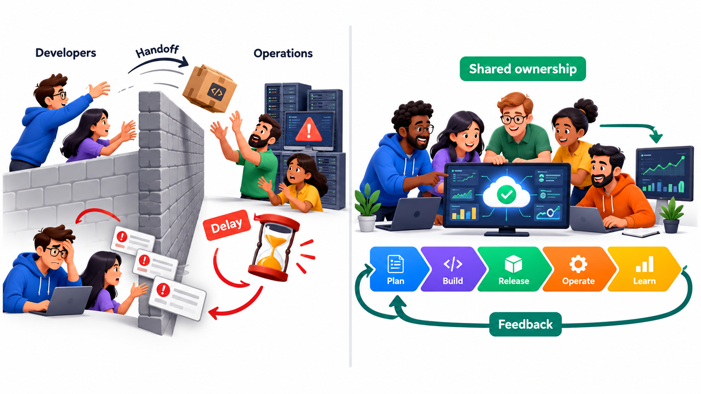
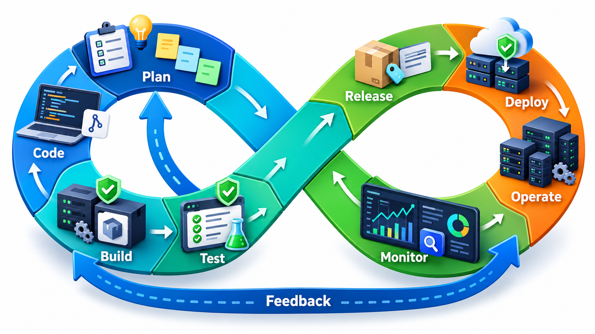
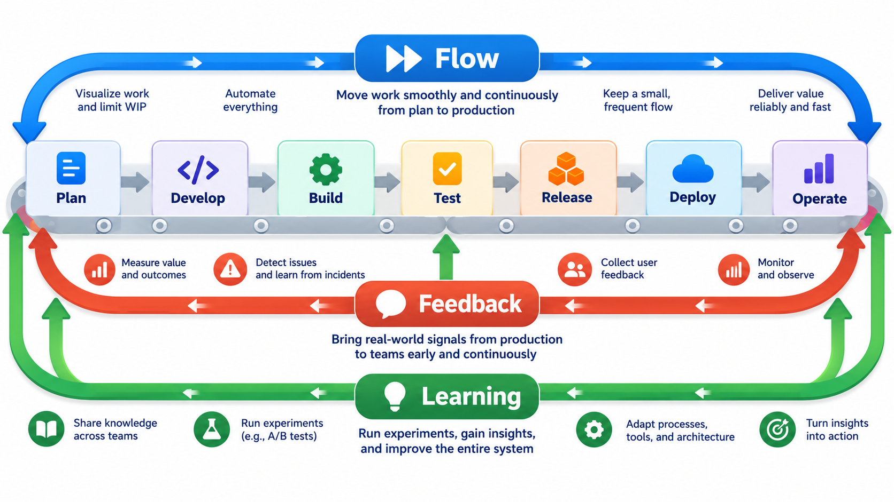
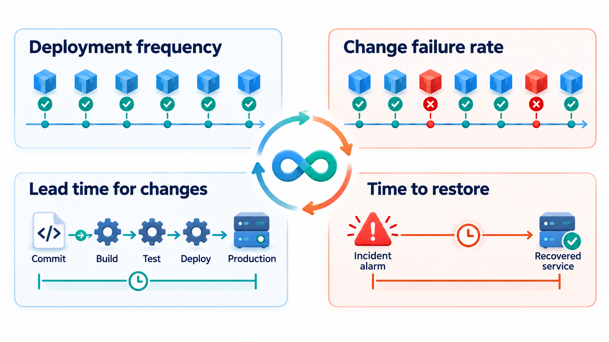
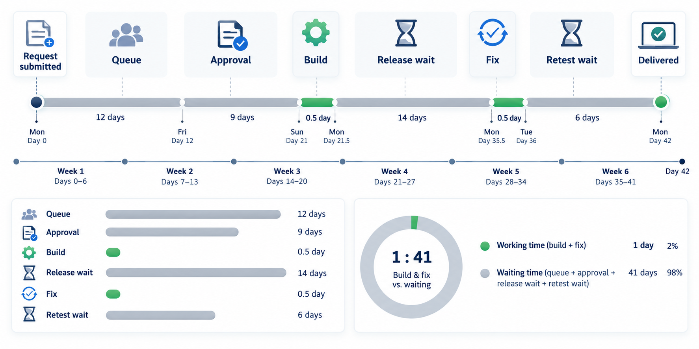

## The Gap Between "It Works on My Machine" and "It Works for Users"

Writing software that works is one job. Getting it safely to users, keeping it running, noticing when it breaks and learning from that is another. For a long time these were done by different groups who rarely spoke, and the gap between them was where most of the pain lived: late releases, midnight emergencies and blame in both directions.

**DevOps** is the answer to that gap. It is not a tool or a job title. It is about how the people who build software and the people who run it work together, and how quickly the knowledge of what happens in production flows back to the people who can act on it.

The name joins two words, *development* and *operations*. Development is the work of creating and changing software. Operations is the work of running it: keeping it available, secure and fast for real users. Each group is judged on something different, and unless the two are brought together, each protects its own measure at the cost of the whole. A developer who is judged on how many features ship has no reason to worry about the pager. An operator who is judged on stability has every reason to resist change. DevOps sets out to give both the same goal.

## The Wall Between Two Teams

For a long time, software organisations split the work in two. Developers wrote the code and were rewarded for delivering features quickly. Operations staff ran the systems and were rewarded for keeping them stable. The goals pulled in opposite directions: developers wanted to change things, and operations wanted things to stay as they were. A release was a handover over a wall. The developers threw code across, and the operations team had to work out how to run it, often with little information.

The results were predictable. Releases were rare and large, because each one was painful. Problems were found at the worst moment, in production, by people who had not written the code. And when something went wrong, the two sides blamed each other, since each could say that its own part had worked.

DevOps removes the wall by changing incentives and habits. The people who build a service also help to run it, and often carry the pager that wakes them when it fails ("you build it, you run it"). People who run systems take part early in design, so that what is built can be deployed, monitored and recovered. The shared aim is a service that changes quickly and stays reliable, not a fight between those two goals.

<!-- Visual: two teams on opposite sides of a wall, developers throwing a package over to operations, beside a single loop in which one team plans, builds, releases, runs and learns together. -->

## A Loop, Not a Line

The best-known picture of DevOps is an endless loop, drawn like the symbol for infinity. On one side is the work of making software: plan, code, build, test. On the other is the work of delivering and running it: release, deploy, operate, monitor. Monitoring feeds straight back into planning, so what is learned in production shapes what is built next.

The point of the loop is speed and learning. A team that releases small changes often finds out within hours if a change was a mistake, and a small change is easy to understand and to undo. A team that releases rarely makes many changes at once and cannot tell which of them caused a problem.

<!-- Visual: an infinity-shaped loop with plan, code, build and test on the left half and release, deploy, operate and monitor on the right half, with an arrow from monitor back to plan. -->

## What Happens Around the Loop

Each stage of the loop has a purpose and, in a mature team, is largely automated.

| Stage | What happens | What automation provides |
| --- | --- | --- |
| **Plan** | The team decides what to build next, using what production has shown | Visible backlogs and data about real use |
| **Code** | Changes are written and kept in shared version control | Reviews of every change; checks that run before merging |
| **Build** | The change is combined with the rest and packaged | A repeatable, automatic build that gives the same result every time |
| **Test** | Automated checks run at several levels | A fast suite that fails the build if anything is broken |
| **Release** | A tested package is approved and tagged | A single version identifier that records exactly what is going out |
| **Deploy** | The package is installed in the live environment | One-step, repeatable deployment, with a way to go back |
| **Operate** | The service runs; capacity and configuration are managed | Environments defined in files so they can be recreated at will |
| **Monitor** | Health, speed and errors are measured, and alarms are raised | Dashboards and alerts that reach the right people at once |

The automated path from a committed change to a running service is called a **pipeline**. Its great virtue is that it makes the safe way the easy way: nobody needs to remember the checklist, because the pipeline does it.

## The Three Ways of Working

A popular description of the practices behind DevOps names three principles.

| Principle | The idea | What it looks like in practice |
| --- | --- | --- |
| **Flow** | Make work move from idea to user in a smooth stream | Small batches, limits on work in progress, automated pipelines, removing waits |
| **Feedback** | Make information flow back, quickly, to those who can act | Automated tests, monitoring, alerts, user data in front of the team |
| **Continual learning** | Treat failure as information and improve constantly | Blameless reviews, experiments, time set aside to fix problems and share knowledge |

Notice how closely these echo lean and Kanban. DevOps applies the same thinking to the whole path to the user, including the part that happens after the code is written.

## Culture First, Tools Second

It is tempting to treat DevOps as a set of tools: pipelines, containers, dashboards. The tools matter, and they are worth learning. But a company can buy every tool and still have a wall, if its developers are measured only on features and its operations people only on uptime. The practices that mark a DevOps culture are about people.

- **Shared ownership.** Whoever writes the code is responsible for how it behaves in production.
- **Automation of the repetitive.** Builds, tests, deployments and recoveries are scripted, because a step done by hand cannot be repeated reliably or quickly.
- **Small, frequent changes.** Each release is small enough to be understood.
- **Fast feedback from production.** Logs, metrics and alerts reach the people who can act on them.
- **Blameless learning.** When something fails, the team asks how the system allowed it, not who to blame. People who fear blame hide problems.

A handy summary of these is the word CALMS: **Culture** (shared goals and trust), **Automation** (of the repetitive), **Lean** (small batches, visible flow), **Measurement** (of speed and stability) and **Sharing** (of knowledge and responsibility). A team strong in tools but weak in culture and sharing has only the middle of the picture.

## Environments and Reproducibility

A common cause of failures is that the environment where software is tested differs from the one where it runs: a different version of a library, a different setting, a different amount of data. "It works on my machine" is the classic symptom. DevOps answers with **reproducibility**: the environment is described precisely, in files kept under version control, so that an identical one can be created whenever needed, for testing, for staging or for recovery after a failure.

This idea, sometimes called *infrastructure as code*, treats servers and their configuration like any other product of engineering: written down, reviewed, tested and versioned. It reduces the risk of a hand-built server that nobody can recreate, and it means that the same description produces the same environment every time. The practical result is that a mistake in an environment becomes a change to a file, which can be reviewed and undone, and not a quiet manual alteration that nobody remembers.

## Measuring How Well It Works

Because DevOps is about flow and reliability, it can be measured. A research programme called DORA (DevOps Research and Assessment) studied thousands of teams and found four measures that went together with better outcomes. Two describe speed: how often a team deploys, and how long a change takes to go from commit to production. Two describe stability: what share of deployments cause a failure, and how fast service is restored when one does.

The surprise in the research was that speed and stability were not opposites. The teams that deployed most often also tended to have fewer failures and recover faster. To see the measures at work, take one week of eight deployments, two of which failed.

| Measure | This week's figure | How it is worked out |
| --- | --- | --- |
| Deployment frequency | 8 a week, about one and a half per working day | Count of deployments |
| Change failure rate | 25% | 2 failed out of 8 |
| Time to restore | 20 minutes on average | The two failures took 30 and 10 minutes to fix |

Mature teams often report far lower failure rates, and the number only means something when tracked over time. Short recovery is what makes frequent deployment safe: a mistake costs minutes, not a night. A team would not use these numbers to rank people. They show whether the system of delivery is getting healthier.

<!-- Visual: four measures in a 2 by 2 grid: deployment frequency and lead time for changes on the speed side, change failure rate and time to restore on the stability side. -->

## Learning From Failure

Operations is where failures are met, so DevOps puts weight on how a team handles them. When something breaks, the first task is to restore service, by rolling back, switching a feature off or adding capacity. The second, once the pressure is off, is to understand why it happened. A **blameless review** asks what the sequence of events was, what information people had at each moment, and what in the system allowed a reasonable person to make the mistake. It ends with specific changes: a missing alert, a confusing procedure, a step that should be automated.

The attitude matters. If people are punished for the incident, they conceal near misses and the same failure returns. If the review treats the system, not the person, as the thing to fix, people report problems early and the organisation learns. Many teams also rehearse failure on purpose, practising rollbacks and recovery in calm conditions so that they are routine when they matter.

## Where DevOps Meets the Rest of the Process

DevOps does not replace agile or Scrum. It extends the same values past the point where code is written. An agile team that hands finished code to a separate release team once a quarter has moved the bottleneck, not removed it. The two ideas work together: agile makes the team good at deciding what to build in small steps, and DevOps makes it good at putting those steps in front of users and learning from them.

<!-- Visual: a six-week request in which a few short blocks of active work are separated by long waits for queues, approvals, environments and release slots. -->

The practices that support DevOps, including continuous integration, deployment pipelines, containers and monitoring, each deserve study of their own. What matters first is a simpler question: do the people who write the software and the people who run it share a goal, and can they see the same picture of how the system is behaving?

A sensible way to begin is with the slowest, most painful step between a finished change and a happy user. For one team it is a manual release that takes a weekend; for another it is a test environment that takes a week to get. Remove that obstacle, measure the effect, and then move to the next. Culture changes more by a series of visible improvements than by a declaration.
