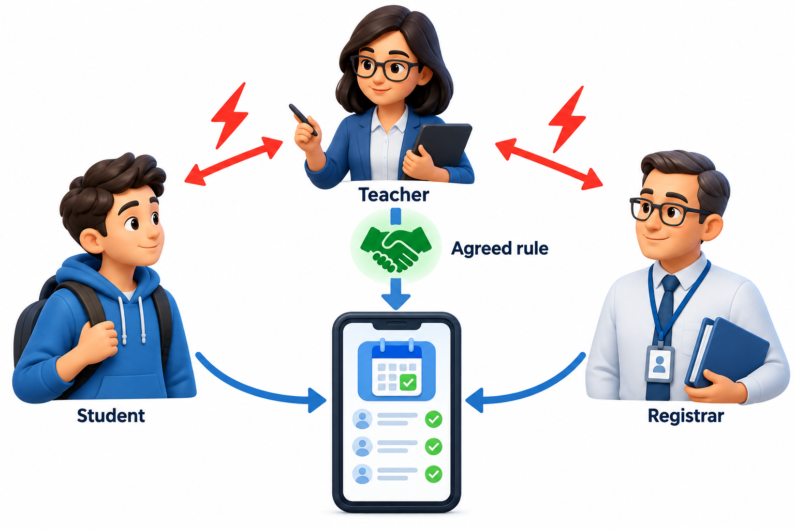
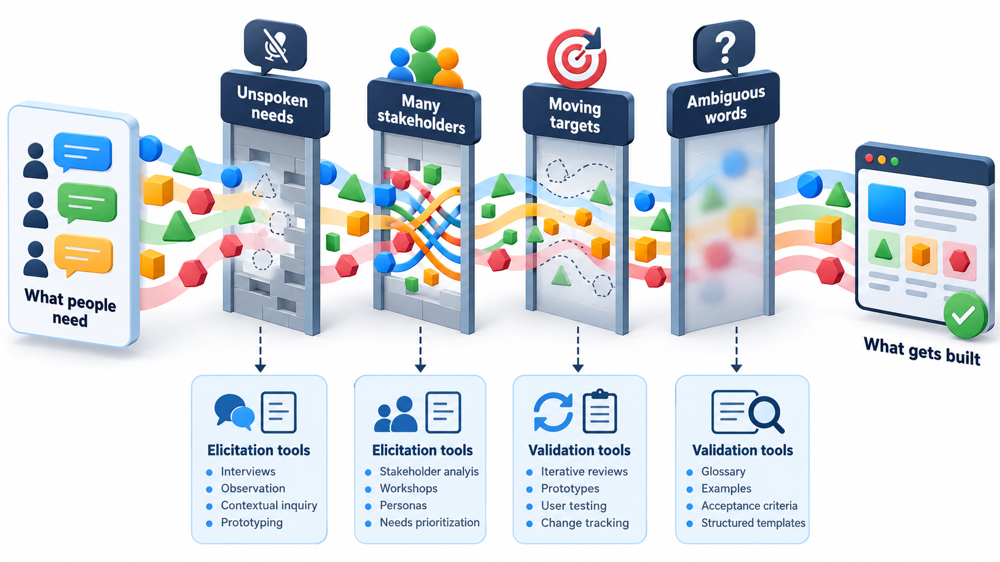
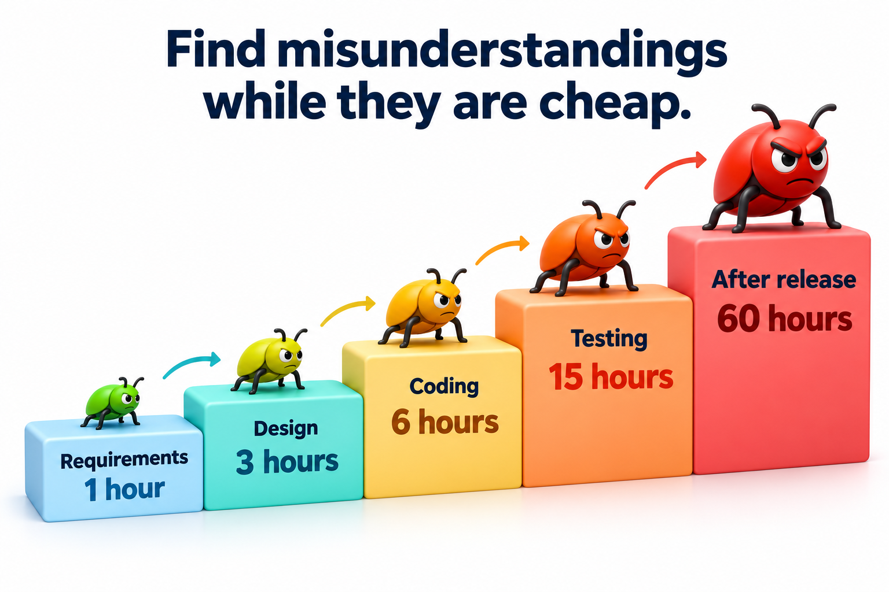
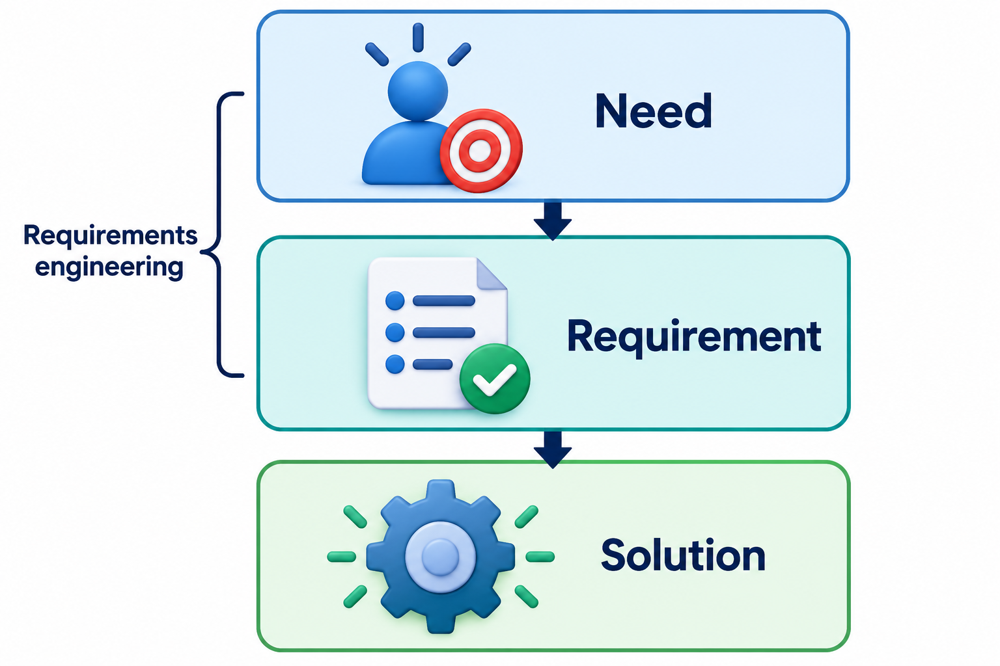
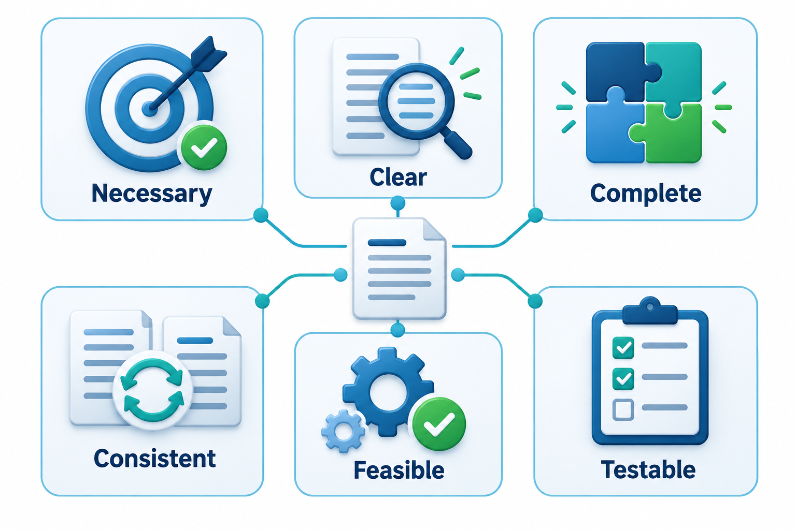
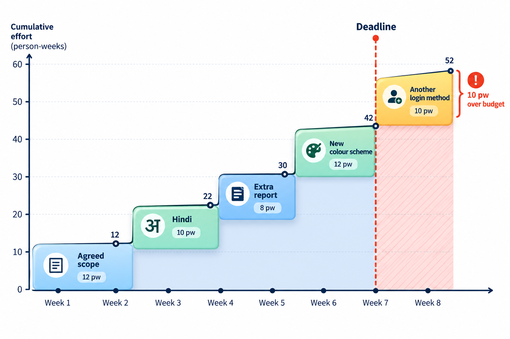

## The Most Expensive Sentence Is the One Everyone Understood Differently

A project can be built perfectly and still fail, if what was built is not what was needed. The gap usually opens at the very start, when someone writes a sentence that seems clear and three people read it three ways. By the time the difference shows, the design, the work and the tests have all been built on one reading.

This is the territory of **requirements engineering**: finding out what a system must do and for whom, before and while it is built. Of all the stages in software development, it is the one where a mistake is cheapest to make and most expensive to find late. This topic is about why it is hard.

It is easy to underrate how hard it is, because it looks like the simplest part of the work. There is no code to write and no tool to learn; one simply talks to people and writes down what they say. Yet this is exactly where many projects are lost. Surveys of failed projects keep returning to the same causes: incomplete requirements, changing requirements, and too little involvement of users. The difficulty is not typing but understanding, and understanding other people's needs, which they may not be able to state, is a skill that has to be learned.

## What Requirements Engineering Covers

Requirements engineering is a set of activities, not one. It is useful to see the whole outline, because the challenges in this topic arise in each of its parts, and the topics that follow take each part in turn.

| Activity | The question it answers | Why it is hard |
| --- | --- | --- |
| **Elicitation** | What do the stakeholders need? | People cannot always say; they disagree; they do not know what is possible |
| **Analysis** | Are these needs consistent, feasible and in the right order? | Needs conflict; resources are limited |
| **Specification** | How do we write them down so that all readers agree? | Natural language is ambiguous |
| **Validation** | Are these the right requirements? | Reviewers see what they expect to see |
| **Management** | How do we handle change and keep track? | Requirements keep moving, and everything depends on them |

These are not strictly sequential. A team elicits, analyses and writes in short loops, learning as it goes, and the loop continues through the life of the project.

## Why Asking What People Want Is Not Simple

If requirements were just a list that the customer already had in their head, a developer could write it down and begin. Four difficulties make it harder.

**People cannot always say what they need.** Users know their daily work so well that much of it is invisible to them. A clerk will describe the official procedure and forget the three workarounds that make it actually function. Other things are discovered only when the user sees a working version and says "not like that".

**There are many stakeholders, and they disagree.** A college fee system has students, accountants, the principal, the auditors, the bank and the IT department, each with different priorities. The accountant wants control, the student wants speed, and the auditor wants records. A requirements list that only reflects the loudest voice is a requirements list with holes.

**Needs change while the system is being built.** Laws change, competitors move, and the people who understand the problem learn more. A requirement that was correct in January may be wrong by June.

**Words are ambiguous.** The same sentence means different things to different readers, and each reader is sure they understand.

<!-- Visual: Students teachers and administrators can pull the same requirement in different directions. -->

## Tacit Knowledge: What Experts Cannot Tell You

A great deal of what people know about their work is **tacit**: they use it without being able to put it into words. A registrar who has processed admissions for twenty years knows that certain certificates are usually late, that one district's records follow a different format and that a particular signature must never be missing. Asked to describe the process, they give the official one. The rest only appears when the analyst watches them work, asks about a specific awkward case, or sees the system fail on real data.

<!-- Visual: four obstacles (unspoken needs, many stakeholders, moving targets, ambiguous words) as four boxes between "what people want" and "what is built". Save as images/20_four_obstacles.png. -->

This is why requirements work cannot rely on questionnaires alone. Observing people, asking them to walk through real cases, and showing them early versions all draw out knowledge that interviews miss. The practical rule is to ask about the last time something went wrong, not about the ideal procedure.

## Who Are the Stakeholders?

A **stakeholder** is anyone affected by the system or able to affect it. The group is wider than the people who use it.

| Stakeholder | Relationship to the system | What they typically care about |
| --- | --- | --- |
| **End users** | Use it daily | Ease, speed, doing their job without friction |
| **Customers or sponsors** | Pay for it | Value for money, delivery date, risk |
| **Operators and support staff** | Keep it running | Reliability, clear logs, simple recovery |
| **Regulators and auditors** | Check it follows rules | Records, controls, compliance |
| **Other systems and their owners** | Exchange data with it | Stable interfaces and formats |
| **People affected indirectly** | Their lives are touched without using it | Privacy, fairness, safety |

Forgetting a stakeholder group is one of the commonest ways to miss a requirement. An analyst who talks only to the sponsor will discover the operators' needs on the day of the first outage. A useful exercise is to list stakeholders and then rank them by how much influence they have and how much the system affects them; the high-influence, high-impact ones need close attention, and the quiet, affected ones need deliberate effort to hear.

## When Stakeholders Disagree

Conflict between stakeholders is normal, not a sign of failure. The requirements engineer's role is not to pick a winner silently but to make the conflict visible and get it resolved by someone with the authority to do so.

1. **Notice the conflict.** Two requirements that cannot both be met, such as "payment must be one click" and "payment must be confirmed by OTP", should be flagged and not quietly reconciled.
2. **Find the interests behind the positions.** The accountant who insists on a manual approval step may really need to prevent fraud; another control might meet the need with less delay.
3. **Offer options with consequences.** Show what each choice costs in time, money and risk.
4. **Get a decision from the right person.** Record who decided, and why.

A requirement without an owner who can decide is a requirement waiting to be argued about again.

## One Sentence, Two Meanings

Ambiguity is easy to underestimate because it hides in ordinary sentences. Take a requirement from a hostel management system: "Send a reminder to students with pending fees or overdue library books and hostel dues." Does that mean students who have pending fees, *or* who have both overdue books and hostel dues? Or students who have either pending fees or overdue books, and who also have hostel dues? The sentence reads fine in a meeting, and a developer will pick one meaning without noticing that there were two.

Take four students and three facts about each: whether fees are pending, whether library books are overdue, and whether hostel dues are unpaid. The two readings give different answers.

| Student | Fees pending | Books overdue | Hostel dues | Reading one: fees, or (books and hostel) | Reading two: (fees or books), and hostel |
| --- | --- | --- | --- | --- | --- |
| Asha | Yes | No | No | Reminded | Not reminded |
| Ravi | No | Yes | Yes | Reminded | Reminded |
| Meena | No | Yes | No | Not reminded | Not reminded |
| Kiran | Yes | Yes | Yes | Reminded | Reminded |

The two readings disagree about Asha. A developer who chose reading two would silently stop reminding students who owe fees but have no hostel dues, and nobody would notice until money went uncollected. Same words, different grouping. The fix is to ask, and to write the answer as a precise sentence or a small table like the one above.

## Common Faults in Written Requirements

Beyond ambiguity, written requirements suffer from a short list of familiar faults.

| Fault | What it looks like | Example |
| --- | --- | --- |
| **Ambiguous** | More than one meaning | "The system should respond quickly" |
| **Incomplete** | A case is missing | "Refund the fee if the student withdraws" (what if they withdraw after the deadline?) |
| **Inconsistent** | Two requirements contradict | "Passwords expire every 30 days" and "Passwords never expire for staff accounts" |
| **Unverifiable** | No way to tell if it is met | "The interface shall be user-friendly" |
| **Infeasible** | Cannot be built within limits | "The system shall never fail" |
| **A hidden design** | Describes a solution, not a need | "Use a dropdown for the course list" |

Reading each requirement against this list takes a few minutes and finds a surprising share of the problems before anyone has built anything.

## The Cost of Finding Out Late

A misunderstanding in requirements is cheap to repair while it is still a sentence on a page. Once the design, the code and the tests have been built on top of it, repair means redoing all of them. The same error that costs an hour to fix in a requirements meeting can cost many times that after release, and cost a customer too.

<!-- Visual: the same misunderstanding costing 1 hour to fix at requirements and rising to 60 hours after release. -->

That is why requirements work is front-loaded in some processes, and repeated in small slices in others. The purpose of both is the same: find the misunderstanding when it is cheap.

## Need, Requirement and Solution Are Different Things

A common source of trouble is jumping to a solution. A user says "we need a mobile app". That is a solution. The need underneath may be "students should know their fee status without visiting the office", and an SMS message, a web page or a notice board may serve it. A requirement lies between: "the system shall tell a student their fee status within one minute of a request". The requirement states what, and leaves how open.

Teams that accept the solution as the requirement lose the chance to find something simpler or better. Teams that ask "what problem does that solve?" a few times often find that the need was different from the request.

<!-- Visual: three layers: a need (what the person is trying to achieve), a requirement (what the system must do about it), and a solution (one way of building it). -->

## Signs of a Good Requirement

A usable requirement has a few qualities that can be checked by reading it. It is **clear**, so that two readers get the same meaning. It is **testable**, so that someone can say whether it is met. It is **feasible** within the time, money and technology available. It is **necessary**, answering a real need, and **consistent** with the other requirements. Run each requirement through these questions and the vague ones show up quickly.

<!-- Visual: six checks that make a requirement usable and testable. -->

## When the Target Moves

Even a good set of requirements will change. The question is whether the change is noticed and judged, or just absorbed. If five "small" additions arrive and each is quietly accepted, the project may be a third larger without anyone having decided that. This is the pattern known as scope creep.

Change has several sources: the business shifts its priorities, the law changes, users see the product and want something else, or the team learns that an assumption was wrong. The remedy is not to forbid change, which would leave the product out of date, but to handle it consciously. Each proposed change is described, its effect on cost, time and other requirements is estimated, and a named person decides. Changes that are accepted are recorded, so that the project's scope at any moment can be stated.

<!-- Visual: cumulative requests stacking up beyond the original deadline. -->

## Five Misreadings of Requirements Engineering

**"Requirements are what the customer asks for."** Requests are a starting point. Needs are found by asking why, watching real work and testing ideas.

**"Requirements are written once, at the start."** They are discovered and refined for the whole life of the project. The aim is to notice change, not to forbid it.

**"If the customer signed it, it is right."** A signature shows agreement with the words. It does not show that the words were understood in the same way.

**"Ambiguity is a writing problem."** It is a shared-understanding problem. Better wording helps, but examples, tables and conversation settle it for good.

**"Requirements engineering is paperwork before the real work."** It is the part of the work that decides whether the rest is worth doing. A system built perfectly to the wrong requirement is a perfectly built failure.
