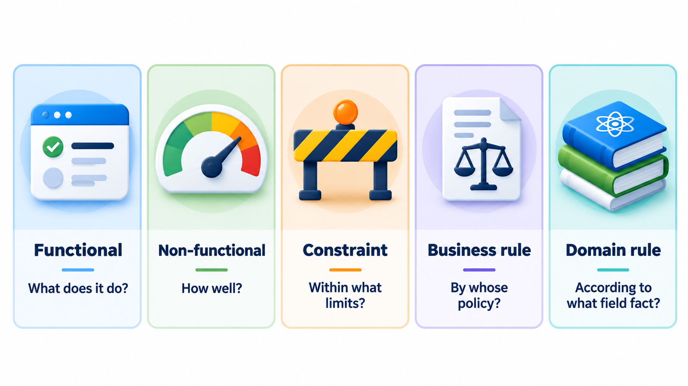
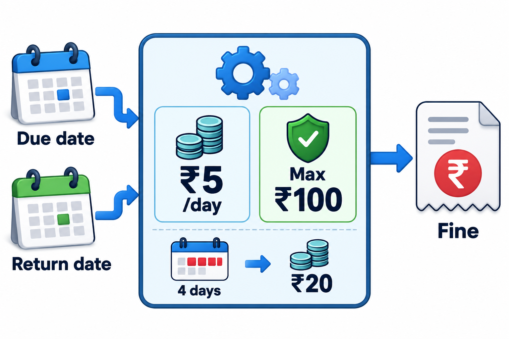
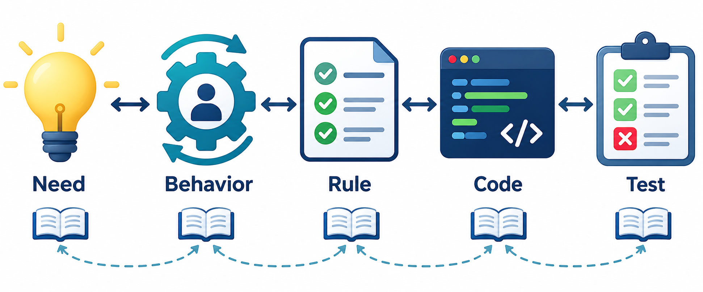
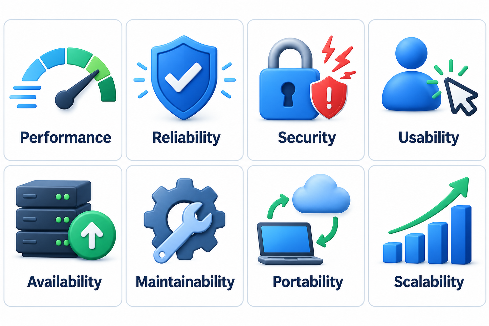

## A Requirement Is Not Always a Feature

Ask people what a system should do and they will describe features: book a meal, print a receipt, search a record. But a system is also expected to be fast, to run on the phones people already own, to follow the rules of the business and to respect the laws of the field it works in. These expectations are requirements too, and they are the ones most often left unsaid because they seem too obvious to mention.

Requirements therefore come in different kinds, and sorting them helps a team to ask the right questions, because each kind is found in a different place and is checked in a different way. A rule from the world of the user, such as "a gene name must never be changed into anything else", is as binding as any feature, even if no one thinks to say it.

Sorting is useful because each kind fails in its own way. Missing functional requirements make the product incomplete: users cannot do something they need. Missing non-functional requirements make it unusable: it does everything and is too slow. Missing constraints make it unbuildable or unacceptable: it ignores the platform or the budget. Missing business and domain rules make it wrong: it does the right things in the wrong way. Knowing which kind of gap you are looking for makes the search more careful.

## Levels of Requirement: From Need to Detail

Requirements also differ in how detailed they are. A team usually works at three levels, each answering a different reader.

| Level | Written for | Style | Example |
| --- | --- | --- | --- |
| **Business or stakeholder requirement** | Sponsors and users | Short, in the language of the business | "Students should be able to pay fees without visiting the office" |
| **User requirement** | Users and analysts | What a user needs to do, in their own terms | "A student can pay a semester fee online and receive a receipt" |
| **System requirement** | Designers and testers | Precise statements of what the system shall do | "The system shall accept UPI and card payments, record each payment once and issue a numbered receipt within 10 seconds" |

The levels are linked: each system requirement exists because of a user requirement, and each of those because of a business need. A requirement at the lower level that cannot be traced to anything above is a candidate for removal; it may be a feature somebody liked rather than one anyone needed.

## The Main Kinds

| Kind | What it says | Where it comes from | Example for a hostel mess app |
| --- | --- | --- | --- |
| **Functional** | What the system does | Users and their tasks | "A student can book a meal for tomorrow" |
| **Non-functional** | How well it does it | Quality needs of users and the business | "The booking page loads within 2 seconds on a 4G phone" |
| **Constraint** | A limit on the solution | Technology, budget, standards, the organisation | "The app must run on Android 9 and above" |
| **Business rule** | A policy the organisation has chosen | Management, law, contracts | "Meal booking closes at 8 pm the evening before" |
| **Domain rule** | A fact about the field of work | The field itself, such as science or law | "A gene name must never be altered" |

**Functional requirements** are the ones most people think of first: the features. They are normally written as things a user or the system does.

**Non-functional requirements** describe qualities such as speed, security, availability and ease of use. They are easy to forget because nobody asks for "fast" as a feature, and they often shape the whole design.

**Constraints** are not about what the system does, but about what the solution may or may not be. A rule that the data must stay in India, that the system must use the college's existing login, or that the budget is fixed, all limit the choices of designers.

**Business rules** are decisions of the organisation: the late fee, the cut-off time, the maximum number of books. They belong to the organisation and can change when the organisation decides. Writing them separately from features means a change of policy does not require rewriting the requirements.

**Domain rules** are facts about the field that the software must respect: tax law, medical dosing limits, the rule that a gene name must not be altered. They are the hardest to find, because experts do not think to mention what everyone in their field takes for granted.

<!-- Visual: five boxes (functional, non-functional, constraint, business rule, domain rule) each with a one-line question: what does it do, how well, within what limits, by whose policy, according to what fact of the field. Save as images/21_five_kinds.png. -->

## Functional Requirements in More Detail

A good functional requirement says who or what acts, what the action is, and what the visible result is. It is useful to look at them in groups, because the groups suggest questions.

| Group | Question to ask | Example |
| --- | --- | --- |
| **Inputs** | What does the system receive, from whom, and in what form? | "The student enters a roll number and semester" |
| **Processing** | What does it do with the input? | "The system calculates the fee, applying scholarships and fines" |
| **Outputs** | What does it produce, for whom? | "A receipt with a unique number is shown and emailed" |
| **Data** | What must it remember? | "Each payment is stored with date, amount and method" |
| **Error handling** | What happens when something is wrong? | "If the bank does not respond, the student is told the payment is pending, not failed" |
| **Boundary cases** | What happens at the extremes? | "A student with a zero balance sees a message, not a payment form" |

The last two groups are the most often forgotten. Specifications tend to describe the happy path; errors and boundaries are where users meet trouble.

## Tracing a Rule Through a Requirement

A business rule is stated in one place and appears in several. The rule "late fee is 5 rupees per day, to a maximum of 100" shows up as a functional requirement ("the system calculates the late fee"), as test cases, and as the code itself. If the rule changes and only the code is updated, the documents become wrong. Keeping the rule as its own item, that others point to, makes the change a one-line edit.

<!-- Visual: inputs, business rules and outputs for calculating a library fine. -->

A functional requirement can also be followed from the need that caused it, through the requirement and the design, to the test that proves it. That thread is what makes it possible to say later why a feature exists and whether it works.

<!-- Visual: a functional requirement traced from stakeholder need to acceptance test. -->

## Writing Non-Functional Requirements So They Can Be Checked

Qualities are the requirements most often written as adjectives, and an adjective cannot be tested. Turning one into a requirement means choosing a measure, a target and a condition.

| As first stated | Weak because | Stronger version |
| --- | --- | --- |
| "The system should be fast" | Fast for whom, doing what? | "95% of fee-payment pages load within 2 seconds on a 4G connection during peak hours" |
| "It should be secure" | Secure against what? | "All passwords are stored as salted hashes; five failed logins lock the account for 15 minutes" |
| "It should be easy to use" | By whom, after how much training? | "A first-time student completes a payment unaided in under 3 minutes in 9 of 10 trials" |
| "It should be reliable" | What counts as reliable? | "Availability of at least 99.5% over a month, excluding planned maintenance" |

A stronger requirement can be verified, and an argument about whether the system is fast becomes a measurement. The effort of choosing the numbers also forces the team to talk to users about what they really need.

## A Quick Gap Check

One useful habit is to list the requirements gathered so far and count them by kind. Gaps in the count point to questions nobody has asked. Here is the count for a hostel mess app.

| Requirement | Kind |
| --- | --- |
| Students can book a meal for tomorrow | Functional |
| The mess manager can see how many meals are booked | Functional |
| Meal booking closes at 8 pm the evening before | Business rule |
| The booking page loads within 2 seconds on a 4G phone | Non-functional |
| The app must run on Android 9 and above | Constraint |

| Kind | Count |
| --- | --- |
| Functional | 2 |
| Non-functional | 1 |
| Constraint | 1 |
| Business rule | 1 |
| Domain rule | 0, nobody has asked about this yet |

A zero is a question, not a verdict. For a mess app the team might ask about food-safety rules: "must we record allergens, or keep a record of who ate what?" Asking now is cheaper than learning the answer from an inspector.

## Quality Needs Are Requirements Too

The non-functional kind is a family, not a single item. Performance, capacity, availability, security, usability, maintainability and portability are the groups that most often matter. Each needs its own questions and its own way of being measured, which is the subject of a separate topic. What matters here is to see them on the list from the beginning.

<!-- Visual: eight common families of software quality attributes. -->

