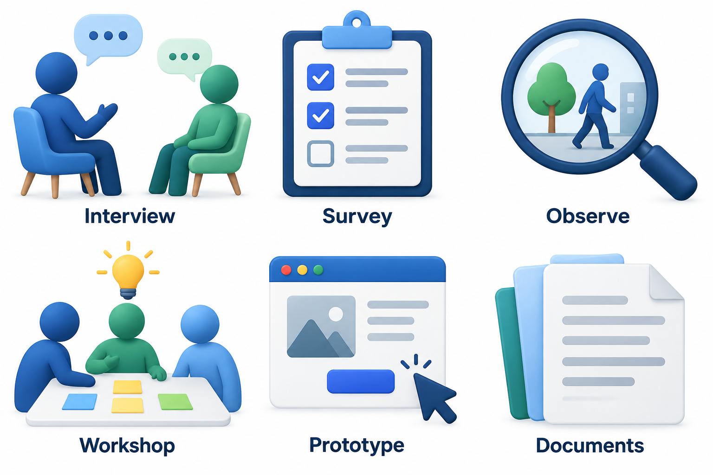
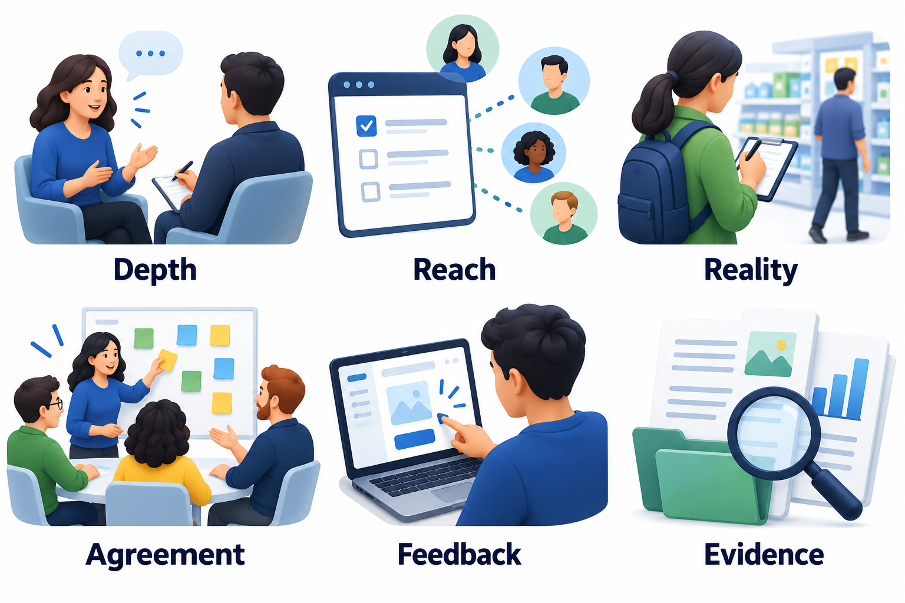
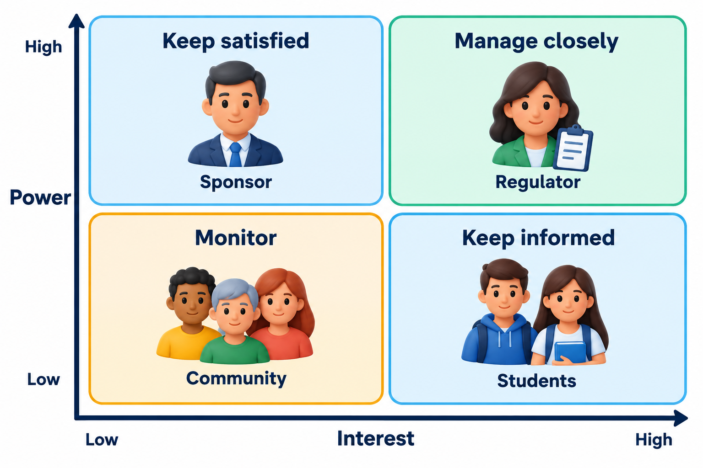
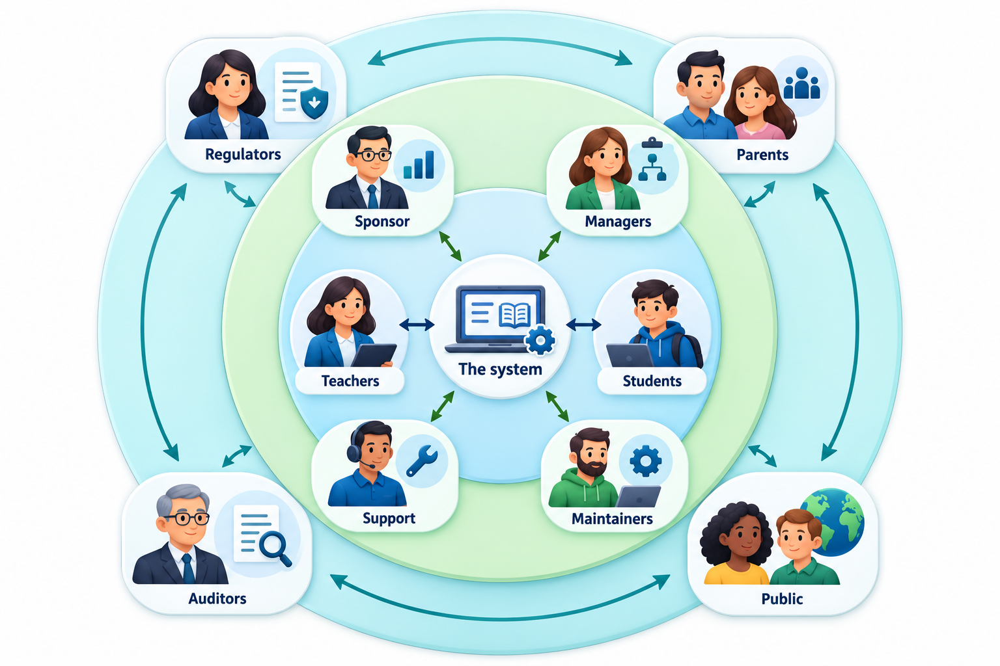
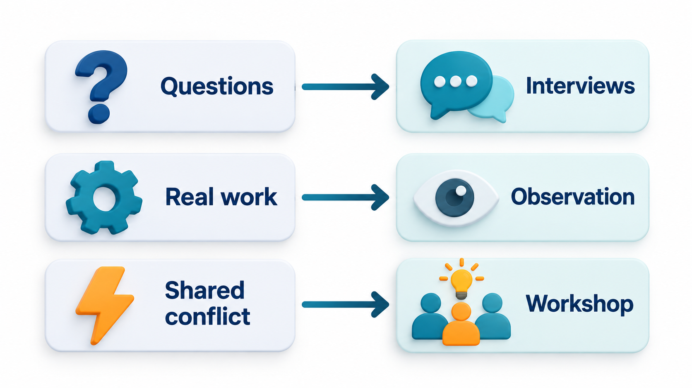
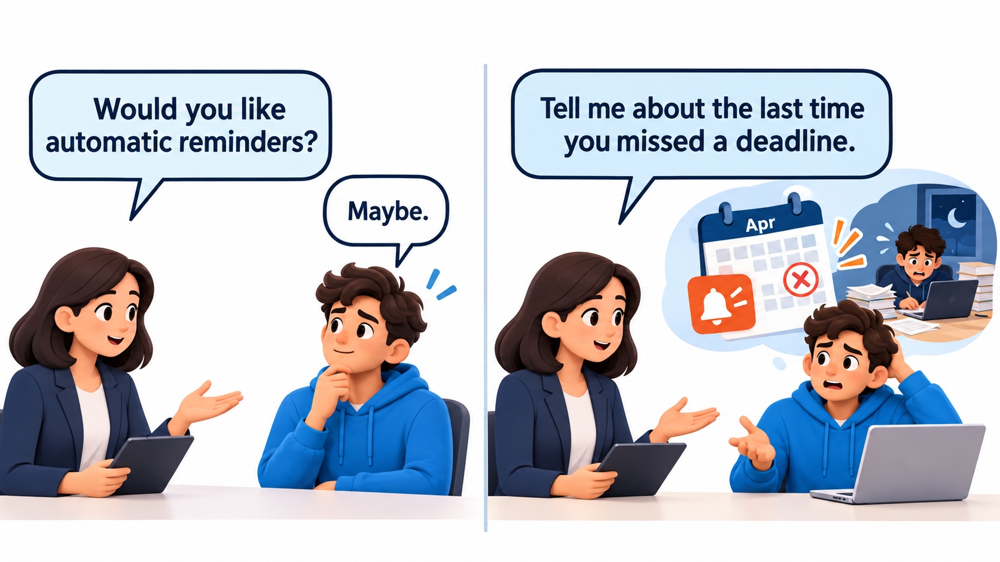

## Why Not Just Ask People What They Want?

It seems the obvious way to find requirements: ask the users. The trouble is that what people say, what they do and what they actually need are three different things. People describe the solution they can imagine, forget the steps they do without thinking, and cannot predict how they will behave with something they have never used. A questionnaire collects opinions; it does not always collect needs.

This is the central problem of **requirements elicitation**: drawing out what people need when the direct answer is unreliable. There is no single technique that solves it. Skilled analysts keep a set of techniques, including watching people work, and choose among them.

The word *elicit* is chosen carefully. To elicit is to draw out, as opposed to collect. Requirements are not lying around waiting to be gathered like apples; they have to be drawn out through conversation, observation and experiment, and they often change shape in the process. The analyst's job is closer to that of a detective or a good teacher than that of a clerk taking dictation.

## Three Gaps Between What Is Said and What Is Needed

Elicitation is hard because of three gaps, and each needs a different response.

| Gap | What it looks like | What closes it |
| --- | --- | --- |
| **Cannot say** | The person knows the work but cannot put it into words; much of it is habit | Observation, walking through real cases, prototypes |
| **Will not say** | The person hides something: a workaround against policy, a fear of being replaced, a politically awkward fact | Trust, privacy, asking from several people, looking at records |
| **Does not know** | The person does not know what is possible, or what they will want when they see it | Prototypes, examples from other places, short trials |

A good plan for elicitation uses a mix of techniques so that each gap is covered. Interviews alone are good at the first sentence of each gap and weak at the rest.

## Six Techniques and What Each Is Good For

| Technique | How it works | Good for | Watch out for |
| --- | --- | --- | --- |
| **Interviews** | One conversation with a person or a small group | Understanding goals, opinions and the reasons behind requests | People describe the official process, and forget the workarounds |
| **Surveys** | A fixed set of questions sent to many people | Measuring how many people share a need | Shallow answers, and only the questions you thought to ask |
| **Observation** | Watching people do their real work | Finding what people do but do not mention | Takes time, and people may act differently when watched |
| **Workshops** | A structured group session with several stakeholders | Resolving disagreements and agreeing priorities quickly | One loud voice can dominate |
| **Document analysis** | Reading forms, reports, manuals and existing systems | Understanding rules and data before talking to anyone | Documents may be out of date or wrong |
| **Prototypes** | Showing a rough version and watching reactions | Making vague ideas concrete | People may judge looks instead of substance |

No technique reveals everything. Interviews tell you what people think, observation tells you what they do, documents tell you what the organisation officially expects, and a prototype tells you how they react to something real. Using two or three together lets each check the others.

<!-- Visual: six techniques as six tools on a workbench, each labelled with what it reveals. -->

## Choosing by What You Do Not Yet Know

A practical way to choose is to ask what is unknown. If you do not know who the stakeholders are, start with documents and a few short interviews. If you know the stakeholders but not the details of their work, watch them. If there are conflicting wants, bring them into a workshop. If the question is how many people feel a problem, send a survey, after the interviews have taught you what to ask.

<!-- Visual: a selection matrix matching elicitation techniques to information needs. -->

## Whom to Ask

Elicitation can fail by asking the wrong people, or too few. The users of the system are the obvious source, but they are not the only one. The people who pay for it, the people who maintain it, the people who are affected by it without using it (the auditor, the parent who receives a message), and the people who must follow the laws it touches all hold part of the picture. A map of stakeholders, ranked by their power over the project and their interest in it, tells the analyst whom to keep close and whom simply to keep informed.

<!-- Visual: stakeholders arranged on a grid with power on one axis and interest on the other, with a plan for each quarter. -->

An *onion* map is a second way to see the same people: the system at the centre, the direct users in the first ring, people inside the organisation who depend on it in the next, and outside parties such as regulators, partners and the public in the outer ring. Asking "who is in each ring, and have I spoken to someone from it?" is a quick way to find the missing voices.

<!-- Visual: An onion map reveals direct users internal stakeholders and external parties around a system. -->

## Interviews in Practice

An interview is a conversation with a purpose, and it can be prepared.

| Stage | What to do |
| --- | --- |
| **Prepare** | Read what exists about the person's work. Decide the few things you most want to learn. Write a short list of open questions, not a script |
| **Open** | Explain why you are there, what you will do with the notes and that there are no wrong answers. Start with something easy, such as the person's role |
| **Explore** | Ask about real events: "Tell me about the last time...". Follow the person's story. Use "why" and "what happened next" to go deeper |
| **Probe the awkward** | Ask "what goes wrong?" and "what do you do when that happens?" Workarounds and exceptions are where requirements hide |
| **Close** | Summarise what you heard and ask what you missed. Ask who else you should talk to |
| **Record** | Write up within a day. Send it back to the person for correction |

Two kinds of question are worth telling apart. *Open* questions ("How do you decide which students to remind first?") invite a story and surprise the analyst. *Closed* questions ("Do you remind students by email?") confirm a fact quickly. A good interview uses mostly open questions and a few closed ones to nail down details. It also avoids *leading* questions, such as "Wouldn't it be better if the system did it automatically?", which suggest the answer and teach the analyst only that the person is polite.

## Observation and Walkthroughs

Watching people work reveals what they cannot tell you. There are several forms.

- **Passive observation.** The analyst watches and takes notes without interrupting. It shows the real sequence of work, interruptions and workarounds.
- **Active observation.** The analyst asks questions during the work ("Why did you open that file?"). It explains choices but slows the work.
- **Apprenticeship.** The analyst learns to do the job, under the guidance of a practitioner. It gives deep understanding of difficult skills.
- **Walkthrough of a real case.** The person takes the analyst through a specific recent case using the real papers or screens. It anchors the discussion in facts rather than generalities.

Observation needs permission and explanation, and it should not be used to judge people. Done with respect, it usually builds trust, because the person sees that the analyst cares about how the work is really done.

## Workshops and Group Techniques

A workshop brings several stakeholders together for a structured session, often half a day. It is the fastest way to expose and settle disagreements, since people hear each other's reasons directly. A good workshop has a clear purpose, a facilitator who keeps time and manages the loud voices, and visible outputs such as a list of agreed priorities or a rough process map on the wall.

Other group techniques include *brainstorming*, in which ideas are produced freely first and judged afterwards, and *card sorting*, in which participants group items such as features or menu entries in the way that makes sense to them. The danger in all group settings is that senior or confident people dominate. Techniques such as writing ideas individually before sharing, or voting with dots, give quieter participants a fair hearing.

## Turning Interview Notes into Themes

Notes from interviews are raw material. The skill is to find patterns across them. Take five short notes from hostel students about the mess, and count how often each concern appears.

| Interview note | Concern raised |
| --- | --- |
| "queue is long at 8 pm and food runs out" | Long queue; food runs out |
| "I skip dinner when the queue is long" | Long queue |
| "menu is not known until I reach the mess" | Menu not visible |
| "food runs out so I eat outside" | Food runs out |
| "cannot tell the mess if I will be away" | Cannot cancel |

| Theme | Raised in |
| --- | --- |
| Long queue | 2 of 5 interviews |
| Food runs out | 2 of 5 interviews |
| Menu not visible | 1 of 5 interviews |
| Cannot cancel | 1 of 5 interviews |

A count is a prompt, not a ranking. A single interview can reveal an important need that others did not mention. But a theme that keeps coming back across different people is a good candidate for a requirement. Tallying like this is a crude tool, and a real analyst reads the notes for meaning.

From themes the analyst forms candidate requirements, and then checks them. "Students should be able to see the day's menu before they go to the mess" follows from one theme; "students should be able to cancel a meal booking when they will be away" from another. Each is then taken back to the stakeholders: does this capture what you meant, and how important is it relative to the others?

## Good Interviews Ask About Behaviour

The best interview questions are about what people did, not what they would like. "Tell me about the last time you booked a meal" yields a story with details. "Would you like to book meals on your phone?" yields "yes", which tells you almost nothing, because saying yes costs the person nothing. Follow-up questions such as "what happened next?" and "why did you do it that way?" go further than any prepared list.

<!-- Visual: Different unknowns call for interviews observation or workshops. -->

An interview should also be written up soon, while memory is fresh, and the person should be offered a chance to correct it. That small step catches many misunderstandings before they harden into requirements.

<!-- Visual: two question styles side by side. Left, an opinion question ("Would you like...?") with a vague answer. Right, a behaviour question ("Tell me about the last time...") with a specific story. Save as images/22_question_styles.png. -->

## Traps for the Analyst

Analysts have their own habits that can distort what they find.

| Trap | What happens | Remedy |
| --- | --- | --- |
| **Confirmation bias** | Hearing only what supports the idea you came with | Look for evidence against it; ask what would change the plan |
| **Leading questions** | Putting the answer into the question | Ask open questions; avoid suggesting solutions |
| **Solution jumping** | Treating a stated solution as the requirement | Ask what problem it solves |
| **The loudest voice** | Letting one stakeholder stand for all | Speak to several people at several levels |
| **Jargon** | Using terms the user does not share, or not understanding theirs | Keep a glossary; confirm terms by example |
| **Stopping too early** | Declaring the list complete after a few interviews | Ask in each interview who else to talk to and what was missed |

## Recording What Was Learned

Elicitation produces a mass of notes, and its value depends on turning it into something others can use. Typical outputs include a list of stakeholders and their concerns, a glossary of the terms the domain uses, scenarios or stories describing real tasks, process maps of how work is done today, and an initial list of candidate requirements with a note of their source. Each requirement should say where it came from, so that when it is questioned later it can be traced back to a person and a conversation. A requirement with no source is a requirement nobody can defend.

## Five Misreadings of Elicitation

**"Just ask the users what they want."** Users can describe what they do and what annoys them. They often cannot say what they need, because they have never seen the alternative.

**"A survey replaces interviews."** A survey counts the answers to questions you already thought of. Interviews find the questions you did not.

**"Elicitation happens at the start."** New questions arise whenever people see something working. Elicitation continues, in smaller doses, throughout the project.

**"Observation is spying."** Done openly, with permission and explanation, it is a respectful way to learn how work is really done. People are usually pleased that someone cares.

**"More stakeholders in the room is better."** A large group produces noise and a few loud voices. Use small sessions with the right people, and a larger workshop only when you need to settle conflicts.
