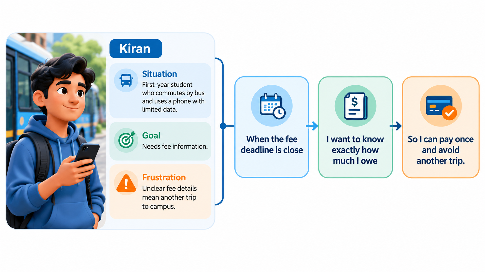
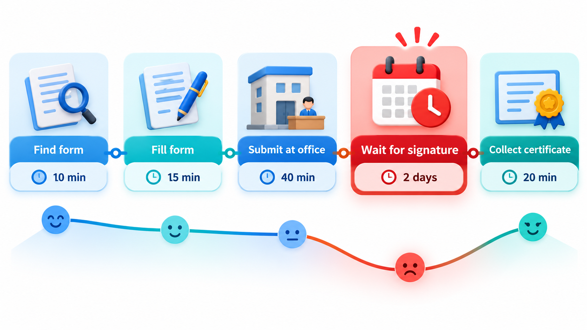
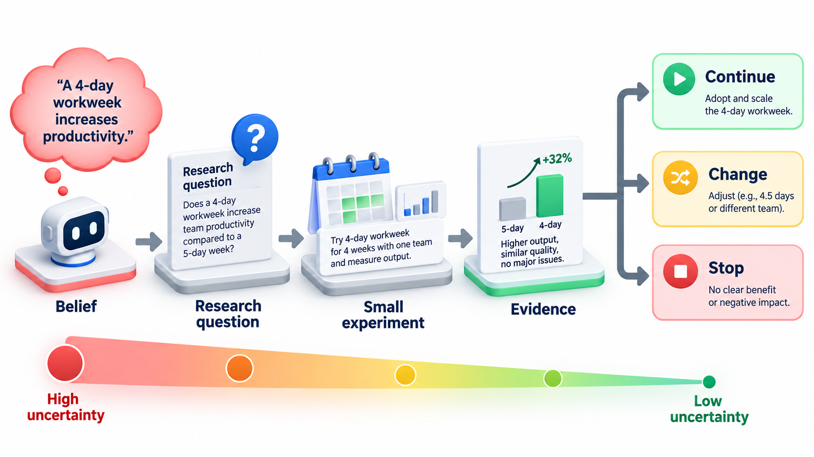
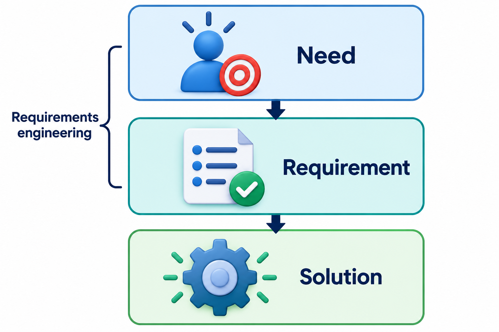

## People Do Not Want a Drill; They Want a Hole in the Wall

A product is a means to an end. Nobody wants a bottle of shampoo for its own sake; they want clean, manageable hair. Asking people what features they want from the product misses this, because they answer in terms of the product they know. Asking what they were trying to get done opens a wider range of ideas.

This idea is called **jobs to be done**: people do not buy products, they "hire" them to do a job in their life. It is a staple of product discovery, the work of finding out what to build and why before building it. A milkshake bought alone at seven in the morning, for example, is not competing with other milkshakes. It is competing with a banana, a bagel and boredom on a long drive.

Discovery matters because building the wrong thing well is the most expensive mistake in software. A team can deliver on time, within budget and to specification, and still produce something nobody uses. The reason is that the specification answered the question "what should we build?" with a guess. Discovery replaces the guess with evidence, at a time when being wrong costs a conversation and not a release.

## Discovery and Delivery

Product work is often described as two activities that run side by side.

| | Discovery | Delivery |
| --- | --- | --- |
| **The question** | Are we solving the right problem, and is this the right solution? | Are we building it well and getting it to users? |
| **Typical activities** | Interviews, observation, experiments, prototypes, analysing usage | Design, coding, testing, releasing |
| **Output** | Evidence and decisions about what is worth building | Working software |
| **Risk it reduces** | Building something nobody wants | Building something badly |
| **Cost of a mistake** | Low if caught here | High once built and released |

In a healthy team both continue all the time. Discovery feeds delivery with well-understood problems, and delivery feeds discovery with real usage data. A team that does only delivery executes other people's guesses efficiently. A team that does only discovery never ships.

## Problem First, Then Solution

The discipline of product discovery rests on one habit: separate the problem from the solution. People tend to arrive with a solution already in mind ("we need a mobile app", "we need a chatbot") and they ask the team to build it. A team that accepts this has skipped the most important questions. Who has the problem? How bad is it? How are they coping now? What would make them change?

Discovery work answers those before the build. Several simple tools are used.

**Personas** are short descriptions of typical users, based on real research and not on guesses. A persona for a college app might be "Kiran, first-year student, travels two hours by bus, mostly uses a phone with limited data, checks fees only when the office reminds him". It is useful not because Kiran is real but because it lets the team ask "would Kiran manage this screen on his phone, on a bus?"

**Jobs to be done** describe what the person is trying to achieve in a situation, in the form "When I am in this situation, I want to do this, so that I can reach this outcome." Kiran's job might be: "When the fee deadline is close, I want to know exactly how much I owe, so that I can pay once and not travel back."

**User journeys** follow a person through all the steps of reaching a goal, including the waiting and the frustrations, and show where the experience is poorest.

<!-- Visual: a persona card (name, situation, goals, frustrations) beside a job statement "When..., I want..., so that..." Save as images/23_persona_and_job.png. -->

## The Forces Behind a Choice

The jobs idea has a useful refinement. When someone switches from one way of doing a job to another, four forces act on the decision.

| Force | Direction | Example for a student choosing to pay fees online |
| --- | --- | --- |
| **Push of the current situation** | Away from the old way | The office queue is long and the office closes before the bus arrives |
| **Pull of the new idea** | Towards the new way | Paying from a phone at midnight with an instant receipt |
| **Anxiety about the new way** | Against switching | "What if the money is deducted but not recorded?" |
| **Habit of the present way** | Against switching | "I have always paid at the counter and I get a stamped slip" |

A product succeeds when the push and pull outweigh the anxiety and habit. Teams usually focus on the pull, adding attractive features, while the real obstacle is anxiety. A clear confirmation screen that shows the payment has been recorded may do more to win users than a new feature. Interviews about why people switched, or declined to switch, bring these forces to light.

## Methods of User Research

Research methods fall into two families that answer different questions.

| Family | Question | Methods | Strength | Weakness |
| --- | --- | --- | --- | --- |
| **Qualitative** | Why? How? What is it like? | Interviews, observation, diary studies, usability sessions | Reveals reasons and surprises | Small samples; cannot tell how common something is |
| **Quantitative** | How many? How much? How often? | Surveys, analytics on real usage, experiments with two versions | Measures size and tests differences | Does not explain why |

They work best together. Qualitative work finds what to measure; quantitative work shows how widespread it is. A common pattern is to learn from a handful of interviews that students dislike a certain step, then check in the usage data how many abandon the process at that step.

For qualitative studies, a small number of participants is usually enough to show the major patterns. After five to eight interviews with the same kind of user, most of the recurring problems have appeared, and extra interviews bring diminishing returns. The caution is that the participants must resemble the real users: five enthusiastic friends of the team teach little.

## Mapping a Journey and Finding the Pain

A journey map lists each step a person goes through, how long it takes and how they feel about it. Here is the map for a student getting a bonafide certificate from a college office.

| Step | Minutes | Satisfaction (1 poor, 5 good) |
| --- | --- | --- |
| Find the form online | 10 | 2 |
| Fill the form | 15 | 3 |
| Walk to the office to submit | 40 | 2 |
| Wait for signature | 2,880 | 1 |
| Collect the certificate | 20 | 3 |
| **Whole journey** | **2,965, a little over 2 days** | Lowest: 1, at the wait |

The student actively works for only about an hour and a half; almost all the time is spent waiting. The lowest satisfaction is at "wait for signature", a step of two full days that is entirely outside the student's control. A feature list drawn up from opinions might have suggested a nicer form. The journey says the real pain is the wait, and the useful solution may be an online signature, or a promise of turnaround, rather than anything about the form.

<!-- Visual: a journey map for the bonafide certificate: five steps along a line with time under each, a mood line dipping at "wait for signature". Save as images/23_journey_map.png. -->

## Testing Assumptions Before Building

Every product idea rests on assumptions: that the problem is real, that users will notice it, that they will adopt a new way, that the team can build it, that it will pay for itself. Discovery makes these explicit and tests the riskiest first.

| Assumption | How risky? | A cheap way to test it |
| --- | --- | --- |
| Students find the signature wait painful | High, because the whole idea depends on it | Ask ten students to describe their last request; count how many mention the wait unprompted |
| Staff will sign online | High, since without them nothing changes | Show two signatories a sketch and watch their reaction; ask what stops them |
| The college can issue a valid digital certificate | Medium | Check the rules with the registrar before building anything |
| Students will use it if it exists | Medium | Offer a manual version through email for two weeks and count requests |

A useful question for each assumption is: if this is false, does the idea still make sense? Those that would sink the idea if wrong are tested first, and in the cheapest way available. This is the same logic as risk-driven development, applied to the question of what to build.

## Learning Before Building

Discovery is not only research. It includes cheap experiments to test ideas before they become projects: a one-page description shown to ten users, a clickable sketch, a manual version of the service run by a person behind the scenes. Each has the same aim, to learn whether the problem is real and whether a particular solution addresses it, while the cost of being wrong is small.

The signal to look for is behaviour. A person who says "that sounds useful" has given you a polite answer. A person who signs up, pays a small amount, or changes how they work has given you evidence.

## Doing Research Responsibly

Research involves real people, and it brings duties. Participants should know what the study is for and agree to take part, and they should be free to stop. Personal information should be collected only if needed, kept safely and used only for the stated purpose. Recordings and notes should be anonymised where possible. Researchers should avoid pressuring participants into agreeing and should not use findings to disadvantage them. These are part of professional practice and, in many places, the law; they also affect quality, since people who trust the researcher give truer answers.

## Where Discovery Meets Requirements

Discovery and requirements engineering are neighbours. Discovery decides *which* problem is worth solving and for whom. Requirements engineering takes the chosen problem and specifies what the system must do. In practice they overlap, and a team returns to discovery whenever it learns that its picture was wrong. The earlier point about keeping needs, requirements and solutions apart is what ties them together.

<!-- Visual: need, requirement and solution shown as three connected layers. -->

