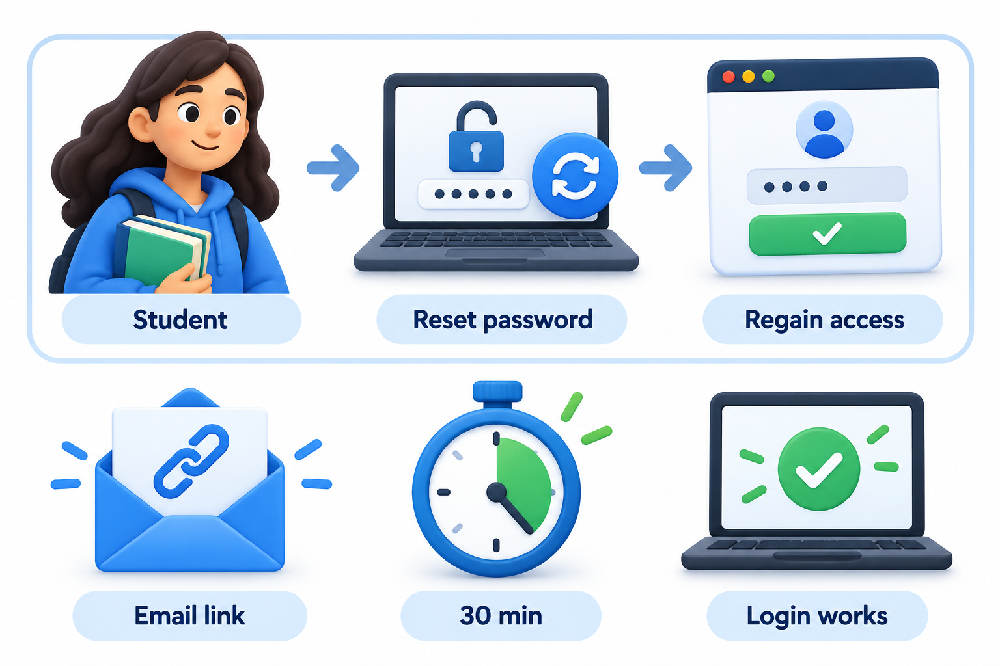
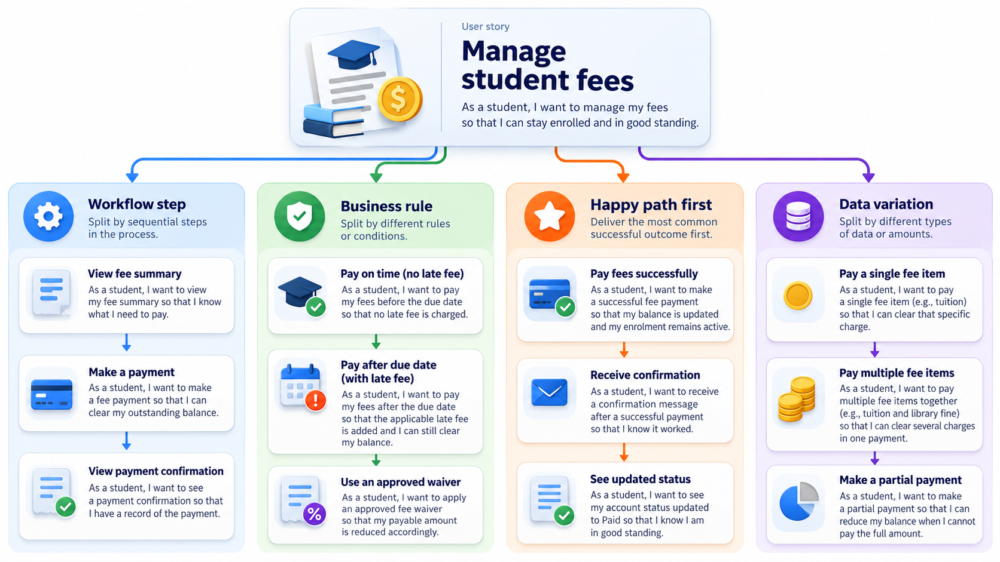
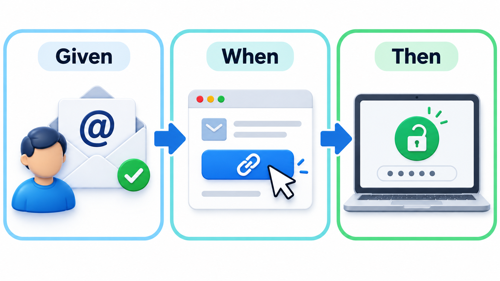
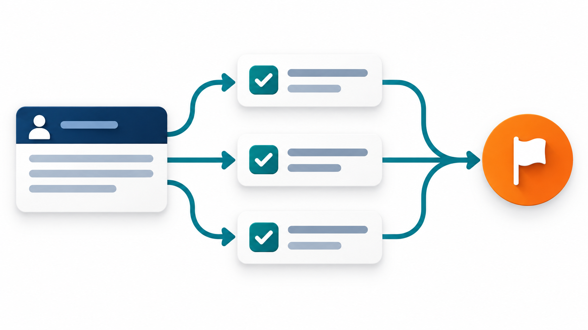

## A Requirement Small Enough to Fit on a Card

A good way to stop a requirement from becoming a long document is to make it too small to be one. Teams that work in the agile style often write each requirement on a small card, with one sentence, such as "a student can reset a forgotten password". The card cannot hold a specification, and that is deliberate. It is a reminder of the feature, and the detail is worked out in conversation. Three words summarise the idea: **card**, **conversation** and **confirmation**. The confirmation is the set of checks that say when the work is finished.

That summary is the best definition of a **user story**: not a document, but a promise to have a conversation, with a clear way of checking the outcome. The format is often misused as a mini-specification. This topic covers the usual shape of a story, the checklist for a good one, and how acceptance criteria turn it into something testable.

Why prefer a reminder to a document? Because a long written requirement creates an illusion of agreement. A reader sees precise-looking text, assumes they understand it, and builds on that assumption; the misunderstanding appears months later. A short story forces a conversation in which the differences surface straight away, while it is cheap to resolve them. The written part is deliberately small so that the talking, which is where understanding is built, is not skipped.

## The Shape of a Story

A story is usually written in one sentence with three parts.

*As a **student**, I want to **reset my password using a link sent to my email**, so that **I can get back into my account without visiting the office**.*

- **Who** (the role) tells the team whose problem this is. Different people have different needs.
- **What** (the goal) says what they want to be able to do.
- **Why** (the benefit) explains the reason. It matters most, because it lets the team suggest alternatives if there is a simpler way to achieve it.

The story is short on purpose. It does not describe the screen, the database or the exact steps. Those are discovered in the conversation, and written down only as far as they are needed.

## INVEST: A Checklist for a Good Story

A well-known mnemonic, proposed in 2003 and still widely used, gives a checklist. A good story is:

| Letter | Meaning | A story that fails it |
| --- | --- | --- |
| **I**ndependent | Can be built in any order, without waiting on another story | "Show the receipt" that cannot work until "pay the fee" exists |
| **N**egotiable | The detail can be discussed, not a fixed contract | A story that specifies the exact colours and layout |
| **V**aluable | Gives something to a user or customer | "Create the database tables" |
| **E**stimable | The team can say roughly how big it is | "Make the system secure" |
| **S**mall | Fits within one iteration | "Build the whole admissions module" |
| **T**estable | There is a clear way to tell if it is done | "The page should feel fast" |

The checklist is useful when a story feels wrong. A story that is too big can be split into smaller ones that each give something to the user. A story that cannot be tested is usually missing its acceptance criteria.

<!-- Visual: a story card (As a..., I want..., so that...) with the three Cs, card, conversation and confirmation, attached beneath it. -->

## Rewriting Weak Stories

Many stories written by beginners fail in predictable ways, and rewriting them is a good exercise.

| Weak story | What is wrong | Better version |
| --- | --- | --- |
| "As a user, I want a database." | No user value; it is a technical task | "As a student, I want my payments to be remembered, so that I can see my history later." |
| "As an admin, I want the system to be fast." | Not testable | "As an accountant, I want the day's collection report to open within 5 seconds, so that I can finish before the bank closes." |
| "As a student, I want to manage my account." | Too big and vague | Split into: change password, update phone number, view payment history |
| "As a student, I want a dropdown of courses." | Describes a solution | "As a student, I want to choose my course quickly, so that I do not make mistakes entering it." |
| "As a user, I want to log in so that I can log in." | The benefit repeats the goal | "As a student, I want to log in, so that only I can see my fee details." |

## Splitting Large Stories

A story that will not fit in one cycle must be split, and the split must keep each piece valuable. Splitting by layer (database, then logic, then screen) fails the test of value. Better patterns divide by something a user can notice.

| Splitting pattern | Example |
| --- | --- |
| **By workflow step** | Pay a fee: choose the amount, pay, receive a receipt |
| **By variation** | Pay by card; pay by UPI; pay by net banking |
| **By rule** | Pay on time; pay with a late fine; pay with a scholarship |
| **By data** | Pay a tuition fee; pay a hostel fee |
| **By quality** | Pay a fee (works); pay a fee quickly under load |
| **Simple first, then complex** | Pay the whole amount; pay in instalments |

A large goal is often called an **epic**, and a collection of related epics a **theme**. A **story map** lays stories out as a grid, with the user's journey from left to right and the stories under each step in order of priority, so that the team can pick a thin first slice that runs end to end.

## Acceptance Criteria: How We Will Know

**Acceptance criteria** are the conditions that must be true for the story to count as done. They are written before the work starts, from the customer's point of view, in specific terms. A popular format is **Given, When, Then**, taken from behaviour-driven development.

- **Given** the starting situation
- **When** something happens
- **Then** the observable result

For the password-reset story, the criteria might be: *Given a reset link sent 5 minutes ago and not yet used, when the student opens it, then they can choose a new password.* *Given a link sent 16 minutes ago, when the student opens it, then they are told it has expired.* *Given a link already used once, when it is opened again, then it is refused.*

The strength of the format is that it forces examples. "The link should expire" can mean anything. "A link that is 16 minutes old is refused, and one that is exactly 15 minutes old still works" cannot be misunderstood, and the boundary case is exactly where bugs live.

<!-- Visual: three password-reset scenarios expressed as Given, When and Then. -->

## Two Styles of Criteria

Criteria come in two common forms, and teams often use both.

| Style | What it looks like | Best for |
| --- | --- | --- |
| **Scenario-based** | Given, When, Then examples | Behaviour that depends on a sequence or a situation |
| **Rule-based** | A short checklist of conditions that must all hold | Simple stories with several independent rules |

A rule-based list for the same story might read: the link is sent to the registered email only; it expires after 15 minutes; it works once; a new password must meet the strength rules; the old password stops working. The list is quicker to write, the scenarios are clearer to test. Either way, each criterion should be specific enough that two people would agree whether it was met.

## From Criteria to Checks

Criteria written as examples can almost be copied into tests. Take the story "As a student I want a password reset link so that I can get back into my account", with the rule that the link works once, within 15 minutes of being sent. Four Given, When, Then scenarios cover it.

| Scenario | Given | Then the link should... |
| --- | --- | --- |
| Fresh link | Sent 5 minutes ago, not used | Work |
| Link at the limit | Sent exactly 15 minutes ago, not used | Work |
| Expired link | Sent 16 minutes ago, not used | Not work |
| Link used twice | Sent 5 minutes ago, already used | Not work |

The second and third scenarios sit either side of the limit, which is where mistakes show up. Somebody had to decide whether "within 15 minutes" includes 15. The value came from the conversation that produced the examples, not from any tooling: the criteria forced that decision before anything was built.

## Ready and Done

Two shared agreements help stories flow. A **definition of ready** says what a story must have before the team will start it: a clear goal, acceptance criteria, an estimate, and no unanswered blocking questions. A **definition of done** says what must be true before it counts as finished: reviewed, tested, meeting the acceptance criteria, integrated and, where relevant, documented. Both are short checklists. The first stops half-understood work from entering a cycle; the second stops half-finished work from leaving it. Together they make the conversation about "when is this ready?" and "when is this done?" quick, because the answer is already written down.

## Stories Are Not the Whole Requirements

Stories work well for describing features from a user's point of view. They are weaker at expressing rules that cut across features, such as performance or security, and at showing how pieces fit together. Teams add acceptance criteria for those, write separate non-functional requirements, and keep diagrams or notes where needed. A backlog of stories is a plan for conversations, and the conversations are where the requirements really get made.

A typical gap is the quality attributes. "The system must handle 5,000 payments in ten minutes" does not belong to any one story. It is better kept as a standing constraint that every relevant story must respect, and checked whenever the related features change. Similarly, rules about data protection or accessibility apply across the product and are best recorded once and referred to.

<!-- Visual: acceptance criteria turn one user story into checkable outcomes. -->

## Five Misreadings of User Stories

**"A user story is a small requirements document."** It is a reminder to talk. The detail comes from conversation and is captured in acceptance criteria, not in the sentence.

**"The 'so that' part is optional."** It is the most useful part. Knowing the reason lets a team propose a better way to meet the need.

**"Every story needs to follow the template."** The template helps, but a story that says the same thing in plain language is fine. Technical tasks that give no user benefit are better written as tasks than as awkward stories.

**"Acceptance criteria are written after the work is done."** They are written before, so everyone agrees what done means. Written afterwards they only describe what was built.

**"Passing acceptance criteria means the story is good."** It means the story meets its criteria. If the criteria miss something that matters, the story can pass and still disappoint, which is why the conversation with the customer continues after the check.
