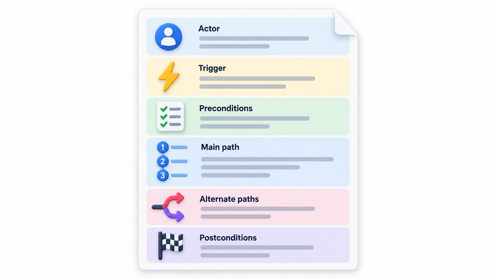
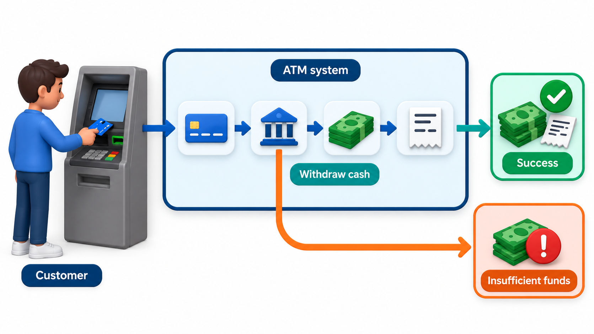
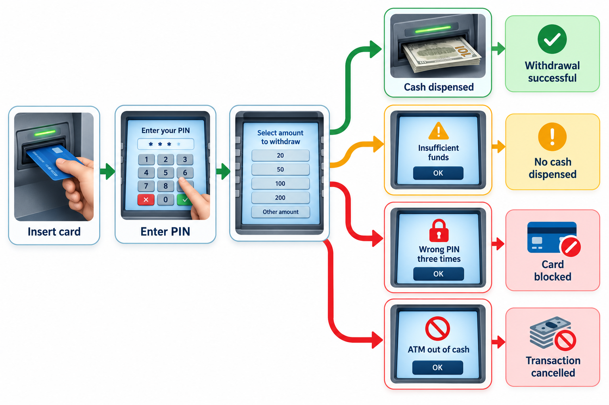
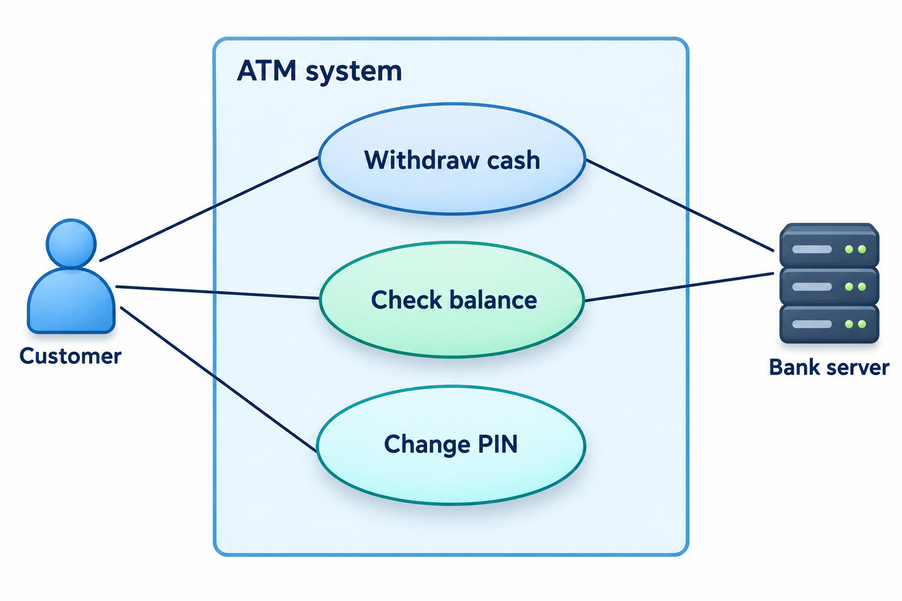
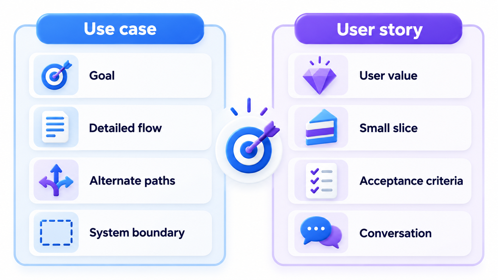

## The Story of a Goal, Including Everything That Can Go Wrong

Most descriptions of a system say what happens when everything goes well. Real use is full of other cases: the book is reserved, the card is declined, the connection drops. A requirement that ignores them leaves the team to guess, and each person guesses differently.

A **use case** describes how a person (or another system) uses the system to achieve a goal, step by step, including what happens when things do not go to plan. The idea came from the telecommunications industry, where long-lived systems had many kinds of user, and it fed into the Unified Modeling Language. This topic explains how to write one, and why the ways it can go wrong are the most valuable part.

A use case looks at a system from the outside. It does not say how the software is built or what the code does. It says: here is someone with a goal, here is what they do, here is how the system responds, here is what happens when something goes wrong. Because it is written in the language of the user, a client can read it and say "yes, that is how it works" or, more usefully, "no, you have forgotten what happens when the book is reserved". That checking by non-programmers is its main strength.

## The Parts of a Use Case

A use case has a small, fixed set of parts.

| Part | What it says | Example: Renew a library book |
| --- | --- | --- |
| **Actor** | Who or what interacts with the system | Library member |
| **Goal** | What the actor wants to achieve | Keep a borrowed book for longer |
| **Precondition** | What must be true before it starts | The member is logged in |
| **Main flow** | The usual steps when all goes well | Select the book, choose renew, see the new due date |
| **Alternate flows** | What happens in other cases | The book is reserved; the renewal limit is reached; a fine is due |
| **Postcondition** | What is true when it ends | The due date is extended by 14 days, and the renewal is recorded |

The **actor** is a role, and not a person: "library member" covers every member. Systems can be actors too, for instance the payment gateway that answers a request. The **main flow** is the happy path, written as numbered steps in plain language: "1. The member selects a book. 2. The system shows its due date. 3. The member chooses renew." The **alternate flows** hang off the main flow at the numbered step where they branch: "3a. The book is reserved by another member."

<!-- Visual: a use case drawn as an actor on the left, the goal in the middle inside the system boundary, and the main flow and alternate flows as paths leading to outcomes. -->

## A Complete Example

Seeing all the parts together makes the style clear. Here is a full use case for withdrawing cash from a cash machine.

| Field | Content |
| --- | --- |
| **Name** | Withdraw cash |
| **Actor** | Account holder (the bank's central system is a supporting actor) |
| **Goal** | Obtain cash from the account |
| **Precondition** | The machine is working and holds cash |
| **Trigger** | The account holder inserts a card |
| **Main flow** | 1. The holder inserts the card. 2. The machine asks for the PIN. 3. The holder enters the PIN. 4. The machine checks it. 5. The holder chooses an amount. 6. The machine checks the balance with the bank. 7. The machine dispenses the cash. 8. The machine returns the card and prints a slip |
| **Alternate flows** | 4a. The PIN is wrong: the machine allows two more tries, then keeps the card. 6a. The balance is too low: the machine says so and offers a smaller amount. 6b. The bank does not respond: the machine cancels the withdrawal and returns the card. 7a. The machine runs out of cash: it tells the holder before debiting the account |
| **Postcondition** | The account is debited by exactly the amount dispensed, and the transaction is recorded |

Look at 6b and 7a. They are the cases a casual specification forgets, and they are where money goes missing. Writing them out forces the team to decide, for example, that the account must not be debited if no cash comes out.

## Why the Alternate Flows Matter Most

The main flow is easy. Anyone can describe what happens when everything works. The alternate flows are where the real requirements hide, and where most bugs are born. A system that handles the happy path perfectly and mishandles the reserved book, the maxed-out renewal count or the unpaid fine will feel broken to every user who meets one of those cases, and they are not rare.

Writing the alternate flows out forces questions that would otherwise be answered by accident in code. Should a member with a fine be allowed to renew? For how long? Does a reserved book give a message, or just fail? The use case turns each of those into a decision someone makes deliberately.

Alternate flows come in a few kinds, and listing the kinds helps find them.

| Kind | Question to ask | Example |
| --- | --- | --- |
| **Different choice** | What other valid choices could the actor make? | The holder asks for a smaller amount |
| **Rule not met** | Which business rule might fail? | Renewal limit reached |
| **Wrong input** | What if the data is invalid? | Wrong PIN |
| **System or partner failure** | What if something we depend on fails? | The bank does not answer |
| **The actor gives up** | What if they stop halfway? | The holder cancels at the amount screen |

## Scenarios: One Path Through a Use Case

A use case describes many possibilities. A **scenario** is one specific path through it with a specific person and specific data. "Meena renews a book that nobody else has reserved, and it is extended by 14 days" is a scenario that follows the main flow. "Ravi tries to renew a book that Asha has reserved, and is told no" follows alternate flow 3a. Scenarios are the right unit for tests and for talking to users, since people find a concrete story easier to react to than an abstract set of rules.

<!-- Visual: the main flow drawn as a straight line with alternate flows branching off at steps 3a, 3b and 3c, each ending in its own outcome. -->

## Turning the Flows into Test Scenarios

Take the use case "Renew a library book". The precondition is that the member is logged in. The main flow is that the book is renewed; three alternate flows can intervene, checked in a fixed order.

| Order checked | Condition | Outcome |
| --- | --- | --- |
| 1 (flow 3a) | The book is reserved by another member | Refused, another member is waiting |
| 2 (flow 3b) | Renewals so far are 2 or more | Refused, renewal limit reached |
| 3 (flow 3c) | A fine is due | Pay the fine first |
| Otherwise | None of the above | Main flow: renewed for 14 days |

Four members then give four scenarios.

| Member | Situation | Result |
| --- | --- | --- |
| Meena | Nothing unusual | Main flow: renewed for 14 days |
| Ravi | Book reserved | Alternate flow 3a: refused, another member is waiting |
| Asha | Already renewed twice | Alternate flow 3b: refused, renewal limit reached |
| Kiran | Fine of Rs 30 due | Alternate flow 3c: pay the fine of Rs 30 first |

Order matters: a reserved book is refused before anything else is considered, which is a business decision the use case had to make explicit. Meena follows the main flow, and each of the others meets a different alternate flow and gets a message explaining why, not a silent failure. A tester can use this list of scenarios almost directly as a test plan, and a developer can see which cases are needed. A bare sentence such as "the system shall let members renew books" would have hidden all three alternate flows.

## Writing Good Use Cases

A few habits separate useful use cases from tedious ones.

- **Name the goal with a verb and an object.** "Renew a book", "Pay a fee", "Reset a password". The name tells the reader what the actor achieves.
- **Write from the actor's side.** "The member selects the book" and "The system shows the due date". Avoid describing internal mechanics.
- **One action per step.** Short, numbered sentences in the present tense, each either something the actor does or something the system does.
- **Keep the interface out.** "The member chooses renew" is better than "the member clicks the blue button in the top right".
- **Make the goal complete.** A use case should deliver something of value to the actor, not a fragment such as "enter a PIN".
- **Stay at a useful size.** Two or three pages at most, and between five and ten main steps. A use case with thirty steps is probably several.

The level of a use case also matters. A *summary* use case describes a large goal that contains many smaller ones ("Run an exam session"). A *user-goal* use case describes one thing a person does in one sitting ("Submit an answer sheet"). A *subfunction* use case describes a smaller step that others share ("Check identity"). Most work is done at the middle level.

## Reusing Parts: Include and Extend

Large systems repeat steps. Many use cases begin with "log in", and several need "check identity". Rather than repeating them, a common step can be written once and pointed to. An *included* use case is one that is always part of another: "Renew a book" includes "Check member status". An *extending* use case adds optional behaviour at a stated point: "Renew a book" can be extended by "Pay a fine" only if a fine is due. Used sparingly this removes duplication; used heavily it produces a maze that nobody can read, so the rule is to use it only where repetition would really hurt.

## Use Case Diagrams and Their Limits

A use case diagram draws the actors and the goals they pursue within a system boundary. It is a good overview for a conversation with a client, since it fits on one page. It carries little detail, however. The detail is in the written flows. A common mistake is to spend days perfecting the diagram and write nothing underneath it.

<!-- Visual: ATM actors and goals represented in a use-case diagram. -->

## Use Cases and User Stories Compared

Teams sometimes ask which to use. Both aim to describe what users need, and they differ in emphasis.

| | User story | Use case |
| --- | --- | --- |
| **Size** | One sentence, plus criteria | One to three pages of flows |
| **Detail** | Low; detail comes in conversation | Higher; the flows are written down |
| **Focus** | A small piece of value | A whole goal with its branches |
| **Best for** | Agile teams with close contact to users | Complex interactions, contracts, regulated work, distant customers |
| **Weakness** | Easy to lose the overall picture | Easy to become heavy and out of date |

They combine well: a story can name a feature, and a use case can describe the complicated flow behind it. Many teams use stories for the backlog and a short use case where a feature has many branches.
