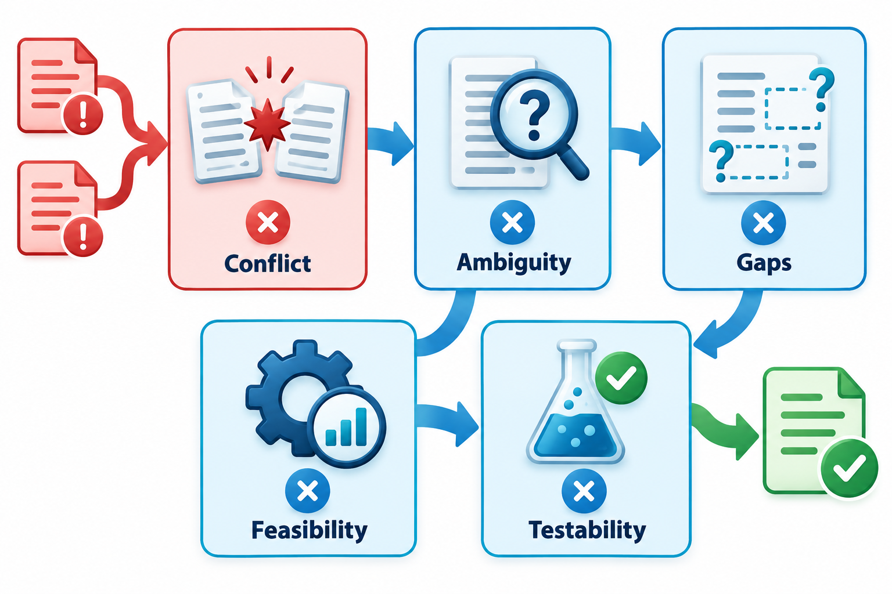
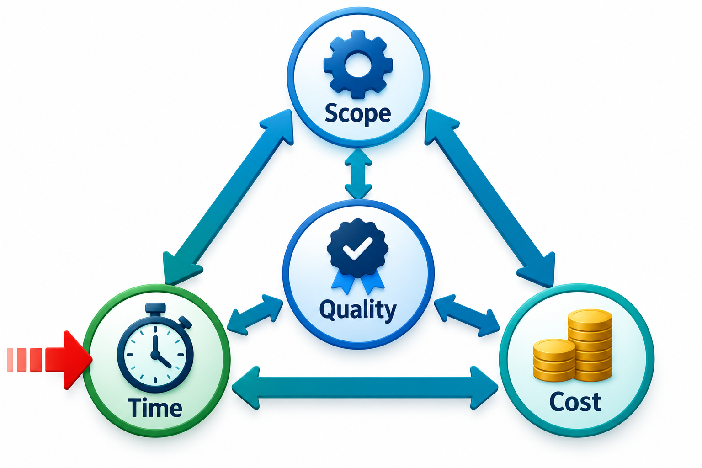
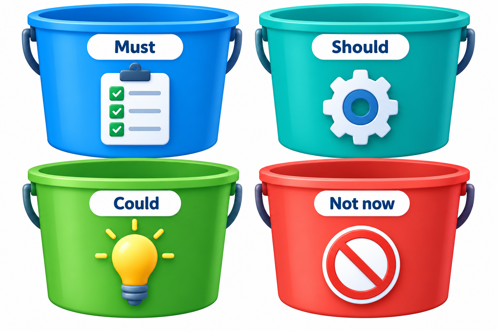
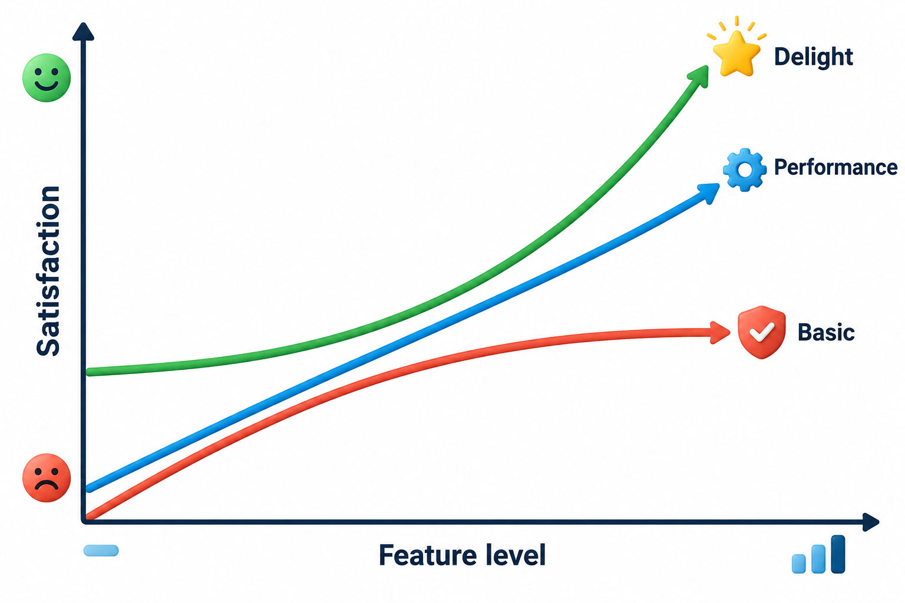
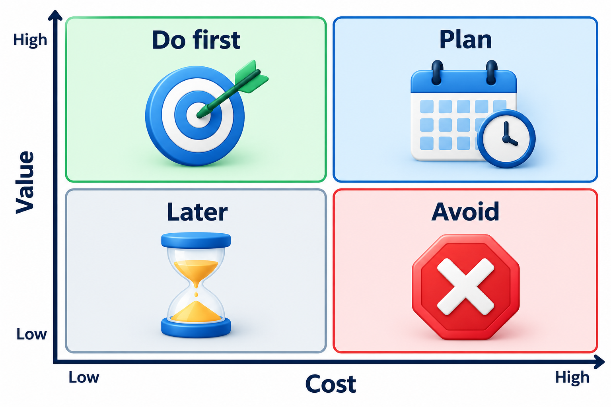
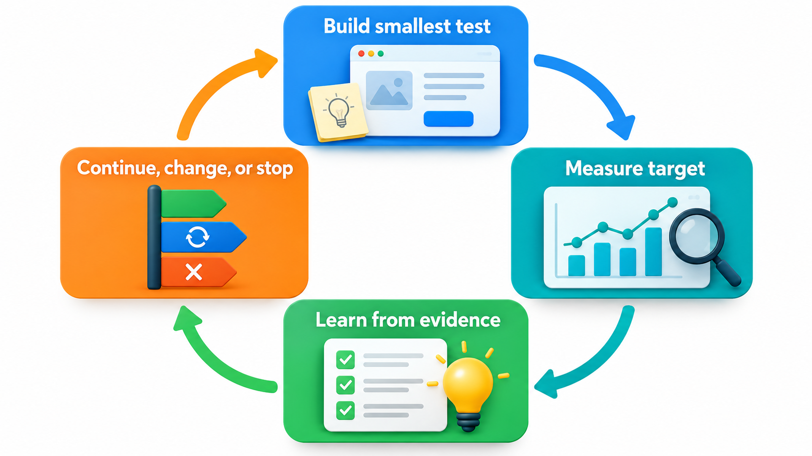

## Everything Cannot Be Built First

A product team usually has more good ideas than time. Every request seems important to the person who made it, and the team cannot do all of them at once. Someone has to examine the requirements, resolve the conflicts between them, and decide what to build first.

That decision is better made with numbers that others can challenge than with opinions. One widely used method, called **RICE**, scores each idea on four things: how many people it **reaches**, how much it **impacts** each of them, how **confident** the team is in those estimates, and how much **effort** it needs. The score is reach times impact times confidence, divided by effort. Nobody pretends the numbers are exact; the method moves a conversation from "I think we should build this" to "here is how many people it helps, how much, how sure we are, and what it costs".

Analysis and prioritisation are two halves of one task. Analysis asks whether the requirements, taken together, make sense: are they clear, consistent, complete and possible? Prioritisation asks which of them to do first when they cannot all be done at once. The first protects the team from building something contradictory; the second protects it from spending its limited time on the wrong things.

## Analysis: Finding Problems Before They Are Built

**Requirements analysis** takes the raw list and asks of each item and of the whole set: is it clear? Does it conflict with another? Is anything missing? Is it feasible? Can it be tested? A few kinds of problem recur.

- **Conflicts.** One stakeholder wants every student to see every grade, another says marks must stay private. These cannot both be satisfied as stated.
- **Ambiguity.** The wording allows more than one reading.
- **Gaps.** An obvious situation has no requirement, such as what happens when a payment fails halfway.
- **Infeasibility.** A requirement needs something that cannot be done with the time, money or technology available.
- **Overlap.** The same thing is specified twice, in slightly different words, and the copies will drift apart.

Conflicts are settled by negotiation. The analyst brings the parties together, finds the need under each position, and looks for something that meets both. A parent who wants to see a child's marks and a teacher who wants them private may both be satisfied by showing marks only to the logged-in parent.

<!-- Visual: requirements checked for conflict, ambiguity, completeness, feasibility and testability. -->

## Tools for Analysis

Several simple techniques help an analyst see the requirements more clearly.

| Technique | What it does | What it reveals |
| --- | --- | --- |
| **Classification** | Sorts requirements into functional, non-functional, constraints and business rules | Gaps in a category; items stored in the wrong place |
| **Modelling** | Draws processes, data or interactions | Missing steps and inconsistent assumptions between people |
| **Interaction matrix** | Lists requirements on both axes and marks conflicts and dependencies | Which requirements support or obstruct each other |
| **Feasibility check** | Asks of each requirement whether it can be done with the time, money, skills and technology | Items that need a spike or a different approach |
| **Risk assessment** | Rates each requirement by how likely it is to go wrong and how much it matters | Where to prototype or test first |

A small *interaction matrix* is a powerful habit. For a dozen requirements, it takes a short time to check each pair and write C for conflict, D for dependency, or blank. Pairs marked C go to negotiation; chains of D show the order in which things must be built.

## Scope, Time, Cost and Quality Pull Against Each Other

Prioritising is forced by a simple fact: scope, time, cost and quality are linked. Fix the date and the budget, and either the scope or the quality must give. A team that tries to keep all four will end up with a hidden fifth variable, the stress of the people.

Because quality is rarely the thing a team should give up, the usual lever is scope. The skill of prioritising is therefore the skill of deciding, honestly and early, what to leave out. A project that fixes its date and its quality and varies its scope is in a much healthier position than one that fixes its scope and discovers the cost afterwards.

<!-- Visual: scope, time, cost and quality as four connected corners, with an arrow showing that squeezing one pushes another out. -->

## Four Ways to Rank

**MoSCoW** sorts requirements into four bins. **Must have** items are the ones without which the release is pointless or illegal. **Should have** items are important but the release can survive without them. **Could have** items are nice, and are dropped first when time runs short. **Won't have this time** items are agreed as out of scope for now, which is a way of saying no without saying never. The strict test for a Must is "what happens if this is missing at launch?". If the answer is "the release still works", it is not a Must. Many teams also limit Musts to about 60 per cent of the planned effort, so that there is room to absorb surprises.

<!-- Visual: requirements grouped into Must, Should, Could and Won't have priorities. -->

**The Kano model**, from the Japanese researcher Noriaki Kano in the 1980s, sorts features by how they affect satisfaction. *Basic* features are expected, and give no delight when present but cause anger when missing, like a login that works. *Performance* features raise satisfaction in proportion to how well they are done, like speed. *Delighters* are unexpected extras that create enthusiasm, and over time they become expected. The model is a reminder that some features must be there, while others differentiate the product.

<!-- Visual: basic, performance and delight features on the Kano satisfaction model. -->

**Value against cost** is the simplest of all: place each item on a grid, with benefit on one axis and effort on the other. High-benefit, low-effort items go first; high-effort, low-benefit items are dropped or deferred; the other two corners need judgement.

<!-- Visual: A value and cost matrix separates work to do first plan later defer or avoid. -->

**RICE** scoring, introduced earlier, adds numbers to the same idea. Here it is applied to four features for a college app. Reach is the number of students affected in a term, impact runs from 0.25 (minimal) to 3 (massive), confidence from 0 to 1, and effort is in person-weeks.

| Feature | Reach | Impact | Confidence | Effort | RICE score |
| --- | --- | --- | --- | --- | --- |
| Fee reminders by SMS | 4,000 | 2 | 0.8 | 2 | 3,200 |
| Dark mode | 3,000 | 0.25 | 1.0 | 3 | 250 |
| Hostel room booking | 800 | 3 | 0.5 | 8 | 150 |
| Timetable on home screen | 5,000 | 1 | 0.9 | 1 | 4,500 |

The timetable on the home screen scores highest: it reaches 5,000 students, has a moderate impact, the team is fairly sure, and it takes one week. Hostel room booking has the biggest impact per student, a 3, but reaches 800 students, the team is only half sure, and it takes eight weeks, so it scores lowest. Dividing by effort means cheap features can beat bigger ones that reach more people. The ranking is a starting point for discussion. If someone disagrees with a score, the number shows which estimate to argue about, which is more useful than arguing about the ranking.

## Things a Score Does Not Capture

Whatever method is used, several factors can override a ranking and should be considered explicitly.

| Factor | Why it matters | Example |
| --- | --- | --- |
| **Dependencies** | A low-scoring item may be needed before a high-scoring one | A user account system scores low alone but nothing else works without it |
| **Deadlines** | A legal or business date can make an item urgent regardless of score | A tax rule that takes effect on 1 April |
| **Risk** | A risky item may be best done early, to learn whether it is possible | Integration with an unfamiliar bank system |
| **Cost of delay** | Some benefits shrink or vanish if the item comes late | A feature tied to an admissions season |
| **Strategy** | The organisation may want a capability for reasons beyond this release | Preparing for a second campus |

A good prioritisation therefore ends with a short discussion of these factors, not a mechanical sort. The score proposes; the team, with the product owner, decides.

## MVP, Success Metrics and Experiments

Prioritisation leads to the idea of a **minimum viable product**, or MVP: the smallest version of the product that lets a team learn whether the idea works. It does not mean a poor product. It means leaving out everything that is not needed to test the main assumption.

An MVP only teaches something if the team decides beforehand what success looks like. A **success metric** is a number with a threshold, such as "at least 40 per cent of students who receive an SMS reminder pay within three days". After release the team measures it. If the result is far below the threshold, the idea or the design needs to change. An **experiment** can sharpen this further: show the new version to half the users, keep the old for the rest, and compare. The aim is to make decisions based on what users do.

<!-- Visual: a cycle of build the smallest thing, measure against a stated target, learn, and decide whether to continue, change or stop. Save as images/26_mvp_learning_loop.png. -->

## Turning Priorities into a Plan

A ranked list becomes a plan when it is divided into releases or cycles. A simple way to do this is to take the Musts and the highest-scoring items for the first release, fit them to the team's capacity, and place the rest in later releases. The plan is a forecast, not a contract, and the product owner revisits it as the team learns. Items change position because evidence arrives: a feature turns out harder than estimated, users react unexpectedly, or a rule changes. A roadmap that cannot move is a sign that nobody is learning.

It also helps to keep a visible list of what has been deliberately left out, with the reason. When someone asks months later why a feature is missing, the answer is a record and not a memory, and the item can be revived if circumstances change.
