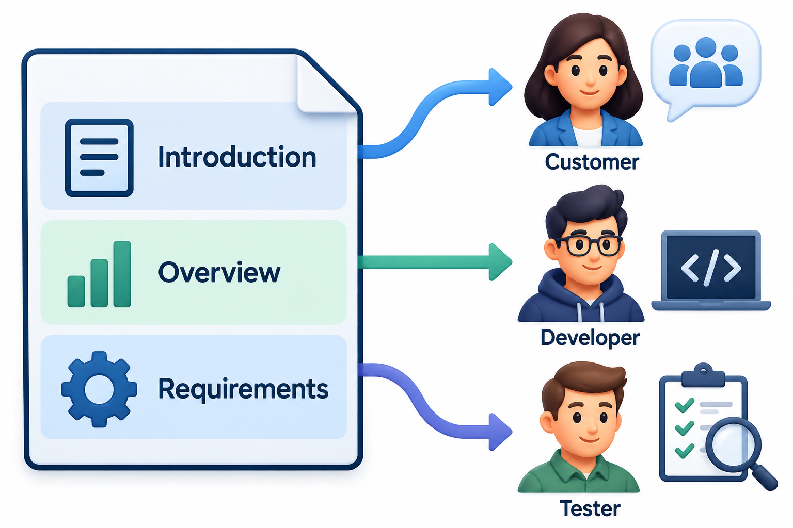
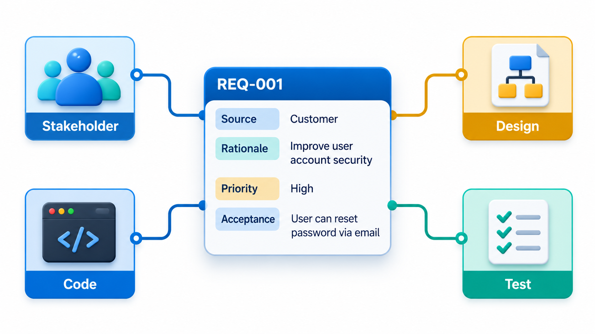
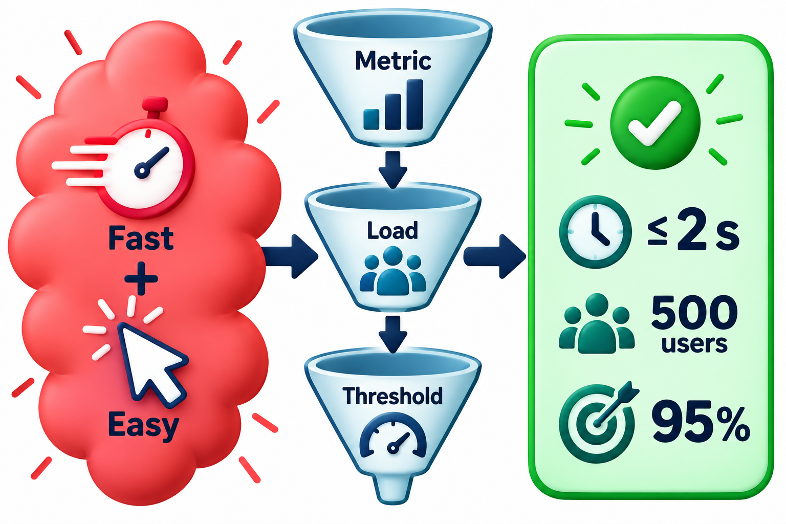
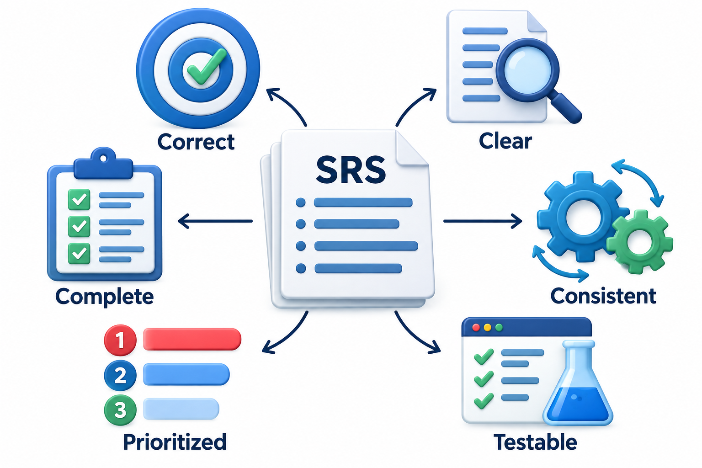
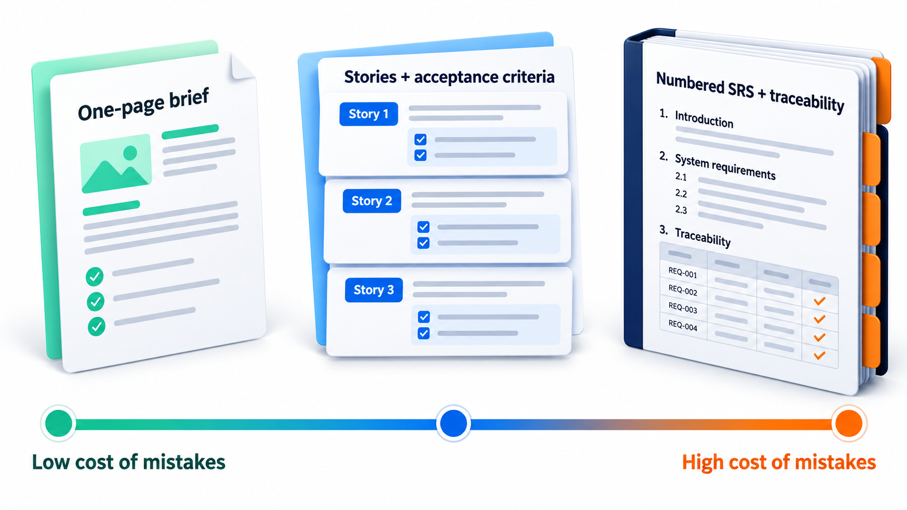

## Writing It Down So That Two People Build the Same Thing

Ask two developers to build "a fee portal" from a conversation and they will build two different portals. The conversation was clear to everyone in the room, and each person left with a slightly different picture. Writing the requirements down in a shared, precise form is how a team makes the picture the same for everyone, including the testers who must check it and the people who will join later.

A **software requirements specification**, or SRS, is the agreed, written description of what the software must do, precise enough that a developer can build to it and a tester can check against it. The most demanding projects, such as flight software, write theirs with great care and review it in detail before building. Few projects need to go that far. This topic covers what goes into an SRS, what makes one good, and what lighter options exist.

A specification does several jobs at once. For the customer it is a statement of what they will receive, to check against their intentions before money is spent. For developers it is the brief to build from. For testers it is the source of test cases. For managers it is the basis for estimating and for judging whether a change is in or out of scope. And for maintainers, years later, it is the nearest thing to a record of intent. A document that serves all of them has to be written with care, because each reader brings different questions.

## What an SRS Contains

International standards describe the content. The best-known recent one is ISO/IEC/IEEE 29148, published in 2018, which replaced an older and very widely used standard, IEEE 830. A typical SRS has these parts.

| Section | What it holds |
| --- | --- |
| **Introduction** | Purpose of the document, scope of the system, definitions and who reads it |
| **Overall description** | The system in context: users, environment, assumptions and dependencies |
| **Functional requirements** | What the system does, one numbered requirement at a time |
| **Non-functional requirements** | Performance, security, availability, usability and other qualities, each measurable |
| **External interfaces** | How the system connects to users, hardware and other software |
| **Constraints** | Limits on the design: standards, technology, regulations |
| **Glossary** | The precise meaning of each important term |

The numbering of the functional requirements is not decoration. Each requirement has an identifier so that tests, design and code can point to it, which is what lets a team show later that nothing was forgotten and nothing extra was built.

<!-- Visual: an SRS as a document with its sections stacked, and three groups of readers (customers, developers, testers) each reading the sections they need. -->

## Writing Individual Requirements

The quality of an SRS is the quality of its individual sentences. A few conventions make them clear.

- **One requirement per statement.** "The system shall record the payment and send a receipt" is two requirements joined by "and"; if one is met and the other not, the statement cannot be marked pass or fail.
- **Use "shall" for what is required.** Reserve "should" for the desirable and "may" for the optional, and use them consistently. A reader can then tell mandatory from preferred without guessing.
- **Give each a unique identifier.** For example FR-12 for functional requirement 12. The identifier never changes, even if the requirement moves.
- **Name the actor and the result.** "The system shall email the student a receipt within one minute of a successful payment."
- **Use measurable terms.** Replace adjectives with numbers and conditions.
- **Describe what, not how.** "Search results shall appear within two seconds" is a requirement; "use a hash table" is a design decision.

Some words should raise suspicion whenever they appear in a requirement.

| Word or phrase | Why it is a problem | A better approach |
| --- | --- | --- |
| "fast", "quickly", "efficient" | No measure | State time and conditions |
| "user-friendly", "easy" | Subjective | State a task and a success rate |
| "etc.", "and so on", "such as" | The list is open | List everything required, or say the list is examples |
| "as appropriate", "if necessary" | Hands the decision to the developer | State the condition |
| "usually", "normally" | What about the other cases? | State the rule and the exception |
| "support", "handle" | What exactly happens? | State the behaviour |
| "all", "never", "always" | Rarely literally true | Check whether the claim can hold |

## Attributes of a Requirement

A requirement is more useful with a little information attached. A table of attributes lets a team sort, search and manage the list.

| Attribute | What it records | Why it helps |
| --- | --- | --- |
| **Identifier** | A unique, permanent label | Tests, design and code can refer to it |
| **Text** | The requirement statement | The content itself |
| **Priority** | Must, Should, Could | Decisions when time is short |
| **Source** | Who asked for it, and when | Questions can be answered by going back to the person |
| **Rationale** | Why it exists | Helps resolve disputes and avoids needless removal |
| **Status** | Proposed, agreed, implemented, tested | Shows progress |
| **Verification method** | Test, inspection, demonstration or analysis | Planning how it will be checked |

The rationale is the attribute most often omitted and most often missed. "The report shall be exportable as a spreadsheet" is a puzzling instruction a year later. "The accounts office reconciles it with the bank's file in a spreadsheet" explains it, and reveals that exporting a bank-compatible layout is part of what is really required.

## Qualities of a Good SRS

A good SRS is judged by the same properties as a good individual requirement, applied to the whole document. It is **correct**, in that each requirement describes something that is really needed. It is **unambiguous**, so each can be read in only one way. It is **complete**, with nothing important missing. It is **consistent**, with no requirements contradicting each other. It is **verifiable**, since there is a way to check each one. And it is **modifiable**, organised so that a change in one place does not require edits in ten.

The difference between a weak requirement and a strong one is usually a number and a condition. "The system shall be fast" cannot be checked. "The search results page shall appear within 2 seconds for 95 per cent of requests when 500 users are searching at once" can.

<!-- Visual: a vague quality statement rewritten as a measurable requirement. -->

## A Fragment of a Real SRS

To see how it looks, here is a short extract for a fee-payment feature.

| ID | Requirement | Priority | Verification |
| --- | --- | --- | --- |
| FR-14 | The system shall allow a logged-in student to view the fee due for the current semester, itemised by head. | Must | Test |
| FR-15 | The system shall accept payment by UPI and by debit or credit card. | Must | Test |
| FR-16 | The system shall record each successful payment exactly once, even if the student submits the payment more than once. | Must | Test |
| FR-17 | The system shall issue a receipt with a unique number within 10 seconds of a successful payment, and shall email it to the student. | Must | Test |
| FR-18 | If the bank does not respond within 30 seconds, the system shall show the student a "payment pending" message and shall not record a payment until the bank confirms. | Must | Test |
| NFR-3 | During the first hour of fee-payment opening, at least 95% of payment pages shall load within 2 seconds with 2,000 students online. | Must | Load test |
| CON-1 | Student payment data shall be stored within India. | Must | Inspection |

Each line stands alone, has an identifier, and can be checked. FR-16 and FR-18 are the kind of requirement that comes from asking "what could go wrong?", and they are the ones most likely to be missing from a first draft.

## Organising the Specification

With dozens or hundreds of requirements, organisation decides whether readers can find what they need. Common ways to group functional requirements are by feature (all payment requirements together), by user class (student, accountant, administrator), or by mode of operation (normal, maintenance, recovery). Whichever is chosen, the document should use it consistently, and a cross-reference table should show how requirements relate to the use cases or stories they came from. The aim is to make a reader's question, "what does the system do when a payment fails?", answerable by looking in one place.

## Checking a Draft for Gaps

A simple check on a draft SRS is whether every agreed section is present and has real content. Compare the sections the team agreed every SRS must have with how many words each has in a draft.

| Section | Words in the draft | Verdict |
| --- | --- | --- |
| Introduction | 120 | OK |
| Overall description | 340 | OK |
| Functional requirements | 1,850 | OK |
| Non-functional requirements | 0 | Missing |
| External interfaces | 0 | Missing |
| Constraints | 0 | Missing |
| Glossary | 95 | Very thin |

The functional section has 1,850 words while the non-functional section is empty. That is a common shape for a first draft, and it is precisely how a system ends up with features and no performance target. Word counts say nothing about quality, but a missing section is a certain gap.

## Reviewing a Specification

A specification should be reviewed before anyone builds from it. A review looks at it from several angles at once.

| Reviewer | What they look for |
| --- | --- |
| **Customer or user** | Is this what we meant? Is anything missing from our point of view? |
| **Developer** | Can I build this? Is anything ambiguous or impossible? |
| **Tester** | Can I write a test for each one? Is the pass condition clear? |
| **Another analyst** | Are there contradictions, duplicates or gaps between sections? |
| **Operations or security** | Are the qualities that matter to us stated and measurable? |

Reviewers who read the same text with different questions find different problems, which is why a review with only one kind of reader is much less effective. Techniques such as having each reviewer write a test case from a requirement, or build a rough picture of the screen it implies, expose ambiguities that reading alone misses.

## Lightweight Alternatives

A formal SRS suits situations where a contract, a regulator or a long-lived system demands precision. Many teams need something lighter. An agile team may keep a **product backlog** of stories with acceptance criteria as its working requirements. A small project may use a short **one-page brief** of the goals, the users, what is in and out of scope, and the key quality targets. Some teams keep requirements as **executable examples** in tests, so the specification can never drift away from the code.

<!-- Visual: Six quality checks for a useful software requirements specification. -->

The choice depends on cost and risk. The cost of vagueness is low for a student club's website and very high for a hospital system. A good engineer picks the lightest form that still removes the ambiguity that matters.

<!-- Visual: a scale from a one-page brief through a story backlog with acceptance criteria to a full numbered SRS, labelled with rising cost of mistakes. Save as images/27_spec_weight_scale.png. -->

