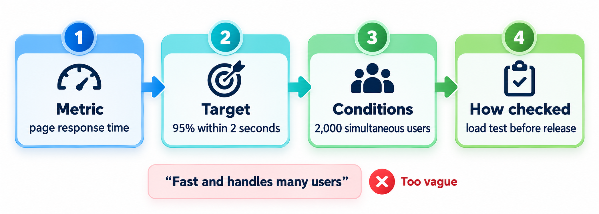
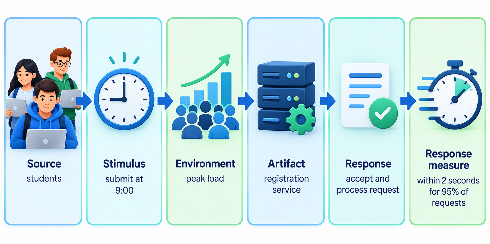
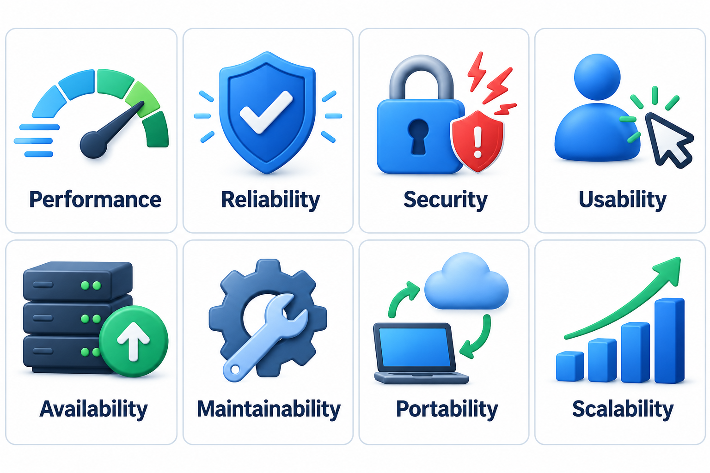
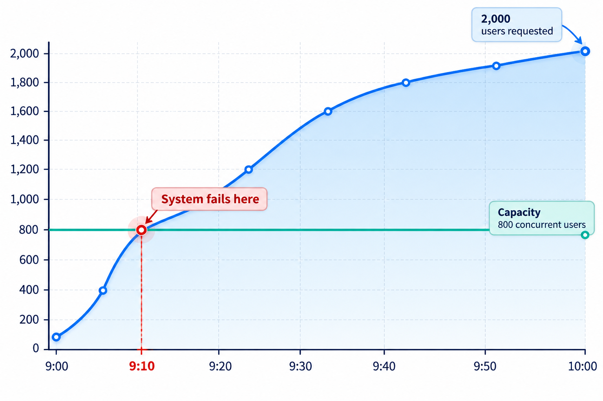

## The Requirements Nobody Writes Down Until They Are Broken

Ask for requirements and people list features. Ask whether the system should be fast and they say "of course". Ask how fast, and the conversation stalls. The qualities that make software pleasant or unusable, such as how quickly, how reliably and how securely it works, are the **non-functional requirements**. They are also the requirements most likely to be written as an adjective and never checked.

Their importance is easy to see from users' behaviour. Small delays measurably change what people do: they leave slower pages, abandon slower searches and trust slower systems less. None of that is about features. A search page with a delay still searches; the loss comes from a quality. That is why non-functional requirements deserve the same care as features.

The name is unfortunate, since it defines them by what they are not. A better way to think of them is as the *quality requirements*: the conditions every feature must satisfy to be worth having. A payment feature that works but takes a minute, loses a transaction once in a hundred, or exposes card numbers is a feature that fails. The functional requirement says what to build; the quality requirements say how good it must be.

## Why They Are Neglected

Functional requirements are easy to ask for: "a student can pay a fee". Quality requirements are easy to assume: of course it should be fast, of course it should be secure. When everyone assumes, nobody writes them down, and each person's assumption differs. The developer thinks "fast" means a second or two. The customer, who has used the system on results day with five thousand classmates, expects it to work then.

Quality requirements also shape the whole design. A system that must serve a hundred users at once and one that must serve a hundred thousand are built differently from the start. Asking about quality after the design is fixed means changing the design, and that is the costly way to learn.

## Making a Quality Measurable

The remedy is to turn each quality into a statement with four parts.

| Part | The question | Example |
| --- | --- | --- |
| **Metric** | What do we measure? | Time from clicking Pay to seeing the receipt |
| **Target** | What value is good enough? | At most 3 seconds, for 95 per cent of payments |
| **Conditions** | Under what circumstances? | With 2,000 students paying within 10 minutes |
| **Method** | How will we check it? | A load test on the staging server before each release |

A requirement with those four parts can be tested, and a failure can be pointed to. Without them it is a wish.

<!-- Visual: the four parts of a measurable requirement, metric, target, conditions and method, shown as four labelled boxes filled in for the payment example. -->

A useful structure for this is the **quality attribute scenario**, which describes a quality as a short story: a *stimulus* arrives (2,000 students pay in ten minutes), the system is in some *environment* (normal operation), it makes a *response* (processes the payments), and the response has a *measure* (95 per cent complete within 3 seconds). The story format keeps vague adjectives out.

<!-- Visual: a measurable quality scenario from stimulus to response measure. -->

## The Families of Quality, One by One

Quality requirements fall into recognisable families, each with its own typical question and its own way of being measured. Going through the list for every project makes it much less likely that one is overlooked.

| Family | The question | Typical metrics | Example requirement |
| --- | --- | --- | --- |
| **Performance** | How fast does it respond? | Response time, processing time, throughput | "95% of search results appear within 2 seconds" |
| **Capacity** | How much can it handle? | Users at once, records stored, requests per second | "Support 5,000 simultaneous logins and 10 million stored payments" |
| **Availability** | How much of the time is it working? | Percentage uptime, maximum downtime | "Available 99.9% of each month, excluding announced maintenance" |
| **Reliability** | How often does it fail, and how well does it recover? | Failures per period, recovery time, data loss | "No payment is lost or recorded twice after a system restart" |
| **Security** | Who can do what, and how is data protected? | Authentication strength, access rules, encryption, audit logs | "All passwords stored as salted hashes; every access to marks is logged" |
| **Usability** | Can the intended people use it? | Task success rate, time to complete, error rate | "9 in 10 first-time students pay unaided in under 3 minutes" |
| **Maintainability** | How easily can it be changed? | Time to make a typical change, number of components touched | "A new fee rule can be added and released within one working day" |
| **Portability** | Can it run elsewhere? | Supported platforms, effort to move | "Runs on current versions of Android and iOS and the two main browsers" |
| **Compliance** | Does it follow the law and standards? | Audit findings, standards met | "Complies with the data-protection law for personal data" |
| **Accessibility** | Can people with disabilities use it? | Standards conformance, assistive-tool tests | "Meets level AA of the web content accessibility guidelines" |

<!-- Visual: eight common families of software quality attributes. -->

## Finding Quality Requirements: Questions to Ask

People rarely volunteer quality needs, so the analyst has to ask. A few questions per family draw them out.

| Family | Questions to put to stakeholders |
| --- | --- |
| Performance | What is the longest wait a user will accept? When are the busiest times? |
| Capacity | How many users now, and in three years? How much data will accumulate? |
| Availability | What happens to your work if the system is down for an hour? A day? When can we take it down? |
| Reliability | What is the worst thing that could happen if it gives a wrong answer? |
| Security | Who must never see this data? Who must be able to prove who did what? |
| Usability | Who will use it, how often, and with what training or devices? |
| Maintainability | How often will the rules change, and who will change them? |
| Portability | What devices and browsers do your users actually have? |
| Compliance | Which laws, regulations or audits apply? |

A good question to end an interview is: "What would make you stop using this system?" The answers are almost always quality failures.

## Doing the Arithmetic Early

Quality targets can often be checked on paper before anything is built. If the target for exam registration is that 6,000 students register within ten minutes, a quick calculation says what the system must be able to do. Assume each registration makes four requests, and each request keeps a server core busy for half a second.

| Step | Working | Result |
| --- | --- | --- |
| Total requests | 6,000 students x 4 requests | 24,000 |
| Average load | 24,000 requests / 600 seconds | 40 requests per second |
| Server work needed | 40 x 0.5 seconds | 20 seconds of work every second |
| CPU cores at the average | One core supplies 1 second of work per second | At least 21 |
| CPU cores for bursts | Plan for 3 times the average | About 61 |

The assumptions about requests and time per request are estimates, to be replaced by measurements once a prototype exists. Traffic does not arrive evenly: many students log in at the minute the form opens, so planning for three times the average gives 61 cores, a big difference and a good reason to test with realistic bursts. Half a minute of arithmetic has already changed the conversation. The team can ask whether 61 cores are affordable, whether registration can be spread over a day, or whether the work per request can be made smaller. The decision comes before the design is fixed.

<!-- Visual: demand crossing server capacity during exam registration. -->

## How Qualities Are Verified

Each family has its own way of being checked, and the choice should be written into the requirement.

| Family | Typical verification |
| --- | --- |
| Performance and capacity | Load and stress tests that simulate the expected and the peak load |
| Availability and reliability | Monitoring over time; failure drills; recovery tests |
| Security | Reviews, scanning for known weaknesses, and attempts to break in |
| Usability | Sessions where real users try tasks while the team observes |
| Maintainability | Measuring the time and effort of a sample change; code reviews |
| Portability | Running the test suite on each supported platform |
| Compliance | Audits and checklists against the standard |

The cost of verification matters when choosing a target. A requirement of 99.999 per cent availability is very expensive to demonstrate, since proving it needs a long observation. Setting a target that cannot be checked at reasonable cost is another form of vagueness.

## Quality Needs Trade-offs

Quality requirements often pull against each other and against cost. Higher security can mean more steps for the user. Faster response can mean more servers. When two targets cannot both be met, someone has to choose, and it is far better to choose in a requirements meeting than during a crisis. A short note on which quality wins in a conflict, such as "availability on results day outranks new features that week", settles many later arguments.

One way to organise the choices is a **utility tree**: write "quality" at the top, split it into the families that matter, and under each write the specific scenarios, marked by how important each is and how hard it will be. Scenarios that are both important and hard are the ones that will shape the architecture, and the team can concentrate its design effort on them.

## Five Misreadings of Non-Functional Requirements

**"They can be added at the end."** Capacity, security and the ability to change are shaped by the structure. Adding them late usually means reworking the design.

**"Users will tell us if the system is slow."** They will, after it has failed on the day it mattered. Writing the target beforehand lets the team test for it.

**"A target of 100 per cent is the safe choice."** Perfect availability or zero errors are not achievable, and chasing them costs more than the value. Pick the number the use deserves.

**"An average is enough."** Averages hide the worst experiences. Percentiles and peak loads describe what real users meet.

**"Non-functional means optional."** The name says only that they are not features. A system that misses its quality targets is as unusable as one that misses its features.
