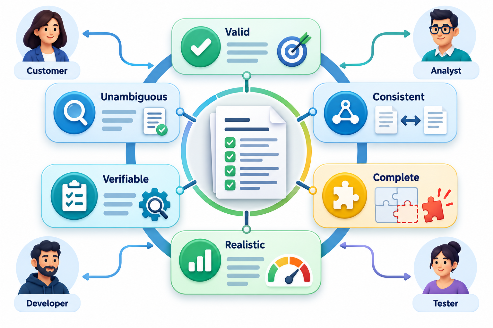
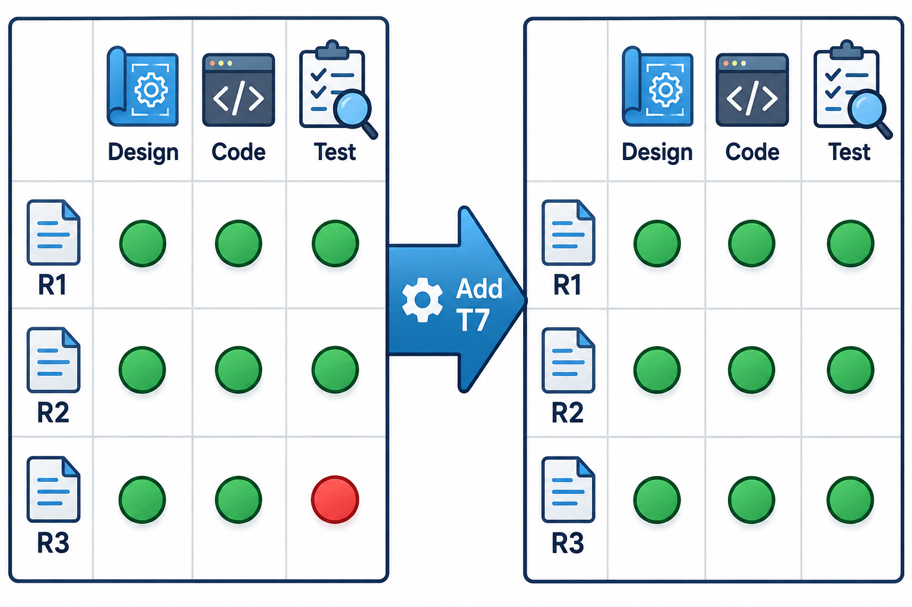
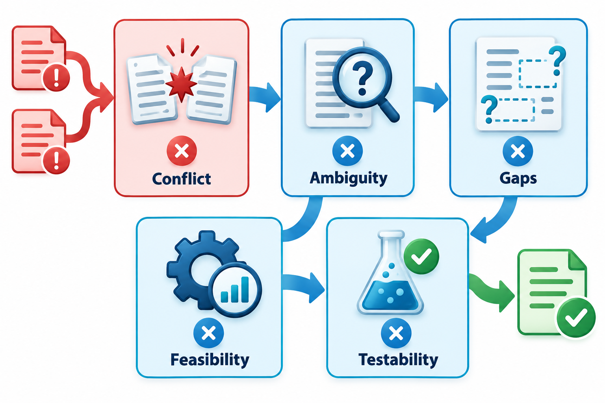
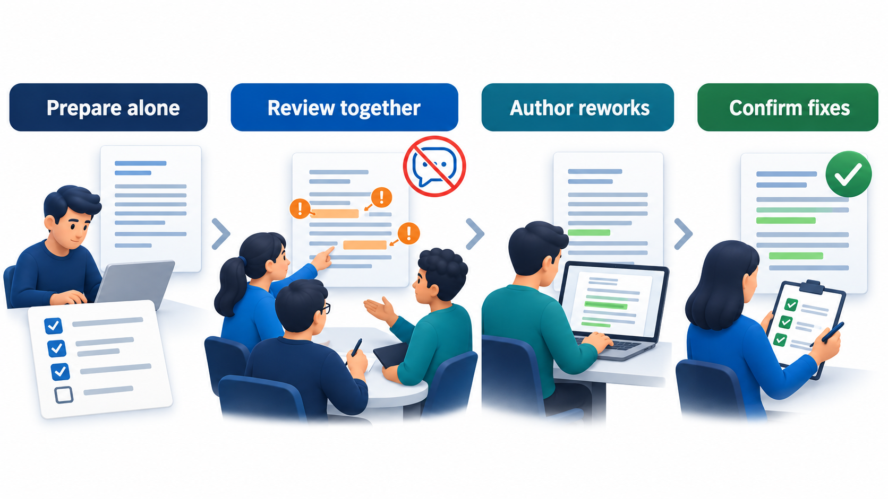

## Reading Is the Cheapest Test There Is

Requirements are written in words, and words can be examined by anyone who can read, long before any software exists. An error found by reading costs the least of all: it is fixed by changing a sentence. Teams have used formal inspections, where a small group reads work item by item against a checklist and records every defect found, since the 1970s, and the idea transfers naturally to requirements.

**Requirements validation** is the work of checking that the requirements are what the stakeholders really want, and that they are good enough to build from. It uses reviews, walkthroughs, prototypes and checks for testability, each catching a different kind of error.

The reasoning is the same as for any early checking. A requirement that is wrong costs almost nothing to correct while it is a line in a document, and a great deal once code, tests and documentation have been built on it. Validation is the deliberate attempt to find those errors at the point where they are cheapest. It is the only check that can catch a requirement which is clearly written, consistent and testable, and still not what anyone needed.

## Verification and Validation, Once More

The word "validation" in requirements work has a specific meaning. A set of requirements is *validated* when the people who need the system confirm that it describes what they need. It is a different check from *verification*, which asks whether the product matches the requirements. If the requirements are wrong, then verification can pass and the system can still fail the people it was meant to serve. Validation is the first line of defence against that.

Validation asks several questions of the requirements as a set. Are they **valid**, in that they describe a real need? **Complete**, with nothing important missing? **Consistent**, with no conflicts? **Realistic**, within what can be built with the time, money and technology? **Verifiable**, so each can be tested? And **unambiguous**, in that two readers arrive at one meaning?

<!-- Visual: a wheel of six checks, valid, complete, consistent, realistic, verifiable and unambiguous, with reviewers from several roles around it. -->

## What Goes Wrong in Requirements

Knowing the usual defects makes reviewers more effective, since they know what to look for.

| Defect | What it looks like | Which check finds it |
| --- | --- | --- |
| **Wrong** | The requirement does not match what the user needs | Prototype, user review |
| **Missing** | A case, rule or quality is not covered | Scenario walkthrough, checklist, traceability |
| **Contradictory** | Two requirements cannot both be true | Cross-reading, interaction matrix |
| **Ambiguous** | More than one reading is possible | Two people paraphrase it separately |
| **Untestable** | No way to tell whether it is met | Try to write a test case |
| **Unrealistic** | Cannot be built with the resources | Developer review, feasibility check |
| **Gold-plated** | A feature no one needs, added because it seemed nice | Ask for the source and the need behind it |
| **Out of date** | True once, no longer | Re-review with current users |

## Four Ways to Validate

**Reviews and inspections.** A group reads the requirements against a checklist and records defects. Including different roles matters. A tester asks "how would I check this?", a developer asks "can this be built?", and a user asks "is this what I need?". Each finds different problems.

**Walkthroughs.** The author guides the reviewers through the document step by step, explaining as they go. Walkthroughs are friendlier and better at sharing understanding, and inspections are stricter and better at finding defects.

**Prototypes.** A rough working version lets users react to something they can touch. People who could not see a problem in a paragraph often see it at once on a screen.

**Test-case writing.** Trying to write a test for each requirement reveals the ones that cannot be tested. A requirement with no test is either vague or missing something. This is also called a testability check, and it is among the most effective, because it forces precision.

## Running a Formal Review

A formal inspection follows a defined process with defined roles, which is why it finds more defects than an informal read.

| Role | Responsibility |
| --- | --- |
| **Author** | Wrote the document; answers questions but does not defend |
| **Moderator** | Plans the review, keeps it on topic and on time |
| **Reader** | Paraphrases the document aloud, which exposes ambiguity |
| **Reviewers** | Read in advance with a checklist and bring their findings |
| **Recorder** | Writes down each defect with its location and severity |

The steps are: *plan* (choose the material and the people), *prepare* (each reviewer reads alone with the checklist), *meet* (log the defects; do not try to fix them), *rework* (the author corrects) and *follow up* (the moderator confirms the corrections). Reading alone first matters, because it gives every reviewer, not only the most confident, a chance to find problems before the discussion starts.

Reviewers can be given different lenses to avoid everyone looking for the same thing. A user reads for missing needs, a tester for untestable statements, a developer for infeasible or ambiguous ones, and an operator for missing quality targets. This is known as perspective-based reading and consistently finds more than a single common read.

## A Checklist Reviewers Can Use

A checklist turns a vague instruction ("review the requirements") into concrete questions.

| Check | Question |
| --- | --- |
| Clarity | Can I restate this in my own words and get the same meaning as the author? |
| Completeness | What happens on the error path, at the boundary and with no data? |
| Consistency | Does this contradict anything elsewhere? Is each term used with one meaning? |
| Testability | What test would prove this? What exactly is the pass condition? |
| Feasibility | Do we know how to build this in the time and budget? |
| Necessity | What need does this serve? What happens if we leave it out? |
| Traceability | Does it have an identifier, a source and a priority? |
| Independence | Does it describe what, and avoid prescribing how? |

## Is Reviewing Worth the Time?

Reviews take people's hours, so it is fair to ask whether they pay back. Here is a log of three validation sessions on the requirements for an exam registration system.

| Session | Hours | Defects found |
| --- | --- | --- |
| Walkthrough with the registrar | 2 | 9 |
| Peer review by testers | 3 | 14 |
| Prototype demo to students | 2 | 7 |
| **Total** | **7** | **30** |

Assume a defect takes an hour to fix while it is still a sentence in the requirements, and thirty hours once it is in released software. Real ratios vary a great deal between projects. Fixing the 30 defects now costs 30 hours. If they had reached release, the same defects would have cost 900 hours. The 7 hours of review are a small part of what was saved. The prototype demo found the fewest defects, but they may be the most serious, because they come from users seeing the system. Counting defects is not the same as weighing them, and a real log would record severity too.

<!-- Visual: a traceability matrix exposing and repairing a missing test link. -->

## Traceability as a Validation Tool

A traceability matrix, which links each requirement to the tests that check it, is itself a validation aid. A requirement with no test shows up as an empty cell. A test that points to no requirement may be checking something nobody asked for. Looking at the matrix before development begins is a quick way to find holes in either.

<!-- Visual: Requirements checked for conflict, ambiguity, completeness, feasibility and testability. -->

## Validation in Agile Work

Agile teams validate continuously and in small steps, with less paper. The acceptance criteria written with each story are agreed with the product owner before work begins, which is a small validation of the story's meaning. The sprint review shows working software to stakeholders every few weeks, and their reactions validate or correct the direction. Prototypes and early releases serve the same purpose. The principle is the same as in a formal inspection: put something concrete in front of the people who need it, as early as possible, and treat their reaction as the test.

What changes is the unit. Instead of validating a hundred-page document once, the team validates a few stories each week. This catches errors sooner, though it needs the discipline to keep a record of what has been agreed, since there is no single document to review.

## Making Reviews Work

Reviews fail in predictable ways. They run too long and people stop paying attention. They turn into arguments about wording. The author feels attacked and defends. A review works better when it is short, focused on a part of the document, prepared for in advance, and aimed at finding problems, not at deciding who is at fault. Reviewers should note a problem and move on; solutions can be worked out afterwards. A checklist helps, and so does picking one concern per pass, for example one pass for ambiguity and another for missing cases.

When is a review finished? A sensible exit rule is that every defect found has been corrected or consciously accepted, that a second reader confirms the corrections, and that the number of defects found per page is falling over successive reviews. A review that finds nothing is not always good news: it may mean the reviewers did not prepare.

<!-- Visual: a review meeting laid out as a simple flow: prepare alone with a checklist, meet and log defects without debating fixes, author reworks, a second look confirms the fixes. Save as images/29_review_flow.png. -->

