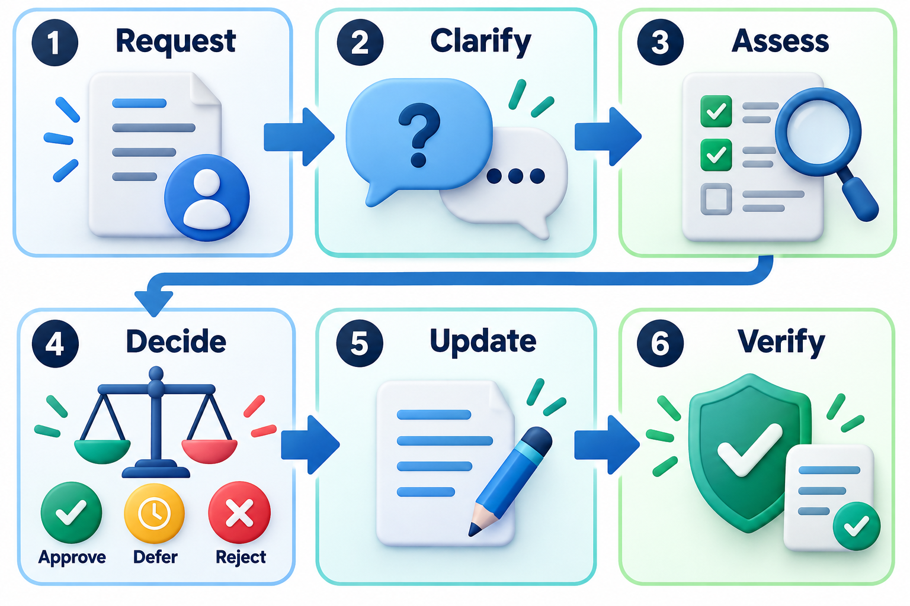
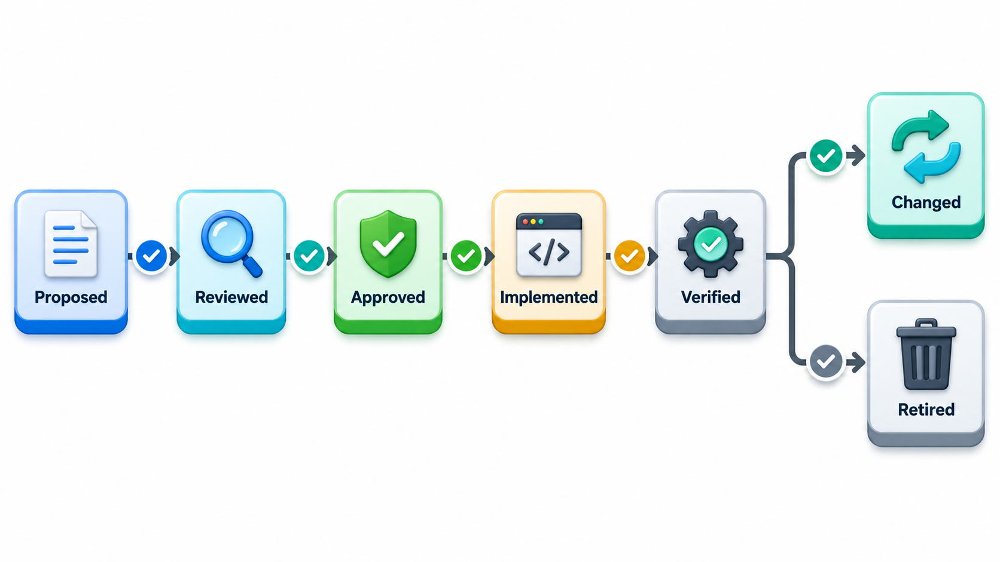
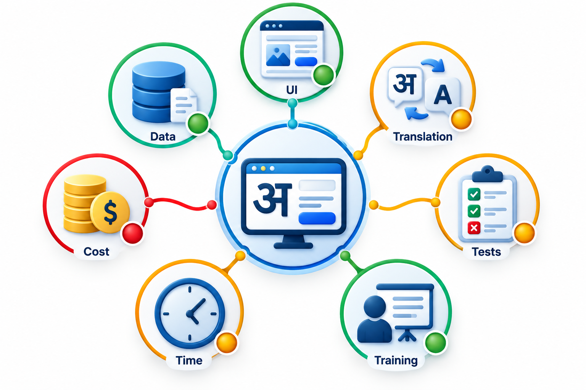
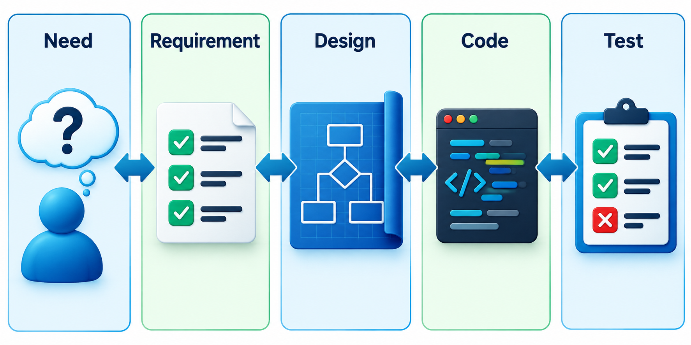
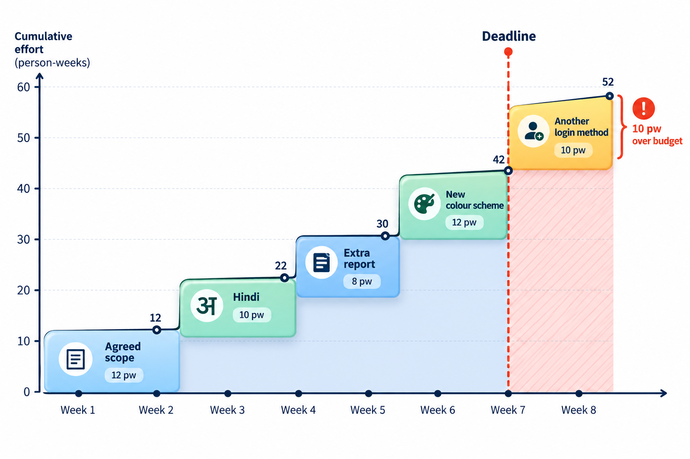

## Change Is Allowed; Surprise Is Not

Requirements change. Users learn what they want, markets move, laws are passed. A team that pretends otherwise will be overrun by changes that nobody weighed. A team that accepts every change will watch the plan grow without limit. The sensible position is between: change is allowed, but each one is seen, priced and decided.

**Requirements management** is the set of habits that keeps change under control: recording requirements, tracking every change, and being able to say what depends on what. It is what separates growth by choice from growth by accident, and it is the main defence against scope creep, the slow expansion of a project beyond what was agreed.

Once there are more than a few dozen requirements, memory and goodwill are not enough to keep them straight. Who asked for this one? Is it agreed or still a proposal? What did it say last month? Which tests cover it? Which code implements it? If a team cannot answer these questions in minutes, it will find out the answers in a crisis, and the answers will be expensive. Management is the discipline that makes the answers always at hand.

## Requirements Change, and That Is Normal

The goal of managing requirements is not to stop them changing. Change is a sign that people are learning. The goal is that every change is *noticed*, *understood* and *decided on*, so that the project grows by choice and not by accident. Three practices do most of the work.

**Baselines.** At a chosen moment, the team agrees on a version of the requirements and calls it a baseline. After that, the baseline is changed only through a formal route. Without a baseline, there is nothing to compare changes against, and the phrase "that was always in scope" can never be settled.

**Version control for requirements.** Each requirement has an identifier, an owner, a status and a history. When a requirement changes, the old version is kept, with the date and the reason. Anyone can see what was agreed in March and what replaced it in June.

**A change control process.** A change request states the proposed change and why. Someone assesses its impact on cost, time, other requirements, design and tests. A named person or group approves, defers or rejects. Approved changes are made, verified and recorded.

<!-- Visual: a change request moving through submit, assess impact, decide, implement and verify, with the baseline updated at the end. -->

## Where Changes Come From

Changes have different sources, and the source affects how they should be handled.

| Source | Example | Usual response |
| --- | --- | --- |
| **The business changes its mind** | A new fee structure is announced | Evaluate against priorities and update the plan |
| **The world changes** | A new law requires a new field on a form | Treat as mandatory with a deadline |
| **Users see the product** | "We need a way to cancel" | Add to the backlog; compare with other requests |
| **The team learns** | An assumed feature turns out to be technically infeasible | Renegotiate the requirement |
| **Errors in the requirements** | Two requirements contradict | Correct and record the reason |
| **New stakeholders appear** | A new department joins | Re-run elicitation for their needs |

The first two are largely outside the team's control; the others can be reduced by good elicitation and validation earlier. Tracking the source of each change over a project shows where the requirements process is weakest. A project in which most changes come from errors needs better validation; one in which most come from the business needs closer contact with the sponsor.

## The Life of a Requirement

Each requirement passes through states, and recording the state shows the progress of the whole list at a glance.

| State | Meaning |
| --- | --- |
| **Proposed** | Suggested but not yet reviewed |
| **Approved** | Agreed and part of the baseline |
| **Designed** | A design that satisfies it exists |
| **Implemented** | Built |
| **Verified** | Tested and found to meet its criteria |
| **Deferred** | Postponed to a later release |
| **Rejected** | Considered and declined, with the reason recorded |
| **Retired** | No longer needed |

The recorded history of states lets the team report truthfully: of 120 requirements, 90 are verified, 18 are implemented but not yet verified, 8 are in design and 4 are deferred. A project that cannot make that statement is steering without instruments.

## Impact Analysis: What Else Does This Touch?

Before a change is approved, the team asks what it will disturb. Adding a Hindi interface looks like a small feature. It affects every screen's text and layout, the database that stores names, the tests, the documentation, the training materials and the support staff. A careful assessment lists them and estimates the effort for each. Without that list, the estimate is a guess based on the visible part.

| Question | What it uncovers |
| --- | --- |
| Which other requirements does this affect or conflict with? | Hidden dependencies; contradictions |
| Which design elements and code change? | The technical effort |
| Which tests must be written or rerun? | The verification effort |
| Which documents, manuals and training are affected? | The communication effort |
| What does it do to the schedule, the cost and the risk? | The cost of saying yes |
| What happens if we do not do it? | The cost of saying no |

<!-- Visual: the technical and project impacts of adding a Hindi interface. -->

## Deciding with a Rule

Change control should not mean that every request needs a committee. A team can agree on a simple rule beforehand, and apply it in a minute. Suppose the baseline plan is 60 days, and the rule is to approve a change only if its value (from 1 to 5) is at least half its effort in days.

| Request | Effort (days) | Value | Decision | Plan after |
| --- | --- | --- | --- | --- |
| Hindi interface | 8 | 5 | Approved | 68 days |
| Change button colour | 3 | 1 | Deferred | 68 days |
| Export marks to Excel | 4 | 4 | Approved | 72 days |
| Chat support | 15 | 2 | Deferred | 72 days |
| SMS reminders | 6 | 5 | Approved | 78 days |

The plan grows from 60 to 78 days, 30 per cent, and every day of it rests on a recorded decision. The deferred requests stay on a list and are not lost. If no one had applied a rule, all five would probably have been accepted, giving 96 days. That is the difference between growth by choice and by accident.

On bigger projects a **change control board** meets regularly to decide: typically the sponsor, the project manager, a technical lead and a user representative. Its value is that the people who bear the cost and the people who gain the benefit are in the same room. Small agile teams usually delegate this to the product owner, who decides what goes into the next sprint, with the team's estimates in front of them.

## Traceability: Following the Thread

**Traceability** is the ability to follow a requirement forwards, to the design, code and tests that implement it, and backwards, to the need or stakeholder that caused it. The structure that records the links is a **traceability matrix**: a table with requirements on one axis and tests, design parts or code on the other.

Traceability earns its keep in three situations. When a requirement changes, the matrix lists everything affected. When a test fails, it shows which requirement is at risk. And when a reviewer asks "why does this feature exist?", it leads back to a real need, or shows that none exists. In regulated work such as medical devices or aviation, traceability is required as evidence. Elsewhere, it is a way to avoid building things nobody asked for and forgetting things someone did.

<!-- Visual: bidirectional trace links from stakeholder need to test case. -->

## Directions and Kinds of Trace

Traces are described by direction and by what they link.

| Kind | Links | Question it answers |
| --- | --- | --- |
| **Forward** | A requirement to design, code and tests | Has every requirement been built and tested? |
| **Backward** | A piece of design, code or a test to a requirement | Why does this exist? Is anything built that nobody asked for? |
| **Vertical** | Across levels: need, requirement, design, code | What does a change at one level affect? |
| **Horizontal** | Between related items at one level | Which requirements depend on or conflict with each other? |

A small example makes the idea concrete. Requirement FR-16, "record each payment exactly once", links back to the stakeholder need "the accounts office must not see duplicate entries" and forward to the design element "payment recorder", the unit test "double submit is ignored" and the acceptance test "pay twice quickly; one entry appears". If the accounts office later drops that need, the matrix shows exactly which items could be reviewed for removal.

## Keeping the Matrix Honest

A matrix that nobody updates is worse than none, because it gives false confidence. A few habits keep it alive.

- **Record the link when the work is done**, not afterwards. Make the identifier part of the commit message, the test name and the design note.
- **Use the tools you already have.** An issue tracker with links between items serves for a small team; a spreadsheet may be enough for a short project.
- **Review it at milestones.** Check for empty cells (requirements without tests) and orphans (tests or code without a requirement).
- **Trace at the level that pays.** For a safety-critical system trace everything. For a low-risk app, trace the requirements that matter most.

## Scope Creep and How It Happens

**Scope creep** is the gradual growth of a project's scope without a matching change in time, budget or people. It rarely arrives as one big demand. It arrives as many small ones, each reasonable alone: "could the report also show last year's figures?", "can we add a column?". Each costs a day. After twenty of them the project is a month late and nobody can point to the decision.

The defence is not saying no. It is making each request visible with its cost, as the change-control process does, so that someone chooses with the cost in front of them. Sometimes the answer is yes, with a new date. Often it is "yes, in the next release".

<!-- Visual: a project timeline with the original deadline marked and many small additions stacking up beyond it. -->

## Measuring How Stable the Requirements Are

Because change is normal, the useful question is how fast it is happening. A simple measure is **requirements volatility**: the number of requirements added, changed or deleted in a period, as a share of the total. A project with 120 requirements that sees 6 changes in a month has volatility of 5 per cent a month, which is calm. One that sees 30 changes in a month is at 25 per cent and is either in the middle of discovery or losing control. Plotting the figure over time is informative: a healthy project's volatility falls as understanding grows, and a project whose volatility rises towards the end is probably about to miss its date.
