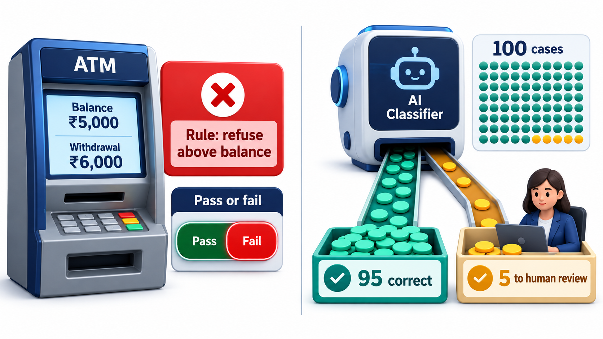
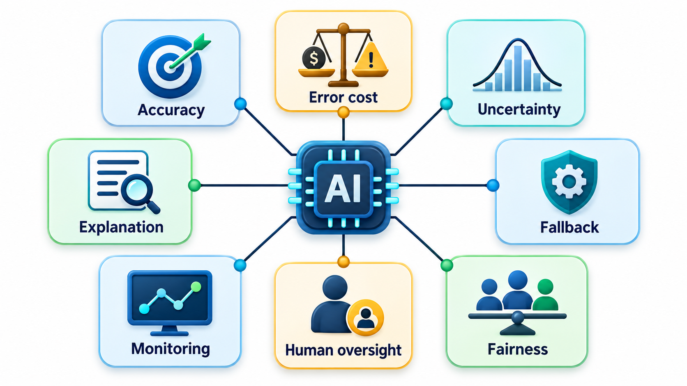
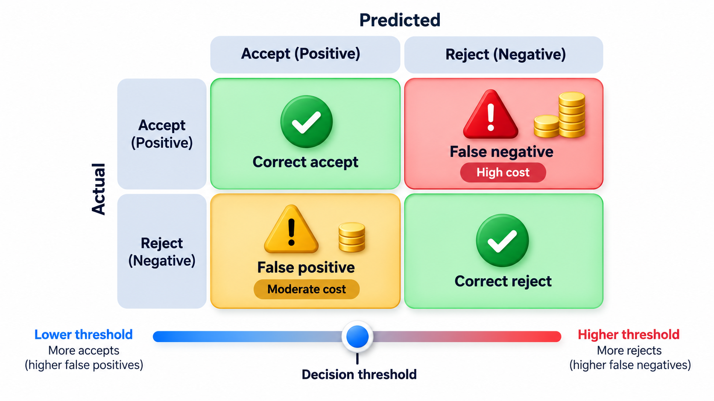
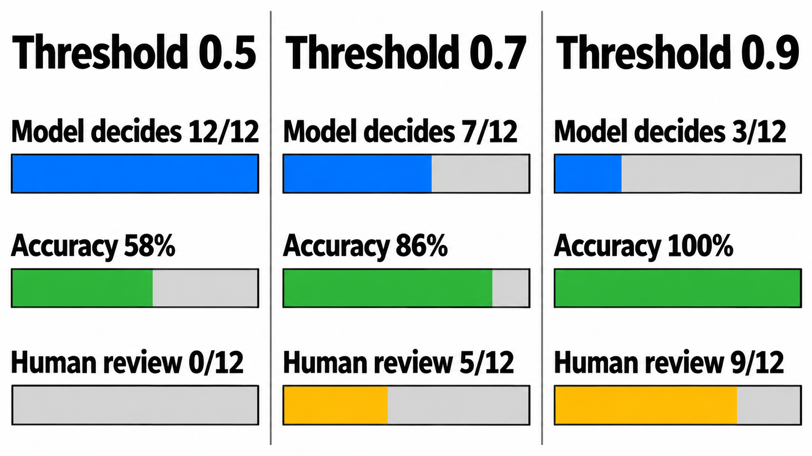

## When Behaviour Is Learned, What Does "Correct" Mean?

For ordinary software, a requirement is a rule: when the balance is too low, refuse. For a system that learns from examples, the behaviour is not written by anyone. It comes from training data, and it is right only some of the time. A requirement such as "rank the applicants well" cannot be checked by reading code, and it silently inherits any bias that the data holds.

That raises a question every team building AI-enabled software has to answer: how do you write requirements for something whose behaviour is learned and not programmed? The answers involve accuracy thresholds, uncertainty, fallbacks to humans, fairness and oversight, and this topic goes through each.

A real case shows why it matters. An experimental recruiting tool, trained on ten years of past applications, learned to prefer the patterns in those applications. Because most past applicants had been men, it began to mark down applications that mentioned women's activities. Nobody had written a requirement saying "penalise women", and nobody had written one against it either. The model's behaviour came from its data, and the specification had said only "rank applicants well". Requirements for AI exist to close exactly that gap: to say what the learned behaviour must achieve, for whom, and with what safeguards.

## What Makes AI Requirements Different

For ordinary software a requirement can be exact. "The system shall refuse a withdrawal larger than the balance" is either met or it is not. An AI component is different in four ways, and the requirements must change to fit.

**Correctness is a rate.** A spam filter is not "right" or "wrong". It is right 97 times in 100. The requirement becomes a threshold: "at least 95 per cent accuracy on the evaluation set", and a team has to decide what rate is good enough for this use.

**Different mistakes cost different amounts.** For a medical screening tool, missing a sick patient is far worse than a false alarm. A single accuracy number hides that. The requirement must say which kind of error matters more, and how much.

**Behaviour depends on data.** A model trained on last year's applicants or last year's photographs may not suit this year's. Requirements need to cover the data, its quality and its coverage, and whether the performance has been checked for different groups of people.

**It will sometimes be wrong, and the system must cope.** An AI component is never perfect, so the design needs a plan for when it is wrong or unsure: a fallback, a human check, a way for the user to correct it.

<!-- Visual: a conventional requirement ("refuse withdrawals above the balance": met or not) beside an AI requirement ("at least 95 per cent correct, with a fallback for the rest"). Save as images/31_exact_vs_statistical.png. -->

## The Items an AI Requirements Document Needs

| Topic | The question to answer | Example for a loan-screening assistant |
| --- | --- | --- |
| **Accuracy threshold** | How often must it be right, on what data? | At least 90 per cent agreement with experienced officers on 2,000 past cases |
| **Error costs** | Which mistakes are worse, and how much? | Wrongly refusing a good applicant is tolerable. Wrongly approving a risky loan is not |
| **Uncertainty** | What does the system do when it is unsure? | Below a confidence of 0.8, send to a human officer |
| **Fallback** | What happens if the model is unavailable or fails? | Applications continue by the manual route |
| **Fairness** | For which groups must performance be checked? | Accuracy within 3 points across gender, region and age bands |
| **Human oversight** | Who can review and override, and how? | An officer can overrule any decision, and the reason is recorded |
| **Monitoring** | How will we know it is degrading? | Weekly check of accuracy on a sample of fresh cases |
| **Explanation** | What must the user be told? | Applicants are told the main factors in a refusal |

<!-- Visual: the eight items of the table arranged around an AI component in the centre, labelled with the question each answers. Save as images/31_ai_requirement_checklist.png. -->

## Which Kind of Error Matters

Accuracy alone is a blunt number. For a system that sorts cases into two groups, say risky and not risky, there are four outcomes, and two of them are mistakes.

| | Model says "risky" | Model says "not risky" |
| --- | --- | --- |
| **Truly risky** | Correct (a true positive) | Missed (a false negative) |
| **Truly not risky** | False alarm (a false positive) | Correct (a true negative) |

Two measures capture the mistakes. *Recall* is the share of truly risky cases the model catches. *Precision* is the share of the cases it flags that really are risky. A model can have high recall and low precision (it flags nearly everything, catching all the risky cases and many harmless ones) or the reverse. Which matters more depends on the cost.

| Application | Worse mistake | What to require |
| --- | --- | --- |
| Cancer screening | Missing a real case | Very high recall, accepting more false alarms to be followed up |
| Spam filtering | Hiding a genuine email | High precision for spam, so genuine mail is rarely lost |
| Fraud detection on payments | Missing fraud, but also blocking genuine payments | A balance, with a human review for borderline cases |
| Exam proctoring | Wrongly accusing a student | Very high precision and a human check before any action |

Writing these into the requirement turns a vague hope of "accuracy" into a statement that can be tested and argued about, and forces the question of who bears the cost of each mistake.

## Requirements About Data

Because the model's behaviour comes from its data, the data needs requirements of its own.

| Data requirement | What it asks | Why it matters |
| --- | --- | --- |
| **Representativeness** | Does the data cover the people, places and conditions the system will meet? | A model trained on city photographs may fail on village ones |
| **Quality of labels** | Were the answers in the training data produced carefully and consistently? | Wrong labels teach wrong behaviour |
| **Separate test data** | Is the system tested on cases it never saw in training? | Otherwise accuracy is flattering |
| **Freshness** | How recent must the data be, and how often renewed? | The world changes |
| **Provenance and rights** | Where did it come from, and may we use it? | Legal and ethical duties |
| **Privacy** | Is personal data minimised and protected? | Data protection law and trust |

A short list of such questions, answered in writing before work begins, prevents most of the surprises that appear when a promising model meets real data.

## Turning Uncertainty into a Requirement

One of the most useful ideas is to let the model decide only when it is confident, and send the rest to a person. This trades coverage for accuracy. Take twelve results from a classifier that labels applications, each with the model's confidence and whether it turned out to be right, and try three confidence thresholds.

| Threshold | Cases the model decides alone | Accuracy when it decides |
| --- | --- | --- |
| 0.5 | 12 of 12 | 58% |
| 0.7 | 7 of 12 | 86% |
| 0.9 | 3 of 12 | 100% |

At 0.5 the model decides every case and is right only 58 per cent of the time, which would fail almost any accuracy requirement. At 0.7 it decides 7 of the 12 and is right 86 per cent of the time. At 0.9 it decides only 3 of 12, all of them correct. A higher threshold buys accuracy and costs coverage, since more cases go to humans. The requirement is the choice: "the model decides alone when confidence is at least 0.9, which covers a quarter of cases at 100 per cent accuracy, and the rest are reviewed". With only twelve cases the figures are rough, and a real requirement is based on thousands.

<!-- Visual: a curve of model accuracy rising and the share of cases the model decides alone falling as the confidence threshold moves from 0.5 to 0.9, with the people-reviewed share rising. Save as images/31_threshold_tradeoff.png. -->

## Fairness, Oversight and Change Over Time

Two further areas deserve their own requirements. **Fairness** asks whether the system performs equally well for different groups. The way to specify it is to name the groups and a tolerated gap in performance, and to test on data that includes them, as the recruiting example shows what happens when nobody does. **Human oversight** asks who can see and change the system's decisions, and decides that the people affected can ask for a review. For decisions that matter in a person's life, such as loans, hiring or medical care, a human who can override is often a requirement of law or policy, not an option.

The system also changes after release. The world drifts, new kinds of input appear, and the model's accuracy can slowly fall without any bug. A requirement for monitoring, with a threshold that triggers retraining or a review, is the only way to notice.

## Robustness, Safety and Explanation

Learned systems can behave oddly on inputs unlike those they were trained on, and can be deliberately fooled. Requirements should therefore ask how the system behaves on unusual, noisy or hostile inputs: for example, that it declines to answer rather than guess when an image is too dark, or that small changes to an input do not flip its decision. They should also say what the user must be told. People affected by a decision often need to know that a machine took part, the main reasons for the outcome, and how to ask for a human review. These duties come from ethics and, increasingly, from regulation, and they are much easier to meet when they are in the requirements from the start.

## Five Misreadings of AI Requirements

**"We cannot specify AI, it just learns."** What it learns is not specified, but what it must achieve, how often, for whom and with what fallback, can all be written down and tested.

**"One accuracy number is enough."** It hides which errors happen and to whom. Error costs and group-wise results belong in the requirement.

**"More data fixes bias."** More of the same data can strengthen the same bias. The data needs to be examined for who and what it covers.

**"A human in the loop makes it safe."** A human who rubber-stamps the model's output adds no safety. The role needs time, information and the authority to disagree.

**"Once it passes testing, it is done."** The world changes after release. Monitoring and a trigger for retraining are part of the requirements.
