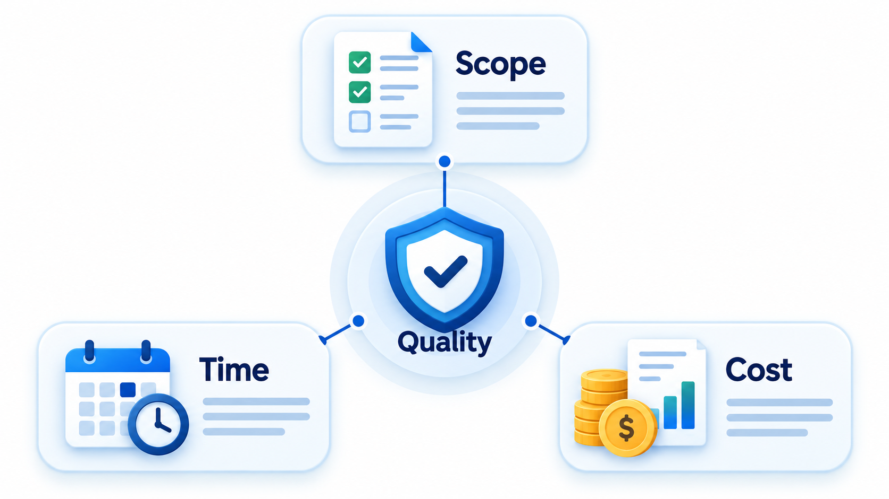
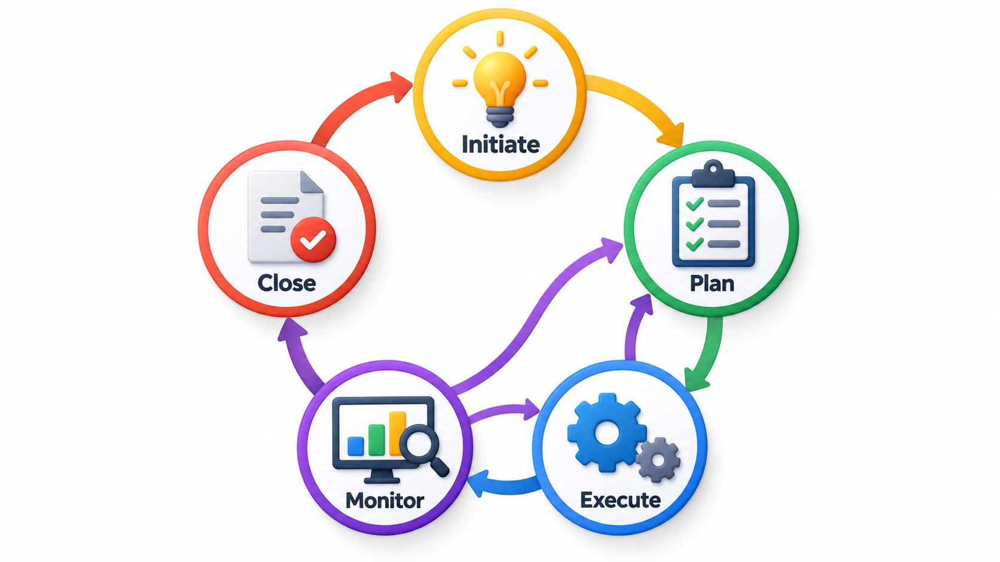
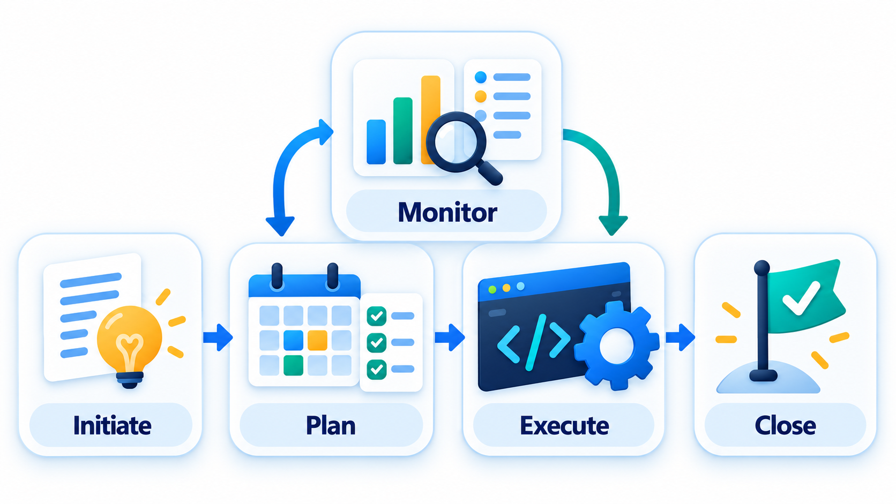
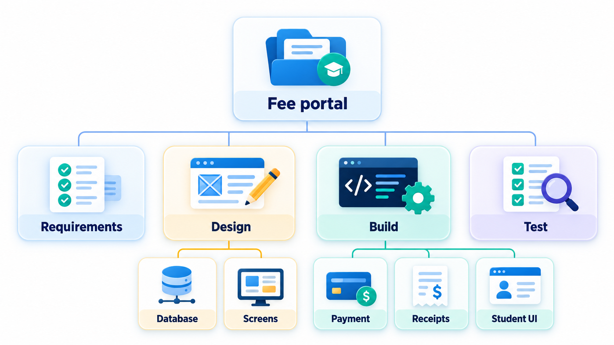
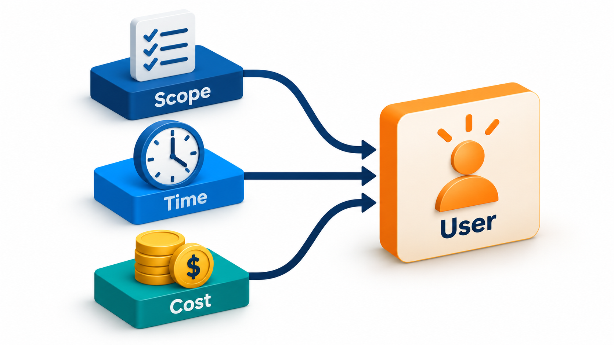

## A Project Is a Promise About Scope, Time and Cost

Writing software is one job. Making sure the right thing is built, by a team that can finish it, for a cost the organisation can bear, by a date that still matters, is another. When the second job is done badly, the best programmers in the world cannot save the result: staff are cut to hit a deadline, a system goes live before it is proven, warnings are ignored, and no one is clear who is in charge of what.

**Project management** is the discipline of the second job. A project is a temporary effort with a defined goal, and managing it means keeping three things in balance: what will be delivered (scope), when (time) and for how much (cost). This topic lays out the vocabulary of that discipline.

Many new graduates meet project management as a set of slightly bureaucratic chores: status reports, timesheets, planning meetings. It is better understood as a response to a real difficulty. A piece of software of any size involves many people, uncertain work, shared deadlines and limited money. Without someone deliberately watching the whole, each person optimises their own part and the whole drifts. Project management is the practice of keeping the whole in view.

## What a Project Is

A **project** is temporary work with a defined goal. It has a beginning and an end, it produces something that did not exist before, and it is not the routine running of an existing operation. Building a payroll system was a project. Running payroll every month afterwards is operations. The distinction matters, because projects are managed by what they must deliver and by when, and operations by how steadily they run.

**Project management** is the discipline of planning, organising and controlling the work and the people so that the project reaches its goal. It does not do the technical work. It creates the conditions in which the technical work can succeed.

| | Project | Operations |
| --- | --- | --- |
| **Duration** | Temporary, with an end | Continuing |
| **Output** | Something new or changed | The same service, delivered repeatedly |
| **Uncertainty** | High | Lower |
| **Managed by** | Goals, deadlines, budget | Steadiness, efficiency, reliability |
| **Example** | Build a college fee portal | Run the portal, answer user queries, apply fixes |

Software organisations constantly move between the two. A product team runs a project to build version 2, and then operations to keep it running, and the techniques that suit one are wrong for the other.

## The Constraints That Pull Against Each Other

Every project is shaped by a small set of linked quantities.

| Constraint | The question it asks |
| --- | --- |
| **Scope** | What exactly must be delivered? |
| **Time** | By when? |
| **Cost** | How much money and effort? |
| **Quality** | How good must it be, and how do we know? |

They are often drawn as a triangle with quality at the centre. The point of the picture is that they are linked. Fix the scope and the date, and the cost must rise, because more people or more hours are needed. Fix the cost and the date, and the scope must shrink. A project that tries to hold all three fixed, while also demanding high quality, will find the missing give somewhere hidden: the quality drops, or the team works unsustainable hours. A system with a hard launch date and a fixed budget often loses the testing and the training, and that is where the failure appears.

<!-- Visual: scope, time and cost at the corners of a triangle with quality in the centre, and arrows showing that pushing one corner moves the others. -->

## Who Is Involved

Several roles recur on every project, even when one person holds more than one.

| Role | What they do |
| --- | --- |
| **Sponsor** | Provides the funding and authority; decides whether the project continues; resolves disputes the manager cannot |
| **Project manager** | Plans, coordinates, tracks and reports; owns the delivery |
| **Team members** | Do the technical and other work |
| **Customer or user representatives** | Define needs, review the work, accept the result |
| **Steering group** | Senior stakeholders who meet occasionally to review progress and make big decisions |
| **Other stakeholders** | Anyone affected: operations, support, finance, legal, regulators |

A project manager's skill set is mostly non-technical. They need to clarify goals, negotiate scope, communicate clearly in several directions, notice trouble early and resolve conflict. They need enough technical understanding to ask good questions and to tell when an answer sounds wrong, but they do not need to be the best programmer in the team, and a manager who tries to be tends to neglect the job.

## The Project Life Cycle and the Management Cycle

A project passes through phases that depend on its type, and the management work cuts across them. A software project may move through concept, planning, development, testing, release and closure. Within each phase the same management activities appear, which are often grouped in five.

## Five Groups of Activity

Project management work is often organised into five groups of activity. They are not strict stages. They overlap, and a project returns to them as it learns.

| Group | What happens |
| --- | --- |
| **Initiating** | Decide that the project is worth doing, name a sponsor and a manager, state the goal |
| **Planning** | Define the scope, the work, the schedule, the budget, the risks and the communication |
| **Executing** | Do the work, coordinate the people and produce the deliverables |
| **Monitoring and controlling** | Compare the actual progress with the plan, and correct course |
| **Closing** | Hand over the result, record what was learned, release the team |

Notice that two of the five are about watching and adjusting. A plan is not a prediction that has to be defended. It is a baseline against which reality is compared, so that differences show up early.

<!-- Visual: the five overlapping groups of project-management activity. -->

## Starting Well: The Charter

Projects often go wrong at the start because nobody wrote down what they were for. A short **project charter** corrects this. It is a one- or two-page document, agreed by the sponsor, that states why the project exists, what it will deliver and what is out of scope, who the sponsor and manager are, the main constraints (date, budget), the main risks known so far, and how success will be judged. It is not a detailed plan. Its value is that it gives everyone a shared reference point and gives the manager authority to proceed. When scope disputes arise six months later, the charter is the document they return to.

## Breaking the Work Down

The most important planning tool is the **work breakdown structure**, or WBS. It takes the project's whole scope and divides it, level by level, into smaller pieces called work packages, until each piece is small enough to estimate, assign and track. A fee portal might break into login, fee payment and reports, and each of those into tasks.

A good WBS has a few properties. It covers *all* the work: if something is not in the breakdown, it is not in the plan, and it will surprise everyone later. This is sometimes called the 100 per cent rule: the pieces at each level must add up to the whole of the level above, no more and no less. It does not overlap, so that two people are not doing the same thing. And it is organised by *deliverable* more than by activity, so that each piece has a result you can see.

Take a small work breakdown for a fee portal, with each task estimated in days.

| Work package | Task | Days |
| --- | --- | --- |
| Login | Sign-in screen | 3 |
| Login | Password reset | 2 |
| Fee payment | Fee calculation | 4 |
| Fee payment | Gateway integration | 6 |
| Fee payment | Receipt | 2 |
| Reports | Daily collection | 3 |
| Reports | Defaulters list | 2 |

Rolling the tasks up into their packages shows where the effort lies.

| Work package | Days | Share of effort |
| --- | --- | --- |
| Login | 5 | 23% |
| Fee payment | 12 | 55% |
| Reports | 5 | 23% |
| **Whole project** | **22 days across 7 tasks** | 100% |

Fee payment is 12 of the 22 days, over half of the effort, mostly because of the gateway integration. The total is the first estimate of the project's size. It is only as good as the task estimates, but a team can now see where the weight lies and where to look hardest for risk. A breakdown also shows what is missing: there is no task for testing, deployment or training, and a real work breakdown would add them. A missing line is a gap in the plan.

<!-- Visual: a fee portal decomposed into work packages. -->

## The Plan Is Several Plans

"The project plan" is really a set of linked plans, each answering a question.

| Plan | The question it answers |
| --- | --- |
| **Scope** | What is in and what is out? |
| **Schedule** | Which tasks, in what order, by whom, by when? |
| **Cost** | How much will it cost and when is the money needed? |
| **Quality** | What standards apply and how will we check them? |
| **Resource** | Who and what do we need, and when? |
| **Risk** | What could go wrong, and what will we do? |
| **Communication** | Who needs what information, how often, in what form? |
| **Change** | How are changes requested, judged and recorded? |

For a small project these may be a page each, or a few paragraphs in a single document. What matters is that each question has an answer written down before the work starts, because the questions that were never asked are the ones that cause trouble.

## Predictive and Adaptive Approaches

Projects can be managed with different degrees of up-front planning. A **predictive** approach plans most of the work in detail at the start and then manages to the plan. It suits projects with stable scope and well-understood work. An **adaptive** approach plans in short cycles, adjusting as it learns, and suits projects where the requirements or the technology are uncertain. Most real projects fall between the two, with an overall plan of milestones and detailed planning only for the next cycle or two. The management groups above apply in both; what differs is how often the cycle of planning, doing and checking turns.

## Why Projects Fail

Studies and experience agree on a short list of causes, and few of them are technical.

| Cause | What it looks like | A defence |
| --- | --- | --- |
| **Unclear or changing goals** | People disagree on what success is, or it shifts without anyone deciding | A charter; change control |
| **Unrealistic plans** | Dates set by wishes, not by estimates | Estimate in ranges; plan buffers |
| **Poor communication** | Bad news travels slowly; stakeholders are surprised | Regular reporting; a culture that rewards early warnings |
| **Weak sponsor involvement** | Nobody with authority resolves conflicts | An engaged sponsor and steering group |
| **Unmanaged risk** | Known threats are ignored until they occur | A risk register reviewed regularly |
| **Scope creep** | Small additions accumulate unseen | Visible, priced decisions on every change |
| **Inadequate skills or turnover** | The team lacks a needed skill or loses key people | Early staffing; sharing knowledge |
| **Skipping quality for speed** | Testing and training are cut to hit a date | Treat quality as fixed, scope as flexible |

## What Success Means

A project is easy to count as a success if it hit the date, the budget and the scope. Experienced managers say that is not enough. A system can arrive on time and within budget and be unused. It can overrun and be loved. The wider test includes whether the people it was built for adopt it and gain from it, whether the team is in good shape at the end and whether the organisation learned from the work.

<!-- Visual: project success includes outcomes beyond scope time and cost. -->

## Closing Properly

Closing is the stage most often skipped, because the team is tired and the next project is waiting. Yet it holds some of the best value. A proper close hands the result to the people who will run it, with documentation and training, confirms with the customer that the goals were met, releases the team and equipment, and records the lessons. A short **lessons-learned** session asks what went well, what did not and what to do differently, and writes the answers where the next project will find them. Without it the organisation pays again for the same mistakes.

## Five Misreadings of Project Management

**"The project manager is the person who does the schedule."** The schedule is one output. The manager's real work is clarifying goals, removing obstacles, managing risk and keeping people informed and aligned.

**"If the plan is good, execution follows."** Plans meet reality. The value of a plan is that it makes differences visible so they can be handled while they are small.

**"Scope, time and cost can all be fixed."** They are linked. If all three are fixed, the pressure shows up in quality, in the people, or in a failure at the end.

**"Project management is overhead for developers."** A project without it still has the work. It just has no one watching dependencies, no list of risks, and no routine for noticing trouble.

**"Success is delivering what was specified."** What was specified may not be what was needed. The outcome for the users matters as much as the delivery.
