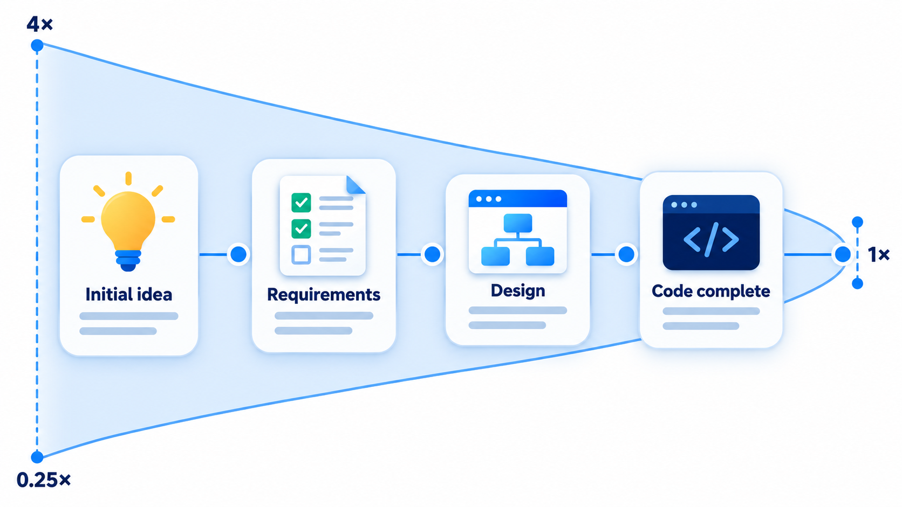
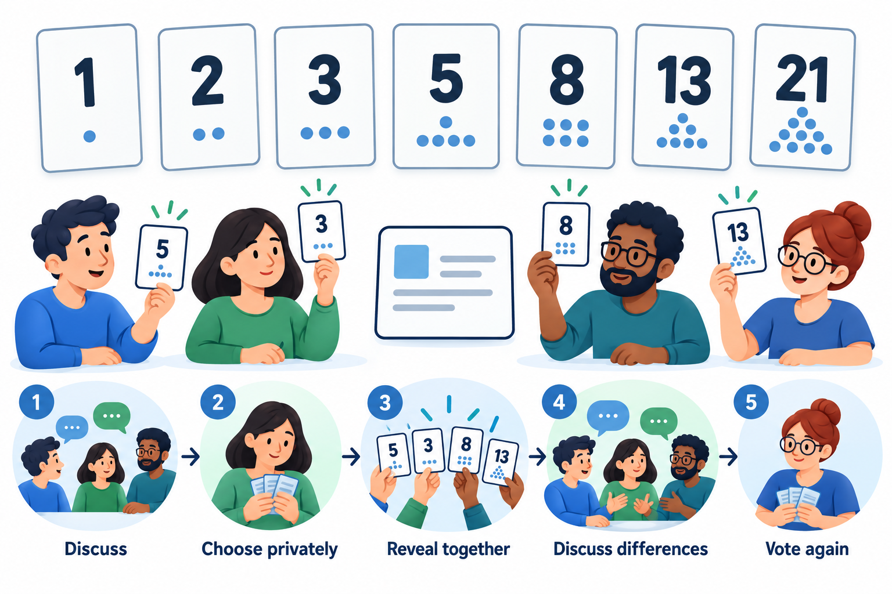
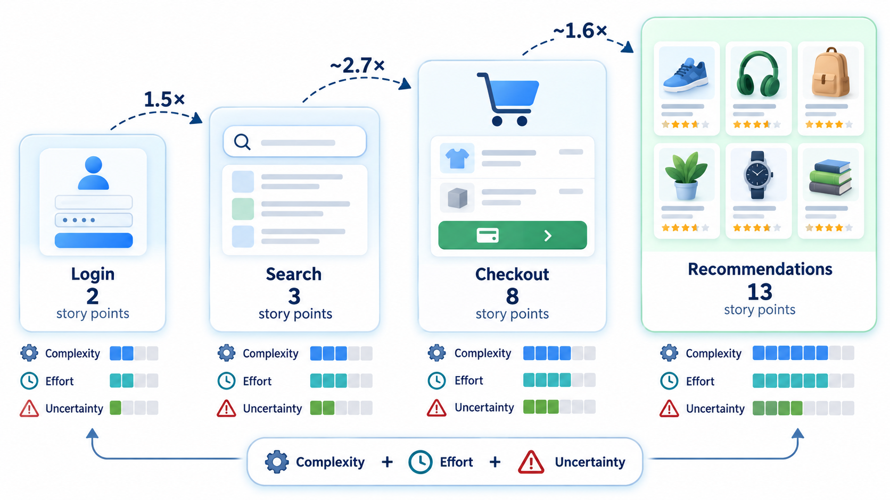
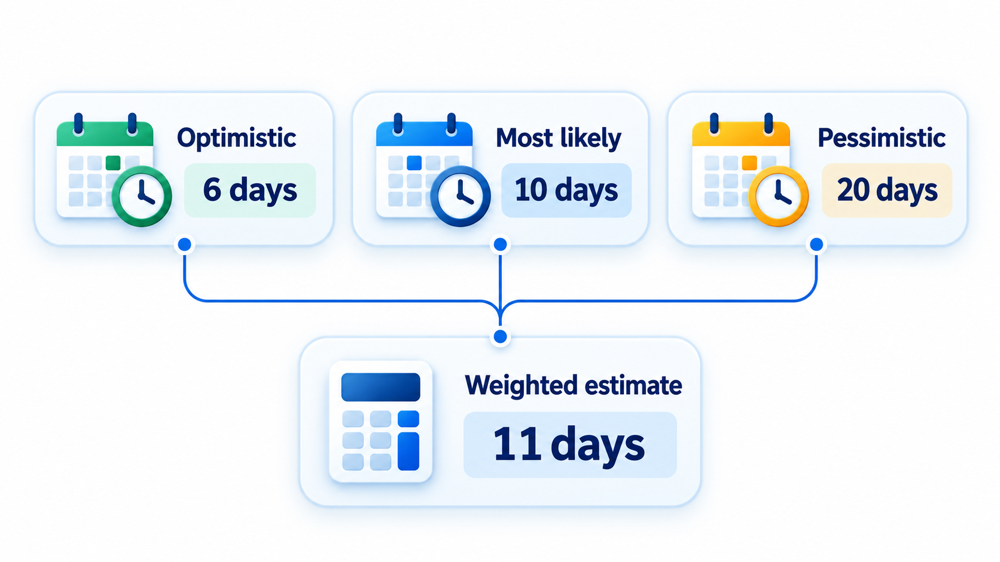
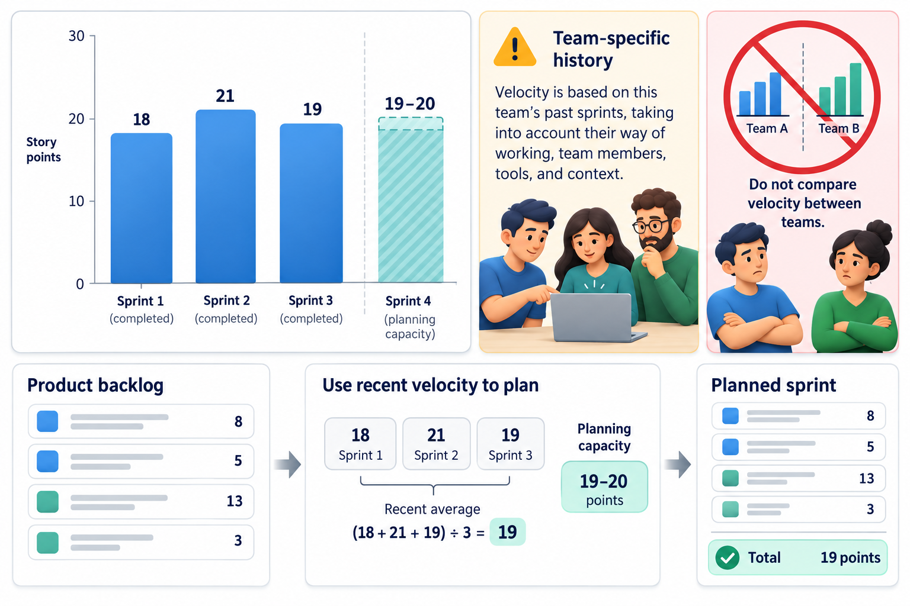

## Why Every Estimate Is Too Optimistic

Ask a team how long a piece of work will take and they picture it going well: the requirements are clear, nobody is ill, nothing breaks. That picture is the best case, and it is the one that becomes the estimate. Experience says the best case is rare. Projects of every kind, from school curricula to software, finish later than their plans.

This is the **planning fallacy**: the tendency to base a forecast on the plan in your head while ignoring how similar projects have actually gone. It is not stupidity. It is how human judgement works. The antidote is not more optimism or more determination. It is method: ways of producing estimates that are less hostage to hope, such as looking at past projects, asking several people, and estimating a range and not a single number.

Estimation matters because almost every other management decision rests on it. The budget, the schedule, the staffing, the price quoted to a customer and the decision whether to start at all, all depend on a guess about how much work there is. A bad estimate does not just produce a bad number; it produces a project that starts in trouble, with a date that was never realistic and a team that knows it.

## Estimates, Targets and Commitments

Three things are often confused, and much trouble comes from the confusion.

| | What it is | Who sets it | Example |
| --- | --- | --- | --- |
| **Estimate** | A forecast of how long or how much, based on evidence | The people who will do the work | "Probably 12 to 16 weeks" |
| **Target** | A goal that someone wants to reach | The business or customer | "We want it by 1 April" |
| **Commitment** | A promise to deliver by a date, made after weighing the first two | The team, with management | "We will deliver by 30 April, with these features" |

An estimate cannot be negotiated, because it describes the work, not wishes. A target can be pursued by changing the scope, the staffing or the quality, not by changing the estimate. A commitment is made once the gap between estimate and target has been dealt with openly. The usual damage comes when a target is dressed as an estimate ("we estimate April"), so that nobody notices the gap until it is too late to close.

## An Estimate Is a Range, and It Narrows Over Time

An estimate is not a promise. It is a statement of what is likely given what is known, and what is known grows as the project goes on. At the very beginning, when only a vague idea exists, the true effort may be anywhere between a quarter and four times the first guess. By the time the requirements are agreed, the range is far narrower, and near the end it is tight. This widening and narrowing is called the **cone of uncertainty**, a name popularised by Steve McConnell from earlier work by Barry Boehm.

The lesson is practical. An early number should be given as a range, with its stage named. A single figure quoted at the idea stage will be taken as a commitment, and will be wrong. The honest answer at the start is "somewhere between 3 and 12 months, and we will narrow it once the requirements are clear".

<!-- Visual: a cone narrowing from a wide range at the concept stage to a tight range at release, with the multipliers 0.25x to 4x at the start. -->

## Why Estimates Go Wrong

Beyond optimism, several well-known biases and practical problems distort estimates.

| Problem | What happens | A remedy |
| --- | --- | --- |
| **Anchoring** | The first number mentioned in the room pulls every later estimate towards it | Estimate privately before discussing |
| **Wishful thinking** | The estimate drifts towards what the sponsor wants to hear | Separate estimating from target setting |
| **Forgotten work** | Testing, meetings, integration, fixing and documentation are left out | Use a checklist of activities; compare with past projects |
| **Ignoring the unknown** | Tasks that have never been done are treated as if they were familiar | Use ranges; add a spike to learn first |
| **Averaging the wrong way** | Adding best cases or ignoring that delays are more likely than gains | Use three-point estimates; sum expected values, not best cases |
| **Optimistic velocity** | Assuming everyone is productive every hour | Apply a realistic focus factor |
| **Not learning** | Estimating the same way each time, and never checking | Record estimates and actuals, and review the gap |

## Ways of Building an Estimate

Estimation approaches can be organised by where the number comes from.

| Approach | How it works | Strength | Weakness |
| --- | --- | --- | --- |
| **Top-down** | Estimate the whole project, then divide among parts | Quick; useful early | Hides the detail that causes overruns |
| **Bottom-up** | Estimate each small task, then add | Detailed; can reveal forgotten work | Slow; needs a breakdown that already exists; errors can still be optimistic |
| **Analogy** | Compare with similar past projects | Grounded in real outcomes | Needs records, and a truly similar project |
| **Parametric** | Use a formula relating size to effort, calibrated on data | Repeatable; shows the effect of changes | Needs a measure of size and calibration |
| **Expert judgement** | An experienced person estimates | Fast and often decent | Inherits personal bias |

Using two approaches and comparing the answers is one of the best defences against error. If a bottom-up estimate gives 20 weeks and a comparison with the last three projects suggests 30, the gap is a prompt to find what has been forgotten.

## Techniques That Reduce Bias

**Expert judgement.** An experienced person estimates from experience. It is quick and often reasonable, but it inherits the person's optimism and memory. It improves when several people estimate separately and compare.

**Analogy.** Compare with a past project of similar size, and adjust. "The last fee portal took 14 weeks; this one is a bit bigger, so 18." It works when real records exist.

**The Delphi method.** A group of experts estimate independently and anonymously. A coordinator shares the range and the reasons, and the experts estimate again. After a few rounds, the estimates usually converge. Because the answers are anonymous, a senior person's opinion cannot sway the others.

**Three-point estimates.** For each task, give an optimistic, a most likely and a pessimistic value. A common formula weights them to an expected value: (optimistic + 4 × most likely + pessimistic) divided by 6. The spread between best and worst gives a sense of uncertainty.

**Planning poker, story points and velocity.** Agile teams estimate relative size, not hours. Each member privately picks a card from a sequence such as 1, 2, 3, 5, 8, 13; the cards are shown together; and those with the highest and lowest numbers explain their thinking. The team agrees a number of *story points* for the item. Over several sprints, the team's **velocity**, the points it finishes per sprint, becomes a way to forecast how long the remaining work will take.

<!-- Visual: planning poker using Fibonacci-like cards and simultaneous reveal. -->

## Computing a Three-Point Estimate

The three-point formula weights the most likely value four times and the two extremes once each: (best + 4 x likely + worst) / 6. A rough measure of uncertainty is (worst - best) / 6. Apply them to three tasks, in days.

<!-- Visual: relative story-point sizing across four software features. -->

| Task | Best | Likely | Worst | Expected | Give or take |
| --- | --- | --- | --- | --- | --- |
| Login | 2 | 4 | 9 | 4.5 | 1.2 |
| Payment | 5 | 8 | 20 | 9.5 | 2.5 |
| Reports | 3 | 5 | 8 | 5.2 | 0.8 |
| **Whole job** | **10** | | **37** | **19.2** | |

The worst cases sit further above the likely values than the best cases sit below them, because real tasks fail more often by running late than by finishing early. The formula pulls the expected value above the most likely one when the worst case is far away: for payment it gives 9.5 days though the most likely is 8. Payment's uncertainty, 2.5, is more than twice login's 1.2, so it is the task to watch.

The whole job is expected to take about 19 days. The best case adds up to 10 and the worst to 37. All three numbers belong in the report, because a single "19 days" hides a range that nearly doubles. A real project would not add the worst cases directly, since it is unlikely that every task goes wrong at once. The point is that the estimate carries its uncertainty with it.

<!-- Visual: optimistic, likely and pessimistic inputs producing a weighted estimate. -->

## Velocity: Forecasting from Evidence

Agile teams use their own history to forecast. If a team finished 21, 18, 24 and 21 points in the last four sprints, its average velocity is 21. A backlog of 126 points then needs about six sprints. Giving the range from the best to the worst recent sprint, five to seven sprints, is more honest than one number. This works because the points are the team's own unit, applied consistently, and the forecast comes from what the team has done, and not from what it hopes.

<!-- Visual: using recent completed work to forecast a team's next Sprint. -->

## Buffers and Re-estimating

Because estimates are uncertain, plans need room. A **buffer** is time held in reserve for the unexpected. Padding every task by a fixed amount is a poor way to do it: people use up whatever time they are given, and the padding disappears. A better way is to estimate tasks realistically and add a single visible buffer at the end of a group of tasks or the whole project, sized from the uncertainty, and to watch how fast it is consumed. If half the buffer is gone with a third of the work done, the project is in trouble and the sponsor should hear now.

Estimates should also be revisited. At each milestone the team compares what it predicted with what happened, and re-estimates the remaining work with the new knowledge. Keeping a simple record of estimate against actual for every task is among the most valuable habits a team can adopt, because over a year it shows what kind of work the team underestimates, and by how much, and the next estimate can be corrected.

## Five Misreadings of Estimation

**"An estimate is a commitment."** An estimate is a forecast with a range. A commitment is a decision made with the range in view, often with a buffer.

**"A more detailed estimate is more accurate."** Detail gives an illusion of precision. Accuracy comes from using real data from similar work.

**"Estimates are wrong, so estimating is pointless."** They are always uncertain, but the exercise reveals assumptions, gaps and risks. A rough range is far more useful than none.

**"Story points are hours in disguise."** They measure relative size, and are meant to stay consistent within a team. Converting them to hours defeats the purpose.

**"Pressure from management improves the estimate."** It only changes the number the team states. The work stays the same size.
