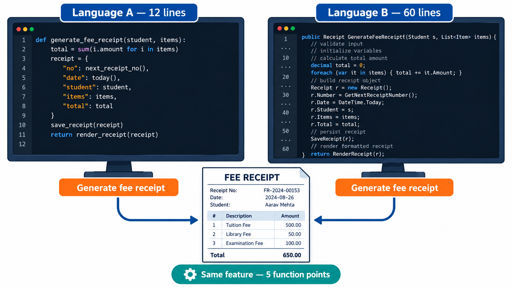
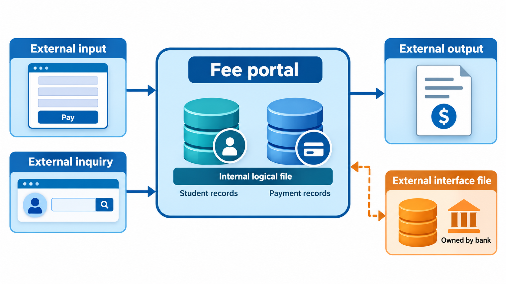
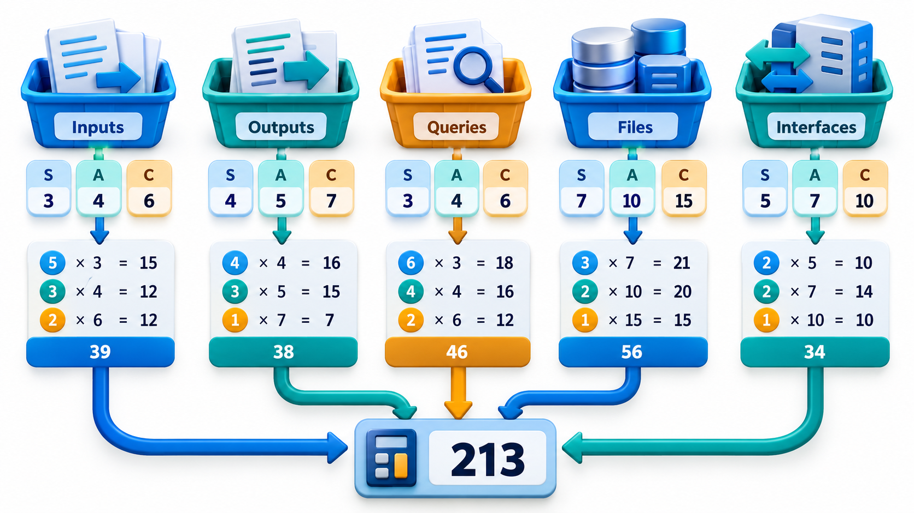
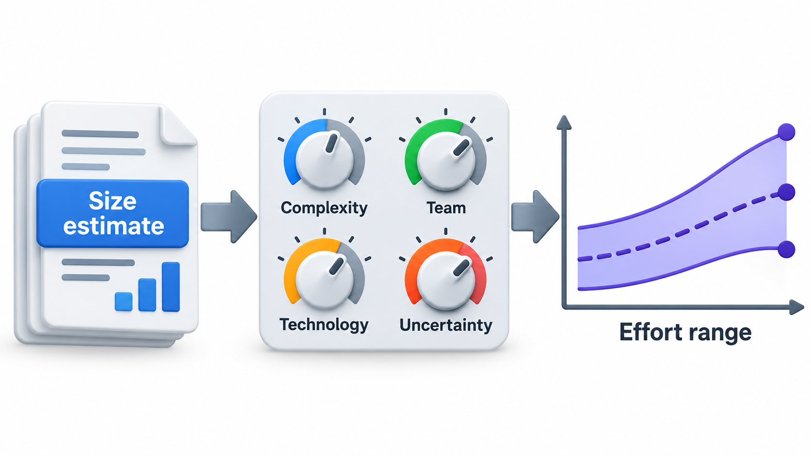
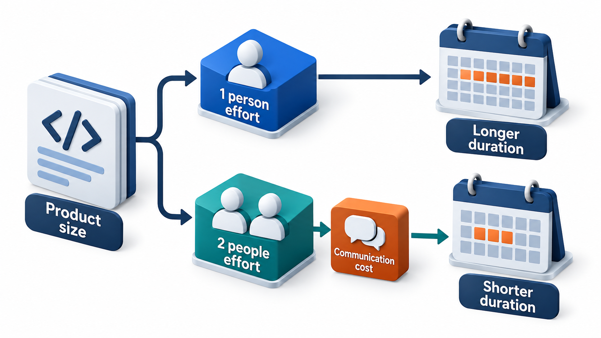

## How Big Is Software Before It Exists?

Every estimate of effort or cost begins from a size. For a building, the size is square metres. For software there is no obvious equivalent, and the obvious candidate, lines of code, has a flaw: a program that takes a thousand lines in one language might take three hundred in another, so counting lines favours the wordy and punishes the efficient. Lines can also only be counted after they are written, when the estimate is no longer needed.

A better approach measures software from the outside, by what it gives its users. Count the inputs the system accepts, the outputs it produces, the questions it answers and the data it holds, and weight each by how complex it is. The result is called a **function point**, and it is the same whatever the language. This topic covers the two most common ways to measure size, lines of code and function points.

Why does size matter at all? Because the cost of a project is the product of two things: how much there is to build, and how fast a team builds it. Of the two, the first is the more neglected. Teams talk about speed and staffing, and rarely agree on what a unit of "how much" is. Without a size measure, an estimate is a feeling. With one, a team can compare this project with the last, record how fast it really builds, and make forecasts that improve over time.

## What Makes a Good Size Measure

Before comparing the options it helps to know what to ask of any measure.

| Property | The question |
| --- | --- |
| **Available early** | Can it be found from requirements, before the code exists? |
| **Independent of technology** | Does it mean the same whatever the language or tools? |
| **Repeatable** | Do two people counting get the same answer? |
| **Related to effort** | Does a bigger number really mean more work? |
| **Cheap to collect** | Can it be counted without a large effort? |
| **Meaningful to the customer** | Can a non-programmer understand what is being counted? |

No measure scores well on all of them. Lines of code are cheap and repeatable but late and language-bound. Function points are early and independent but need training. Story points are fast and meaningful to the team but not comparable between teams. A team chooses the one whose weaknesses it can live with.

## Lines of Code

The simplest measure of size is **lines of code (LOC)**, often counted in thousands (KLOC). It is easy to count, and a large amount of historical data is recorded in it. It also has serious problems.

- It is known only *after* the code is written, so it must be estimated beforehand, which is just as hard.
- It depends on the language. The same feature might take 10 lines in one and 100 in another.
- It rewards verbose code. A programmer who solves a problem in 20 clear lines looks less productive than one who takes 200.
- It ignores quality, design and reuse. The most valuable work is sometimes deleting code.
- Different people count differently: do comments, blank lines and generated code count?

For these reasons LOC is a poor way to compare people, but it remains useful inside one team and one language for forecasting, because it is simple and the historical data exists. COCOMO, a widely used effort model, takes KLOC as its input.

A team that uses LOC should write down its counting rules: whether comments and blank lines count, how generated code and reused libraries are treated, and whether a statement that spans three lines is one or three. Most teams count only new or changed lines of source code, excluding comments and blanks, and report reused code separately so that it does not flatter the productivity figure.

<!-- Visual: the same feature written in two languages, one needing 12 lines and the other 60, both labelled with the same function point count. Save as images/34_loc_vs_function_points.png. -->

## Function Points

**Function point analysis** counts five kinds of thing from the user's point of view.

| Component | What it counts | Example in a fee portal |
| --- | --- | --- |
| **External inputs** | Data coming in that changes something | Pay a fee, add a student |
| **External outputs** | Processed data going out | A fee receipt, a defaulters report |
| **External inquiries** | A request that fetches data without changing it | Look up a student's balance |
| **Internal logical files** | Groups of data the system maintains | The students table, the payments table |
| **External interface files** | Data the system uses but another system owns | The bank's payment file |

Each item is rated *simple*, *average* or *complex* from the data it handles, and the rating gives a weight. The standard weights for average complexity are 4 for each input, 5 for each output, 4 for each inquiry, 10 for each internal file and 7 for each external interface. Multiplying the counts by the weights and adding gives the **unadjusted function points**.

The count is then adjusted for how demanding the environment is. Fourteen **general system characteristics**, such as the need for high performance, heavy use, online updates and complex processing, are each scored from 0 to 5. Their total, between 0 and 70, gives a **value adjustment factor**: 0.65 plus 0.01 times the total. The adjusted figure is the unadjusted points multiplied by the factor, so the factor can move the count by up to 35 per cent either way.

<!-- Visual: the five function point components arranged around the system boundary: inputs and inquiries arriving, outputs leaving, internal files inside, external interface files outside. Save as images/34_function_point_components.png. -->

## Rating Simple, Average and Complex

The rating depends on how many data elements and how many file types a component touches. A pay-fee input that reads a handful of fields and updates one file is simple; one that reads many fields and updates several files is complex. The standard weights rise with complexity.

| Component | Simple | Average | Complex |
| --- | --- | --- | --- |
| External input | 3 | 4 | 6 |
| External output | 4 | 5 | 7 |
| External inquiry | 3 | 4 | 6 |
| Internal logical file | 7 | 10 | 15 |
| External interface file | 5 | 7 | 10 |

The skill in counting is in deciding what one "input" or one "file" is, consistently. Practitioners therefore follow published counting rules, and organisations that rely on function points train their counters and check each other's work.

## A Worked Count

A small fee portal has 8 inputs, 6 outputs, 5 inquiries, 4 internal files and 2 external interfaces, all of average complexity. Each kind of component is multiplied by a standard average weight.

| Component | Count | Weight | Points |
| --- | --- | --- | --- |
| External inputs | 8 | 4 | 32 |
| External outputs | 6 | 5 | 30 |
| External inquiries | 5 | 4 | 20 |
| Internal files | 4 | 10 | 40 |
| External interfaces | 2 | 7 | 14 |
| **Unadjusted total** | | | **136** |

Internal files are the heaviest line: four files give 40 points, because stored data is costly to design and maintain. The unadjusted total is 136 function points.

The count is then adjusted for how demanding the system is overall. Fourteen general characteristics, such as performance needs and ease of installation, are each scored 0 to 5. With a middle total of 35, the adjustment factor is 0.65 + 0.01 x 35 = 1.0, so the adjusted size is also 136. If the portal had to process heavily and run at high loads, the total might be 50, the factor 1.15 and the size 156 function points. The function point count does not say how long the project will take. It is the size, which later feeds an effort model.

## Other Measures of Size

Several other measures are in use, each suited to a setting.

| Measure | What it counts | Where it fits |
| --- | --- | --- |
| **Story points** | Relative size of backlog items, set by the team | Agile teams planning their own work |
| **Use case points** | Actors and use cases, weighted by complexity | Projects with use case requirements |
| **Object or component counts** | Screens, reports, modules or classes | Quick early estimates when the technology is stable |
| **Feature counts** | Number of features, rated by size | Product teams comparing releases |

Story points deserve a note because they differ in kind. They are not a standard unit: a point on one team is not a point on another, and they measure the size of a piece of work relative to other pieces, including difficulty and uncertainty. Their strength is speed and honesty about uncertainty; their weakness is that they cannot be compared across teams or used to quote a price to an outside customer.

## From Size to Effort

Size alone is not a forecast. A team converts it using its own **productivity**, measured from past projects: for example, 8 function points per person-month. At that rate, 136 points would take about 17 person-months. The number belongs to a team and a type of work, so borrowing another organisation's rate is risky. The more data a team keeps, the better its conversion becomes.

Size, effort and calendar time are three different things. A 17 person-month job does not take 17 months for one person. With four people it might take about five months, though communication costs mean it will be a bit more than 17 divided by 4.

Because productivity varies, a sensible conversion gives a range and not a point. If the team's past projects ranged from 6 to 11 function points per person-month, then 136 points gives roughly 12 to 23 person-months. Showing the range alongside the central value tells the sponsor how much uncertainty remains and protects the team from being held to a single optimistic figure.

<!-- Visual: product size effort and calendar duration are related but distinct. -->

## Why Both Measures Still Matter

Function points are language independent and can be estimated early from the requirements, which suits contracts and early forecasts. They need training to count consistently and are less natural for agile teams, who often use story points instead. LOC is crude but cheap and fits models like COCOMO. In practice a team picks the measure it can keep honest, and uses it consistently.

## Using Size Well

A few habits make size measurement useful.

- **Count at several points in the project.** An early function point count from the requirements, and a later one when the design is stable, show how the size is growing. Growth beyond 10 per cent without a change decision is a warning of scope creep.
- **Keep the history.** For every finished project record the final size, the effort and the duration. Over time this is the most valuable estimating asset a team owns.
- **Adjust for reuse.** Reused or generated components add size to the product but little effort. Report them separately.
- **Do not use size to judge people.** It measures the product, not the programmer, and using it as a performance measure invites inflating it.

## Five Misreadings of Size Measurement

**"More lines of code means more productivity."** It can just as easily mean more waste. Some of the best changes remove code.

**"Function points measure how hard the code is to write."** They measure what the user gets. Difficulty is a separate matter, handled by adjustment and by effort models.

**"Size can be measured precisely before the project starts."** Early counts depend on requirements that are still changing. A function point count is an estimate too, and it should be refined as understanding improves.

**"Size is effort."** Effort depends on size and also on the team, tools, complexity and the amount of reuse.

**"A number from another company will do."** Productivity rates differ widely between teams. Use your own records, and use published figures only as a rough guide.
