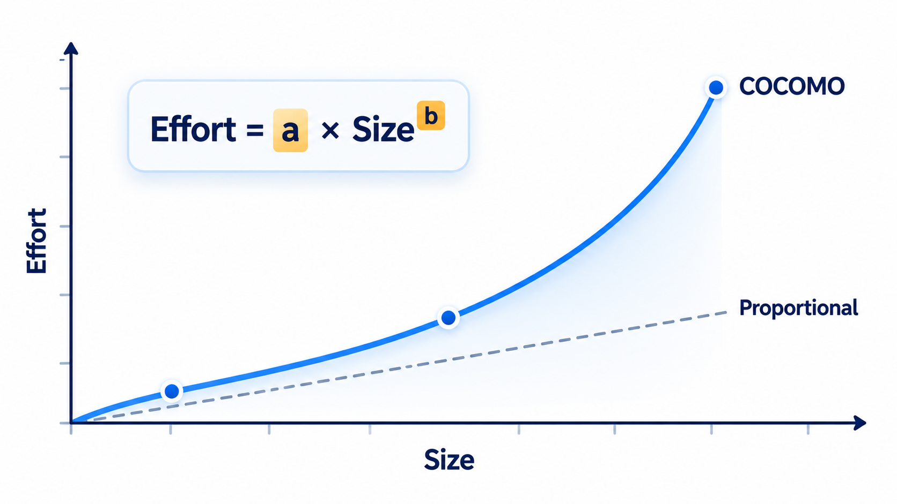
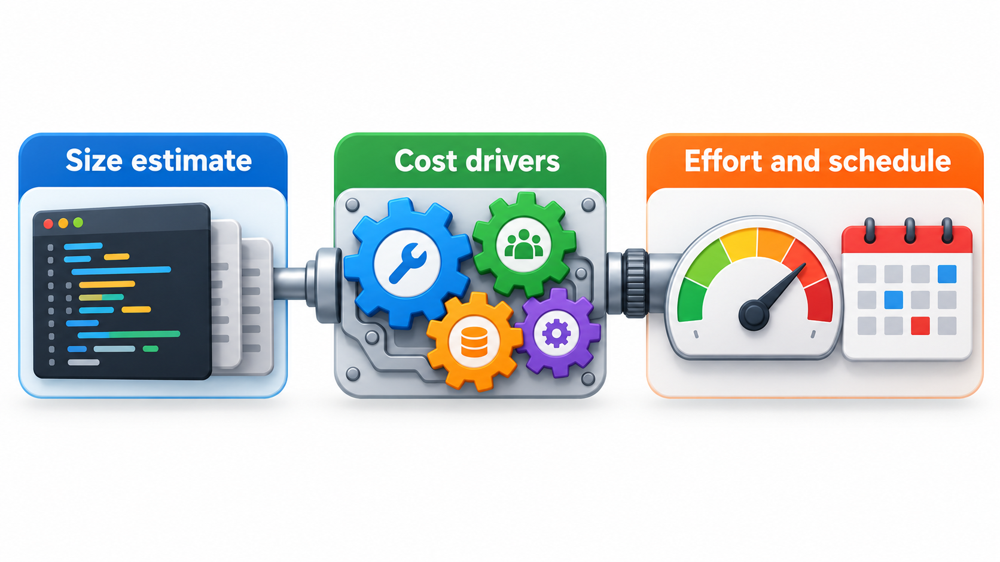
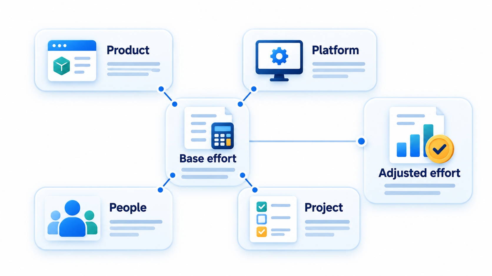
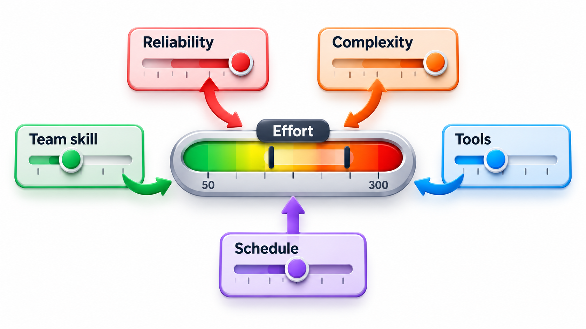
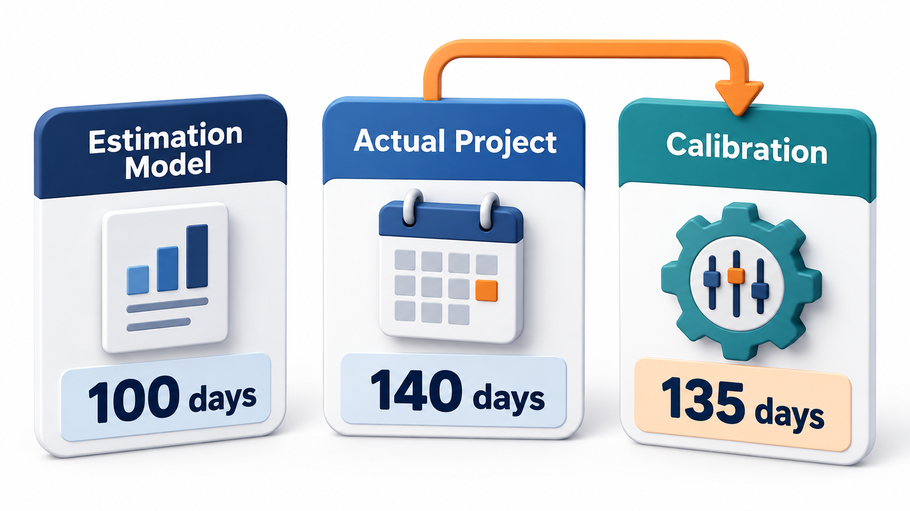

## Effort Grows Faster Than Size

If a project twice as big took twice the effort, planning would be easy. It does not. A project twice the size usually takes noticeably more than twice the effort, because there is more to coordinate, more to understand and more that can go wrong. Meanwhile calendar time grows far more slowly than effort, because more people can work at once.

The **Constructive Cost Model**, COCOMO, put these observations into formulas, calibrated against data from dozens of real projects. It is not magic: it is a curve fitted to old projects, and it is only as good as the match between those projects and yours. But it reveals three facts that are true almost everywhere. Effort grows faster than size. Calendar time grows much more slowly than effort. And the people and the product matter as much as the lines of code.

Before models like this existed, estimates were mostly guesses, or rules of thumb passed along by experienced managers. COCOMO offered something to argue with. A manager could supply a size, get a number for effort, and compare it with their own judgement and with what happened last time. Even where the number was wrong, the discussion about *why* it was wrong taught the team what its project really depended on.

## Basic COCOMO: Size In, Effort Out

The simplest form takes only the size in thousands of lines of code, written KLOC, and gives two answers.

- **Effort** in person-months: E = a × (KLOC)b
- **Schedule** in calendar months: T = 2.5 × Ed

The constants depend on the kind of project, which Boehm called a mode.

| Mode | What it means | a | b | d |
| --- | --- | --- | --- | --- |
| **Organic** | Small teams, familiar work, flexible requirements | 2.4 | 1.05 | 0.38 |
| **Semi-detached** | Mixed experience, mixed requirements, a middle case | 3.0 | 1.12 | 0.35 |
| **Embedded** | Tight constraints from hardware, regulation or operations | 3.6 | 1.20 | 0.32 |

The exponent *b* is above 1 in every mode. That is the first fact: doubling the size more than doubles the effort. A bigger program needs more communication, more integration and more rework, and the model reflects that. The embedded mode's exponent of 1.20 is the steepest, because tightly constrained software costs more per line as it grows.

Reading the formulas correctly matters. A person-month is the work of one person for one month, and the model takes no position on how many people do it. The schedule formula is what links effort to calendar time, and its small exponent (about a third) says that time grows slowly with effort: multiplying effort by eight multiplies the schedule by roughly two. The ratio of effort to schedule then gives the average team size, which is how the model hints at staffing.

<!-- Visual: effort plotted against size, showing a curve rising faster than a straight line, with the three modes as three curves of increasing steepness. -->

## Computing It

Basic COCOMO gives effort in person-months as a x KLOC^b, where KLOC is thousands of lines of code, and schedule in months as 2.5 x effort^d. The constants depend on the kind of project: organic (a small team on familiar work), semi-detached, or embedded (tight hardware and rules). For a project of 32 KLOC:

| Mode | Effort | Schedule | Average team |
| --- | --- | --- | --- |
| Organic | 91 person-months | 13.9 months | about 6.6 people |
| Semi-detached | 146 person-months | 14.3 months | about 10.2 people |
| Embedded | 230 person-months | 14.3 months | about 16.2 people |

For the same size, embedded work needs two and a half times the effort of organic work, so the kind of project matters as much as its size. The schedule barely changes between modes: about 14 months in all three. Effort rises by 150 per cent while time hardly moves, because people work in parallel. Dividing effort by months gives the average team size, and the bigger team is what lets the embedded project finish in about the same calendar time. The model does not say that 230 person-months can be squeezed into 4 months with 57 people. There is a minimum sensible schedule, and below it adding people makes things worse.

## What the Size Exponent Means

The fact that the exponent exceeds 1 has a practical consequence: small projects are cheaper per line than big ones. Using the organic constants, compare three sizes.

| Size | Effort | Effort per KLOC |
| --- | --- | --- |
| 8 KLOC | about 21 person-months | 2.6 |
| 32 KLOC | about 91 person-months | 2.8 |
| 128 KLOC | about 403 person-months | 3.1 |

Quadrupling the size from 32 to 128 KLOC multiplies the effort by more than four. The extra cost per line is the price of coordination: more modules to integrate, more people to keep in step, more interactions to test. This is a quantitative form of the message that large projects are harder than small ones, and it is the economic argument for splitting a big system into smaller, independent pieces where this can be done.

## Where the Effort Goes

A total effort figure is spread across the life cycle. The proportions vary, but a typical pattern for a medium project is roughly as follows.

| Activity | Approximate share of effort |
| --- | --- |
| Requirements and planning | 6 to 10% |
| Design | 15 to 20% |
| Coding and unit testing | 30 to 40% |
| Integration and system testing | 20 to 30% |
| Documentation, training and management | 10 to 15% |

The surprise for many beginners is how little of the total is coding. Programming is typically a third of the effort or less; the rest is understanding, designing, checking and managing. An estimate based on how long it takes to type the code can therefore be wrong by a factor of three.

## Intermediate COCOMO: Adjusting for the Real Project

Basic COCOMO ignores almost everything about the project except size. **Intermediate COCOMO** multiplies the effort by an **effort adjustment factor**, the product of fifteen cost drivers, each rated from very low to very high. The drivers fall into four groups.

| Group | Examples |
| --- | --- |
| **Product** | Required reliability, size of the database, complexity |
| **Computer** | Time and storage constraints, how much the platform changes |
| **Personnel** | Analyst and programmer capability, experience with the application, language and tools |
| **Project** | Use of modern practices, software tools, schedule pressure |

A driver at its normal level has a multiplier of 1.0. Above-normal reliability needs push effort up, and a more capable analyst pulls it down. Apply four drivers to a 32 KLOC organic project, with the intermediate model's constant of 3.2. With every driver normal, the nominal effort is 122 person-months.

| Cost driver | Multiplier | Running factor |
| --- | --- | --- |
| Required reliability: high | 1.15 | 1.15 |
| Product complexity: high | 1.15 | 1.32 |
| Analyst capability: high | 0.86 | 1.14 |
| Application experience: high | 0.91 | 1.03 |

The running factor ends at 1.03, so the adjusted effort is 126 person-months, close to the nominal one: the expensive demands and the strengths almost cancel. Had the team been of low capability instead, the multipliers would have risen above 1 and the effort could have grown by half. This is the third fact: the people and the product matter as much as the code. The multipliers come from published tables calibrated to the model's original data, and a team should check them against its own projects.

<!-- Visual: product, platform, people and project factors adjusting base effort. -->

## Which Drivers Matter Most

Not all drivers move the estimate equally. In the published tables, the spread between the best and worst rating is widest for people and for product demands.

| Driver | Range of multiplier (best to worst) | What it says |
| --- | --- | --- |
| Analyst capability | about 0.71 to 1.46 | A weak analyst can double the effort of a strong one |
| Programmer capability | about 0.70 to 1.42 | Similar spread for the people building it |
| Required reliability | about 0.75 to 1.40 | Safety-critical software costs far more than throwaway code |
| Product complexity | about 0.70 to 1.65 | Hard problems cost much more than routine ones |
| Use of modern tools | about 0.83 to 1.24 | Tools help, but less than people |
| Schedule pressure | up to about 1.23 | Compressing the schedule raises the cost |

The ranking carries a management message: investing in good people and in understanding the problem pays more than most tools or tricks, and demanding an impossible schedule is expensive, not free.

## What-If Questions

One of the best uses of a cost model is to ask what happens when something changes. Suppose the team in the example faces a request to raise the required reliability from high to very high, a multiplier of 1.40 instead of 1.15. The running factor changes from 1.03 to about 1.25, and the effort from 126 to about 152 person-months, an increase of 26 person-months. The sponsor can now weigh that cost against the benefit of higher reliability, with a number in front of them instead of a feeling. The same technique prices the effect of a smaller team, a tighter schedule, reuse of an existing component or a change of language.

## COCOMO II

The original model was built for the way software was made in the 1970s. In 2000 Boehm and colleagues published **COCOMO II**, rebuilt for modern practice: reuse, rapid development, object-oriented design, and projects whose requirements change. It has three sub-models for different stages: *application composition* for early prototyping with tools, *early design* when only rough information exists, and *post-architecture* once the structure is known.

Its central formula keeps the same shape: effort = A × SizeE × the product of effort multipliers. The exponent E is no longer fixed. It is computed from five **scale factors**, including precedentedness (has this been done before?), flexibility, risk resolution, team cohesion and process maturity. A team with strong ratings gets an exponent near 0.91, so size costs it less than a straight line. A team with weak ratings gets an exponent above 1.2. The model treats the way a team works as something that changes how fast cost grows, which is a large idea in a small formula.

## Calibration: Making the Model Yours

A COCOMO result is only as good as its fit to your own projects. The remedy is **calibration**: record the actual size and effort of finished projects, and adjust the constants until the model reproduces them. After a handful of projects, a team's own model will usually outperform the published constants. Without calibration, treat the result as one estimate to compare with others, and not as an answer.

<!-- Visual: actual results calibrate an estimation model for future projects. -->

## Using Models Wisely

Cost models are tools for thinking, not oracles. A few rules keep them useful.

- **Treat the output as one estimate among several.** Compare it with a bottom-up estimate and with past projects. Large disagreements point to something missed.
- **Remember the input is itself an estimate.** A size guessed early may be off by a factor of two, and the model passes that error straight through.
- **Show a range.** Vary the size and the drivers within plausible limits and report the spread.
- **Use it for comparison and negotiation.** The model is best at answering "how much more would this cost than that?", which is easier than predicting the absolute figure.
- **Keep records.** Every finished project is data for calibration.
